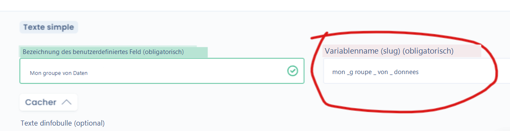

# API-Konfiguration

Diese Seite beschreibt die Dastra-REST-API: ihre Adresse, ihre Nutzungsgrenzen und den Umgang mit benutzerdefinierten Feldern und Tags. Wie Sie einen Schlüssel erhalten und die API aufrufen, lesen Sie unter [Authentifizierung](authentication.md).

### APIs in Dastra konfigurieren

API steht für _**Application Programming Interface**_ (Programmierschnittstelle).

APIs ermöglichen es, die Dastra-Plattform mit anderen externen Tools zu verbinden.

Die Möglichkeiten sind vielfältig: Verbindung mit einer CRM-Software zur automatisierten Übernahme von Beteiligten, Synchronisation eines Tools zur Verwaltung von Betroffenenrechten mit dem Dastra-Modul usw.

Dastra basiert auf dem Standard **API-Rest** und insbesondere auf den folgenden HTTP-Anfragen:

| URI                                                                | GET                                                                                 | POST                                                                                                                                                                                                                                               | PUT                                                                                                                                                                                  | PATCH                                                                                                                                                                                                                 | DELETE                                                                      |
| ------------------------------------------------------------------ | ----------------------------------------------------------------------------------- | -------------------------------------------------------------------------------------------------------------------------------------------------------------------------------------------------------------------------------------------------- | ------------------------------------------------------------------------------------------------------------------------------------------------------------------------------------ | --------------------------------------------------------------------------------------------------------------------------------------------------------------------------------------------------------------------- | --------------------------------------------------------------------------- |
| Sammlungsressource, wie `http://api.beispiel.com/collection/`      | _Ruft_ die URIs der Mitgliedsressourcen der Sammlungsressource im Antwortkörper ab. | _Erstellt_ eine Mitgliedsressource in der Sammlungsressource unter Verwendung der Anweisungen des Anfragekörpers. Die URI der erstellten Mitgliedsressource wird _automatisch zugewiesen_ und im _Location_-Header-Feld der Antwort zurückgegeben. | _Ersetzt_ alle Darstellungen der Mitgliedsressourcen der Sammlungsressource durch die Darstellung im Anfragekörper oder _erstellt_ die Sammlungsressource, wenn sie nicht existiert. | _Aktualisiert_ alle Darstellungen der Mitgliedsressourcen der Sammlungsressource unter Verwendung der Anweisungen des Anfragekörpers oder _erstellt gegebenenfalls_ die Sammlungsressource, wenn sie nicht existiert. | _Löscht_ alle Darstellungen der Mitgliedsressourcen der Sammlungsressource. |
| Mitgliedsressource, wie `http://api.beispiel.com/collection/item3` | _Ruft_ eine Darstellung der Mitgliedsressource im Antwortkörper ab.                 | _Erstellt_ eine Mitgliedsressource in der Mitgliedsressource unter Verwendung der Anweisungen des Anfragekörpers. Die URI der erstellten Mitgliedsressource wird _automatisch zugewiesen_ und im _Location_-Header-Feld der Antwort zurückgegeben. | _Ersetzt_ alle Darstellungen der Mitgliedsressource oder _erstellt_ die Mitgliedsressource, wenn sie nicht existiert, durch die Darstellung im Anfragekörper.                        | _Aktualisiert_ alle Darstellungen der Mitgliedsressource oder _erstellt gegebenenfalls_ die Mitgliedsressource, wenn sie nicht existiert, unter Verwendung der Anweisungen des Anfragekörpers.                        | _Löscht_ alle Darstellungen der Mitgliedsressource.                         |

Quelle: [_Wikipedia_](https://de.wikipedia.org/wiki/Representational_State_Transfer)

### Adresse und Versionen

Die Dastra-API ist unter `https://api.dastra.eu` erreichbar. Die Routen sind versioniert und beginnen mit `/v1/`.

* Die Routen eines Mandanten enthalten seine Kennung: `/v1/ws/{workspaceId}/{resource}`, zum Beispiel `/v1/ws/{workspaceId}/DataSubjectRequests`. Die Kennungen stehen im Tab **tenantId & workspaceId** der Seite **API-Schlüssel & MCP**.
* Die Routen, die die gesamte Organisation betreffen, haben keine Mandantenkennung, zum Beispiel `/v1/Workspaces`.

### Referenz der Endpunkte

Die Liste der Endpunkte mit ihren Parametern und Datenmodellen wird im OpenAPI-Format veröffentlicht:

* die Swagger-Oberfläche: [https://api.dastra.eu/swagger/index.html](https://api.dastra.eu/swagger/index.html);
* die OpenAPI-Definition als JSON: [https://api.dastra.eu/api/v1/dastra.json](https://api.dastra.eu/api/v1/dastra.json).

Sie enthält nur die öffentlichen Endpunkte der API. Das Compliance-Modul (Frameworks, Kontrollen, Tests, Audits) hat eine eigene API, deren Routen mit `/v1/compliance/` beginnen: [https://api.dastra.eu/v1/compliance/swagger/index.html](https://api.dastra.eu/v1/compliance/swagger/index.html).

Die Referenzen stehen auch auf [dastra.readme.io](https://dastra.readme.io) bereit. Ein vollständiges Beispiel finden Sie unter [API-Anwendungsfälle](use-cases.md).

### Einschränkungen

Anfragen werden pro Nutzer gezählt, also pro Inhaber des API-Schlüssels, und zwar nach ihrem Typ:

| Anfragetyp | Limit |
| --- | --- |
| Lesen (`GET`) | 500 pro Minute und 10.000 pro 10-Minuten-Zeitraum |
| Schreiben (`POST`, `PUT`, `PATCH`, `DELETE`) | 75 pro Minute und 1.000 pro 10-Minuten-Zeitraum |
| Sensible Endpunkte | 5 pro 5-Minuten-Zeitraum |

Einige Endpunkte, etwa die des KI-Assistenten, haben strengere Limits.

Bei Überschreitung eines Limits antwortet die API mit dem HTTP-Status 429 und einem Header `Retry-After`, der in Sekunden die Wartezeit bis zum nächsten Versuch angibt. Warten Sie diese Zeit ab, bevor Sie die Anfrage erneut senden.

Um Ihre Zähler zu prüfen, rufen Sie `GET https://api.dastra.eu/rate-limiting-state` auf.

Die Sicherheitsoptionen, etwa die [IP-Filterung](../features/settings/ip-filtering.md), gelten nicht für Aufrufe mit einem API-Schlüssel.

### Bereitstellung benutzerdefinierter Felder in der Dastra-API

In Dastra ist es möglich, [benutzerdefinierte Felder](../features/general/custom-fields.md), die in Ihrem Dastra-Mandanten erstellt wurden, über die API bereitzustellen.

Benutzerdefinierte Felder sind für jeden Mandanten spezifisch. Um sie in der Dastra-API zu berücksichtigen, legen Sie zunächst den **Namen der Variablen (Slug)** in der Definition des benutzerdefinierten Feldes fest:

<figure><figcaption></figcaption></figure>


[custom-fields.md](../features/general/custom-fields.md)


Die meisten über die API bearbeitbaren Entitäten stellen eine Eigenschaft `customFields` bereit, die Sie ändern können.

Wenn Sie in Ihrem Mandanten die folgenden Felder definieren:

* `my_string_field`: ein Feld vom Typ **Text**;
* `my_boolean_field`: ein Feld vom Typ **Boolean**;
* `my_numeric_field`: ein Feld vom Typ **Zahl (ganze Zahl)**;
* `my_checkbox_field`: ein Feld vom Typ **Kontrollkästchen**.

können Sie sie so ändern:

```json
{
  "label": "Google Analytics 4",
  "customFields": {
    "my_string_field": "Value of my field",
    "my_boolean_field": true,
    "my_numeric_field": 1,
    "my_checkbox_field": ["Apple", "Banana"]
  }
}
```

Bei einem Feld vom Typ **Kontrollkästchen** ist der Wert die Liste der Bezeichnungen der angekreuzten Antworten.

### Der Fall der Tags

Um Tags mit einer Entität zu verknüpfen, rufen Sie zunächst die vorhandenen Tags mit `GET /v1/ws/{workspaceId}/Tags` ab und fügen dann die gewünschten über ihre `id` zur Eigenschaft `tags` der Entität hinzu.

### MCP-Server

Mit dem MCP-Server (Model Context Protocol) arbeitet ein KI-Assistent, ein Code-Editor oder ein Terminal mit Ihren Dastra-Daten. Sie richten ihn im Tab **MCP Server** der Seite **API-Schlüssel & MCP** ein, und er setzt den Tarif Dastra AI Pro voraus. Siehe [Der MCP-Server](../features/general/ai-assistant/mcp.md).


Aufrufe, die Daten erstellen, ändern oder löschen, wirken auf Ihre echten Datensätze. Testen Sie sie zuerst in einem eigenen Mandanten.


API-Schlüssel werden auf der Seite **API-Schlüssel & MCP** verwaltet, die den Inhabern der Organisation vorbehalten ist. Siehe [API-Schlüssel verwalten](../features/settings/api-keys.md).
