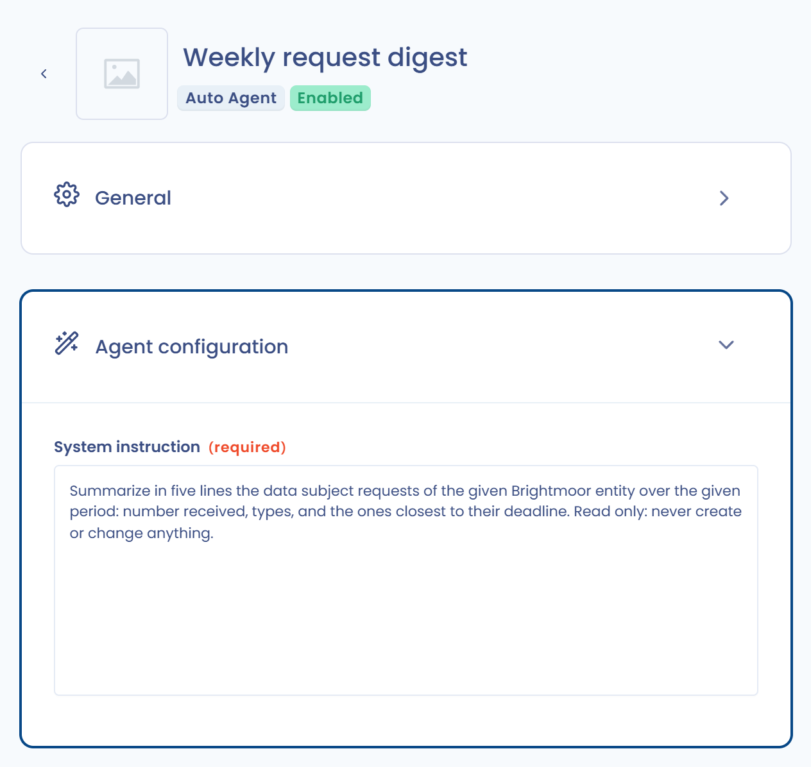
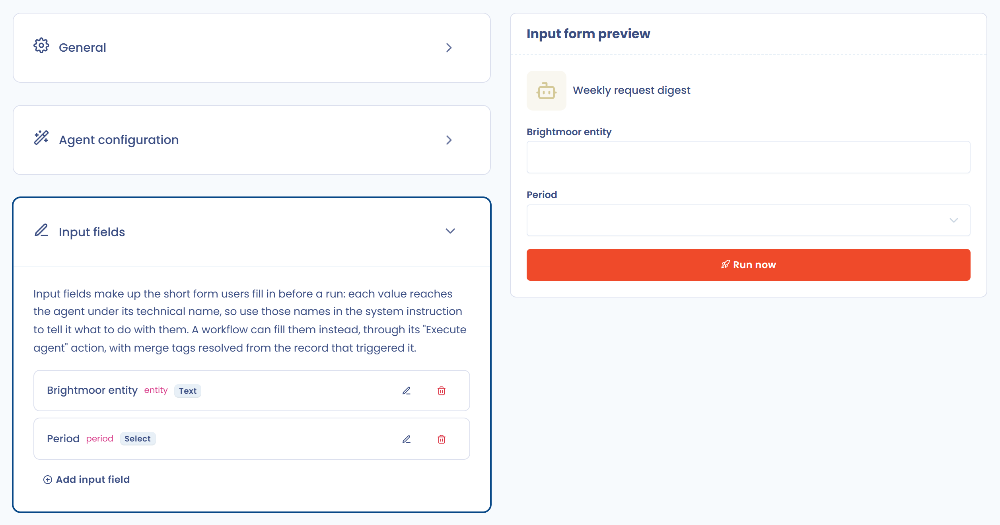
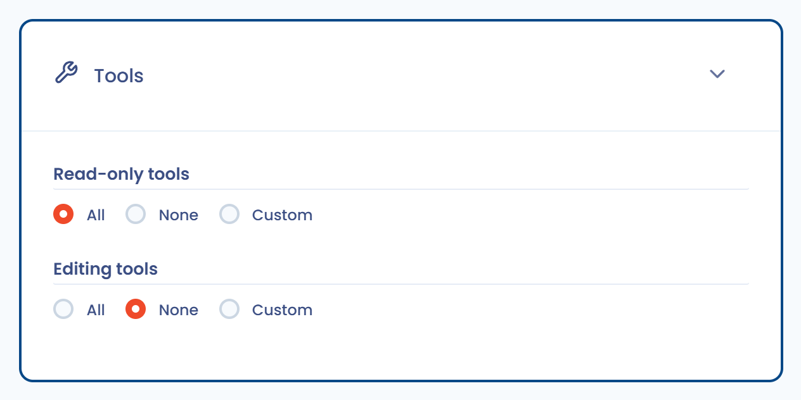
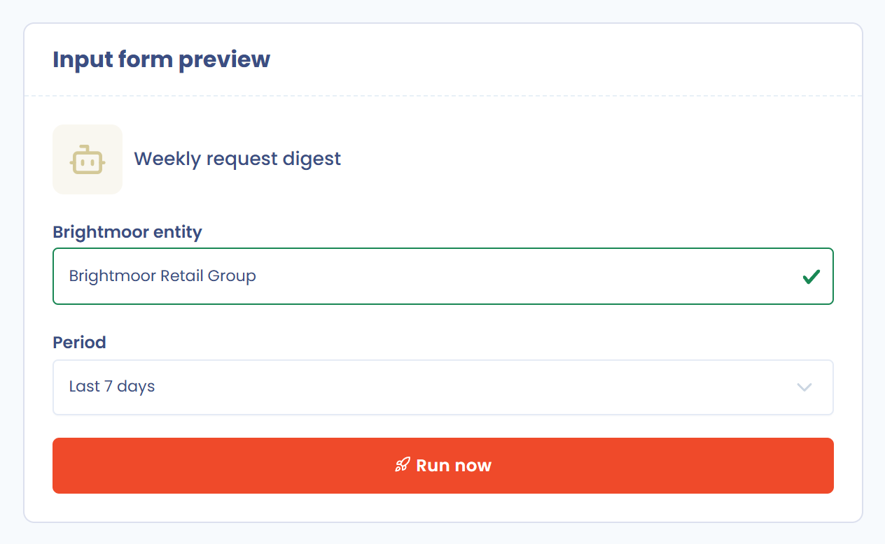
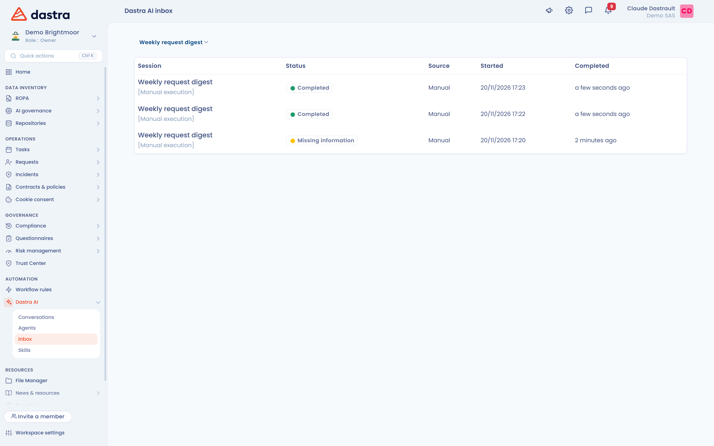
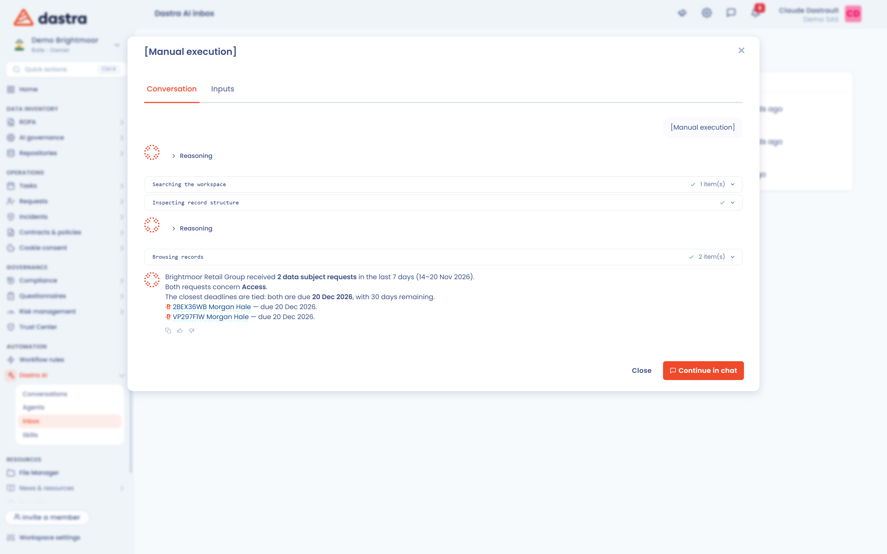
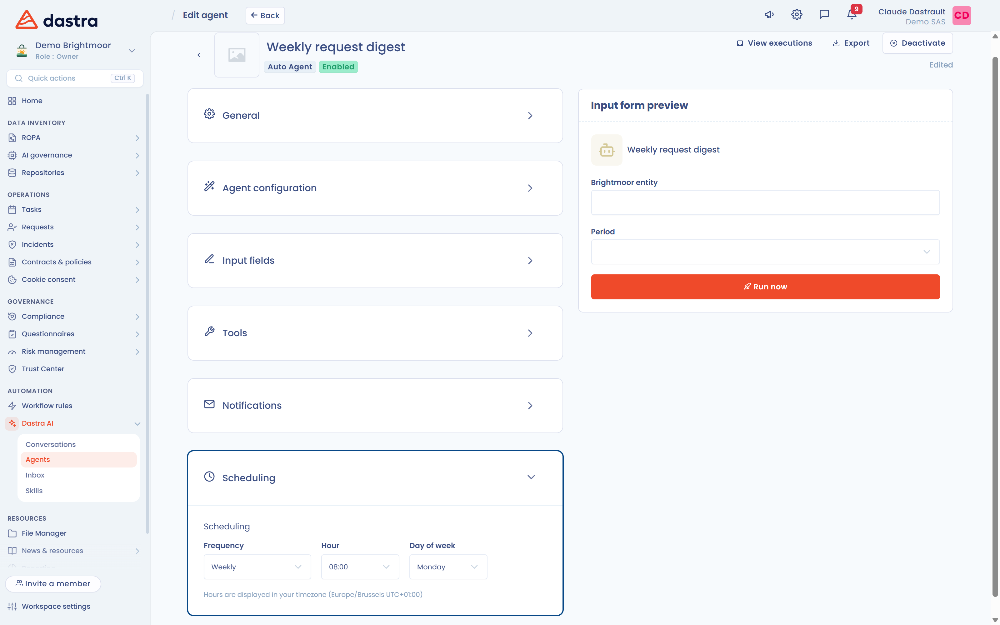

# Einen autonomen Agenten bauen

Dieses Beispiel baut für die Brightmoor Retail Group einen Agenten, der die Betroffenenanfragen der Woche zusammenfasst: wie viele eingegangen sind, welche Rechte sie betreffen und welche der Frist am nächsten sind. Es ist der Fall, für den sich ein [autonomer Agent](../features/general/ai-assistant/agents/autonomous.md) am besten eignet: eine wiederkehrende Aufgabe, die nur Daten liest und berichtet, ohne dass jemand zusieht.

## Was der Agent tut

Der Agent nimmt zwei Werte entgegen, eine Brightmoor-Einheit und einen Zeitraum, liest die Anfragen des Mandanten und schreibt eine Zusammenfassung in fünf Zeilen. Er ändert nichts. Das Ergebnis wird im **Posteingang** von Dastra AI aufbewahrt, wo Sie es nach jeder Ausführung lesen.

Nutzen Sie dieses Muster, wenn die Aufgabe regelmäßig wiederkehrt, immer dieselbe Form hat und unterwegs keine Antwort einer Person braucht. Muss die Aufgabe Fragen stellen oder jeden Schritt von einer Person bestätigen lassen, passt ein [Chat-Agent](../features/general/ai-assistant/agents/conversational.md) besser.

Die Namen und Werte, die Sie eingeben, sind die des englischsprachigen Demo-Mandanten, wie in den Screenshots: Geben Sie sie so ein oder ersetzen Sie sie durch Ihre eigenen.

## Den Agenten erstellen

1. Öffnen Sie **Automatisierung** > **Dastra AI** > **Agenten** und klicken Sie auf **Einen Agenten anlegen**.
2. Wählen Sie **Autonomer Agent**.
3. Geben Sie den **Namen** ein, hier `Weekly request digest`, und optional eine **Beschreibung**, zum Beispiel `Five-line digest of the data subject requests of an entity`.
4. Klicken Sie auf **Einen Agenten anlegen**. Die Schaltfläche bleibt deaktiviert, bis ein Name eingegeben ist.

Der Editor öffnet sich auf dem neuen Agenten.

## Die Systemanweisung schreiben

Öffnen Sie den Block **Konfiguration des Agenten** und füllen Sie die **Systemanweisung** aus, die erforderlich ist:

```
Summarize in five lines the data subject requests of the given Brightmoor entity over the given period: number received, types, and the ones closest to their deadline. Read only: never create or change anything.
```

<figure><figcaption><p>Der Editor mit der Systemanweisung</p></figcaption></figure>

Drei Entscheidungen lassen diese kurze Anweisung funktionieren.

* Die Form der Ausgabe ist festgelegt: „in five lines“, dann die drei Dinge, die jede Zusammenfassung enthalten muss: die Zahl der eingegangenen Anfragen, die Typen und die nächsten Fristen. Jede Ausführung antwortet in derselben Form, sodass sich die Zusammenfassungen von Woche zu Woche vergleichen lassen.
* Der Umfang kommt aus den Eingaben. „The given Brightmoor entity“ und „the given period“ verweisen auf die beiden Eingabefelder des nächsten Schritts. Die Anweisung enthält weder einen Namen einer Einheit noch ein Datum, sodass ein Agent jede Einheit und jeden Zeitraum bedient. Der Hilfetext des Blocks **Eingabefelder** ergänzt, dass sich auf einen Wert auch über seinen technischen Namen verweisen lässt, hier `entity` und `period`.
* Die Regel „nur lesen“ schließt die Anweisung ab. Der letzte Satz nennt die Absicht. Er ist keine technische Sperre: Die liefert der nächste Schritt.

## Die Eingabefelder hinzufügen

Öffnen Sie den Block **Eingabefelder**, klicken Sie auf **Feld hinzufügen** und erstellen Sie die zwei Felder:

| Bezeichnung | Name | Typ | Optionen |
| --- | --- | --- | --- |
| Brightmoor entity | `entity` | **Text** | keine |
| Period | `period` | **Auswahlliste** | `Last 7 days, Last 30 days, Current quarter` |

Der **Name** folgt der Bezeichnung (`brightmoor_entity`), bis Sie einen anderen eingeben: Ersetzen Sie ihn durch `entity`. Bei einem Feld vom Typ **Auswahlliste** nimmt **Optionen** durch Kommas getrennte Werte entgegen. Lassen Sie **Erforderlich** ausgeschaltet: Dieses Beispiel läuft auch mit einem leeren Feld.

<figure><figcaption><p>Die zwei Felder und das Formular, das sie ergeben, rechts</p></figcaption></figure>

Die **Formularübersicht** rechts ist das Formular, das eine Person vor einer Ausführung ausfüllt.

## Die Tools wählen



Öffnen Sie den Block **Tools** und stellen Sie die zwei Gruppen ein:

* **Lesetools**: **Alle**. Der Agent muss den Mandanten durchsuchen und die Anfragen durchsehen, um sie zu zählen.
* **Bearbeitungstools**: **Keine**. Die Zusammenfassung erstellt oder ändert nie einen Eintrag.


Die **Bearbeitungstools** stehen bei der Erstellung eines Agenten auf **Alle**. Der Satz „never create or change anything“ in der Anweisung hindert den Agenten nicht daran, es zu tun, und niemand prüft einen autonomen Agenten bei der Arbeit. Stellen Sie die Gruppe auf **Keine**.




<figure><figcaption><p>Lesetools auf Alle, Bearbeitungstools auf Keine</p></figcaption></figure>



## Den Agenten ausführen



1. Geben Sie in der **Formularübersicht** `Brightmoor Retail Group` in **Brightmoor entity** ein und wählen Sie `Last 7 days` in **Period**.
2. Klicken Sie auf **Ausführen**. Eine Meldung bestätigt, dass die Ausführung gestartet wurde.
3. Öffnen Sie **Dastra AI** > **Posteingang**. Die Ausführung erscheint mit ihrem Status und erreicht nach etwa zwanzig Sekunden **Abgeschlossen**.
4. Klicken Sie auf die Zeile, um die Ausführung zu öffnen. Der Tab **Konversation** zeigt die Schritte des Agenten und seine Antwort, der Tab **Eingabedaten** die Werte, die er erhalten hat.



<figure><figcaption><p>Das Formular, bereit zur Ausführung</p></figcaption></figure>



<figure><figcaption><p>Die Ausführungen im Posteingang</p></figcaption></figure>

Hier ist die Antwort einer echten Ausführung:

```
Brightmoor Retail Group received 2 data subject requests in the last 7 days (14–20 Nov 2026).
Both requests concern Access.
The closest deadlines are tied: both are due 20 Dec 2026, with 30 days remaining.
2BEX36WB Morgan Hale — due 20 Dec 2026.
VP297F1W Morgan Hale — due 20 Dec 2026.
```

Die fünf Zeilen folgen der Form der Anweisung: die Zahl der eingegangenen Anfragen, der Typ, dann die nächsten Fristen. Morgan Hale ist der fiktive Antragsteller der Demo-Anfragen. Die Schritte über der Antwort zeigen, dass der Agent nur Einträge gesucht und durchsucht hat.

<figure><figcaption><p>Die Details einer Ausführung</p></figcaption></figure>

Alle Status und was eine Ausführung aufzeichnet, finden Sie unter [Ausführungen verfolgen](../features/general/ai-assistant/agents/inbox.md).

## Den Agenten planen

Dieser Schritt ist optional. Um die Zusammenfassung jeden Montag zu erhalten, öffnen Sie den Block **Planung**, wählen Sie **Wöchentlich** bei **Häufigkeit** und dann die **Uhrzeit** und den **Wochentag**. Die Änderung wird sofort gespeichert.

<figure><figcaption><p>Ein wöchentlicher Zeitplan, montags um 08:00</p></figcaption></figure>

Eine geplante Ausführung erhält keinen Wert für ihre Eingabefelder. Der Agent dieses Beispiels hätte dann weder eine Einheit noch einen Zeitraum zu lesen: Schreiben Sie für eine geplante Zusammenfassung die Einheit und den Zeitraum in die Anweisung selbst. Wählen Sie im Block **Benachrichtigungen** die **Nutzer wurden benachrichtigt**, die informiert werden sollen, wenn eine Ausführung abgeschlossen wird. Die Regeln für Uhrzeit und Zeitzone finden Sie unter [Einen autonomen Agenten erstellen](../features/general/ai-assistant/agents/autonomous.md#planung).

## Gut zu wissen

* Der Editor speichert von selbst. Es gibt keine Schaltfläche zum Speichern: Jede Änderung wird einen Moment später gespeichert, und der Zeitpunkt der letzten Speicherung steht oben rechts.
* Der Agent ist von Anfang an aktiviert. Ein Zeitplan oder eine Workflow-Regel kann ihn starten, sobald er existiert. Klicken Sie in der Kopfzeile auf **Deaktivieren**, solange Sie ihn noch abstimmen: **Ausführen** funktioniert weiterhin.
* Die Formularübersicht startet eine echte Ausführung. **Ausführen** ist dort dieselbe Schaltfläche wie für jeden Nutzer, und die Ausführung zählt in Ihren monatlichen KI-Credits.
* Ein autonomer Agent läuft nicht mit den Rechten der Person, die ihn gestartet hat. Lesen Sie den [Warnhinweis der Referenzseite](../features/general/ai-assistant/agents/autonomous.md) und die [Rechte von Agenten](../features/general/ai-assistant/agents/README.md#wer-was-tun-darf), bevor Sie ihm Bearbeitungstools geben.
