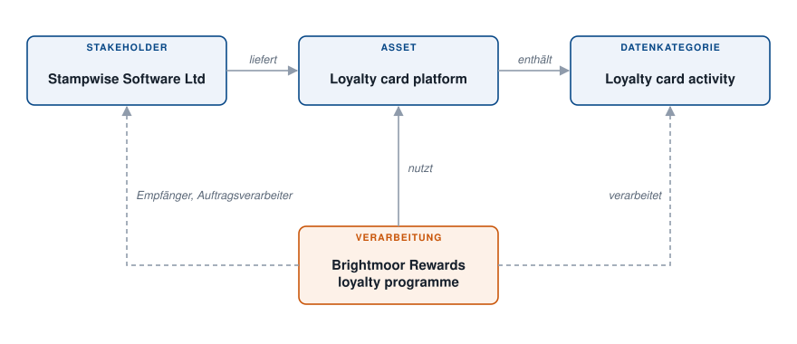

# Einen Datenfluss kartieren

Die Brightmoor Retail Group betreibt ein Treueprogramm. Die Daten ihrer Mitglieder liegen in einer Treuekarten-Plattform, die ein externer Anbieter herausgibt. Dieses Beispiel kartiert diesen Datenfluss einmal in den **Metadaten** und verwendet ihn dann in der Verarbeitungstätigkeit wieder, sodass Verzeichnis und Kartierung konsistent bleiben. Zur Methode siehe [Datenkartierung](../features/mapping/README.md).

<figure><figcaption>
Die vier Objekte und ihre Verknüpfungen
</figcaption></figure>

Die Verknüpfungen sind die folgenden:

* der **Stakeholder** gibt das **Asset** heraus;
* das **Asset** enthält die **Datenkategorie**;
* die **Verarbeitungstätigkeit** verwendet das Asset, führt den Stakeholder als Auftragsverarbeiter auf und verarbeitet die Datenkategorie.

## 1. Den Anbieter erstellen

Erstellen Sie unter **Metadaten** > **Stakeholder** den Stakeholder „Stampwise Software Ltd“, das Unternehmen, das die Plattform herausgibt. Er wird in der Verarbeitungstätigkeit als Auftragsverarbeiter referenziert. Siehe [Stakeholder](../features/mapping/repositories/stakeholders.md).

## 2. Das Asset erstellen

Erstellen Sie unter **Metadaten** > **Assets** das Asset „Loyalty card platform“. Wählen Sie bei **Herausgeber** „Stampwise Software Ltd“ aus. Siehe [Assets](../features/mapping/repositories/assets.md).

## 3. Die Datenkategorie erstellen

Erstellen Sie unter **Metadaten** > **Datenkategorien** die Datenkategorie „Loyalty card activity“ mit ihren Datenfeldern: Kartennummer, Punktestand, Kaufhistorie. Wählen Sie bei **Verbundener Asset** „Loyalty card platform“ aus. Eine Datenkategorie ohne Asset ist verwaist (Orphan): Die Verknüpfung ermöglicht es, alles zu finden, was ein Asset enthält. Siehe [Datenkategorien](../features/mapping/repositories/datasets.md).

## 4. Die Verarbeitungstätigkeit aus der Kartierung aufbauen

Öffnen Sie die Verarbeitungstätigkeit „Brightmoor Rewards loyalty programme“ oder legen Sie sie an.

1. Klicken Sie im Abschnitt **Assets** auf **Asset auswählen** und wählen Sie „Loyalty card platform“ aus.
2. Klicken Sie in der Zeile des Assets auf **Synchronisierung von Daten**. Das Fenster **Synchronisierung von Asset-Informationen** listet auf, was Dastra aus der Kartierung übernehmen kann: den **Herausgeber der hinzuzufügenden Anwendung als Auftragsverarbeiter**, die **Mit dem Asset verbundene Datensätze** und die Sicherheitsmaßnahmen.
3. Aktivieren Sie **Alle auswählen** und klicken Sie auf **Hinzufügen**.

Dastra fügt „Stampwise Software Ltd“ im Abschnitt **Empfänger** in der Kategorie **Verarbeiter** hinzu und „Loyalty card activity“ im Abschnitt **Daten und Speicherdauer**. Nichts wird doppelt eingegeben. Die Zeile des Assets zeigt jetzt **Synchronisiert**. Siehe [Assets](../features/ropa/activity/assets.md) und [Empfänger](../features/ropa/activity/recipients/README.md).

## 5. Das Ergebnis lesen

* In der Verarbeitungstätigkeit zeigt **Empfänger** den Anbieter als Auftragsverarbeiter. Über sein Menü **...** öffnet **Den verbundenen Stakeholder bearbeiten** den Stakeholder.
* Unter **Metadaten** > **Data Mapping** zeigt das Diagramm **Kartierung der Datenflüsse zwischen den Assets** das Asset, seinen Herausgeber und seine Datenkategorie als verbundene Knoten. Siehe [Metadaten](../features/mapping/repositories/README.md).

Ändert sich der Anbieter, bearbeiten Sie den Stakeholder einmal. Wird dem Asset eine zweite Datenkategorie hinzugefügt, zeigt die Zeile des Assets, dass es sich seit der letzten Synchronisierung geändert hat: Führen Sie **Synchronisierung von Daten** erneut in jeder Verarbeitungstätigkeit aus, die es verwendet.

<figure><figcaption>
Der Datenfluss im Diagramm der Kartierung
</figcaption></figure>
