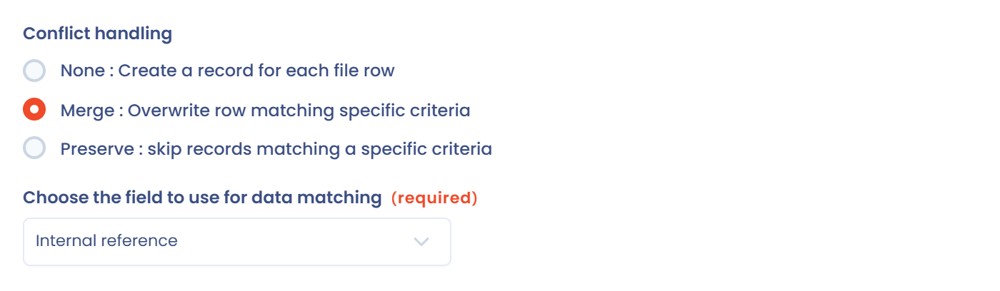
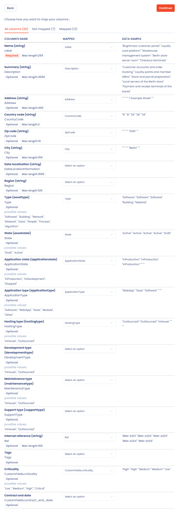

# Assets aus einer Tabelle importieren

Die Brightmoor Retail Group führt ihre Systemliste in einer Tabelle. Dieses Beispiel importiert sie in die Referenzliste **Assets**. Ein Teil der Liste ist bereits in Dastra, sodass der Import die bestehenden Assets aktualisieren und die übrigen anlegen muss. Die Methode ist für Verarbeitungstätigkeiten und die anderen Objekte dieselbe: Die vollständige Referenz finden Sie unter [Daten importieren (Excel, CSV)](../features/general/import.md).

## Die Beispieldatei

Laden Sie die Datei herunter: [examples-assets-import.csv](../.gitbook/assets/examples-assets-import.csv). Es ist eine CSV-Datei mit dem Trennzeichen `;` und der Kodierung UTF-8, dem Format, das der Import erwartet. Sie enthält fünf Zeilen.

| Spalte | Inhalt | Mögliche Werte |
| --- | --- | --- |
| `Ref` | Interne Referenz, bis zu 100 Zeichen | Freitext |
| `Label` | Name des Assets, erforderlich | Freitext |
| `Type` | Kategorie des Assets | `Software`, `Building`, `Network`, `Material`, `Data`, `People`, `Process`, `Algorithm` |
| `Description` | Beschreibung | Freitext |
| `Address`, `ZipCode`, `City` | Standort | Freitext |
| `CountryCode` | Land, 2 Zeichen | ISO-Code, zum Beispiel `DE` |
| `State` | Status des Assets | `Draft`, `Active` |
| `ApplicationType` | Art der Anwendung | `Software`, `WebApp`, `Saas`, `Module`, `Other` |
| `HostingType` | Hosting | `InHouse`, `OutSourced` |
| `ApplicationState` | Lebenszyklus | `InProduction`, `InDevelopment`, `Stopped` |
| `CustomFields.criticality` | Ein benutzerdefiniertes Feld des Mandanten | Freitext |

Die möglichen Werte sind englisch, wie in der Vorlage. Ein Wert, der keiner der Auswahlmöglichkeiten entspricht, wird durch den Standardwert der Spalte ersetzt: Prüfen Sie sie vor dem Import.

In der Anwendung listet **Spaltenformat anzeigen** im Import-Assistenten die Spalten und Werte Ihrer Version auf.

## 1. Das benutzerdefinierte Feld erstellen

Die letzte Spalte befüllt ein benutzerdefiniertes Feld. Erstellen Sie es zuerst.

1. Klicken Sie in der Seitenleiste auf **Mandanteneinstellungen**, dann auf **Benutzerdefinierte Felder** und wählen Sie das Modul der Assets.
2. Klicken Sie auf **Erstellen Sie eine Gruppe von Feldern**, nennen Sie sie „Brightmoor data“ und speichern Sie.
3. Ziehen Sie ein Textfeld in die Gruppe. Geben Sie „Criticality“ unter **Bezeichnung** ein.
4. Prüfen Sie, dass der **Name der Variablen (Slug)** `criticality` lautet, und speichern Sie dann. Der Slug lässt sich danach nicht mehr ändern.

Ein benutzerdefiniertes Feld wird über eine Spalte importiert, die `CustomFields.` gefolgt von seinem Slug heißt: `CustomFields.criticality`. Siehe [Benutzerdefinierte Felder](../features/general/custom-fields.md).

## 2. Den Import starten

1. Öffnen Sie **Metadaten** > **Assets**.
2. Klicken Sie auf den Pfeil neben der Schaltfläche **Asset erstellen** und dann auf **Importieren**.

Der Assistent bietet **Laden Sie die Dateivorlage herunter**, wenn Sie lieber mit einer leeren Datei beginnen.

## 3. Den Modus Zusammenführen und das Abgleichfeld wählen

Das Asset „Brightmoor customer portal“ existiert bereits im Mandanten mit der Referenz `BRM-A001`. Wählen Sie in der Gruppe **Konfliktmanagement** **Fusion: Daten aus übereinstimmenden Zeilen überschreiben (gefährlich!)**.

Wählen Sie dann das **Feld für den Datenabgleich**. Bei Assets sind die Abgleichfelder `Ref` und `Label`. Brightmoor wählt `Ref`, das sich beim Umbenennen eines Assets nicht ändert. Eine Zeile entspricht einem Datensatz, wenn der Wert exakt identisch ist, einschließlich Groß- und Kleinschreibung.

Mit dieser Wahl gilt:

* Die Zeile `BRM-A001` aktualisiert das bestehende Asset;
* die vier anderen Zeilen legen neue Assets an.


**Fusion** ersetzt die gespeicherten Werte durch die der Datei. Eine leere Zelle behält den bestehenden Wert, außer in Spalten mit zwingender Auswahl, etwa dem Typ oder dem Status, die dann ihren Standardwert annehmen: Füllen Sie sie immer aus. Der Vorgang lässt sich nicht rückgängig machen.


Mit **Fusion** werden auch die benutzerdefinierten Felder aktualisiert. Eine Zeile mit leerer `CustomFields.criticality` lässt den gespeicherten Wert unverändert.

Um das bestehende Asset unverändert zu lassen, wählen Sie stattdessen **Aufbewahrung: Daten, die eine Bedingung erfüllen, dürfen nicht verändert werden**: Die Zeile `BRM-A001` wird übersprungen.

<figure><figcaption>
Der Modus Zusammenführen mit dem Abgleichfeld Ref
</figcaption></figure>

## 4. Die Datei senden und die Spalten zuordnen

1. Klicken Sie auf **Bitte senden/verschieben Sie die Dateien hierher** und wählen Sie die CSV-Datei. Dastra liest die ersten Zeilen.
2. Im Schritt **Entsprechungen** ordnet Dastra die Spalten der Datei den Spalten des Imports zu, wenn die Kopfzeile mit dem Namen oder der Bezeichnung der Spalte identisch ist. Die Spalte **Daten aus der Datei** zeigt die ersten Werte Ihrer Datei.
3. Filtern Sie die Liste mit den Tabs **Alle Spalten**, **Keine Übereinstimmung** und **Korrespondenz (importierte Datei)**. Passt eine Kopfzeile nicht, wählen Sie in der Liste der Zeile die richtige Spalte. Die Zuordnung von `CustomFields.criticality` erscheint wie die anderen.
4. Die Schaltfläche **Weiter** bleibt deaktiviert, solange eine erforderliche Spalte, etwa `Label`, keine Zuordnung hat.

<figure><figcaption>
Die zugeordneten Spalten der Beispieldatei
</figcaption></figure>

## 5. Das Ergebnis lesen

Klicken Sie auf **Weiter**. Der Bildschirm **Ergebnis** zeigt die Anzahl der verarbeiteten, angelegten, aktualisierten und übersprungenen Zeilen. Bei der Beispieldatei im Modus Fusion erwarten Sie fünf verarbeitete Zeilen, vier angelegte Assets und ein aktualisiertes. Klicken Sie auf **Anzeigen**, um die Liste zu öffnen.

Ist eine Zeile ungültig, zum Beispiel ein `CountryCode`, der kein Land ist, bricht der gesamte Import ab, und nichts wird gespeichert. Die Meldung nennt die betroffene Zeile, wobei die Kopfzeile als Zeile 1 zählt. Korrigieren Sie die Datei und beginnen Sie von vorn.
