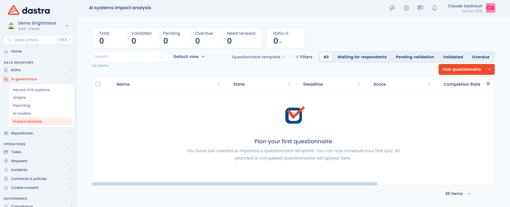

# Grundrechte-Folgenabschätzung (FRIA)

Diese Seite erklärt, wer eine Grundrechte-Folgenabschätzung (FRIA) durchführen muss und wie Sie sie in Dastra durchführen. Sie richtet sich an Betreiber von Hochrisiko-KI-Systemen.

## Regulatorischer Kontext

Artikel 27 der europäischen Verordnung über künstliche Intelligenz (**KI-Verordnung**) schreibt vor der ersten Nutzung bestimmter Hochrisiko-KI-Systeme eine Grundrechte-Folgenabschätzung vor. Die Pflicht gilt nicht für jedes Hochrisiko-System.

Sie gilt für die in Artikel 6 Absatz 2 genannten Hochrisiko-Systeme, mit Ausnahme derer aus Anhang III Nummer 2 (kritische Infrastrukturen). Betroffen sind:

* Betreiber, die dem öffentlichen Recht unterliegen;
* private Stellen, die öffentliche Dienste erbringen;
* Betreiber der Hochrisiko-Systeme aus Anhang III Nummer 5 Buchstaben b und c: die Bewertung der Kreditwürdigkeit von Personen sowie die Risikobewertung und Preisbildung bei Lebens- und Krankenversicherungen.

Der Betreiber führt die Bewertung durch, bevor er das System in Betrieb nimmt. In ähnlichen Fällen kann der Betreiber sich auf eine bereits durchgeführte Bewertung oder auf die Folgenabschätzungen stützen, die der Anbieter bereitstellt. Nach Abschluss der Bewertung teilt der Betreiber der Marktüberwachungsbehörde die Ergebnisse mit (Artikel 27 Absatz 3).

Die Bewertung unterscheidet sich von einer DSGVO-DSFA, ergänzt sie aber: Deckt eine DSFA bereits einige der Pflichten ab, tritt die Grundrechte-Folgenabschätzung hinzu (Artikel 27 Absatz 4).

## Ziel der Bewertung

Die Bewertung beschreibt für das betreffende System:

* die Prozesse des Betreibers, in denen das System eingesetzt wird;
* den vorgesehenen Zeitraum und die Häufigkeit der Nutzung;
* die Kategorien von Personen, die voraussichtlich betroffen sind;
* die spezifischen Risiken einer Beeinträchtigung ihrer Rechte, zum Beispiel auf Privatsphäre, Nichtdiskriminierung, Meinungsfreiheit, Unschuldsvermutung, Würde oder Arbeitnehmerrechte;
* die Maßnahmen der menschlichen Aufsicht;
* die Maßnahmen, die zu ergreifen sind, wenn diese Risiken eintreten, einschließlich der internen Governance und der Beschwerdemechanismen.

## Wann Dastra die Bewertung anbietet

Das Feld **Bewertung der Auswirkungen eines KI-Systems auf die Grundrechte** erscheint im Schritt **Risikostufe** des Datensatzes, wenn:

* der Schritt **Verantwortung** die Rolle des Betreibers angibt;
* die Risikostufe **Hohes Risiko** ist;
* Ihr Plan das Modul **Fragebögen** enthält und Sie Schreibzugriff auf Fragebögen haben.

Ist die Risikostufe **Nicht akzeptabel**, warnt das Feld, dass Artikel 5 der KI-Verordnung den Einsatz verbietet.

<figure><figcaption>
Das Feld, das einem Betreiber eines Hochrisiko-Systems angezeigt wird
</figcaption></figure>

## Die Bewertung durchführen

1. Klicken Sie in dem Feld auf **Durchführung einer Folgenabschätzung**.
2. Das Fenster **Auswahl einer Fragebogen-Vorlage** listet die Vorlagen vom Typ **Analyse der Auswirkungen eines KI-Systems** auf, die in Ihrem Mandanten installiert sind. Klicken Sie auf eine Vorlage, um sie zu planen.
3. Legen Sie im Fenster **Einen Fragebogen planen** fest, wie die Befragten antworten. Siehe [Einen Fragebogen planen](../questionnaires/schedule.md).

<figure><figcaption>
Die Vorlagen zur Folgenabschätzung für KI-Systeme
</figcaption></figure>

Zeigt das Fenster keine Vorlage an, installieren Sie eine:

1. Klicken Sie im Fenster auf **Vorlage erstellen**. Das Modul Fragebögen öffnet sich in einem neuen Tab.
2. Wählen Sie **Basierend auf einer Vorlage**.
3. Filtern Sie in der Bibliothek **Typen** nach **Analyse der Auswirkungen eines KI-Systems** und klicken Sie dann auf die Vorlage, die Sie installieren möchten. Siehe [Automatisierte Fragebogenvorlagen](../questionnaires/templates/README.md#automatisierte-fragebogenvorlagen).
4. Kehren Sie zum Datensatz zurück und klicken Sie erneut auf **Durchführung einer Folgenabschätzung**.


Das Fenster bietet nur Vorlagen vom Typ **Analyse der Auswirkungen eines KI-Systems** an. Eine Vorlage vom Typ **DSFA (PIA)**, auch wenn sie für KI gedacht ist, erscheint dort nicht.


## Abgeschlossene Bewertungen finden

Klicken Sie in der Seitenleiste auf **KI-Governance** und dann auf **Assessments**. Diese Seite zeigt das Modul Fragebögen, beschränkt auf den Typ **Analyse der Auswirkungen eines KI-Systems**. Sie erscheint, wenn Ihr Plan das Modul Fragebögen enthält und Sie Zugriff auf Fragebögen haben.

<figure><figcaption>
Die Seite Assessments
</figcaption></figure>
