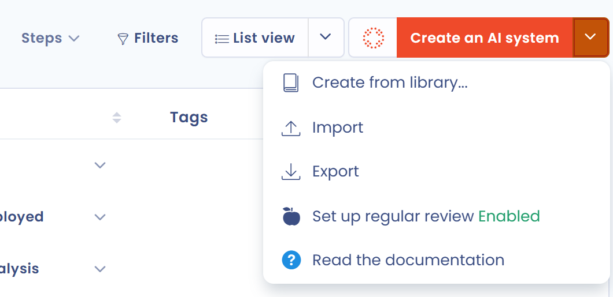

# Ihre KI-Systeme importieren

Wenn Sie bereits ein Verzeichnis von KI-Systemen haben, importieren Sie es in Dastra, statt alles von Hand einzugeben.

1. Klicken Sie in der Seitenleiste auf **KI-Governance** und dann auf **KI-Systeme**.
2. Öffnen Sie oben rechts das Menü der Schaltfläche **Ein neues KI-System erstellen** und klicken Sie auf **Importieren**.
3. Fügen Sie auf der Seite, die sich öffnet, am unteren Rand Ihre Datei hinzu.

<figure><figcaption><p>Die Aktion Importieren im Menü des Verzeichnisses der KI-Systeme</p></figcaption></figure>

Einzelheiten zum Ablauf finden Sie unter [Daten importieren (Excel, CSV)](../general/import.md).

## Dateiformat

Die Datei enthält eine Kopfzeile mit den unten beschriebenen Spaltennamen. Alle Spalten sind optional, außer `Label`.

Spalten mit festen Werten erwarten genau die Werte der Spalte „Zulässige Werte“. Die Groß- und Kleinschreibung spielt keine Rolle. Ein Wert, der keinem der zulässigen Werte entspricht, wird ignoriert.

| Spalte | Beschreibung | Typ | Einschränkungen | Zulässige Werte |
| --- | --- | --- | --- | --- |
| `Label` | Name des Systems | Text | Pflichtfeld, 1 bis 120 Zeichen | Freitext |
| `Ref` | Interne Referenz | Text | höchstens 50 Zeichen | Freitext |
| `Description` | Beschreibung des Systems | Text | höchstens 4.000 Zeichen | Freitext |
| `State` | Status des Systems | `AiSystemState` | | `Draft`, `Cancelled`, `Pending`, `Active` |
| `RiskLevel` | Risikostufe | `AiSystemRiskLevel` | | `Low`, `Medium`, `High`, `Unacceptable` |
| `RiskLevelJustification` | Begründung der Risikostufe | Text | | Freitext |
| `BenefitLevel` | Stufe des geschäftlichen Mehrwerts | `AiSystemBenefitLevel` | | `Low`, `Medium`, `High` |
| `BenefitLevelJustification` | Begründung des geschäftlichen Mehrwerts | Text | | Freitext |
| `DateArchived` | Datum der Verschiebung in den Papierkorb | Datum | Formate `DD-MM-YYYY` oder `DD/MM/YYYY` | Datum |
| `DateCreation` | Erstellungsdatum | Datum | gleiches Format | Datum |
| `DateUpdate` | Datum der letzten Aktualisierung | Datum | gleiches Format | Datum |
| `DateDeployment` | Datum der Einführung | Datum | gleiches Format | Datum |
| `DateRetirement` | Datum der Außerbetriebnahme | Datum | gleiches Format | Datum |
| `TransparencyNoticeDone` | Ein Transparenzhinweis wurde bereitgestellt | Boolescher Wert | | `true` oder `false` |
| `TransparencyNoticeHtml` | Inhalt des Hinweises | Text | | HTML |

### Zuordnung zu den in der Anwendung angezeigten Bezeichnungen

Die Werte in der Datei sind die technischen Namen, nicht die in der Anwendung angezeigten Bezeichnungen. Schreiben Sie nicht die Bezeichnung vom Bildschirm in die Datei.

| Spalte | Wert in der Datei | Angezeigte Bezeichnung |
| --- | --- | --- |
| `State` | `Draft` | Projekt |
| `State` | `Pending` | In Bearbeitung |
| `State` | `Active` | In Bearbeitung |
| `State` | `Cancelled` | Abgebrochen |
| `RiskLevel` | `Low` | Minimal |
| `RiskLevel` | `Medium` | Begrenztes Risiko |
| `RiskLevel` | `High` | Hohes Risiko |
| `RiskLevel` | `Unacceptable` | Nicht akzeptabel |
| `BenefitLevel` | `Low` | Niedrig |
| `BenefitLevel` | `Medium` | Mittel |
| `BenefitLevel` | `High` | Hoch |

## Beispielzeile

```
"Internal ChatGPT","SYS-001","Internal documentation assistant model","Active","Medium","Moderate risks with responsible use","High","Very high business value","01/02/2024","15/01/2024","01/03/2024","20/03/2024","","false","<p>This AI system is used to assist employees in drafting internal documents.</p>"
```

## Gebrauchsfertige Kopfzeile

Kopieren Sie diese Zeile in eine leere `.csv`-Datei:

```
Label,Ref,Description,State,RiskLevel,RiskLevelJustification,BenefitLevel,BenefitLevelJustification,DateArchived,DateCreation,DateUpdate,DateDeployment,DateRetirement,TransparencyNoticeDone,TransparencyNoticeHtml
```
