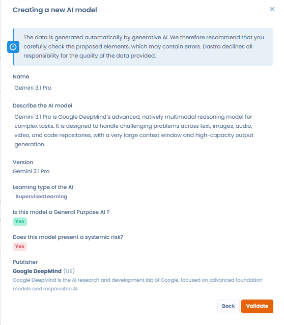

# Das Verzeichnis der KI-Modelle

Für jedes KI-System, das Sie erfassen, geben Sie das oder die KI-Modelle an, die es nutzt. Jedes Modell beschreiben Sie einmal in einem Verzeichnis und verknüpfen es dann mit den Systemen, die es verwenden.

## Definition

Ein Modell der künstlichen Intelligenz ist ein Computerprogramm, das mithilfe von Techniken des maschinellen Lernens und der Datenanalyse bestimmte Aufgaben erfüllen soll.

* Grundlagen: Ein KI-Modell beruht auf bestimmten Algorithmen und Architekturen, etwa den neuronalen Netzen des Deep Learning, die es ihm ermöglichen, aus Daten zu lernen.
* Lernen: Das Modell wird mit großen Datensätzen trainiert, um Muster und Zusammenhänge zu erkennen. Anschließend kann es auf der Grundlage neuer Daten Vorhersagen treffen oder Inhalte erzeugen.
* Funktion: Das ist der Zweck, für den das Modell eingesetzt wird, zum Beispiel die Bilderzeugung beim Modell Midjourney.
* Einsatz: Diese Modelle werden in einer Vielzahl von Anwendungen eingesetzt, von Chatbots und virtuellen Assistenten bis zur Datenanalyse und Inhaltserstellung.

## Das Verzeichnis öffnen

Klicken Sie in der Seitenleiste auf **KI-Governance** und dann auf **KI-Modelle**.

<figure><figcaption>
Das Verzeichnis der KI-Modelle
</figcaption></figure>

Die Schaltfläche **Ein KI-Modell erstellen** öffnet das Fenster zur Erstellung. Ihr Menü bietet außerdem:

* **Erstellen Sie auf der Grundlage von Vorlagen**: ein Modell aus der Dastra-Bibliothek auswählen;
* **Importieren**: eine Liste von Modellen aus einer Datei importieren, siehe unten;
* **Exportieren**: die Liste als CSV, Excel, JSON oder Markdown exportieren.

## Ein KI-Modell erstellen

Klicken Sie auf **Ein KI-Modell erstellen**. Das Fenster bietet drei Optionen:

* **Mit KI generieren**: Der KI-Assistent füllt den Datensatz anhand eines Namens oder einer Beschreibung aus, siehe den nächsten Abschnitt;
* **Basierend auf einer Vorlage**: den Datensatz aus unserer Bibliothek oder aus einem anderen Mandanten erstellen;
* **Von Grund auf neu**: den Datensatz selbst erfassen.

<figure><figcaption>
Die drei Optionen zum Erstellen eines KI-Modells
</figcaption></figure>

Geben Sie bei **Von Grund auf neu** den Namen des Modells ein und vervollständigen Sie dann den Datensatz im Bereich **KI-Model**:

| Feld | Inhalt |
| --- | --- |
| **Name des Modells** | Pflichtfeld, höchstens 120 Zeichen. Beispiel: GPT 4, Mistral AI, MidJourney. |
| **Version** | Die genaue Version des Modells, höchstens 30 Zeichen. Beispiel: gpt-4o-2024-05-13. |
| **Referenz** | Ihre eigene Referenz für das Modell, höchstens 120 Zeichen. |
| **Herausgeber** | Der Herausgeber des Modells, ausgewählt unter den Stakeholdern Ihres Mandanten. Sie können in der Liste einen neuen anlegen. |
| **Tags** | Die Tags, die das Modell einordnen. |
| **Beschreibe dieses KI-Modell kurz** | Die Beschreibung, höchstens 3.000 Zeichen. Beschreiben Sie die Funktionen und die Informationen, über die Sie verfügen. |
| **Art des KI-Lernens** | Die Methode, mit der das Modell trainiert wurde, siehe unten. |
| **Ist diese Vorlage für den allgemeinen Nutzer bestimmt?** | Ja oder Nein. Die Frage betrifft KI-Modelle mit allgemeinem Verwendungszweck (General Purpose AI, GPAI): Ein solches Modell ist vielseitig und kann in viele nachgelagerte Systeme integriert werden. Ein Tooltip erinnert an die Definition der KI-Verordnung. |
| **Stellt dieses Modell ein systemisches Risiko dar?** | Ja oder Nein. Die Frage erscheint nur, wenn das Modell einen allgemeinen Verwendungszweck hat. Ein Tooltip erinnert an die Definition des systemischen Risikos. |
| **Dokumentation** | Ein Texteditor für die Dokumentation des Modells. |

<figure><figcaption>
Der Datensatz eines KI-Modells
</figcaption></figure>

Die Art des Lernens beschreibt, wie das Modell für seine Aufgaben trainiert wurde. Sie beeinflusst, wie das Modell das Gelernte verallgemeinert. Dastra bietet vier Arten an, jeweils mit ihrer Definition in der Liste:

* Überwachtes Lernen: Lernen mit gekennzeichneten Daten, um Vorhersagen zu treffen;
* Unüberwachtes Lernen: Lernen ohne gekennzeichnete Daten, um ähnliche Muster zu finden;
* Lernen durch Verstärkung: Lernen durch Belohnungen und Sanktionen, um Handlungen zu optimieren;
* Lernen durch Übertragung: Nutzung von Wissen aus einem Bereich, um das Lernen in einem anderen zu verbessern.

### Den Datensatz mit dem KI-Assistenten erstellen

Die Option **Mit KI generieren** im Fenster zur Erstellung erzeugt den Datensatz eines KI-Modells aus einem einfachen Namen oder einer Beschreibung. Sie ist verfügbar, wenn Ihr Plan die entsprechenden KI-Funktionen enthält. Der Assistent nutzt die Websuche, um die relevanten Informationen zu finden und einzutragen.

1. Klicken Sie auf **Ein KI-Modell erstellen** und dann auf **Mit KI generieren**.
2. Geben Sie den Namen des Modells oder eine kurze Beschreibung ein, zum Beispiel „GPT-4o von OpenAI“.
3. Prüfen und ergänzen Sie den erzeugten Datensatz, bevor Sie ihn bestätigen.

Der erzeugte Inhalt ist ein Vorschlag. Prüfen und ergänzen Sie die Informationen vor der Bestätigung, denn von KI erzeugte Inhalte können Fehler enthalten.

<figure><figcaption>
Beschreiben Sie das zu erzeugende KI-Modell (Name, Herausgeber ...): Die Websuche wird genutzt, um die Informationen zu ergänzen
</figcaption></figure>

<figure><figcaption>
Der erzeugte Datensatz sollte vor der Bestätigung geprüft werden
</figcaption></figure>

### Modelle importieren und exportieren

Um mehrere Modelle zu importieren, öffnen Sie das Menü der Schaltfläche **Ein KI-Modell erstellen** und klicken Sie auf **Importieren**. Der Ablauf ist derselbe wie in den anderen Modulen: Siehe [Daten importieren (Excel, CSV)](../general/import.md). Die Datei kann folgende Spalten enthalten:

| Spalte | Beschreibung |
| --- | --- |
| `Label` | Name des Modells, Pflichtfeld. |
| `Ref` | Ihre Referenz für das Modell. |
| `Description` | Beschreibung des Modells. |
| `VersionName` | Version des Modells. |
| `LearningType` | `SupervisedLearning`, `UnSupervisedLearning`, `ReinforcedLearning` oder `TransferLearning`. |
| `IsGeneralPurposeAi` | `true`, wenn das Modell einen allgemeinen Verwendungszweck hat, sonst `false`. |
| `SystemicRisk` | `true`, wenn das Modell ein systemisches Risiko darstellt, sonst `false`. |
| `DocumentationHtml` | Dokumentation des Modells als HTML. |

Die Aktion **Exportieren** erzeugt eine CSV-, Excel-, JSON- oder Markdown-Datei der Liste.

## Ein Modell mit einem KI-System verknüpfen

Öffnen Sie den Datensatz des betreffenden KI-Systems. Der Schritt **KI-Modelle** ist der dritte, nach **Allgemeines** und **Verantwortung**.

1. Wählen Sie in der Auswahl **Auswahl der KI-Modelle** ein oder mehrere Modelle aus Ihrem Verzeichnis aus. Sie können in der Auswahl auch ein neues anlegen.
2. Füllen Sie für jedes Modell die **Beschreibung der Nutzung** aus. Dieses Feld erklärt, wie das Modell in diesem KI-System eingesetzt wird.
3. Speichern Sie den Datensatz.

Ein Warnsymbol kennzeichnet die Modelle, die ein systemisches Risiko darstellen.

<figure><figcaption>
Ein Modell mit einem KI-System verknüpfen
</figcaption></figure>
