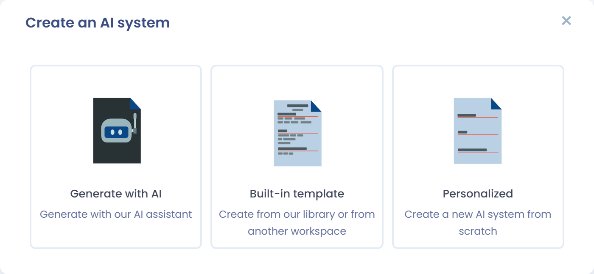
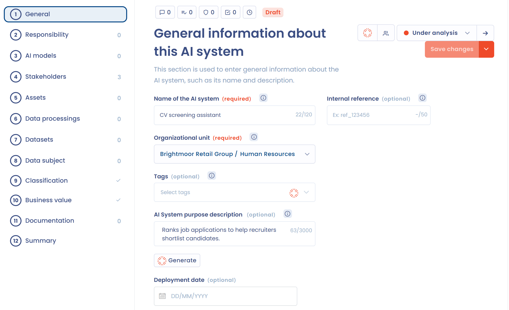
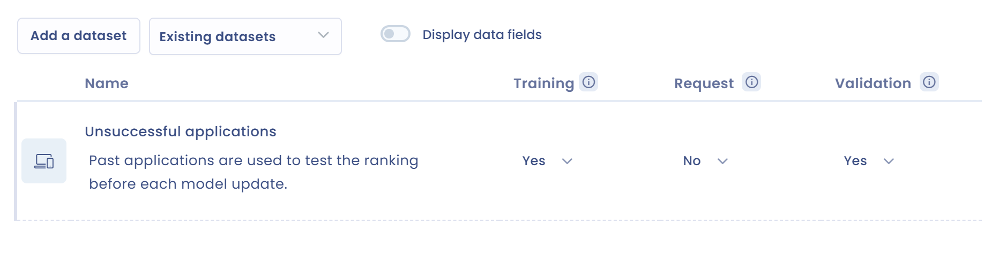
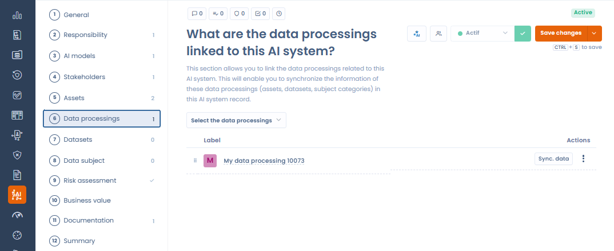
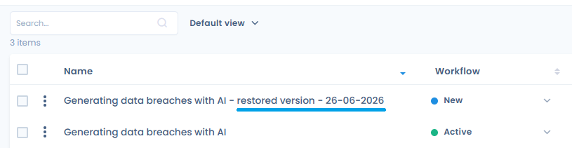

# Ein Verzeichnis der KI-Systeme erstellen

Um ein Verzeichnis Ihrer KI-Systeme aufzubauen, haben Sie zwei Möglichkeiten:

* Sie haben bereits ein Verzeichnis: Importieren Sie es direkt in Dastra. Siehe [Ihre KI-Systeme importieren](import.md).
* Sie haben keines: Legen Sie die KI-Systeme wie unten beschrieben einzeln an.

## Ein KI-System anlegen

Klicken Sie in der Seitenleiste auf **KI-Governance** und dann auf **KI-Systeme**. Klicken Sie anschließend auf **Ein neues KI-System erstellen**. Ein Fenster bietet drei Erstellungsmodi an:

<figure><figcaption>
Drei Erstellungsmodi: KI-Assistent, Vorlage oder leeres Formular
</figcaption></figure>

* **Erstellen mit KI-Assistent**: Der KI-Assistent erzeugt einen Datensatz aus einer kurzen Beschreibung des Systems (Name, Herausgeber, URL ...). Er nutzt die Websuche, um die Informationen anzureichern.
* **Basierend auf einer Vorlage**: Wählen Sie ein System aus der KI-Systembibliothek von Dastra oder aus einem anderen Mandanten.
* **Von Grund auf neu**: Legen Sie einen leeren Datensatz an und füllen Sie jedes Feld selbst aus. Geben Sie den Namen des Systems und seine Organisationseinheit ein.

Die Schaltfläche mit dem KI-Symbol links von der Schaltfläche **Ein neues KI-System erstellen** öffnet direkt die Erzeugung durch den KI-Assistenten.

### Ein KI-System mit dem KI-Assistenten erzeugen

Wählen Sie **Erstellen mit KI-Assistent** und beschreiben Sie dann das zu dokumentierende System (Name, Herausgeber ...). Sie können eine Datei anhängen oder eine URL angeben, um die Erzeugung zu unterstützen.

<figure><figcaption>
Beschreiben Sie das zu erzeugende KI-System (Name, verwendetes KI-Modell ...)
</figcaption></figure>

Der Assistent erstellt einen vorausgefüllten Datensatz, den Sie vor dem Speichern prüfen und bestätigen können.

<figure><figcaption>
Der erzeugte Datensatz sollte vor der Bestätigung geprüft werden: KI kann Fehler machen
</figcaption></figure>


Automatisch von KI erzeugte Daten können Fehler enthalten. Prüfen und korrigieren Sie den vorgeschlagenen Datensatz, bevor Sie ihn in Ihrem Verzeichnis speichern.


Sobald die erforderlichen Informationen gespeichert sind, öffnet Dastra den Datensatz des Systems, ein Formular mit 12 Schritten. Damit können Sie das KI-System so genau wie möglich beschreiben.

<figure><figcaption>
Die 12 Schritte des Datensatzes eines KI-Systems
</figcaption></figure>

## Die 12 Schritte des Formulars

Die Schritte stehen links im Datensatz, mit der Anzahl der erfassten Elemente oder einem Häkchen, wenn der Schritt ausgefüllt ist: **Allgemeines**, **Verantwortung**, **KI-Modelle**, **Interessengruppen**, **Assets**, **Datenverarbeitung**, **Daten**, **Betroffene Person**, **Risikostufe**, **Mehrwert**, **Dokumentation** und **Zusammenfassung**. Speichern Sie den Datensatz jederzeit mit **Speichern**.

### 1. Allgemeines

Geben Sie die grundlegenden Informationen zum KI-System ein:

* den Namen des Systems;
* eine interne Referenz, falls Sie eine haben;
* die Organisationseinheit;
* die Tags;
* die Beschreibung des Zwecks und der Funktionsweise des Systems;
* das Einführungsdatum.

### 2. Verantwortung

Legen Sie Ihre Rolle gemäß der KI-Verordnung fest. Eine Organisation kann je nach ihren Tätigkeiten mehrere Rollen innehaben:

* **Anbieter**: entwickelt ein KI-System oder lässt es entwickeln und bringt es unter eigenem Namen oder eigener Marke entgeltlich oder unentgeltlich in Verkehr oder nimmt es in Betrieb.
* **Betreiber**: verwendet ein KI-System in eigener Verantwortung im Rahmen einer beruflichen Tätigkeit.
* **Importeur**: bringt ein KI-System in der Union in Verkehr, das den Namen oder die Marke einer in einem Drittland niedergelassenen Person trägt.
* **Händler**: stellt ein KI-System auf dem Unionsmarkt bereit, ohne dessen Anbieter oder Importeur zu sein.
* **Bevollmächtigter**: eine in der Union niedergelassene Person, die von einem außerhalb der Union niedergelassenen Anbieter schriftlich bevollmächtigt wurde.
* **Produkthersteller**: Ist ein KI-System in ein Produkt integriert, das einer sektoralen Gesetzgebung unterliegt, zum Beispiel ein Medizinprodukt, gilt der Hersteller des Produkts als Anbieter dieses Systems.

Zu jeder Verantwortung können Sie eine Begründung hinzufügen. Bestimmen Sie Ihre Rollen genau: Sie legen Ihre Pflichten gemäß der KI-Verordnung fest.


Ist keine Verantwortung festgelegt, bietet Dastra einen Fragebogen zur Selbstbewertung der Rollen und Verantwortlichkeiten im Bereich KI an, mit der Schaltfläche **Selbstbewertung der Rollen und Verantwortlichkeiten im Bereich KI**. Sobald die Verantwortlichkeiten feststehen, kann der KI-Assistent eine Begründung erzeugen: Klicken Sie auf **Erstellen Sie mit KI eine Beschreibung der Verantwortlichkeiten**.


### 3. KI-Modelle

Geben Sie das oder die KI-Modelle an, die in diesem System verwendet werden, mit ihrer Beschreibung der Nutzung. Siehe [Das Verzeichnis der KI-Modelle](models.md).

### 4. Interessengruppen

Fügen Sie die Nutzer hinzu, die für dieses KI-System verantwortlich sind, und weisen Sie jedem eine Rolle zu.

### 5. Assets

Fügen Sie die Assets hinzu, die dieses KI-System unterstützen, zum Beispiel Infrastrukturkomponenten, Softwarewerkzeuge oder APIs. Diese Angabe ist optional: Mit ihr bilden Sie die Anwendungskette ab, die die Daten miteinander verbindet.

### 6. Datenverarbeitung

Verknüpfen Sie die Verarbeitungstätigkeiten Ihres DSGVO-Verzeichnisses mit diesem KI-System und synchronisieren Sie dann deren Informationen mit dem Datensatz. Siehe [Verknüpfte Verarbeitungstätigkeiten und Datensynchronisierung](#verknupfte-verarbeitungstatigkeiten-und-datensynchronisierung).

### 7. Daten

Listen Sie die Datenkategorien auf, die diesem KI-System zugeordnet sind: Klicken Sie auf **Einen Datensatz hinzufügen**, um eine anzulegen, oder auf **Verknüpfen Sie vorhandene Datensätze**, um aus Ihrem Verzeichnis zu wählen. Für jede Datenkategorie:

* beschreiben Sie im vorgesehenen Feld die Beziehung zwischen der Datenkategorie und dem KI-System;
* geben Sie in den drei Spalten **Schulung**, **Anfrage** und **Validierung** mit **Ja** oder **Nein** an, wie das System sie verwendet.

Jede der drei Spalten hat einen Hilfetext:

* **Schulung**: Die Daten werden verwendet, um ein KI-Modell zu trainieren, das heißt, es Muster, Zusammenhänge oder Klassifizierungen aus historischen Daten lernen zu lassen.
* **Anfrage**: Die Daten werden verwendet, um das KI-Modell abzufragen, zum Beispiel die Daten, die das System im tatsächlichen Betrieb verarbeitet.
* **Validierung**: Die Daten werden zur Validierung des KI-Modells verwendet, das heißt, um seine Leistung zu bewerten und seine Parameter einzustellen, um eine Überanpassung zu vermeiden.

Der Schalter **Felder anzeigen** zeigt die Datenfelder jeder Datenkategorie an. Dokumentieren Sie für jede Datenkategorie ihren Zweck, ihre Zusammensetzung und ihre Verbindung zum KI-System.

<figure><figcaption>
Der Schritt Daten eines KI-Systems
</figcaption></figure>

### 8. Betroffene Person

Fügen Sie die Kategorien betroffener Personen hinzu, deren personenbezogene Daten das KI-System verarbeitet, zum Beispiel Kunden, Beschäftigte oder Nutzer. Geben Sie an, ob schutzbedürftige Personen betroffen sind.

### 9. Risikostufe

Weisen Sie dem System eine Risikostufe gemäß der KI-Verordnung zu. Dieser Schritt kann auch Warnungen anzeigen, die an Ihre Rolle gebunden sind:

* **Inakzeptables Risiko**: Sind Sie Betreiber eines Systems, das als **Nicht akzeptabel** eingestuft ist, erinnert eine Warnung daran, dass Artikel 5 der KI-Verordnung den Einsatz verbietet.
* **Hohes Risiko**: Sind Sie Betreiber eines Systems, das als **Hohes Risiko** eingestuft ist, stellt eine Warnung den Anwendungsbereich von Artikel 27 der KI-Verordnung vor und bietet an, die [Grundrechte-Folgenabschätzung (FRIA)](fria.md) durchzuführen.

Einzelheiten zu diesem Schritt finden Sie unter [Risikoanalyse und Mehrwert](risk-analysis.md).

### 10. Mehrwert

Bewerten Sie den geschäftlichen Mehrwert des Systems für Ihre Organisation. Diese Bewertung hilft Ihnen, Projekte mit hohem Mehrwert zu priorisieren. Siehe [Risikoanalyse und Mehrwert](risk-analysis.md).

### 11. Dokumentation

Geben Sie an, ob ein Informationshinweis existiert, verfassen oder erzeugen Sie ihn und fügen Sie die Dokumente des Systems an: Hinweise, technische Leitfäden, Compliance-Bewertungen. Siehe [Transparenzhinweis](transparency-notice.md).

### 12. Zusammenfassung

Prüfen Sie die Zusammenfassung aller für dieses KI-System erfassten Informationen, bevor Sie den Datensatz abschließen.

## Verknüpfte Verarbeitungstätigkeiten und Datensynchronisierung

Der Schritt **Datenverarbeitung** im Datensatz eines KI-Systems verknüpft eine oder mehrere Verarbeitungstätigkeiten Ihres DSGVO-Verzeichnisses mit diesem System. Diese Verknüpfung hält Ihr Verzeichnis der Verarbeitungstätigkeiten und Ihr Verzeichnis der KI-Systeme konsistent.

<figure><figcaption>
Der Schritt Datenverarbeitung listet die mit diesem KI-System verknüpften DSGVO-Verarbeitungstätigkeiten auf
</figcaption></figure>

### Daten einer Verarbeitungstätigkeit synchronisieren

Für jede verknüpfte Verarbeitungstätigkeit importiert die Schaltfläche **Synchronisierung von Daten** die Elemente der Verarbeitungstätigkeit in den Datensatz des KI-Systems: Assets, Datenkategorien und Kategorien betroffener Personen.

<figure><figcaption>
Die Schaltfläche zur Datensynchronisierung importiert die Daten der Verarbeitungstätigkeit in den Datensatz des KI-Systems
</figcaption></figure>

Ein Fenster listet die zu importierenden Elemente auf. Sie können genau die auswählen, die hinzugefügt werden sollen.

<figure><figcaption>
Die Elemente auswählen, die von der Verarbeitungstätigkeit in das KI-System synchronisiert werden
</figcaption></figure>

### Verknüpfte KI-Systeme in einer Verarbeitungstätigkeit anzeigen

Umgekehrt listet das Feld **Verbundene KI-Systeme** im Datensatz einer Verarbeitungstätigkeit alle KI-Systeme auf, die ihr zugeordnet sind.

<figure><figcaption>
Das Feld „Verbundene KI-Systeme“ ist im Datensatz jeder Verarbeitungstätigkeit verfügbar
</figcaption></figure>

Diese wechselseitige Verknüpfung erleichtert Audits und die Dokumentation der Compliance mit der KI-Verordnung ausgehend vom DSGVO-Verzeichnis.

## Nutzer einladen, den Datensatz zu vervollständigen

Klicken Sie in einem Datensatz auf die Schaltfläche mit dem Symbol für Nutzer, **Bittet die Nutzer, dieses KI-System zu vervollständigen**. Gehen Sie im Fenster so vor:

1. Wählen Sie den **Abschnitt** des Datensatzes, der zu vervollständigen ist.
2. Wählen Sie die **Einzuladende Nutzer** aus. Sie benötigen mindestens das Recht **Schreiben** oder, wenn sie Interessengruppen des Systems sind, das Recht **Lesen/Schreiben eigener Elemente**.
3. Verfassen Sie die **Einladungsnachricht** oder wählen Sie eine Nachrichtenvorlage aus.
4. Klicken Sie auf **Eine Einladung senden**.

## Weitere Aktionen zu einem KI-System

Im Verzeichnis der KI-Systeme bietet das Menü jeder Zeile **Bearbeiten**, **Duplizieren** und **In den Papierkorb verschieben**. In einem Datensatz bietet das Menü der Schaltfläche **Speichern** insbesondere:

* **Überprüfung**: markiert den Datensatz als überprüft. Die Aktion erscheint für ein System im Status **In Bearbeitung**, wenn die regelmäßige Überprüfung für KI-Systeme aktiviert ist. Siehe [Regelmäßige Überprüfung (Aktualität)](../regular-review.md);
* **Exportieren**: exportiert den Datensatz als CSV, Excel, JSON, HTML, Word, PDF oder Markdown;
* **Informationsblatt erstellen** und **Die Informationsnotiz exportieren**: siehe [Transparenzhinweis](transparency-notice.md);
* **In den Papierkorb verschieben**.

Das Menü der Schaltfläche **Ein neues KI-System erstellen** im Verzeichnis der KI-Systeme bietet außerdem **Erstellen Sie auf der Grundlage von Vorlagen**, **Importieren**, **Exportieren** und **Regelmäßige Überprüfung (Aktualität) konfigurieren**, das die Einstellungen der regelmäßigen Überprüfung für KI-Systeme öffnet.

## Eine frühere Version wiederherstellen

Das Feld **Aktivitätsverlauf** im Datensatz eines KI-Systems bewahrt jede Erstellung und jede Änderung auf. Sie können eine frühere Version direkt aus diesem Feld wiederherstellen.

<figure><figcaption>
Jede Version im Aktivitätsverlauf bietet eine Schaltfläche zum Wiederherstellen
</figcaption></figure>

Jeder Eintrag im Verlauf zeigt eine Schaltfläche zum Wiederherstellen, die für Nutzer mit Schreibrecht sichtbar ist. Nach der Bestätigung erstellt Dastra aus den Daten der gewählten Version ein **neues KI-System**. Sein Name erhält den Zusatz "- restored version - [date]", und Sie werden zu diesem neuen Datensatz weitergeleitet. Das ursprüngliche KI-System bleibt unverändert.

<figure><figcaption>
Die wiederhergestellte Version erscheint als neues KI-System mit dem Zusatz „- restored version - [date]“
</figcaption></figure>
