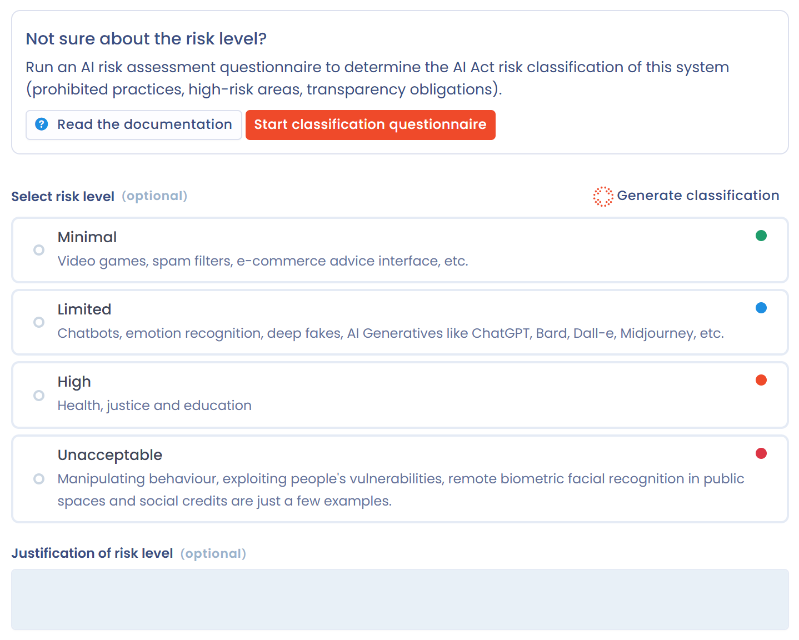

# Risikoanalyse und Mehrwert

Zwei Schritte im Datensatz eines KI-Systems bewerten das System: **Risikostufe** für seine Risikostufe und **Mehrwert** für seinen Wert für Ihre Organisation. Diese Seite beschreibt beide Schritte und die Hilfe, die der KI-Assistent beim Ausfüllen gibt.

## Einstufung der Risikostufe

Im Schritt **Risikostufe** weisen Sie jedem System eine von vier Risikostufen zu: **Minimal**, **Begrenztes Risiko**, **Hohes Risiko** oder **Nicht akzeptabel**. Diese Stufen stammen aus der KI-Verordnung, vom minimalen bis zum inakzeptablen Risiko. Unter jeder Stufe zeigt Dastra Beispiele für die betroffenen Systeme.

Begründen Sie die gewählte Stufe im Feld **Begründung der Risikostufe**. Es steht zur Verfügung, sobald eine Stufe ausgewählt ist.

<figure><figcaption>
Der Schritt Risikostufe eines KI-Systems
</figcaption></figure>

### Risikostufen gemäß der KI-Verordnung

Die KI-Verordnung teilt KI-Systeme in vier Kategorien ein. Jede bringt andere Pflichten mit sich.

#### Minimales Risiko

KI-Systeme, deren Risiko für die Grundrechte oder die Sicherheit von Menschen vernachlässigbar oder null ist.

Beispiele: Spamfilter, Empfehlungssysteme für Inhalte ohne nennenswerte Auswirkung, KI in Videospielen.

Pflichten: Die KI-Verordnung legt keine besonderen fest, aber die allgemeinen Vorschriften gelten weiterhin, etwa die DSGVO und die Pflicht, die KI-Kompetenz des Personals sicherzustellen (Artikel 4).

#### Begrenztes Risiko

KI-Systeme, die gegenüber den Nutzern Transparenzpflichten unterliegen, ohne ihre Rechte wesentlich zu beeinträchtigen.

Beispiele: Chatbots für Gespräche, zu Unterhaltungszwecken erzeugte Deepfakes.

Pflichten:

* den Nutzer darüber informieren, dass er mit einem KI-System interagiert;
* offenlegen, dass Inhalte von KI erzeugt oder verändert wurden.

#### Hohes Risiko

KI-Systeme, die ein erhebliches Risiko für Gesundheit, Sicherheit oder Grundrechte darstellen. Sie unterliegen einem strengen Rahmen aus Compliance und Bewertung.

Beispiele:

* Kredit-Scoring;
* automatisierte Personalauswahl, zum Beispiel die Vorauswahl von Bewerbungen;
* biometrische Identifizierung außerhalb verbotener Praktiken;
* KI in Medizinprodukten oder kritischen Infrastrukturen.

Pflichten:

* Konformitätsbewertung, bevor das System in Verkehr gebracht wird;
* Risikomanagement;
* Governance der verwendeten Daten;
* Transparenz und ausführliche technische Dokumentation;
* menschliche Aufsicht und Rückverfolgbarkeit.


Artikel 27 der KI-Verordnung verlangt von einigen Betreibern von Hochrisiko-Systemen eine Grundrechte-Folgenabschätzung: Betreiber, die dem öffentlichen Recht unterliegen, private Stellen, die öffentliche Dienste erbringen, und Betreiber bestimmter Systeme im Finanzsektor. Siehe [Grundrechte-Folgenabschätzung (FRIA)](fria.md).


#### Inakzeptables Risiko

KI-Systeme, die verboten sind, weil sie den Werten der Europäischen Union widersprechen oder Grundrechte verletzen.

Beispiele:

* Social Scoring von Personen;
* biometrische Echtzeit-Fernidentifizierung in öffentlich zugänglichen Räumen zu Strafverfolgungszwecken, außerhalb strenger Ausnahmen;
* unterschwellige Manipulation von Menschen.

Pflichten: Das Inverkehrbringen und die Nutzung in der Europäischen Union sind verboten.

Die Wahl der richtigen Risikostufe hilft Ihnen, die anwendbaren Pflichten zu bestimmen, Compliance-Maßnahmen zu priorisieren und klar mit Ihren Fach- und Rechtsteams zu kommunizieren.

### Die Klassifizierung mit KI erzeugen

Enthält Ihr Plan die entsprechenden KI-Funktionen, erscheint die Schaltfläche **Klassifizierung generieren** über der Stufenauswahl. Sie schlägt anhand der bereits im Datensatz erfassten Informationen eine Risikostufe vor.

1. Klicken Sie auf **Klassifizierung generieren**. Das Fenster listet die Daten auf, die an das KI-Modell übermittelt werden: Name des Systems, Beschreibung, Modelle, Rolle gemäß der KI-Verordnung, Assets, verknüpfte Verarbeitungstätigkeiten, Datenkategorien und Kategorien betroffener Personen.
2. Klicken Sie auf **Generieren**.
3. Lesen Sie den Vorschlag: die Risikostufe, eine Begründung, die die anwendbaren Bestimmungen der KI-Verordnung nennt, den Konfidenzwert der Analyse und die fehlenden Informationen, die die Klassifizierung ändern oder festigen könnten.
4. Klicken Sie auf **Bitte füllen Sie das Formular aus**, um die Stufe und die Begründung in den Schritt zu übernehmen, oder auf **Zurück**, um die Erzeugung erneut auszuführen.
5. Prüfen Sie das Ergebnis, korrigieren Sie es bei Bedarf und speichern Sie dann den Datensatz.

<figure><figcaption>
Eine vom KI-Assistenten vorgeschlagene Klassifizierung
</figcaption></figure>


Der Vorschlag des KI-Assistenten hilft Ihnen bei der Klassifizierung des Systems. Er ersetzt nicht Ihre rechtliche Analyse. Prüfen Sie ihn, bevor Sie ihn übernehmen.


### Fragebogen zur Klassifizierung

Solange keine Risikostufe festgelegt ist, bietet ein Feld **Benötigen Sie Unterstützung bei der Ermittlung der Risikostufe?** an, einen Fragebogen zur KI-Risikobewertung durchzuführen. Er hilft Ihnen, die Klassifizierung des Systems gemäß der KI-Verordnung zu bestimmen: verbotene Praktiken, Hochrisiko-Bereiche und Transparenzpflichten.

Klicken Sie auf **Eine Risikobewertung durchführen** und wählen Sie eine Vorlage vom Typ **Risikoanalyse eines KI-Systems**. Der Fragebogen wird wie jeder andere geplant: Siehe [Einen Fragebogen planen](../questionnaires/schedule.md). Zeigt das Fenster keine Vorlage an, installieren Sie eine aus der Bibliothek, wie bei der [Folgenabschätzung](fria.md). Das Feld erscheint, wenn Ihr Plan das Modul **Fragebögen** enthält und Sie Fragebögen erstellen können.

## Geschäftlicher Mehrwert eines KI-Systems

Der Schritt **Mehrwert** bewertet den Wert des Systems für Ihre Organisation. Wählen Sie eine der drei Stufen **Niedrig**, **Mittel** oder **Hoch** und erläutern Sie dann im Feld **Begründung des Nutzens**, was das System konkret bringt, zum Beispiel:

* einen Gewinn an operativer Leistung;
* eine Verbesserung der Servicequalität;
* eine Verringerung von Risiken oder Kosten.

<figure><figcaption>
Der Schritt Mehrwert eines KI-Systems
</figcaption></figure>

### Die Bewertung mit KI erzeugen

Die Schaltfläche **Bewertung generieren** funktioniert wie **Klassifizierung generieren**. Der KI-Assistent prüft den Kontext des Datensatzes (Zweck, Modelle, Assets, verknüpfte Verarbeitungstätigkeiten) und schlägt eine Stufe des geschäftlichen Mehrwerts mit einer Begründung vor. Klicken Sie auf **Generieren**, prüfen Sie den Vorschlag und klicken Sie dann auf **Bitte füllen Sie das Formular aus**. Korrigieren Sie den Text bei Bedarf und speichern Sie den Datensatz.

## Warum beide Schritte ausfüllen

Mit der Angabe von Risikostufe und geschäftlichem Mehrwert sehen Sie, ob ein KI-System eher eine strategische Chance für Ihre Organisation oder angesichts seines geringen Nutzens ein unverhältnismäßiges Risiko ist. Ein Hochrisiko-System mit geringem geschäftlichem Mehrwert rechtfertigt möglicherweise nicht, im Betrieb zu bleiben.

Diese kombinierte Analyse unterstützt Ihre Abwägungen und die Ausrichtung Ihres KI-Portfolios an Ihren strategischen und regulatorischen Prioritäten.
