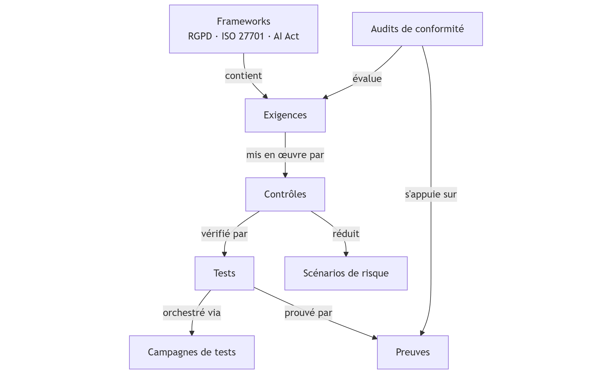

# Compliance

Das Modul **Compliance** von Dastra ermöglicht es, die regulatorische Compliance strukturiert, nachvollziehbar und auditierbar zu verwalten. Es beruht auf einer modularen Architektur, die an den Compliance-Frameworks ausgerichtet ist.

***

## Im Modul navigieren

Im Menü bietet **Compliance** vier Einträge:

* **Projekte**: die Compliance-Projekte, ihre Phasen, ihre Audits und Ihre Aufgaben. Siehe [Projekte](projects/README.md).
* **Bibliothek**: die wiederverwendbaren Frameworks, Kontrollen, Tests, Risiken und Bedrohungen. Siehe [Bibliothek](library/README.md).
* **Scopes**: die Organisationseinheiten, die ein Projekt abdeckt. Siehe [Scopes](scopes.md).
* **Statistiken**: das Compliance-Dashboard des Mandanten (siehe unten).

***

## Architektur des Compliance-Moduls

Das Modul beruht auf einer logischen Kette von Objekten, von den regulatorischen Frameworks bis zu den Compliance-Nachweisen.

<figure><figcaption></figcaption></figure>

### Frameworks

Beispiele: DSGVO, ISO 27701, ISO 27001, KI-Verordnung.

Ein Framework:

* definiert den regulatorischen oder normativen Rahmen,
* enthält eine Reihe anwendbarer Anforderungen.

***

### Anforderungen

Anforderungen stellen die Verpflichtungen dar, die sich aus einem Framework ergeben.\
Beispiele: Zugriffskontrolle, Berechtigungsverwaltung, Protokollierung.

Jede Anforderung:

* ist einem Framework zugeordnet,
* wird bei Compliance-Audits bewertet,
* wird durch eine oder mehrere Kontrollen umgesetzt.

***

### Kontrollen

Kontrollen beschreiben, **wie** eine Anforderung konkret umgesetzt wird.\
Beispiele: regelmäßige Überprüfung der Zugriffsrechte, Berechtigungsverfahren.

Eine Kontrolle:

* setzt eine Anforderung um,
* ist mit einem oder mehreren Risikoszenarien verknüpft,
* wird anhand von Tests überprüft.

***

### Risikoszenarien

Risikoszenarien beschreiben die befürchteten Ereignisse. Sie erscheinen in der Anwendung als **Risiken**.\
Beispiel: unbefugter Zugriff auf sensible Daten.

Kontrollen ermöglichen es:

* diese Risiken zu verhindern oder zu verringern,
* die ergriffenen Abhilfemaßnahmen nachzuweisen.

***

### Tests

Tests dienen dazu, die Wirksamkeit der Kontrollen zu überprüfen.\
Beispiele: wiederkehrende Überprüfung der Zugriffsrechte, Delegation der Freigabe.

Ein Test:

* prüft eine oder mehrere Kontrollen,
* liefert messbare Ergebnisse,
* wird durch Nachweise gestützt.

***

### Testkampagnen

Kampagnen ermöglichen es, Tests im großen Maßstab zu steuern:

* Versand der Kampagnen an Teams oder Kunden,
* zentrale Erfassung der Antworten,
* Verfolgung von Fortschritt und Status.

***

### Nachweise

Nachweise belegen die Compliance.\
Beispiele: Richtlinien, Verfahren, Berichte über die Überprüfung der Zugriffsrechte.

Ein Nachweis:

* ist einem Test zugeordnet,
* wird bei Audits verwendet,
* gewährleistet die Nachvollziehbarkeit der Kontrollen.

***

### Compliance-Audits

Audits ermöglichen es, den Compliance-Grad zu bewerten:

* interne Audits,
* Selbstbewertungen,
* Vorbereitung auf externe Audits.

Sie stützen sich auf:

* die Anforderungen,
* die Kontrollen,
* die zugehörigen Tests und Nachweise.

***

### Gesamtüberblick

Das Compliance-Modul von Dastra ermöglicht es somit:

* regulatorische Anforderungen zu strukturieren,
* Verpflichtungen mit Risiken zu verknüpfen,
* die Compliance durch getestete und dokumentierte Kontrollen nachzuweisen,
* Audits und Zertifizierungen effizient vorzubereiten.

### Das Multi-Framework-Prinzip in Dastra

Das Compliance-Modul von Dastra ist **nativ multi-frameworkfähig**.

Das bedeutet:

* ein **Framework** (DSGVO, ISO, KI-Verordnung …) enthält seine eigenen Anforderungen,
* eine **Anforderung** gehört zu **einem Framework**,
* eine **Kontrolle kann mehrere Anforderungen abdecken**, auch solche aus **verschiedenen Frameworks**,
* **Tests und Nachweise** werden gemeinsam genutzt und sind wiederverwendbar.

Ziel: **Doppelarbeit vermeiden** und die Compliance bereichsübergreifend steuern.

***

### Wichtige Beziehungen zwischen den Objekten

* ein **Framework** enthält mehrere **Anforderungen** (1 zu N),
* **Anforderungen** und **Kontrollen**: N-zu-N-Beziehung,
* **Kontrollen** und **Tests**: N-zu-N-Beziehung,
* ein **Test** wird durch mehrere **Nachweise** gestützt (1 zu N),
* **Kontrollen** und **Risikoszenarien**: N-zu-N-Beziehung.

Eine einzige Kontrolle (zum Beispiel die Überprüfung der Zugriffsrechte) kann somit:

* eine Anforderung der DSGVO erfüllen,
* eine Anforderung der ISO 27001 erfüllen,
* mehrere Risikoszenarien verringern.

Erläuterndes Schaubild:

<figure><figcaption></figcaption></figure>

***

## Statistiken

**Compliance** > **Statistiken** öffnet das **Compliance-Dashboard**, das alle Projekte des Mandanten zusammenführt. Sie können es nach **Status** (Projektphase), **Organisationseinheiten** und **Scopes** filtern.

Das Dashboard enthält:

* globale Kennzahlen. Kontrollen: **Gesamtzahl der Kontrollen**, **Validierte Kontrollen**, **Nicht implementiert** und **Ohne Zuordnung** (Kontrollen ohne zugehörige Anforderung). Tests: **Gesamtzahl der Tests**, **Validierte Tests**, **Fehlgeschlagene Tests** und **Fehlende Nachweise**. Audits: **Gesamtzahl der Audits**, **Abgeschlossene Audits** und **Durchschnittliche Compliance**, mit der Verteilung der Anforderungen auf **Konform**, **Teilweise konform**, **Nicht konform** und **Nicht zutreffend**;
* **Fortschritte bei den Frameworks**: für jedes Framework die Anzahl der Projekte und der Fortschritt bei Kontrollen, Tests, Anforderungen und Risiken;
* **Compliance-Projekte nach Schritt**: die Verteilung der Projekte nach Phase;
* **Anforderungen nach Scope**: der Compliance-Grad jedes Scopes.

<figure><figcaption></figcaption></figure>
