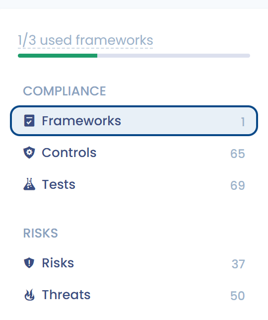

# Bibliothek

Die Bibliothek bildet die **gemeinsame Grundlage**, auf der die Frameworks, die Compliance-Projekte und das Risikomanagement aufbauen.



In der Bibliothek können Sie erstellen, strukturieren und pflegen:

* **Frameworks** (Compliance-Frameworks) und ihre **Anforderungen**,
* **Kontrollen**, die zentralen Elemente, die Anforderungen, Tests und Risiken verbinden,
* **Tests**, die die Kontrollen überprüfen,
* sowie die zugehörigen **Risiken** und **Bedrohungen**.



<figure><figcaption></figcaption></figure>




Die Bibliothek ermöglicht einen **übergreifenden und wiederverwendbaren Ansatz** für die Compliance:\
Eine einzelne Kontrolle kann mehrere Anforderungen abdecken, von mehreren Frameworks gemeinsam genutzt und mithilfe standardisierter Tests bewertet werden.\
Diese Zentralisierung erleichtert die Governance, verbessert die Kohärenz der Frameworks und bietet dank eigener Kennzahlen und Statistiken einen Gesamtüberblick.
