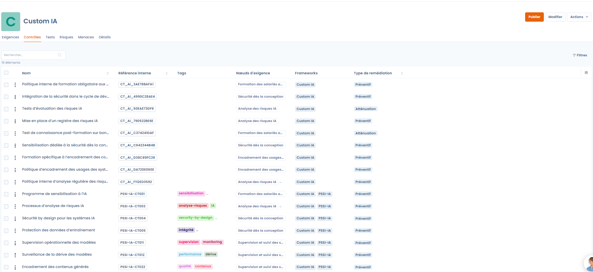
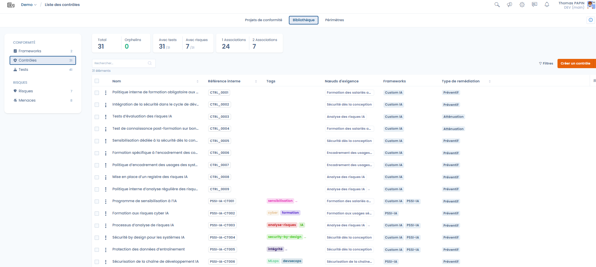
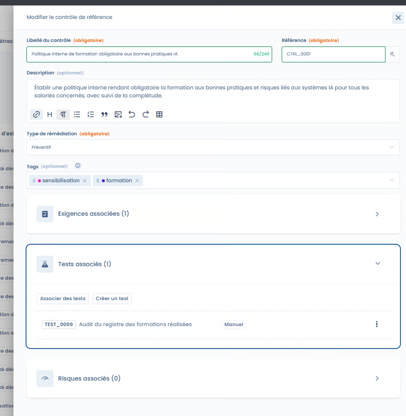
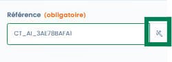
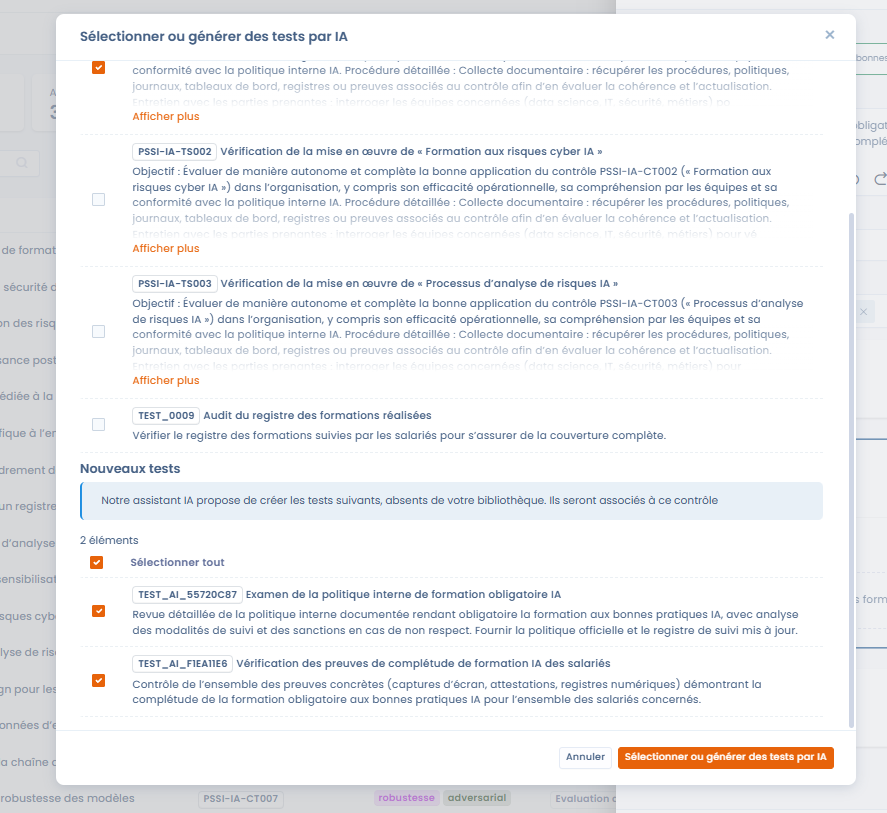
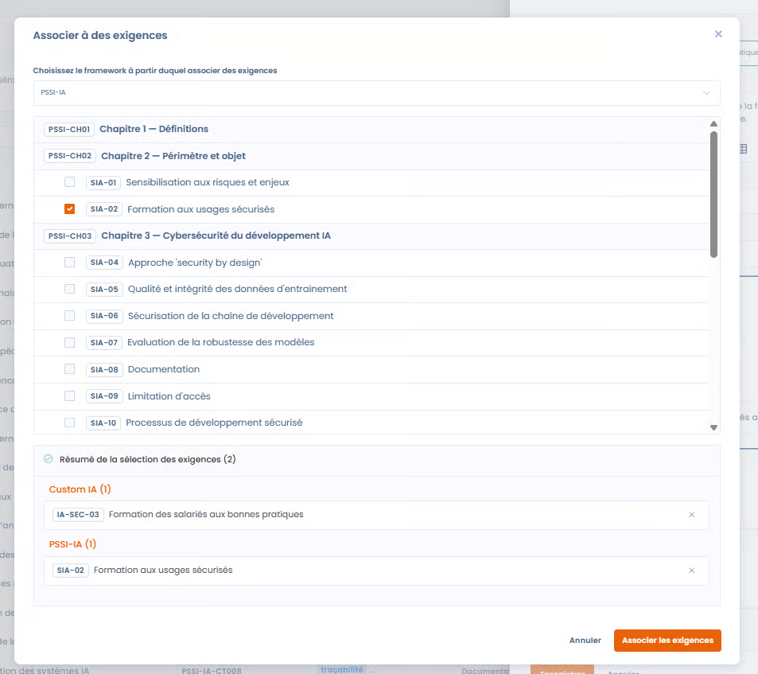
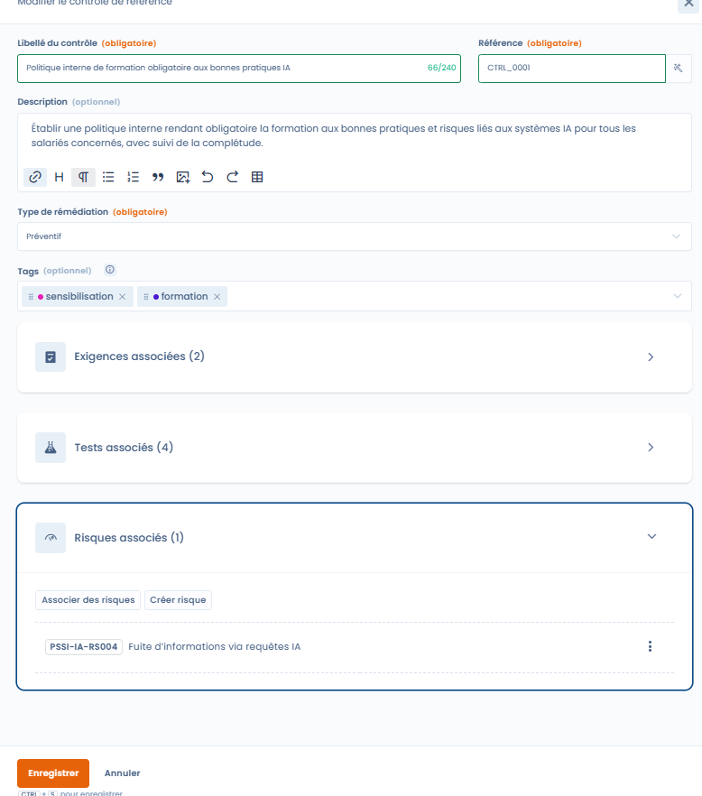
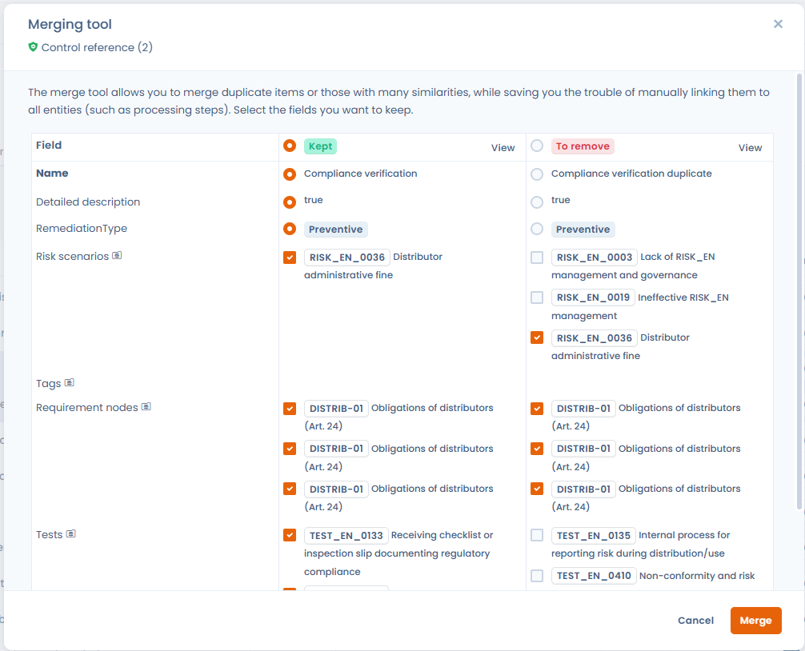

# Kontrollen

Kontrollen übersetzen die Anforderungen eines Frameworks in **konkrete Maßnahmen**, die messbar und auditierbar sind, und ermöglichen es, die Wirksamkeit der Compliance im Zeitverlauf nachzuweisen.

Eine Kontrolle kann:

* **eine oder mehrere Anforderungen** abdecken
* von **mehreren Frameworks** gemeinsam genutzt werden
* mit **Tests** und **Risiken** verknüpft werden

***

## Kontrollen verfolgen und verwalten

<figure><figcaption></figcaption></figure>

Kontrollen lassen sich über zwei sich ergänzende Einstiegspunkte verfolgen.

***

### 1. Vom Framework aus

Im Tab **Kontrollen** eines Frameworks sehen Sie:

* die Kontrollen, die den Anforderungen des Frameworks zugeordnet sind
* ihre Art der Behebung
* die abgedeckten Anforderungen
* die zugehörigen Tests und Risiken

Diese Ansicht ist nützlich, um:

* die Abdeckung eines Frameworks zu verstehen
* die Schlüsselkontrollen zu identifizieren
* die Compliance nach Framework zu steuern

***

### 2. Aus der Kontrollbibliothek

<figure><figcaption></figcaption></figure>

Die **Kontrollbibliothek** zentralisiert alle Kontrollen der Organisation, über sämtliche Frameworks hinweg.

Diese Ansicht ermöglicht es,

* **globale Statistiken** zu nutzen (Kontrollen mit Tests, Risiken, Mehrfachzuordnungen, verwaiste Kontrollen)
* Kontrollen zu identifizieren, die in mehreren Frameworks wiederverwendet werden
* die **Qualität und Kohärenz** der Kontrollbibliothek zu verbessern

***

## Bearbeitungsfenster einer Kontrolle



Im Bearbeitungsfenster legen Sie die Rolle der Kontrolle und ihre Verbindungen zum übrigen Framework-Bestand genau fest.



<figure><figcaption></figcaption></figure>



***

### Bezeichnung und Referenz der Kontrolle

* **Bezeichnung der Kontrolle**\
  Beschreibt klar die umgesetzte Aktion oder Maßnahme.
* **Referenz der Kontrolle**\
  Eindeutige Kennung der Kontrolle in der Bibliothek.



Ein **Referenzgenerator** schlägt automatisch eine Referenz vor, die stimmig ist mit:

* dem Kontext der Kontrolle
* den Namenskonventionen
* den zugehörigen Frameworks

Sie können die vorgeschlagene Referenz frei anpassen.



<figure><figcaption></figcaption></figure>



***

### Art der Behebung

Jede Kontrolle muss einer **Art der Behebung** zugeordnet werden, die ihre Natur festlegt:

* **Präventiv**\
  Die Kontrolle zielt darauf ab, den Eintritt eines Risikos zu **verhindern**\
  _(z. B. Schulung, Zugriffsregeln, Freigabe vor der Produktivsetzung)_
* **Minderung**\
  Die Kontrolle zielt darauf ab, **Auswirkung oder Eintrittswahrscheinlichkeit** eines bereits bestehenden Risikos **zu verringern**\
  _(z. B. Überwachung, Erkennung, Minderungsplan)_

Diese Unterscheidung dient dazu,

* die Strategie des Risikomanagements zu analysieren
* Prävention und Erkennung auszubalancieren
* den Reifegrad der Compliance zu steuern

***

### Tags

Tags ermöglichen es,

* Kontrollen zu kategorisieren (z. B. Schulung, KI, Sicherheit, Überwachung)
* die Suche und das Filtern zu erleichtern
* die vorherrschenden Themen der Bibliothek zu analysieren

***

## Tests zuordnen

[**Tests**](tests.md) ermöglichen es, das Vorhandensein, die Anwendung und die Wirksamkeit einer Kontrolle zu überprüfen.

### Zuordnung mit KI-Unterstützung



<figure><figcaption></figcaption></figure>



Die KI-Unterstützung schlägt vor:

* **bestehende Tests** der Bibliothek, die für die Kontrolle relevant sind
* bei Bedarf die **Erstellung neuer Tests**

Dieser Ansatz gewährleistet:

* Kohärenz zwischen Kontrollen und Tests
* Zeitersparnis
* Vereinheitlichung der Auditmethoden



***

## Anforderungen zuordnen



Eine Kontrolle kann zugeordnet werden:

* mehreren Anforderungen desselben Frameworks
* Anforderungen **verschiedener Frameworks**

Im Abschnitt **Verwandte Anforderungen** des Bearbeitungsfensters sind die Anforderungen nach Framework gruppiert; neben dem Namen steht die Versionsnummer des Quell-Frameworks (z. B. _Version 2_).

Dies ermöglicht es,

* Kontrollen gemeinsam zu nutzen
* eine interne Kontrolle mit einem regulatorischen Framework zu verknüpfen
* Brücken zwischen Frameworks zu schlagen (z. B. Custom AI ↔ AI ISSP)



<figure><figcaption></figcaption></figure>



***

## Risiken zuordnen



<figure><figcaption></figcaption></figure>



Kontrollen können zugeordnet werden:

* **bestehenden** [**Risiken**](risks.md)
* oder **neuen Risiken**, die direkt im Datenblatt der Kontrolle erstellt werden

Die Zuordnung ermöglicht es,

* die von einer Kontrolle abgedeckten Risiken anzuzeigen
* die Wirkung der Kontrolle auf das Restrisiko zu bewerten
* ein stimmiges Risikomanagement aufzubauen



***

## Kontrollen zusammenführen

Mit der Zeit kann die Kontrollbibliothek redundante oder nahezu identische Kontrollen aus verschiedenen Frameworks enthalten. Die Funktion **Zusammenführen** ermöglicht es, sie in einer einzigen Referenzkontrolle zu konsolidieren.

### So funktioniert die Zusammenführung

Wählen Sie in der Kontrollbibliothek oder in einem Projekt die zusammenzuführenden Kontrollen aus (bis zu 30) und lösen Sie die Zusammenführung über die **Sammelaktionen** aus. Ein Assistent fordert Sie auf, die **Reference version** zu wählen, also die Kontrolle, die erhalten bleibt. Die Zuordnungen der anderen Kontrollen (Nachweise, Anforderungen, Risikoszenarien, abgedeckte Kontrollen) werden ohne Datenverlust auf sie übertragen, anschließend werden die anderen Kontrollen gelöscht.


Die Zuordnung erfolgt **vollständig manuell**: Dastra erkennt Duplikate nicht automatisch. Sie wählen selbst die ähnlichen Kontrollen aus, die konsolidiert werden sollen.


<figure><figcaption>
Wählen Sie bis zu 30 Kontrollen aus und lösen Sie die Zusammenführung über die Sammelaktionen aus
</figcaption></figure>

Die Vergleichstabelle zeigt die Kontrollen nebeneinander, eine Spalte pro Kontrolle. Wählen Sie die Kontrolle, die erhalten bleiben soll, über die Optionsschaltfläche ihrer Spalte: Sie trägt die Bezeichnung **Reference version**. Die anderen Spalten tragen die Bezeichnung **Keep selected fields**: Nur die Felder, die Sie dort ankreuzen, werden in die Referenzversion übernommen (**Select all** kreuzt die gesamte Spalte an).

<figure><figcaption>
Vergleichen Sie die Kontrollen nebeneinander und wählen Sie Feld für Feld die Werte, die erhalten bleiben sollen: Nachweise, Anforderungen, Risikoszenarien und abgedeckte Kontrollen werden auf die erhaltene Kontrolle übertragen
</figcaption></figure>


Die Zusammenführung ist unwiderruflich. Prüfen Sie die Zuordnungen jeder Kontrolle, bevor Sie den Vorgang bestätigen.


### Typische Anwendungsfälle

* **Deduplizierung**: Mehrere Framework-Importe haben gleichwertige Kontrollen erzeugt: Die Zusammenführung konsolidiert sie ohne Informationsverlust.
* **Übergreifende gemeinsame Nutzung**: Eine Kontrolle, die sowohl ISO 27001 als auch das Framework der KI-Verordnung abdeckt, lässt sich durch Zusammenführen der Kontrollen beider Frameworks gewinnen.
* **Bereinigung der Bibliothek**: Vor einem Audit verbessert das Entfernen verwaister oder redundanter Kontrollen die Lesbarkeit des Compliance-Dashboards.

***

## Zusammenfassung: Warum Kontrollen zentral sind

In Dastra sind Kontrollen der **Konvergenzpunkt** zwischen:

* den Anforderungen (was erwartet wird)
* den Tests (was überprüft wird)
* den Risiken (was gesteuert wird)

Dieser Ansatz ermöglicht:

* eine operative und messbare Compliance
* eine übergreifende Governance
* die Wiederverwendung der Compliance-Anstrengungen
