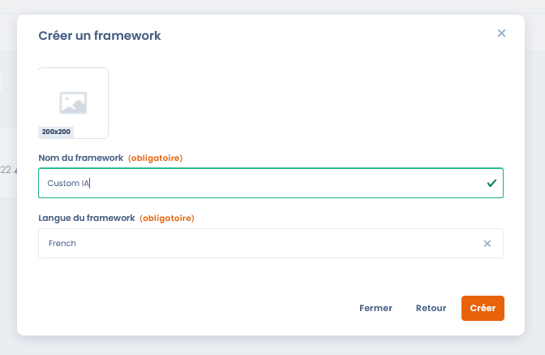
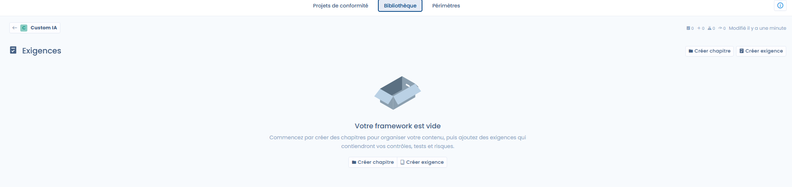
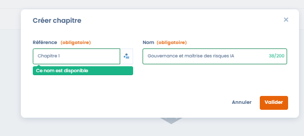
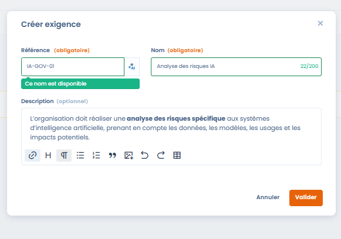
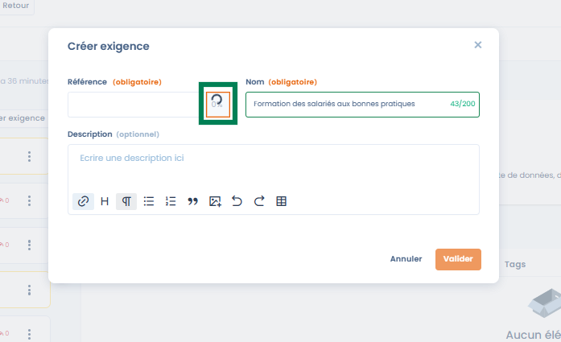
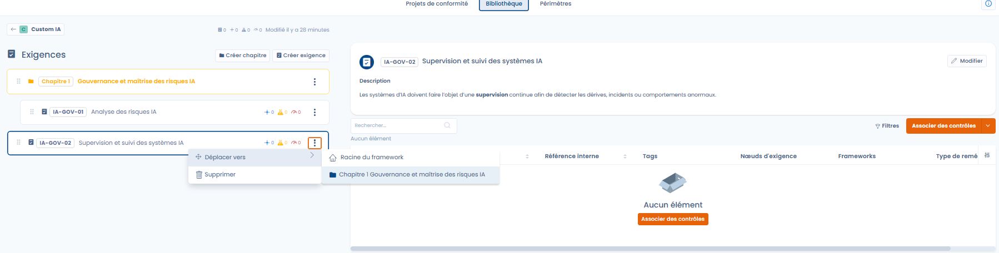
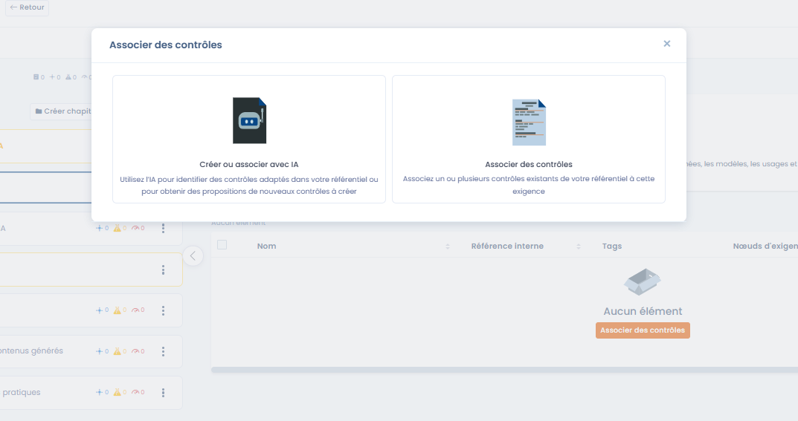
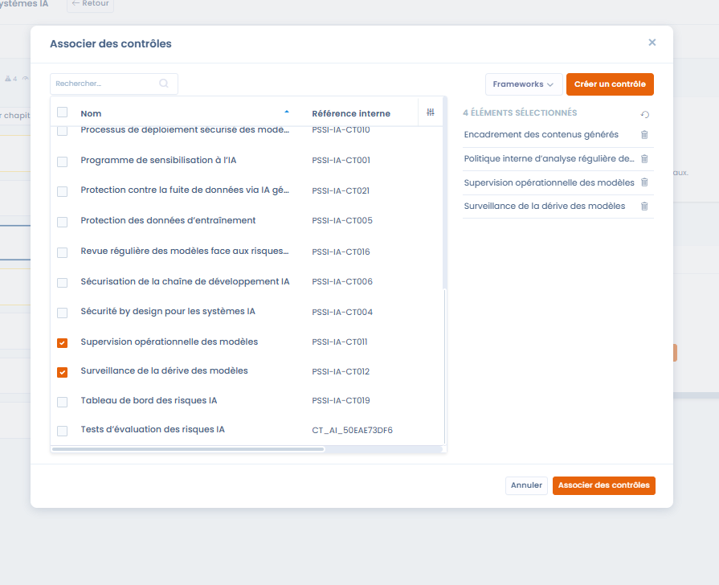
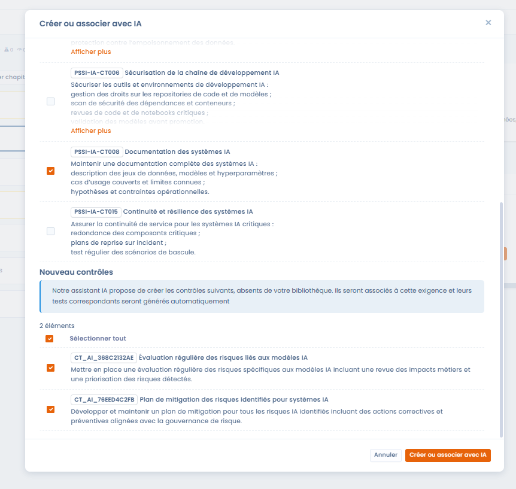

# Benutzerdefiniertes Framework erstellen

## Einführung

Mit einem benutzerdefinierten Framework bauen Sie ein Compliance-Framework auf, das **an den spezifischen Kontext der Organisation angepasst** ist: interne Richtlinie, branchenspezifisches Framework, KI-Initiative, Sicherheit, Qualität oder Governance.

Ein benutzerdefiniertes Framework kann:

* **vollständig von Grund auf** aufgebaut werden,
* oder als **gemeinsame Grundlage** für mehrere Compliance-Projekte dienen.

***

## Schritt 1: Das Framework erstellen



Beim Erstellen eines benutzerdefinierten Frameworks legen Sie fest:

* **Den Namen des Frameworks** (z. B. _Custom AI_, _AI ISSP, Demo_)
* **Die Sprache des Frameworks**, die die Standardsprache der Anforderungen und Kontrollen bestimmt

Nach der Erstellung wird das Framework in der Bibliothek im Status **Entwurf** angelegt.



<figure><figcaption></figcaption></figure>



***

## Schritt 2: Ansicht und verfügbare Aktionen

Ein neu erstelltes Framework ist standardmäßig:

* **leer**
* **schreibgeschützt**

### Aktionen, die verfügbar sind, solange das Framework nicht geändert wurde

* **Exportieren**: das Framework im Format JSON / Excel abrufen
* **Duplizieren**: das Framework kopieren
* **In den Papierkorb verschieben**: das Framework aus der Bibliothek entfernen (**Wiederherstellen** holt es zurück, **Löschen** entfernt es endgültig)

**Solange sich das Framework nicht im Bearbeitungsmodus befindet, sind weder Ergänzungen noch Änderungen möglich.**

***

## Schritt 3: In den Bearbeitungsmodus wechseln



Um das Framework zu ergänzen (Kapitel, Anforderungen, Kontrollen usw.), gehen Sie wie folgt vor:

1. Klicken Sie auf **Bearbeiten**
2. Schalten Sie das Framework in den **Bearbeitungsmodus**

Im Bearbeitungsmodus können Sie:

* **Kapitel** erstellen
* **Anforderungen** hinzufügen
* das Framework schrittweise strukturieren


Der Bearbeitungsmodus ist nur für eine Entwurfsversion verfügbar. Die Anforderungen einer veröffentlichten Version sind gesperrt und die Schaltfläche **Bearbeiten** ist deaktiviert: Erstellen Sie eine Version des Frameworks, um sie weiterzuentwickeln (siehe [Framework-Versionen](versions.md)). Name, Logo und Beschreibung bleiben bearbeitbar.






<figure><figcaption></figcaption></figure>




***

## Anforderungen erstellen und strukturieren

Sobald das Framework erstellt und in den **Bearbeitungsmodus** geschaltet ist, können Sie beginnen, es in **Kapitel** und **Anforderungen** zu gliedern.\
In diesem Schritt übertragen Sie ein regulatorisches, normatives oder internes Regelwerk in Elemente, die in Dastra verwendbar sind.

***

### Mit Kapiteln gliedern



<figure><figcaption></figcaption></figure>



Kapitel ermöglichen es, das Framework übersichtlich und stimmig zu organisieren.



#### Regeln der Gliederung

Dastra erlaubt:

* **Kapitel der obersten Ebene**
* **Unterkapitel**

Die Tiefe ist bewusst auf **maximal zwei Ebenen** begrenzt, um:

* die Lesbarkeit des Frameworks zu gewährleisten
* zu komplexe Strukturen zu vermeiden
* die Verwendung der Anforderungen in Compliance-Projekten zu erleichtern

#### Auszufüllende Felder

Beim Erstellen eines Kapitels:

* **Referenz**: interne Kennung des Kapitels
* **Name**: fachlicher Titel des Kapitels

&#x20;


_Bewährte Vorgehensweise_: Gliedern Sie die Kapitel nach großen Themen\
(z. B. Governance, Sicherheit, Betrieb, Nutzungen usw.).


***

### Eine Anforderung erstellen



Anforderungen drücken die **Compliance-Erwartungen** aus, die die Organisation erfüllen muss.\
Sie bilden die direkte Verbindung zwischen dem Framework und den operativen Kontrollen.



<figure><figcaption></figcaption></figure>



#### Verfügbare Felder

* **Referenz (Pflichtfeld)**\
  Eindeutige Kennung der Anforderung innerhalb des Frameworks
* **Name (Pflichtfeld)**\
  Knappe Formulierung der Anforderung
* **Beschreibung (optional)**\
  Details zu Inhalt, Geltungsbereich und Zielen der Anforderung

***

### KI-Unterstützung für die Referenz der Anforderung



<figure><figcaption></figcaption></figure>



Beim Erstellen einer Anforderung bietet Dastra eine **KI-Unterstützung** an, die automatisch eine Referenz erzeugt, die stimmig ist mit:

* dem Namen der Anforderung
* dem übergeordneten Kapitel
* dem Kontext des Frameworks




Diese Funktion ermöglicht es,

* die Namenskonventionen zu vereinheitlichen
* Inkonsistenzen oder Duplikate zu vermeiden
* beim Erstellen benutzerdefinierter Frameworks Zeit zu sparen

Sie können die vorgeschlagene Referenz weiterhin frei ändern.

***

### Anforderungen organisieren und verwalten

<figure><figcaption></figcaption></figure>

Nach dem Erstellen können Anforderungen:

* in ein anderes Kapitel verschoben werden
* gelöscht werden
* schrittweise ergänzt werden

Jede Anforderung zeigt außerdem Kennzahlen im Überblick (Verknüpfungen mit Kontrollen, Risiken, Tests), die den Grad ihrer Abdeckung leichter erkennen lassen.

***

### Kontrollen einer Anforderung zuordnen



Kontrollen sind die **operativen** Elemente, mit denen sich die Einhaltung einer oder mehrerer Anforderungen nachweisen lässt.

Um einer Anforderung Kontrollen zuzuordnen, gibt es zwei Vorgehensweisen.



<figure><figcaption></figcaption></figure>



***

#### Option 1: Bestehende Kontrollen zuordnen




Sie können eine oder mehrere Kontrollen auswählen, die bereits in der Bibliothek vorhanden sind, und sie der Anforderung zuordnen.




<figure><figcaption></figcaption></figure>



Eine einzelne Kontrolle kann **mehreren Anforderungen** zugeordnet werden, was fördert:

* die gemeinsame Nutzung
* die Kohärenz des Frameworks
* eine bessere Nachvollziehbarkeit

***

#### Option 2: Kontrollen mit KI erstellen oder zuordnen



<figure><figcaption></figcaption></figure>



Dastra bietet eine KI-Unterstützung, die es ermöglicht,

* automatisch **relevante bestehende Kontrollen** zu identifizieren
* bei Bedarf die **Erstellung neuer Kontrollen** vorzuschlagen

Die KI stützt sich auf:

* den Inhalt der Anforderung
* den Kontext des Frameworks
* die bereits in der Bibliothek vorhandenen Kontrollen



Mit der KI erstellte Kontrollen können automatisch enthalten:

* ihre Beschreibung
* ihre Zuordnung zur Anforderung
* die zugehörigen Tests

***

### Vorteile dieses Ansatzes

Dieser Ansatz ermöglicht:

* eine **schrittweise Strukturierung** des Frameworks
* **gewollte Überschneidungen** zwischen Anforderungen
* die Erstellung übergreifender Kontrollen, die mehrere Anforderungen abdecken
* eine solide Grundlage für das Risikomanagement und die Compliance-Projekte
