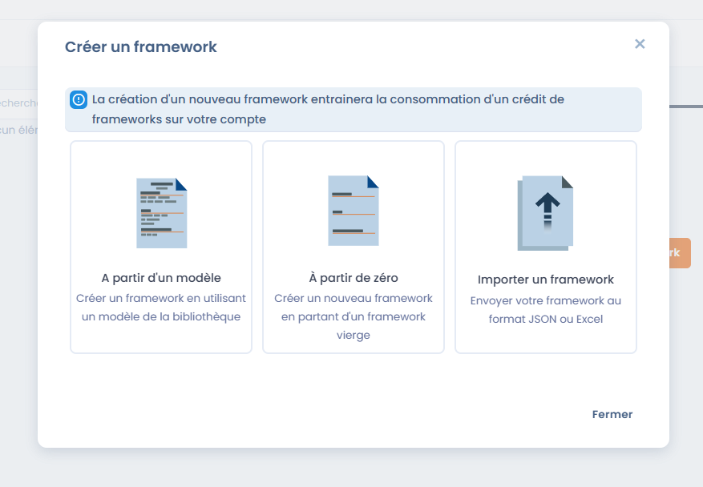
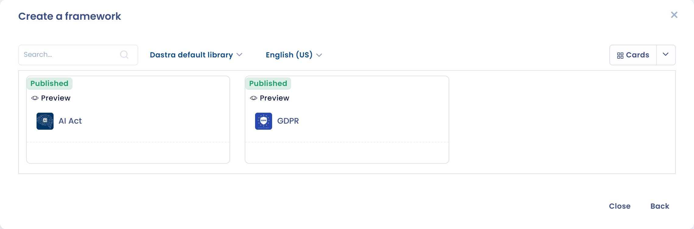
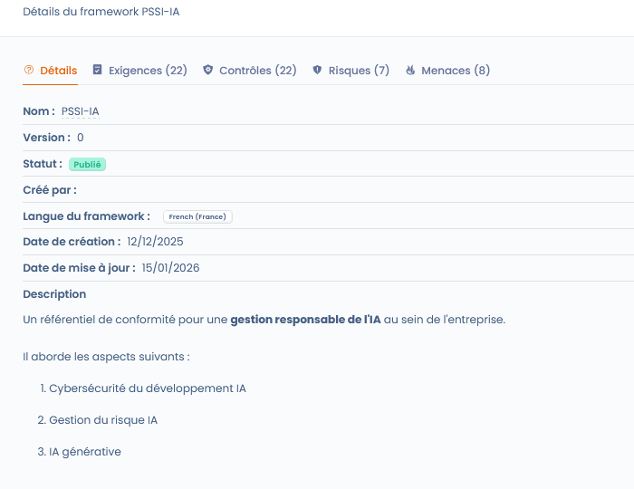
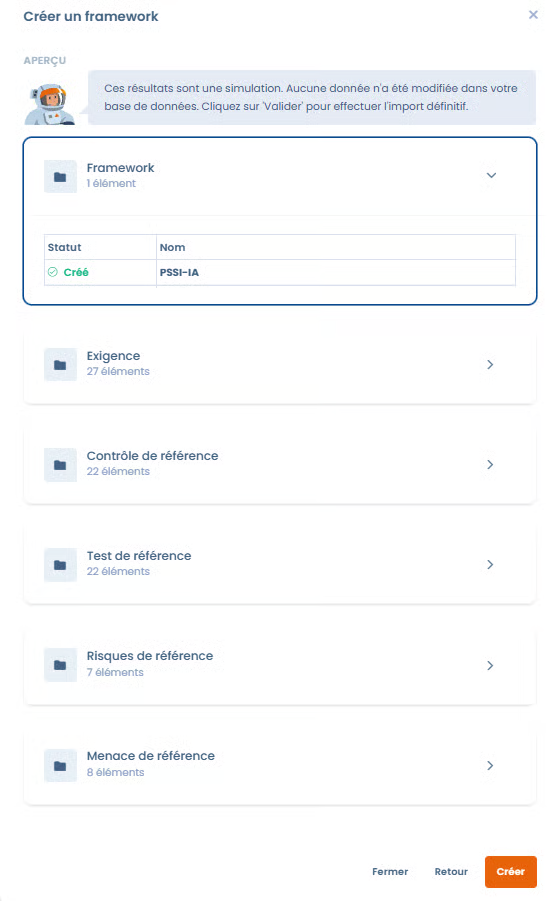

# Import und Dastra-Vorlagen

Klicken Sie unter **Compliance** > **Bibliothek** > **Frameworks** auf **Ein Framework erstellen**. Das Dialogfenster bietet drei Methoden:



* **Basierend auf einer Vorlage**: von einer Vorlage der Dastra-Bibliothek ausgehen (siehe unten)
* **Von Grund auf**: ein leeres Framework erstellen (siehe [Benutzerdefiniertes Framework erstellen](custom.md)). Diese Methode hängt von Ihrem Tarif ab
* **Ein Framework importieren**: eine JSON- oder Excel-Datei senden (siehe unten)

Auf derselben Seite können Sie auch die **Details eines bestehenden Frameworks** anzeigen.







***

## Ein Framework aus einer Vorlage erstellen

### Vorteile, von einer Vorlage auszugehen

Der Import eines Frameworks aus einer Vorlage ermöglicht es, **Zeit zu sparen** und auf ein Framework aufzubauen, das bereits strukturiert ist und den regulatorischen oder branchenspezifischen bewährten Vorgehensweisen entspricht.

Die von Dastra angebotenen Vorlagen enthalten:

* Die Struktur der Kapitel
* Die zugehörigen Anforderungen
* Die Kontrollen
* Die damit verbundenen Risiken und Bedrohungen

Sie lassen sich anschließend an Ihren Kontext **anpassen**.

***

### Schritte zum Import einer Vorlage



* Klicken Sie auf **Ein Framework erstellen**
* Wählen Sie **Basierend auf einer Vorlage**
* Rufen Sie die Vorlagenbibliothek von Dastra auf
* Suchen Sie eine Vorlage nach Namen und legen Sie dann fest:
  * den Filter **Datenquelle der Bibliothek** (standardmäßig **Von Dastra erstellte Vorlagen**)
  * die Sprache
  * die Darstellungsart der Ergebnisse
* Wählen Sie die gewünschte Vorlage aus
* Sehen Sie sich die **Details des Frameworks** an:
  * Anzahl der Anforderungen
  * Kontrollen
  * Risiken
  * Bedrohungen
  * Fachliche Beschreibung
* Bestätigen Sie den Import\
  → Das Framework wird Ihrer Bibliothek hinzugefügt und ist **bearbeitbar**.



<figure><figcaption></figcaption></figure>

<figure><figcaption></figcaption></figure>




Das Erstellen eines neuen Frameworks verbraucht ein **Framework-Guthaben** Ihres Kontos. Ist das Kontingent erreicht, können Sie die Details einer Vorlage weiterhin ansehen, sie aber erst importieren, wenn Sie Platz schaffen oder Ihr Kontingent erhöhen.


Spätere Versionen des Frameworks (erstellt, importiert oder durch eine Aktualisierung aus dem Quellreferenzwerk erzeugt) verbrauchen kein zusätzliches Guthaben.

***

## Ein Framework aus einer Datei importieren

Sie können ein Framework importieren, das Sie selbst vorbereitet oder aus Dastra exportiert haben. Diese Methode setzt das Importrecht für die Bibliothek und ein verfügbares Framework-Guthaben voraus.

1. Klicken Sie auf **Ein Framework erstellen** und dann auf **Ein Framework importieren**. Ist die Bibliothek leer, wird die Schaltfläche **Ein Framework importieren** auch direkt angeboten.
2. Wählen Sie das Format:
   * **JSON**: Ihr Framework im Format .json importieren;
   * **Komplexe Excel-Tabelle**: Ihr Framework über eine Excel-Arbeitsmappe mit mehreren Blättern importieren.
3. Klicken Sie bei der Excel-Arbeitsmappe auf **Laden Sie die Dateivorlage herunter**, um die Mustermappe zu erhalten, anhand derer der Import die Daten erkennt. Aktivieren Sie **Verwenden Sie die nativen Spalten- oder Berichtsnamen (empfohlen für den Datenimport).**, wenn Ihre Datei die nativen Spaltennamen verwendet.
4. Senden Sie Ihre Datei (jeweils eine).
5. Dastra zeigt zunächst eine Simulation: Es werden keine Daten geändert. Die Tabelle gibt für jedes Element an, ob es **Erstellt**, **Aktualisiert**, **Ignoriert** oder **Simuliert** wird, mit den Summen. Prüfen Sie sie und klicken Sie dann auf **Bestätigen**, um den endgültigen Import auszuführen.

Der Import erstellt das Framework und alle darin enthaltenen Elemente in Ihrer Bibliothek.

<figure><figcaption></figcaption></figure>

***

## Ergebnis nach dem Import



<figure><figcaption></figcaption></figure>



Sie können die Elemente anschließend vor der Erstellung prüfen.

Alle Objekte, die Ihr Framework enthält, werden in Ihrer Bibliothek erstellt.



Nach dem Import ist das Framework:

* In der Bibliothek verfügbar
* Ergänzbar oder anpassbar
* Grundlage für:
  * **Compliance-Projekte**
  * Die Bewertung der Kontrollen
  * Das Risikomanagement

***

## Aus dem Quellreferenzwerk aktualisieren

Ist eine neuere Version der ursprünglichen Vorlage verfügbar, zeigt die Karte des Frameworks das Badge **Update verfügbar** und die Seite des Frameworks den Hinweis _Eine aktuellere Version des Quell-Repositorys ist verfügbar_ mit dem Link **aktualisieren**.

Dieser Link öffnet eine Vorschau der Änderungen (Kontrollen, Tests, Risikoszenarien und Bedrohungen). Nach Ihrer Bestätigung wird aus der Quelle eine veröffentlichte Version des Frameworks erstellt, die zur aktuellen Version wird; frühere Versionen und die Projekte, die sie verwenden, bleiben unverändert. Siehe [Framework-Versionen](versions.md).
