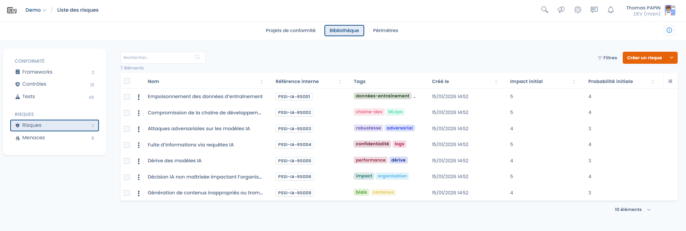
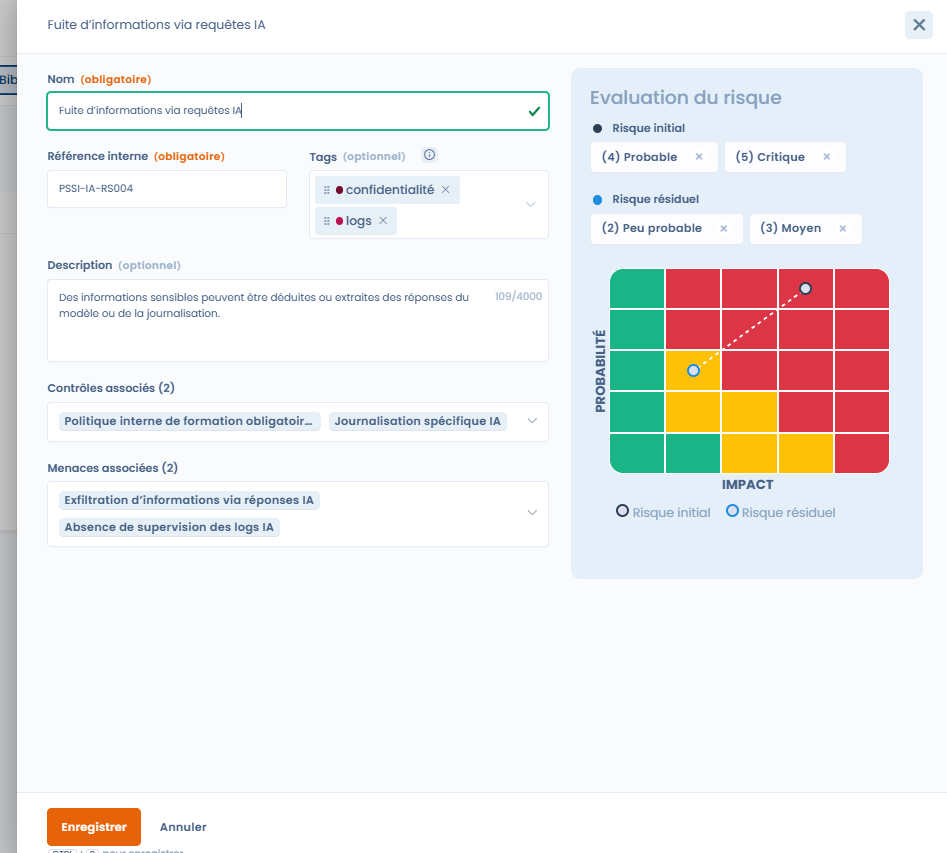
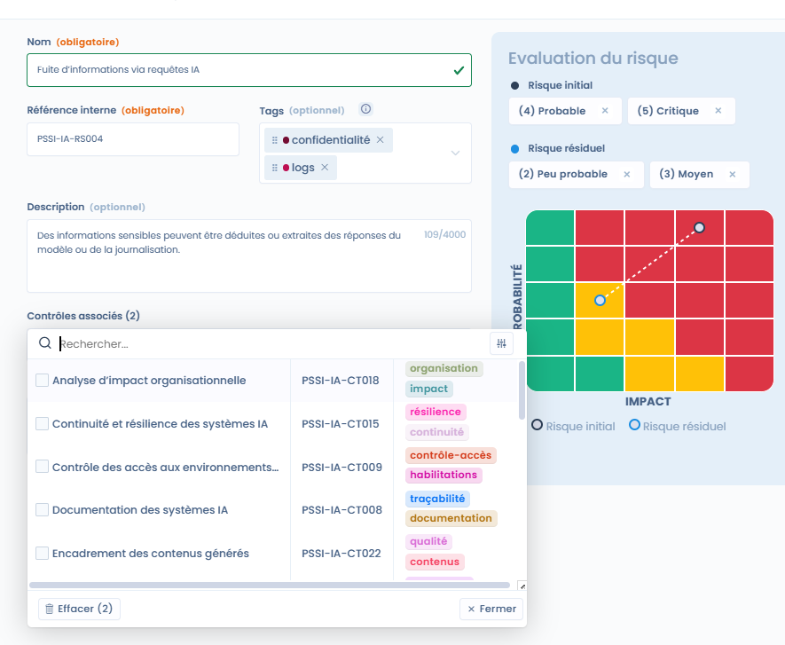

# Risiken

In Dastra stellt ein Risiko ein **befürchtetes Ereignis** dar, das negative Auswirkungen auf die Organisation haben kann, im Zusammenhang mit der Nutzung, Entwicklung oder dem Betrieb von Systemen (z. B. KI-Systemen).

Risiken sind ein **zentrales Steuerungselement**: Sie ermöglichen es, die Risikoexposition der Organisation zu messen und die tatsächliche Wirksamkeit der vorhandenen Kontrollen zu bewerten.

***

## Risiken und Kontrollen: eine zentrale Beziehung

**Risiken stehen nie für sich allein.**

In Dastra gilt:

* ein **Risiko wird von einer oder mehreren Kontrollen abgedeckt**
* eine **Kontrolle trägt zur Verringerung eines oder mehrerer Risiken bei**

Die Kontrollen bilden daher die **Maßnahmen zur Risikominderung**.\
Sie ermöglichen es, zu verringern:

* die **Eintrittswahrscheinlichkeit** des Risikos,
* und/oder seine **Auswirkung** auf die Organisation.

Diese Beziehung ermöglicht den Übergang von einem deklarativen Ansatz zu einem **operativen Risikomanagement**, das auf konkreten und überprüfbaren Maßnahmen beruht.

***

## Ansicht der Risikobibliothek

<figure><figcaption></figcaption></figure>

Die Risikobibliothek bietet einen Gesamtüberblick über die identifizierten Risiken, insbesondere mit:

* ihrer Referenz und Beschreibung,
* den zugehörigen Tags (Vertraulichkeit, Leistung, Robustheit usw.),
* den anfänglichen Stufen für Auswirkung und Wahrscheinlichkeit,
* Filtern, die die übergreifende Analyse erleichtern.

Diese Ansicht ermöglicht es,

* die wesentlichen Risiken zu identifizieren,
* ihre Abdeckung durch Kontrollen zu überprüfen,
* die Compliance-Maßnahmen zu priorisieren.

***

## Ein Risiko erstellen und beschreiben



<figure><figcaption></figcaption></figure>



Beim Erstellen oder Bearbeiten eines Risikos geben Sie an:

* **den Namen und die Referenz des Risikos**
* eine **Beschreibung**, die das Risikoszenario qualifiziert
* **Tags**, die die Kategorisierung erleichtern



***

## Risikobewertung

Jedes Risiko wird in zwei erfassten Bewertungen beurteilt, dem Anfangsrisiko und dem Restrisiko, hinzu kommt eine berechnete Stufe, das aktuelle Risiko:

### Anfangsrisiko

Das **Anfangsrisiko** entspricht der Risikostufe **vor der Umsetzung der Kontrollen**.

Es wird bewertet anhand von:

* einer **Wahrscheinlichkeit**
* einer **Auswirkung**

Diese beiden Dimensionen werden in einer standardisierten **Risikomatrix** eingeordnet.

***

### Restrisiko

Das **Restrisiko** entspricht der Risikostufe **nach Anwendung der zugehörigen Kontrollen**.

Der Vergleich von Anfangsrisiko und Restrisiko ermöglicht es,

* die Wirksamkeit der Kontrollen zu messen,
* die Verringerung des Risikos zu veranschaulichen,
* die Entscheidungen zu den Abhilfemaßnahmen zu begründen.

Derzeit ist die **Risikomatrix fest vorgegeben** und für alle Risiken gleich, damit die Bewertung einheitlich und vergleichbar bleibt.

***

### Aktuelles Risiko

In einem Projekt zeigt Dastra zusätzlich das **aktuelle Risiko**. Es stellt die Risikostufe zu einem bestimmten Zeitpunkt dar, auf Grundlage des tatsächlichen Fortschritts der Abhilfemaßnahmen und Kontrollen. Es entwickelt sich daher zwischen dem Anfangsrisiko und dem Restrisiko.

Die drei Stufen sind nebeneinander in der Ansicht **Kartografie** des Tabs **Risiken** eines Projekts sichtbar (siehe [Projektimplementierung](../projects/implement.md)).

***

## Kontrollen zuordnen



Ein Risiko muss einer oder mehreren **Kontrollen** zugeordnet werden, die die Maßnahmen darstellen, die zu seiner Minderung umgesetzt werden.

Die Zuordnung ermöglicht es,

* die Hebel zur Verringerung des Risikos klar zu identifizieren,
* die Auswirkung der Kontrollen auf das Restrisiko zu verfolgen,
* die Nachvollziehbarkeit zwischen Compliance und Risikomanagement sicherzustellen.



<figure><figcaption></figcaption></figure>



***

## Bedrohungen zuordnen

Risiken können auch mit **Bedrohungen** verknüpft werden, die die **Ereignisse oder Ursachen** darstellen, die das Risiko auslösen können.

Beispiel:

* **Bedrohung**: fehlende Überwachung der KI-Protokolle
* **Risiko**: Informationsabfluss über KI-Anfragen

Diese Unterscheidung ermöglicht eine feinere und strukturiertere Analyse der Risikoszenarien.

***

## Risiken zusammenführen

Wie bei den Kontrollen und Tests kann die Risikobibliothek Duplikate enthalten. Wählen Sie mindestens zwei Risiken aus und klicken Sie dann in den Sammelaktionen auf **Zusammenführen** oder im Bearbeitungsfenster eines Risikos auf **Zusammenführen**. Der Assistent entspricht dem für Kontrollen: Wählen Sie die **Reference version** und die Felder, die übernommen werden sollen (siehe [Kontrollen](controls.md)). Die Zusammenführung ist unwiderruflich.

***

## Warum Risiken in die Bibliothek aufnehmen

Die Zentralisierung der Risiken in der Bibliothek ermöglicht:

* einen übergreifenden Blick auf die Risiken aller Frameworks
* eine einheitlichere Bewertung
* eine direkte Verbindung zwischen Risiken, Kontrollen und Anforderungen
* eine wirksamere Steuerung von Compliance und Sicherheit
