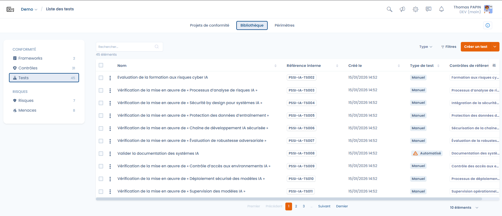
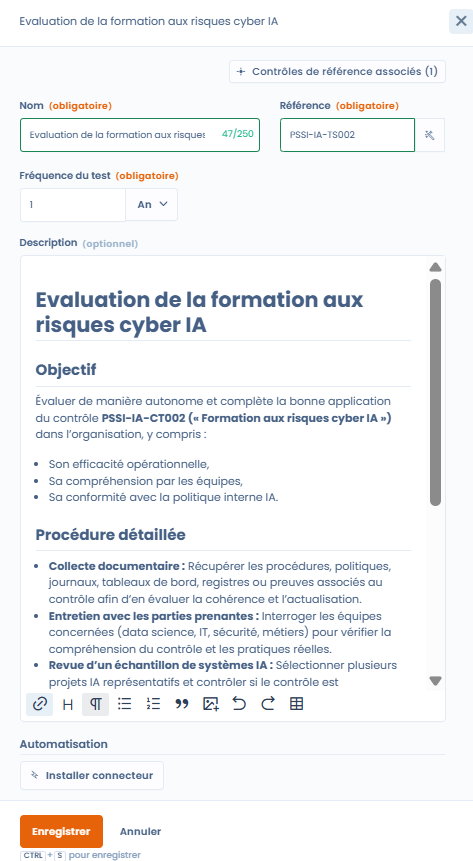
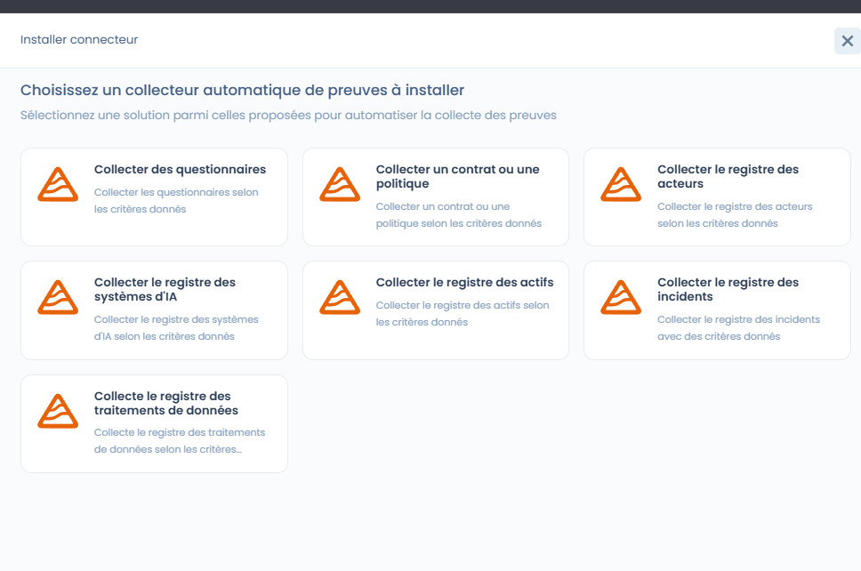

# Tests

Ein Test legt fest, **wie** und **wie oft** eine Kontrolle bewertet wird und auf welchen Nachweisen diese Bewertung beruht.

Tests sind die operative Verbindung zwischen:

* den **Kontrollen** (umgesetzte Maßnahmen),
* den gesammelten **Nachweisen**,
* und den im Zeitverlauf beobachteten **Compliance-Ergebnissen**.

***

## Die Rolle der Tests in Dastra

Ein Test beantwortet eine einzige Frage:

> _Wird die Kontrolle tatsächlich angewendet und ist sie wirksam?_

Jeder Test ist:

* einer **Referenzkontrolle** zugeordnet
* wird mit einer **festgelegten Häufigkeit** durchgeführt
* wird in **Compliance-Projekten** verwendet, um verwertbare Nachweise und Ergebnisse zu erzeugen

***

## Ansicht der Testbibliothek

<figure><figcaption></figcaption></figure>

Die Testbibliothek bietet eine übergreifende Ansicht aller verfügbaren Tests, insbesondere mit:

* ihrem Typ (manuell oder automatisiert),
* dem Erstellungsdatum,
* den zugehörigen Kontrollen,
* erweiterten Filtern (Framework, Typ, Anforderungen, verwaiste Tests).

Diese Ansicht ermöglicht es:

* Tests zu erkennen, die in mehreren Kontexten wiederverwendet werden,
* nicht zugeordnete Tests aufzuspüren,
* Überprüfungsmethoden zu standardisieren.

***

## Manuelle Tests (Standard)

Standardmäßig ist ein Test **manuell**.

Ein manueller Test beruht auf einer **menschlichen Handlung**, zum Beispiel:

* Prüfung von Dokumenten,
* Gespräch mit den Teams,
* Überprüfung eines Verzeichnisses,
* punktuelle Prüfung eines Prozesses.

### Funktionsweise in einem Compliance-Projekt

Wird ein manueller Test zu einem Projekt hinzugefügt:

* erfordert er eine **regelmäßige Aktualisierung der Nachweise**
* gemäß der im Test **festgelegten Häufigkeit** (monatlich, vierteljährlich, jährlich usw.)

So bleibt die Compliance **lebendig** und wird im Zeitverlauf aktuell gehalten.

***

## Einen Test konfigurieren



Beim Erstellen oder Bearbeiten eines Tests legen Sie fest:

* **den Namen und die Referenz des Tests** (mit Referenzgenerator)
* **die Häufigkeit des Tests**
* **die detaillierte Beschreibung**, einschließlich:
  * des Ziels des Tests
  * des Verfahrens, das zu befolgen ist
  * der erwarteten Nachweise



<figure><figcaption></figcaption></figure>



Diese Angaben dienen als operative Anleitung, wenn der Test in einem Projekt durchgeführt wird.

### Das Testfenster in einem Projekt

In einem Projekt öffnet sich ein Test in einem Fenster mit Registerkarten:

* **Testdetails**: Bezeichnung, **Inhaber des Tests**, Status, **Testverfahren**, **Häufigkeit der Tests** und Nachweise;
* **Verwandte Kontrollen**: die Kontrollen, die der Test überprüft;
* **Fehlerprüfungen**: die Probleme, die Prüfer zu diesem Test gemeldet haben (siehe [Audits](../projects/audits.md));
* **Context**: das Projekt, die Frameworks und der Scope, zu denen der Test gehört.

***

## Automatisierte Tests mit Dastra-Konnektoren

Dastra bietet einsatzbereite Konnektoren (Fragebögen, Verzeichnisse, Richtlinien usw.) sowie einen generischen Konnektor für HTTP-Anfragen. Diese Konnektoren, auch automatische Nachweissammler genannt, werden direkt in den **automatisierten Tests** des Compliance-Moduls verwendet.

<figure><figcaption></figcaption></figure>

Zusätzlich zu den manuellen Tests lassen sich in Dastra **automatisierte Tests** mithilfe von **Konnektoren** konfigurieren.

Ein automatisierter Test nutzt einen Dastra-Konnektor, um:

* Elemente des Mandanten direkt abzufragen
* automatisch Nachweise zu sammeln
* die Compliance anhand festgelegter Kriterien zu überprüfen

### Einen Konnektor für einen Test installieren

1. Öffnen Sie einen manuellen Test und klicken Sie auf **Connector installieren**.
2. Wählen Sie unter **Bitte wählen Sie einen automatischen Beweissammler zur Installation aus.** den Konnektor aus.
3. Legen Sie die **Häufigkeit der Tests** fest (in Tagen, Monaten oder Jahren) und konfigurieren Sie die Standardwerte des Konnektors.
4. Klicken Sie auf **Bestätigen**. Die Sammlung der Nachweise beginnt sofort mit dieser Konfiguration.

Klicken Sie anschließend auf **Ausführen**, um die Sammlung bei Bedarf erneut zu starten. Jede Ausführung wird als Nachweis des Tests gespeichert. Ist die Konfiguration eines Konnektors ungültig, bleibt die automatische Sammlung deaktiviert, bis Sie sie korrigieren.

### Verfügbare Konnektoren

| Konnektor | Sammelt |
| --- | --- |
| **Fragebogen sammeln** | Die Fragebögen des Mandanten, gemäß Kriterien. |
| **Einen Vertrag oder eine Richtlinie sammeln** | Einen Vertrag oder eine Richtlinie, zum Beispiel, um deren Vorhandensein und Aktualität zu überprüfen. |
| **Verzeichnis der Stakeholder sammeln** | Die Stakeholder (Dritte) des Mandanten. |
| **Sammeln Sie das Verzeichnis der KI-Systeme** | Das Verzeichnis der KI-Systeme, zum Beispiel, um deren Dokumentation zu überprüfen. |
| **Sammeln Sie das Verzeichnis der Assets** | Die Assets des Mandanten. |
| **Sammeln Sie das Verzeichnis der Vorfälle** | Die Vorfälle des Mandanten. |
| **Sammeln Sie das Verzeichnis der Datenverarbeitung** | Die Verarbeitungstätigkeiten des Verzeichnisses. |
| **HTTP-Anfrage** | Das Ergebnis einer Anfrage an eine beliebige API oder einen beliebigen Endpoint (siehe unten). |

Beispiel: Ein automatisierter Test kann überprüfen, dass jedes KI-System über eine konforme und aktuelle Dokumentation verfügt, ganz ohne manuellen Eingriff.

## Einen benutzerdefinierten Konnektor hinzufügen

Zusätzlich zu den Standardkonnektoren lassen sich in Dastra **benutzerdefinierte Konnektoren** erstellen, um die Sammlung von Nachweisen in den Compliance-Tests zu automatisieren.

Ein benutzerdefinierter Konnektor ermöglicht es:

* eine technische Abfrage auszuführen (zum Beispiel eine HTTP-Anfrage),
* eine interne oder externe Quelle abzufragen,
* sachliche Elemente automatisch zu erfassen,
* Nachweise zu erzeugen, die in Audits verwendet werden können.

Der Konnektor wird so zu einer **wiederkehrenden und nachvollziehbaren Nachweisquelle**.

### HTTP-Anfrage

Der Konnektor **HTTP-Anfrage** ermöglicht es, jede bereitgestellte API und jeden Endpoint abzufragen.

Er eignet sich besonders dafür:

* Drittanbieter-Tools abzufragen,
* das Vorhandensein oder den Zustand einer Ressource zu überprüfen,
* technische oder dokumentarische Kontrollen zu automatisieren.

## Den HTTP-Konnektor konfigurieren

<figure><figcaption>
Die Konfigurationsoberfläche des HTTP-Konnektors mit den Registerkarten Auth, Header, URL-Parameter und Body
</figcaption></figure>

Mit der Konfigurationsoberfläche des HTTP-Konnektors lässt sich eine Anfrage erstellen, ohne die JSON-Syntax zu kennen.

| Feld | Beschreibung |
| --- | --- |
| **URL** | Abzufragender Endpoint. Pflichtfeld, im Format `http://` oder `https://`. |
| **HTTP Method** | `GET` oder `POST`. |
| Registerkarte **Auth** | Wählen Sie die **Authentifizierung**: **Keine**, **API-Schlüssel**, **Autorisierungstoken (Bearer)** oder **Basis-Authentifizierung (Basic)**. Der passende Header wird automatisch zu jeder Anfrage hinzugefügt, ohne dass Sie JSON eingeben müssen. |
| Registerkarte **Header** | Benutzerdefinierte Header als Schlüssel-Wert-Paare, die zusätzlich zur Authentifizierung gesendet werden. |
| Registerkarte **URL-Parameter** | Abfrageparameter als Schlüssel-Wert-Paare, die an die URL angehängt werden. |
| Registerkarte **Body** | **Anfrage-Body** im JSON-Format. |

Sensible Felder (API-Schlüssel, Token, Passwort) sind standardmäßig maskiert; über ein augenförmiges Symbol lassen sie sich vorübergehend anzeigen. Schreibgeschützte Vorschauen zeigen, was tatsächlich gesendet wird: **Header, die gesendet werden**, **URL, die aufgerufen wird** und **Anfrage-Body, der gesendet wird**, wobei sensible Werte maskiert bleiben.

### Ergebnis der Anfrage

Der Test gilt als bestanden, wenn der Endpoint mit dem HTTP-Code 200 antwortet. Jede Ausführung wird als Nachweis im Compliance-Projekt gespeichert, und der Test läuft gemäß der **Häufigkeit der Tests** erneut, die bei der Installation des Konnektors gewählt wurde. Die Erfolgskriterien lassen sich nicht konfigurieren.

## Vorteile automatisierter Tests

Automatisierte Tests ermöglichen es:

* Nachweise **kontinuierlich zu sammeln**
* den operativen Aufwand zu verringern
* die Zuverlässigkeit der Kontrollen zu verbessern
* Abweichungen schneller zu erkennen

Sie eignen sich besonders für wiederkehrende oder strukturierte Kontrollen.

***

## Nachweise aus dem Dateimanager anhängen

Beim Hinzufügen eines Nachweises zu einem Test können Sie direkt eine Datei aus dem **Dateimanager** von Dastra auswählen, ohne sie erneut importieren zu müssen. Klicken Sie dazu im Fenster zum Hinzufügen eines Nachweises auf **Datei-Explorer**.

<figure><figcaption>
Mit der Schaltfläche **Datei-Explorer** lassen sich Nachweise auswählen, die bereits im Dateimanager von Dastra vorhanden sind
</figcaption></figure>

***

## KI-Analyse der Nachweise

Dastra kann die an einen Test angehängten Nachweise automatisch analysieren und angeben, ob sie dem entsprechen, was das Verfahren erwartet. Diese Funktion ist eine **Entscheidungshilfe für die Prüferin oder den Prüfer**: Sie ersetzt niemals das menschliche Urteil und akzeptiert oder lehnt Nachweise nicht in Ihrem Namen ab.

### Funktionsweise

Wird ein Nachweis zu einem Test hinzugefügt, vergleicht die KI den Inhalt des Nachweises mit der Bezeichnung und der Beschreibung des Testverfahrens. Das Ergebnis erscheint in der Spalte **KI-Bewertung** der Nachweistabelle als **farbiges Badge**:

| Bewertung | Bedeutung |
| --- | --- |
| **Richtig** | Der Nachweis entspricht dem Verfahren. |
| **Wahrscheinlich richtig** | Der Nachweis scheint zu passen, eine Prüfung durch einen Menschen wird empfohlen. |
| **Nicht konform** | Der Nachweis entspricht nicht dem Verfahren. |
| **Unbekannt** | Die KI kann keine Aussage treffen. |

Fahren Sie mit der Maus über das Badge, um das **Dokument** (Zusammenfassung des analysierten Dokuments), das **Vertrauen in die Analyse** (von 0 bis 100 %) und die **Details**, die die Bewertung begründen, anzuzeigen.

### Unterstützte Nachweisarten

Die Analyse passt sich der Art des vorgelegten Nachweises an:

| Art des Nachweises | Analysemethode |
| --- | --- |
| Bild (Screenshot, JPEG, PNG usw.) | Visuelle Analyse des Inhalts durch ein Bildverarbeitungsmodell |
| Dokument (PDF, Word) | Textextraktion, danach Analyse des Texts |

Die Kurzinfo der Spaltenüberschrift **KI-Bewertung** erinnert an diese Methode.

### Aktivierung und Einstellungen

Die Funktion ist optional und standardmäßig deaktiviert. Um sie zu aktivieren, gehen Sie zu **Einstellungen** > **Compliance** und schalten Sie die Option **Automatische KI-Analyse von Beweismitteln** ein.


Solange die Funktion nicht aktiviert ist, werden **keine Nachweisdaten an das KI-Modell gesendet**.


Um die Analyse zu deaktivieren, klicken Sie in der Kurzinfo eines Ergebnisses auf **Ich möchte diese Funktion deaktivieren**: Der Link führt zu den Compliance-Einstellungen. Das verwendete KI-Modell lässt sich nach der Wahl Ihrer Organisation über die Einstellungen des KI-Assistenten konfigurieren (Modellfamilie oder benutzerdefinierter KI-Anbieter).

### Was die Analyse nicht leistet

* Sie **akzeptiert oder lehnt** Nachweise **nicht automatisch ab**: Die endgültige Entscheidung liegt immer bei der Prüferin oder dem Prüfer.
* Sie ändert den Status des Tests nicht.
* Sie ist unverbindlich: Eine Bewertung **Unbekannt** oder **Wahrscheinlich richtig** signalisiert, dass eine Prüfung durch einen Menschen empfohlen wird.

***

## Tests zusammenführen

Wie bei den Kontrollen kann die Testbibliothek redundante Tests ansammeln, insbesondere nach dem Import mehrerer Frameworks. Mit der Funktion **Tests zusammenführen** lassen sich diese Duplikate zu einem einzigen Referenztest zusammenfassen.

### Funktionsweise der Zusammenführung

Wählen Sie in der Testbibliothek die Tests aus, die zusammengeführt werden sollen, und klicken Sie dann auf **Zusammenführen**. Wählen Sie die **Reference version**, also den Test, der erhalten bleibt: Die Zuordnungen der anderen Tests (verknüpfte Kontrollen, Ausführungsergebnisse, Häufigkeit) werden auf ihn übertragen, anschließend werden die anderen Tests gelöscht. Haken Sie in der Vergleichstabelle in den Spalten **Keep selected fields** die Felder an, die übernommen werden sollen.


Die Zusammenführung ist nicht umkehrbar. Prüfen Sie die Zuordnungen jedes Quelltests, bevor Sie bestätigen.


### Typische Anwendungsfälle

* **Deduplizierung**: Zwei Framework-Importe haben einen doppelten Test „Überprüfung der Datenschutzerklärung“ erzeugt: Die Zusammenführung fasst sie zusammen.
* **Rationalisierung**: Mehrere sehr ähnliche manuelle Tests lassen sich zu einem einzigen, umfassenderen Test zusammenfassen.
* **Aufräumen vor einem Audit**: Weniger verwaiste Tests verbessern die Lesbarkeit des Dashboards.

***

## Einen Test mit einem Dokument verknüpfen

Ein Compliance-Test lässt sich mit einem oder mehreren **Dokumenten aus dem Dateimanager von Dastra** verknüpfen (Verträge, Richtlinien, dokumentarische Nachweise, Auftragsverarbeitungsverträge). Mit dieser Verknüpfung finden Sie die Tests, die zu einem Dokument gehören, und umgekehrt.

### Aus der Ansicht eines Dokuments

Ist ein Test mit einem Dokument verknüpft, erscheint in der Bearbeitungsansicht des betreffenden Dokuments oder Vertrags ein Bereich **Tests**, der die Referenz, den Namen und den Status jedes zugehörigen Tests anzeigt.

<figure><figcaption>
Ein verknüpfter Test erscheint im Bereich Tests rechts neben dem Dokument (hier: G-T2 Lawful Basis Spot Check, Done / Pass)
</figcaption></figure>

### Aus dem Dateimanager

Im Dateimanager zeigt das Detailblatt eines Dokuments in der Seitenspalte alle Dastra-Elemente an, mit denen es verknüpft ist: Verarbeitungstätigkeiten, Verträge und Compliance-Tests.

<figure><figcaption>
Der Dateimanager zeigt die mit jedem Dokument verknüpften Tests in der Detailspalte an
</figcaption></figure>

Diese Nachverfolgbarkeit in beide Richtungen zeigt Ihnen in Audits, welche Tests auf welchem Dokument beruhen, und ermöglicht es, alle dokumentarischen Nachweise über den Dateimanager zu finden.

***

## Komplementarität der Ansätze

Dastra ermöglicht die Kombination von:

* **manuellen Tests** für Kontrollen, die Analyse oder menschliches Urteilsvermögen erfordern
* **automatisierten Tests** für objektive und wiederkehrende Überprüfungen

Diese Komplementarität schafft ein Gleichgewicht zwischen Gründlichkeit, Effizienz und Pragmatismus.
