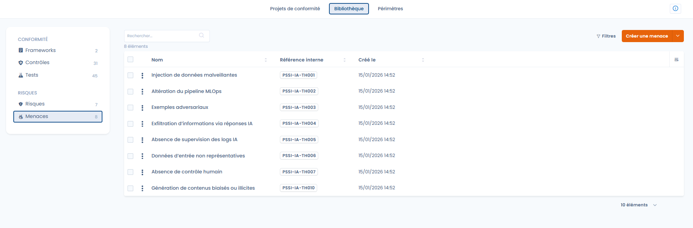
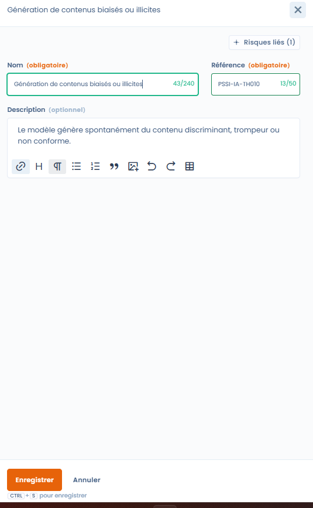

# Bedrohungen

In Dastra stellt eine Bedrohung den **auslösenden Faktor** eines Risikos dar:\
Sie beschreibt, _wie_ oder _warum_ ein Risiko eintreten kann.

Bedrohungen bereichern die Risikoanalyse, ohne ihre Bewertung zu verkomplizieren.

***

## Bedrohungen, Risiken und Kontrollen: die Kausallogik

Das Modell von Dastra beruht auf einer einfachen und gut lesbaren Kette:

> **Bedrohung** > **Risiko** > **Kontrollen** > **Tests**

* Eine **Bedrohung** beschreibt eine Situation, ein Verhalten oder ein Ereignis
* Ein **Risiko** beschreibt die mögliche Auswirkung auf die Organisation
* **Kontrollen** zielen darauf ab, den Eintritt oder die Folgen des Risikos zu begrenzen
* **Tests** ermöglichen es, die Wirksamkeit der Kontrollen zu überprüfen

Beispiel:

* **Bedrohung**: fehlende Überwachung der KI-Protokolle
* **Risiko**: Informationsabfluss über KI-Anfragen
* **Kontrollen**: Protokollierung, Überwachung, Sensibilisierungsschulungen
* **Tests**: Überprüfung der Protokolle, regelmäßige Audits

***

## Ansicht der Bedrohungsbibliothek

<figure><figcaption></figcaption></figure>

Die Bedrohungsbibliothek zentralisiert alle identifizierten Bedrohungen mit:

* ihrem Namen und ihrer Referenz,
* ihrem Erstellungsdatum,
* Filtern, die die Navigation erleichtern.

Diese Ansicht ermöglicht es,

* bestehende Bedrohungen wiederzuverwenden,
* eine einheitliche Terminologie sicherzustellen,
* kohärente Risikoszenarien zu strukturieren.

***

## Eine Bedrohung erstellen und verwalten




Beim Erstellen oder Bearbeiten einer Bedrohung geben Sie an:

* **den Namen der Bedrohung**
* **eine interne Referenz**
* eine **optionale Beschreibung**, die die Bedrohung in ihren Kontext einordnet



<figure><figcaption></figcaption></figure>



Das Modul ist bewusst **schlank** gehalten:\
Bedrohungen tragen keine quantifizierte Bewertung und sind nicht direkt mit Kontrollen verknüpft.

***

## Zuordnung zu Risiken

Eine Bedrohung wird **einem oder mehreren Risiken** zugeordnet.

Diese Zuordnung ermöglicht es,

* die Risikoszenarien genau zu dokumentieren,
* das Verständnis der Ursachen zu verbessern,
* die Kohärenz der Gesamtanalyse zu stärken.

Dieselbe Bedrohung kann zu mehreren Risiken beitragen und umgekehrt.

***

## Warum Bedrohungen verwenden

Die Verwendung von Bedrohungen ermöglicht:

* eine feinere und realistischere Analyse der Risiken,
* eine bessere Nachvollziehbarkeit der Szenarien,
* eine klarere Kommunikation mit den Beteiligten (CISO, Datenschutzbeauftragte, Fachbereiche).

Bedrohungen ergänzen die Analyse, ohne den operativen Verwaltungsaufwand zu erhöhen.

***

## Bedrohungen zusammenführen

Die Bedrohungsbibliothek lässt sich wie die Risikobibliothek zusammenführen: Wählen Sie mindestens zwei Bedrohungen aus und klicken Sie dann in den Sammelaktionen oder im Bearbeitungsfenster einer Bedrohung auf **Zusammenführen**. Wählen Sie die **Reference version** und die Felder, die übernommen werden sollen (siehe [Kontrollen](controls.md)). Die Zusammenführung ist unwiderruflich.

***

## Zusammenfassung

Bedrohungen sind ein **Klärungsinstrument**.\
Sie helfen, **den Ursprung der Risiken** besser zu verstehen und damit die vorhandenen Kontrollen besser zu begründen.
