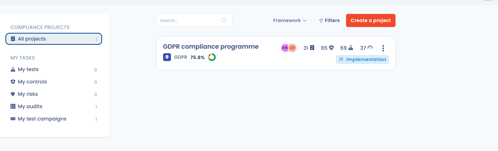

# Projekte

Ein Compliance-Projekt verfolgt, wie ein oder mehrere Frameworks auf einen Scope Ihrer Organisation angewendet werden. Es bündelt Anforderungen, Kontrollen, Tests, Risiken und Audits und schreitet in Phasen voran, vom Scoping bis zum abschließenden Audit.

Diese Seite behandelt das Erstellen eines Projekts, seine sechs Phasen, den Phasenassistenten und die Navigation. Jede Phase wird auf den folgenden Seiten ausführlich beschrieben:

* [Projektgestaltung](design.md): Frameworks, Anforderungen, Kontrollen und Risiken, die importiert werden;
* [Projektimplementierung](implement.md): Tests, Risikobewertung, Konnektoren;
* [Compliance-Überwachung](monitoring.md): Nachweise, Testkampagnen, Export der Anwendungserklärung;
* [Audits](audits.md): interne Audits und abschließende Audits.

Eine vollständige Schritt-für-Schritt-Anleitung für ein Zertifizierungsprojekt finden Sie im [Beispiel eines ISO-27001-Projekts](../../../examples/iso-27001-project.md).

## Die Projekte öffnen

Klicken Sie im Menü auf **Compliance** und dann auf **Projekte**. Das Seitenmenü hat zwei Gruppen:

* **Compliance-Projekte**: **Alle Projekte** listet die Projekte des Mandanten auf;
* **Meine Aufgaben**: die Ihnen zugewiesenen Elemente über alle Projekte hinweg (siehe unten).

## Ein Projekt erstellen

1. Klicken Sie unter **Alle Projekte** auf **Ein Projekt erstellen**.
2. Geben Sie den **Titel** des Projekts ein (höchstens 200 Zeichen).
3. Wählen Sie den **Scope** (Pflichtfeld). Existiert er noch nicht, klicken Sie in der Liste auf **Einen Scope erstellen**, um ihn zu definieren, ohne den Dialog zu verlassen. Siehe [Scopes](../scopes.md).
4. Klicken Sie auf **Weiter**.
5. Fügen Sie unter **Weisen Sie Nutzer dem Projekt zu** die Personen hinzu, die das Projekt verwalten dürfen, und geben Sie jeder die Rolle **Verantwortlich** oder **Informiert**. Sie selbst werden standardmäßig mit der Rolle **Verantwortlich** hinzugefügt.
6. Klicken Sie auf **Hinzufügen**.

Das Projekt öffnet sich in seiner Übersicht, in der Phase **Scope**.


Zum Erstellen oder Bearbeiten eines Projekts ist Schreibzugriff auf die operative Compliance erforderlich.


<figure><figcaption></figcaption></figure>

## Projektphasen

Ein Projekt durchläuft sechs Phasen. Die aktuelle Phase ist in der Übersicht hervorgehoben, und jede Phase zeigt ihr Ziel an, wenn Sie mit der Maus darüberfahren.

| Phase | Ziel | Seite |
| --- | --- | --- |
| **Scope** | Den Compliance-Rahmen festlegen, das heißt die betroffenen Organisationseinheiten. Das geschieht in der Regel beim Erstellen des Projekts. | [Scopes](../scopes.md) |
| **Konzeption** | Die anzuwendenden Frameworks (DSGVO, ISO usw.) festlegen, einschließlich ihrer Anforderungen, Kontrollen und Risiken. Sie können die Vorlagen von Dastra oder Ihre eigenen Frameworks verwenden. | [Projektgestaltung](design.md) |
| **Implementierung** | Festlegen, wie die Compliance umgesetzt wird: Tests, Risikobewertung, Inhaber und mögliche Automatisierungen. | [Projektimplementierung](implement.md) |
| **Überwachung** | Mithilfe von Testkampagnen Nachweise für das gesamte Projekt sammeln und sicherstellen, dass möglichst viele Kontrollen bestanden werden. Das ist die Phase des laufenden Betriebs. | [Compliance-Überwachung](monitoring.md) |
| **Interne Prüfung** | Ein erstes internes Audit durchführen, um zu prüfen, dass alles korrekt umgesetzt ist, bevor das abschließende Audit stattfindet. | [Audits](audits.md) |
| **Abschlussprüfung** | Das Zertifizierungsaudit für jedes Framework durchführen, das Sie umgesetzt haben. | [Audits](audits.md) |

<figure><figcaption></figcaption></figure>

### Die Phase wechseln

Die Phasen sind nicht gesperrt: Sie können zu jeder Phase wechseln, vorwärts oder rückwärts.

1. Klicken Sie in der Übersicht auf die gewünschte Phase.
2. Bestätigen Sie im Dialog **Möchten Sie das Projekt in diese Phase überführen?**.

Einige Funktionen sind je nach Phase aktiviert oder deaktiviert, und Ihre gesamte Arbeit bleibt erhalten. Handeln Sie außerhalb der empfohlenen Phase, zeigt Dastra eine Warnung an, ohne Sie zu blockieren:

* Änderung von Nachweisen außerhalb der Phase **Überwachung**;
* Start einer Testkampagne außerhalb der Phase **Überwachung**;
* Erstellen eines Audits außerhalb einer Audit-Phase oder eines Zertifizierungsaudits außerhalb der Phase **Abschlussprüfung**.

### Der Checkliste des Assistenten folgen

Oben in der Übersicht erinnert der Assistent an das **Phase-Ziel** und zeigt eine **Checkliste** für die aktuelle Phase an. Jeder Schritt hat eine Aktionsschaltfläche, die den passenden Bildschirm öffnet.

| Phase | Schritte der Checkliste |
| --- | --- |
| **Scope** | Projektumfang festlegen |
| **Konzeption** | Mindestens ein Framework hinzufügen; Kontrollen zum Projekt hinzufügen; Risiken zum Projekt hinzufügen |
| **Implementierung** | Mindestens eine Kontrolle konfigurieren; automatisierte Tests konfigurieren; alle Risiken bewerten; Inhaber zu Tests zuweisen |
| **Überwachung** | Mindestens einen Test bestätigen; sicherstellen, dass mindestens 80 % der Tests erfolgreich sind |
| **Interne Prüfung** | Ihr erstes internes Compliance-Audit konfigurieren; mindestens ein internes Audit abschließen |
| **Abschlussprüfung** | Mindestens ein abschließendes Audit pro Framework durchführen; eines Ihrer Abschluss- oder Zertifizierungsaudits abschließen |

Sind alle Schritte erledigt, erscheint die Schaltfläche **Weiter zur Phase: …**, mit der Sie nach derselben Bestätigung zur nächsten Phase wechseln.

Um den Assistenten auszublenden, klicken Sie auf sein Kreuz (**Assistenten ausblenden**). Die Schaltfläche **Anzeigeassistent** blendet ihn wieder ein.

## In einem Projekt navigieren

Das Seitenmenü eines Projekts zeigt den Scope, den Titel (zum Bearbeiten anklicken) und die Projektnutzer und gibt dann Zugriff auf diese Registerkarten:

| Gruppe | Registerkarten |
| --- | --- |
| **Projekt** | **Überblick**, **Anforderungen**, **Audits** |
| **Kontrollen und Tests** | **Kontrollen**, **Tests**, **Testkampagnen** |
| **Risiken** | **Risiken**, **Bedrohungen** |

Mit den Schaltflächen für Aufgaben und Kommentare im Menü verfolgen Sie das Projekt gemeinsam mit anderen Nutzern. Das Menü **⋯** bietet:

* **Einstellungen**: Titel, Beschreibung und Scope bearbeiten;
* **Aktivitätsverlauf**: die am Projekt vorgenommenen Änderungen einsehen;
* **Exportieren**: das Projekt als PDF, DOCX, JSON, HTML oder Markdown exportieren;
* **In den Papierkorb verschieben**: das Projekt archivieren. Ein archiviertes Projekt ist schreibgeschützt: **Wiederherstellen** macht es wieder bearbeitbar, **Löschen** entfernt es dauerhaft.

## Ihre Aufgaben verfolgen

Die Gruppe **Meine Aufgaben** des Seitenmenüs bündelt, was Ihnen zugewiesen ist, über alle Projekte hinweg. Hier arbeiten Inhaber von Tests und Prüfer täglich. Wer die Projektliste nicht öffnen darf, landet beim Öffnen von **Compliance** direkt in **Meine Tests**.

| Ansicht | Inhalt |
| --- | --- |
| **Meine Tests** | Die Tests, deren Inhaber Sie sind, mit ihren Statistiken. Filtern Sie nach Testkampagne, um eine Kampagne zu öffnen und Ihre Nachweise hinzuzufügen. |
| **Meine Kontrollen** | Die Kontrollen, deren Inhaber Sie sind. |
| **Meine Risiken** | Die Risiken, deren Inhaber Sie sind. |
| **Meine Audits** | Die Audits, bei denen Sie Prüfer sind. Klicken Sie auf ein Audit, um es zu bewerten. |
| **Meine Testkampagnen** | Die Testkampagnen, die Sie nach Status und nach Framework filtern können. |

Siehe auch [Tests validieren](monitoring.md#tests-validieren).

## Ein Projekt im Trust Center anzeigen

Das Trust Center kann eine Zusammenfassung aller Frameworks eines Compliance-Projekts anzeigen, mit den Informationen des letzten Audits und den zugehörigen Anhängen. Die Option wird in der Konfiguration des Trust Centers aktiviert: siehe [Ihr Trust Center konfigurieren](../../trust-center/configuration/README.md).
