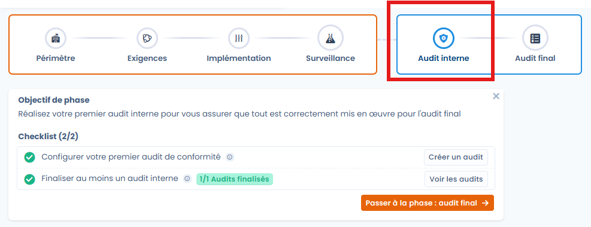
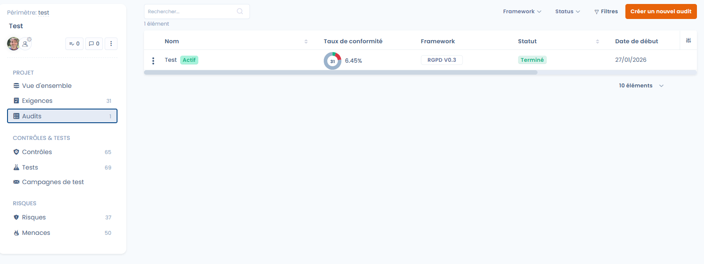
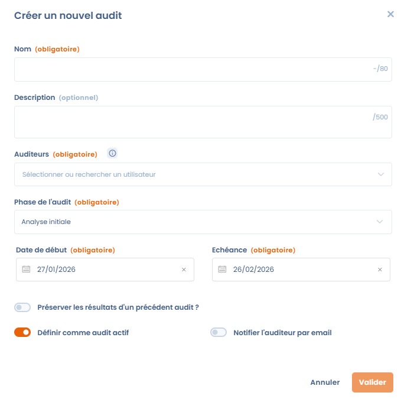
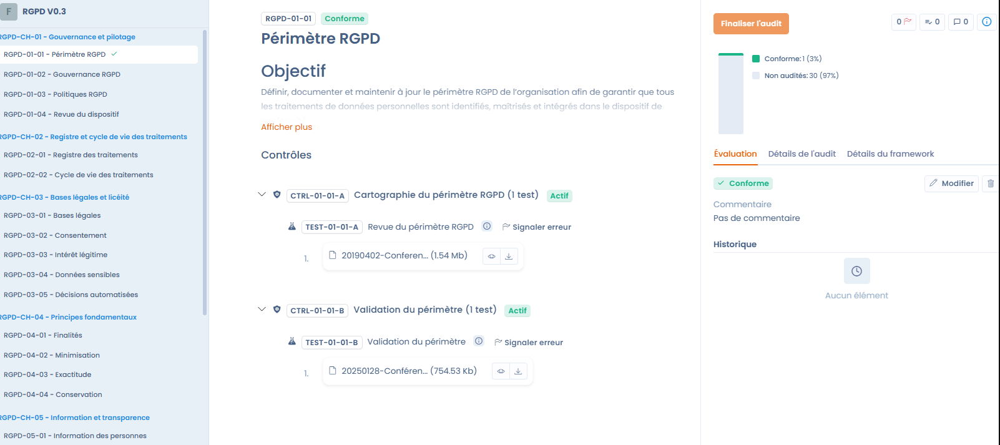
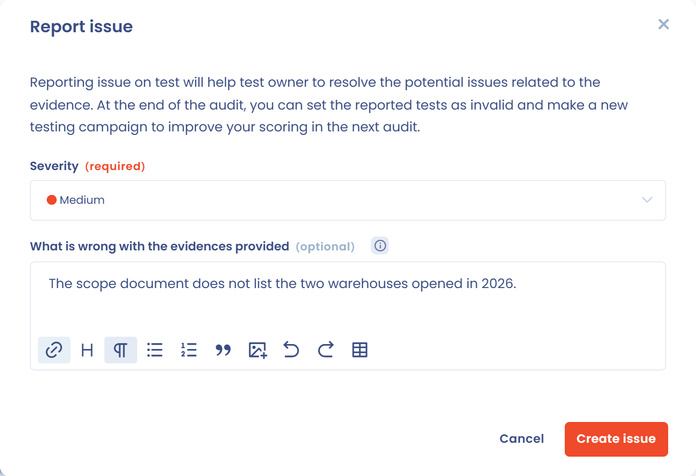
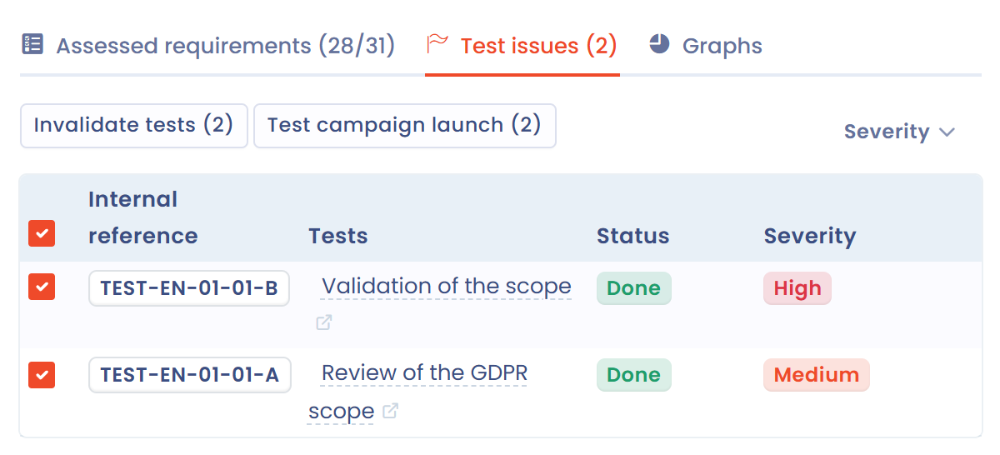
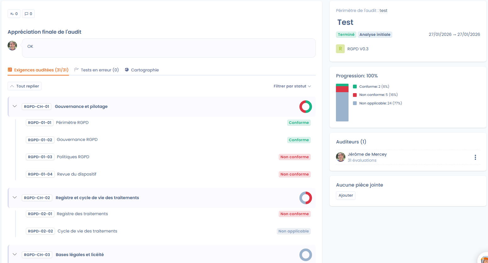

# Audits

Die Phasen **Interne Prüfung** und **Abschlussprüfung** eines Projekts validieren offiziell den Compliance-Stand zu einem bestimmten Zeitpunkt. Sie bauen auf der zuvor geleisteten Arbeit in Design und Überwachung auf und liefern eine strukturierte Bewertung, die intern oder durch externe Auditoren erfolgt.

Ein Audit deckt ein Framework des Projekts ab. Die Auditoren bewerten jede Anforderung anhand der Kontrollen, Tests und Nachweise, die bereits im Projekt vorhanden sind. Anschließend wird das Audit mit einer Gesamtbewertung abgeschlossen.

<figure><figcaption></figcaption></figure>

## Was das Modul leistet

* **Audits durchführen**, intern oder extern, mit Standard-Frameworks (DSGVO, KI-Verordnung usw.) oder mit Ihren eigenen Rastern.
* **Zusammenarbeiten**: Die Auditoren haben Zugriff auf die zugehörigen Anforderungen, Kontrollen, Tests und Nachweise, und während des Audits kann ein Auditor hinzugefügt werden.
* **Die Überwachungsarbeit wiederverwenden**: Die Kontrollen und Nachweise des Projekts können bei der Bewertung direkt eingesehen werden.
* **Abweichungen behandeln**: Probleme, die an Tests festgestellt werden, melden und Korrekturaufgaben erstellen.
* **Die Ergebnisse exportieren** als XLSX, PDF, DOCX, JSON, HTML oder Markdown.

<figure><figcaption></figcaption></figure>

## Ein Audit erstellen

Erstellen Sie ein Audit im Compliance-Projekt, nicht im Modul Fragebögen. Es gibt zwei Einstiegspunkte:

* der Tab **Audits** des Projekts mit der Schaltfläche **Neues Audit erstellen**. Wählen Sie dann das Framework in der Liste **Bitte wählen Sie ein zu prüfendes Framework aus.** aus; sie zeigt für jedes Framework, ob bereits ein Audit läuft;
* das Menü **⋯** einer Framework-Karte im **Überblick** des Projekts mit **Neues Audit erstellen**. Das Framework ist dann bereits ausgewählt.

Hat das Projekt kein Framework, zeigt Dastra **Kein Framework muss geprüft werden**: Fügen Sie dem Projekt zuerst ein Framework hinzu (siehe [Projektgestaltung](design.md)).


Ein Audit außerhalb einer Audit-Phase zu erstellen, wird nicht empfohlen: Dastra zeigt eine Warnung an, blockiert Sie aber nicht. Die Auswahl der Audit-Phase **Abschlussprüfung** löst dieselbe Warnung aus, solange sich das Projekt nicht in der Phase **Abschlussprüfung** befindet.


### Allgemeine Informationen

| Feld | Beschreibung |
| --- | --- |
| **Name** | Titel des Audits, zum Beispiel „Jährliches Compliance-Audit“. Pflichtfeld, höchstens 80 Zeichen. |
| **Zusammenfassung** | Kontext oder besonderer Umfang des Audits. Optional, höchstens 500 Zeichen. |
| **Auditoren** | Nutzer, die das Audit durchführen dürfen. Pflichtfeld. Stehen Sie nicht in dieser Liste, können Sie die Anforderungen nicht bewerten, auch wenn Sie der Inhaber der Organisation sind. |

<figure><figcaption></figcaption></figure>

### Audit-Phase und Termine

Die **Audit-Phase** gliedert das Audit und ermöglicht es, die Governance-Dashboards zu filtern. Sie ist unabhängig von der Projektphase.

| Phase | Verwendung |
| --- | --- |
| **Initiale Analyse** | Abgrenzung: Festlegung des Scopes, des Frameworks und der regulatorischen Anforderungen. Standardwert. |
| **Vorbereitung** | Organisation: Zuweisung der Kontrollen an die Auditoren und Planung der Interviews. |
| **Vorprüfung** | Probeaudit: Selbstbewertung, um Lücken vor der offiziellen Frist zu erkennen. |
| **Abschlussprüfung** | Abschluss: endgültige Bewertung, Schlussfolgerungen und offizieller Bericht. |

Tragen Sie das **Anfangsdatum** und die **Frist** ein, um das Audit zeitlich einzugrenzen. Beide Angaben sind Pflicht.

### Optionen

* **Möchten Sie die Ergebnisse eines früheren Audits speichern?**: Das Audit beginnt mit den Bewertungen eines bestehenden Audits. Das ist nützlich bei wiederkehrenden Audits oder um ein Audit zu wiederholen, dessen Kontrollen nicht zufriedenstellend waren. Wählen Sie dann das Audit aus, dessen Ergebnisse Sie wiederverwenden möchten.
* **Als aktives Audit definieren**: Das Audit fließt in die Verfolgungskennzahlen des Frameworks ein, darunter die Compliance-Quote, die im Projektüberblick angezeigt wird. Standardmäßig aktiviert.
* **Benachrichtigen Sie den Prüfer per E-Mail**: Sendet den bestimmten Auditoren eine Einladung. Geben Sie bei Bedarf einen **Inhalt der Nachricht** ein und lassen Sie **E-Mail sofort versenden** aktiviert, oder deaktivieren Sie die Option und wählen Sie ein Datum und eine Uhrzeit innerhalb der nächsten 3 Tage.

Klicken Sie auf **Bestätigen**, um das Audit zu erstellen. Das Audit-Dashboard öffnet sich.

## Das Audit durchführen

Das Audit-Dashboard fasst Fortschritt und Team zusammen.

Links befinden sich drei Tabs:

* **Geprüfte Anforderungen (x/y)**: der Framework-Baum mit dem Status jeder Anforderung. Mit **Nach Status filtern** filtern Sie nach Status;
* **Fehlerprüfungen (n)**: die Probleme, die Auditoren an Tests gemeldet haben (siehe [Einen Fehler an einem Test melden](#einen-fehler-an-einem-test-melden));
* **Grafiken**: Diagramme zur Verteilung der Anforderungen und Kontrollen.

Rechts befinden sich:

* der geprüfte Scope, der Titel, die Beschreibung, der Status und die Phase des Audits, die Termine und das Framework mit seiner Version. **Bearbeiten** öffnet die allgemeinen Informationen;
* der **Fortschritt** des Audits in Prozent, mit der Verteilung der Anforderungen (nicht geprüft, konform, teilweise konform, nicht konform, nicht zutreffend);
* die Liste der **Auditoren** mit der Anzahl der Bewertungen, die jeder Auditor abgeschlossen hat. Mit **Einen Prüfer hinzufügen** und **Den Prüfer entfernen** passen Sie das Team während des Audits an;
* die **Anhänge**: Sammeln Sie hier externe Nachweisdokumente, damit alle Auditoren darauf zugreifen können.

Mit den Schaltflächen für Aufgaben und Kommentare des Dashboards verfolgen Sie das Audit gemeinsam mit anderen Nutzern, zum Beispiel um Korrekturaufgaben zu erstellen.

Die Schaltfläche **Das Audit abschließen** öffnet den Bewertungsbereich. Ihr Menü bietet außerdem:

* **Das Audit erneut öffnen**: macht ein abgeschlossenes Audit wieder bearbeitbar;
* **Exportieren**;
* **Link kopieren**;
* **Audit archivieren**, anschließend **Wiederherstellen**, um es zurückzuholen. Das als aktiv definierte Audit kann nicht archiviert werden.

Sind Sie nicht als Auditor bestimmt, ist die Schaltfläche **Das Audit abschließen** gesperrt: Bitten Sie darum, in die Liste der **Auditoren** aufgenommen zu werden.

## Die Anforderungen bewerten

Im Bewertungsbereich gehen Sie jede Anforderung des Frameworks durch, ohne die Audit-Seite zu verlassen.

* **Navigationsleiste**: **Zurück** und **Weiter** wechseln zwischen den Anforderungen, ein Pfeil springt zur nächsten noch nicht abgeschlossenen Anforderung, und ein Zähler zeigt die Position an (zum Beispiel 1/31).
* **Linker Bereich**: der Framework-Baum, gegliedert in Kapitel und Anforderungen. Ein Indikator bestätigt die bereits bewerteten Anforderungen.
* **Mittlerer Bereich**: das Ziel der Anforderung, darunter die zugehörigen Kontrollen mit ihren Tests. Für jeden Test sehen Sie die angehängten Nachweise (Dateien, Links, JSON-Daten) direkt in der Oberfläche.
* **Rechter Bereich**: der Fortschritt des Audits und drei Tabs: **Bewertung**, **Details zur Prüfung** und **Details zum Framework**.

<figure><figcaption></figcaption></figure>

Legen Sie nach der Analyse der Nachweise im Tab **Bewertung** einen Status für die Anforderung fest und tragen Sie einen **Kommentar** ein, der Ihre Einschätzung begründet:

| Status | Bedeutung |
| --- | --- |
| **Konform** | Die vorgelegten Nachweise erfüllen die Anforderung vollständig. |
| **Teilweise konform** | Es gibt Nachweise, aber sie sind unzureichend oder unvollständig. |
| **Nicht konform** | Es gibt keine Nachweise, oder die Kontrolle gilt als unwirksam. |
| **Nicht zutreffend** | Die Anforderung betrifft nicht den Scope des Audits. |

Der **Verlauf** der Anforderung bewahrt die aufeinanderfolgenden Bewertungen auf. Jeder Eintrag aktualisiert den Fortschritt des Audits.

### Einen Fehler an einem Test melden

Sind die Nachweise eines Tests nicht zufriedenstellend, melden Sie dies dem Testinhaber, ohne die Bewertung zu blockieren.

1. Suchen Sie im mittleren Bereich den Test und klicken Sie auf **Fehler melden**.
2. Wählen Sie unter **Strenge** den Schweregrad: **Niedrig**, **Mittel** (Standard) oder **Hoch**.
3. Beschreiben Sie im Kommentarfeld, was an den vorgelegten Nachweisen nicht stimmt. Der Kommentar ist optional, hilft dem Testinhaber aber, den Nachweis zu verbessern.
4. Klicken Sie auf **Erstellen Sie einen Fehlerbericht**.

Die Schaltfläche wird dann durch eine nach Schweregrad eingefärbte Flagge ersetzt. Fahren Sie mit der Maus darüber, um den Kommentar zu lesen oder die Meldung zu löschen. Ein Test kann pro Audit nur eine Meldung tragen.

<figure><figcaption></figcaption></figure>

Die Meldungen werden im Tab **Fehlerprüfungen** des Audit-Dashboards gesammelt, mit Referenz, Test, Status und Schweregrad. Filtern Sie nach **Schweregrad des Fehlers** und markieren Sie dann Tests, um:

* **Tests ungültig machen**: Die gemeldeten Tests erhalten wieder den Status **Zu erledigen**. Dastra schlägt dann vor, **Eine Testkampagne erneut starten?**, um deren Inhaber zu benachrichtigen, damit sie ihre Nachweise vor dem nächsten Audit aktualisieren;
* **Start einer Testkampagne**: erstellt direkt eine Kampagne mit den markierten Tests (siehe [Compliance-Überwachung](monitoring.md)).

<figure><figcaption></figcaption></figure>

## Das Audit abschließen

Sind alle Anforderungen bewertet, wird die Schaltfläche **Abschluss der Prüfung** verfügbar. Sie öffnet ein Dialogfenster, in dem Sie die **Abschließende Bewertung des Audits** eingeben (Pflichtfeld, höchstens 1.000 Zeichen). Dieser Text gibt eine Gesamteinschätzung zum Reifegrad des geprüften Scopes ab, hebt Beachtenswertes oder Erfolge hervor und kann Übersichtsdokumente enthalten, die aus dem Dateimanager angehängt werden.

Klicken Sie auf **Bestätigen**, um das Audit zu schließen.


Sobald das Audit abgeschlossen ist, können die einzelnen Bewertungen nicht mehr bearbeitet werden, es sei denn, Sie öffnen das Audit mit **Das Audit erneut öffnen** wieder.


## Die Ergebnisse nutzen

Das abgeschlossene Audit fließt in die Compliance-Verfolgung ein:

* der Compliance-Prozentsatz pro Framework erscheint im Projektüberblick und unter **Compliance** > **Statistiken**;
* die **Abschließende Bewertung des Audits** erscheint oben im Audit-Dashboard;
* der Audit-Export bewahrt einen strukturierten Prüfpfad auf, den Sie in den folgenden Jahren wiederverwenden können;
* nicht konforme oder teilweise konforme Anforderungen können mit Aufgaben nachverfolgt werden, die über die Aufgabenschaltfläche des Audits erstellt werden, bevor der nächste Überwachungszyklus beginnt.

<figure><figcaption></figcaption></figure>
