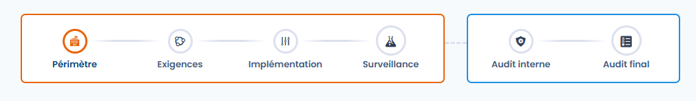
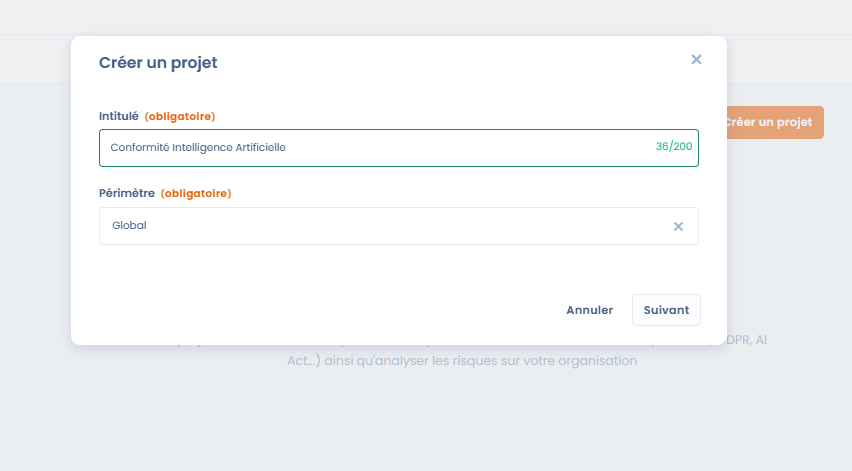
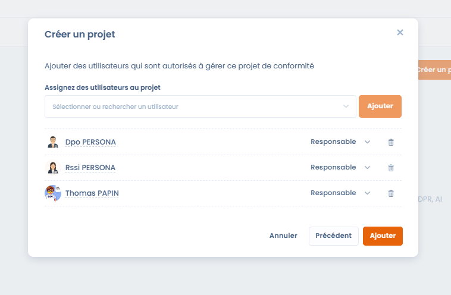
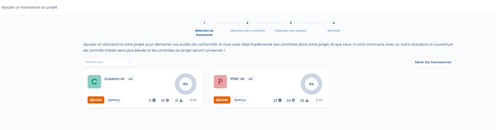
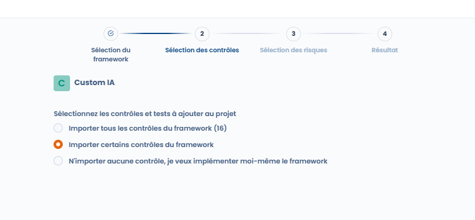
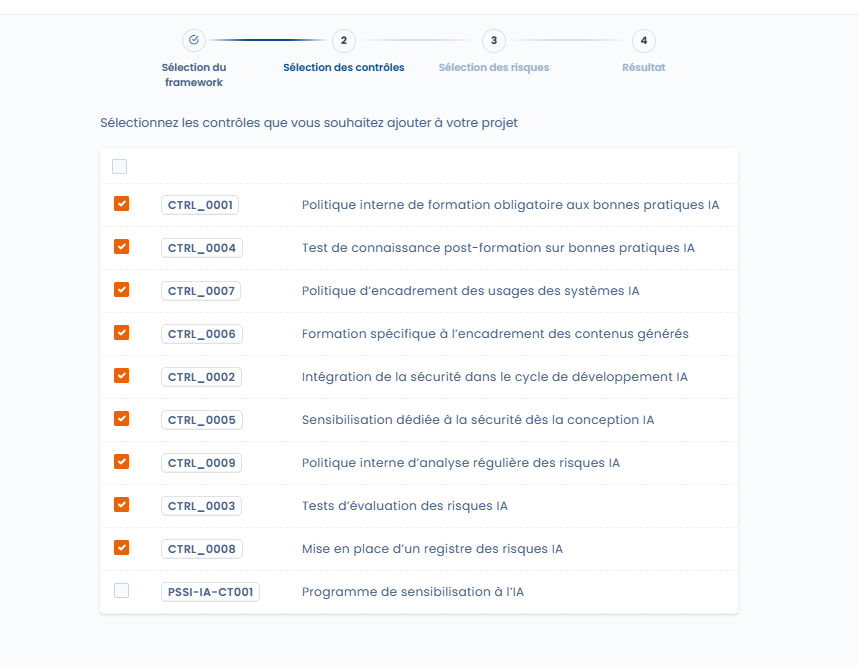
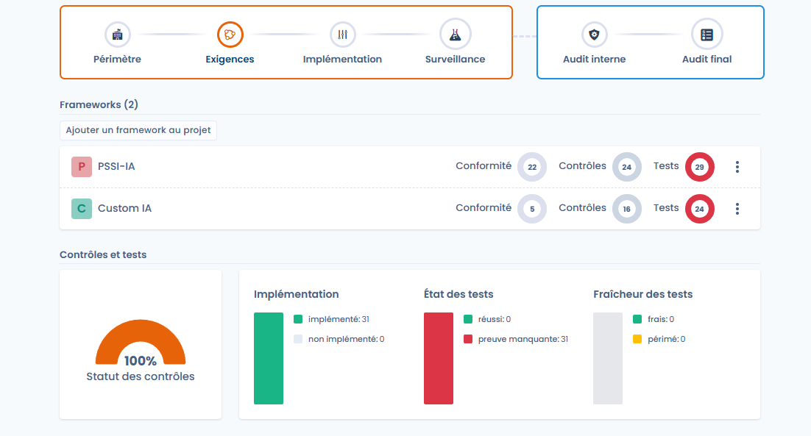
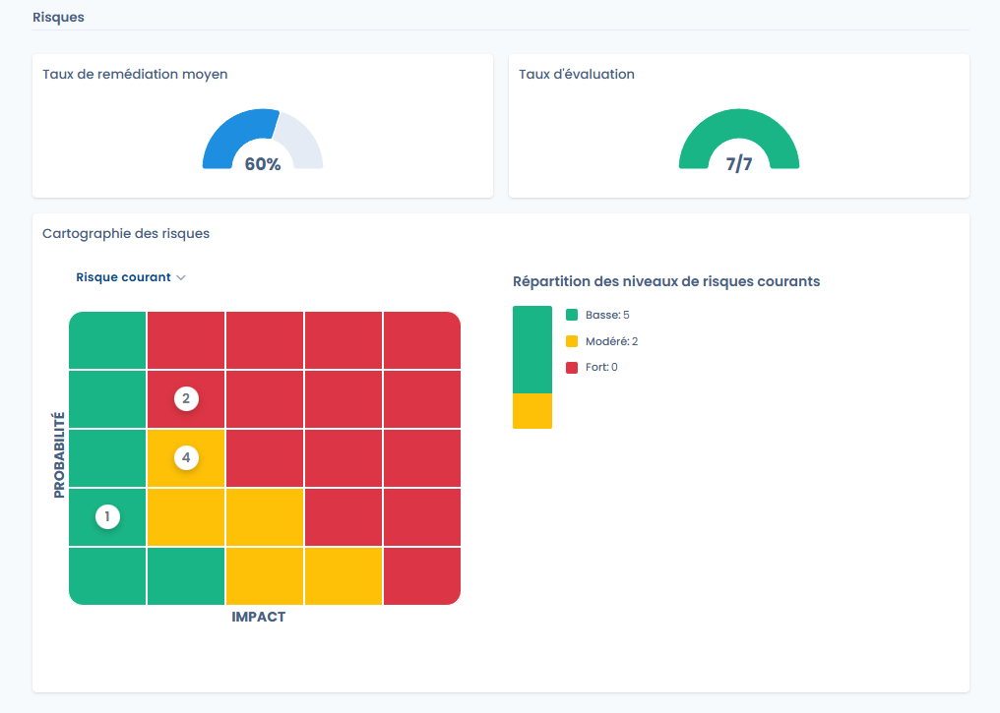

# Projektgestaltung

In der Phase **Konzeption** legen Sie den **organisatorischen Scope** des Projekts fest, wählen die **anwendbaren Frameworks** aus und initialisieren automatisch die zugehörigen Kontrollen, Tests und Risiken.

Dieser Schritt legt die Grundlagen des Projekts und bestimmt die Qualität der Überwachung in den folgenden Phasen. Einen Überblick über die Phasen finden Sie unter [Projekte](README.md).

***

<figure><figcaption></figcaption></figure>

## 1. Das Projekt erstellen und den Scope festlegen

Beim Erstellen des Projekts muss ein **organisatorischer Scope** ausgewählt werden.\
Der Scope fasst eine oder mehrere Organisationseinheiten zusammen und bestimmt **den Anwendungsbereich des Compliance-Projekts**.



Nach dem Erstellen des Projekts wird der Scope in der Kopfzeile des Projekts angezeigt und im gesamten Compliance-Zyklus verwendet.



<figure><figcaption></figcaption></figure>



***

## 2. Nutzer dem Projekt zuweisen



<figure><figcaption></figcaption></figure>



In der Konzeptionsphase können Sie außerdem **die Nutzer bestimmen, die das Projekt verwalten dürfen**.

* Jedem Nutzer kann eine Rolle zugewiesen werden: **Verantwortlich** oder **Informiert**.
* Diese Nutzer dürfen die Kontrollen, Tests und Audits des Projekts steuern.



***

<figure><figcaption></figcaption></figure>

## 3. Compliance-Frameworks hinzufügen

Ein Compliance-Projekt beruht auf einem oder mehreren **Frameworks** (Standards, interne oder benutzerdefinierte Referenzwerke).

Durch das Hinzufügen eines Frameworks importieren Sie:

* die **Anforderungen**,
* die **Kontrollen**,
* die **Tests**,
* und die zugehörigen **Risiken**.

<figure><figcaption></figcaption></figure>

Es werden nur die veröffentlichten Versionen eines Frameworks angeboten. Gibt es mehrere veröffentlichte Versionen, wählen Sie die Version in der Liste **Zu installierende Version**, die neben dem Namen des Frameworks angezeigt wird; die aktuelle Version ist vorausgewählt.

Das Projekt bleibt an die installierte Version gebunden. Ist sie nicht mehr die aktuelle Version, zeigt die Framework-Karte in der Projektübersicht das Badge **Update verfügbar** an. Der Wechsel zu einer anderen Version erfolgt manuell mit der Aktion **Die Version des Frameworks aktualisieren**; sie ist nicht möglich, solange im Projekt ein Audit läuft (siehe [Framework-Versionen](../library/frameworks/versions.md)).

Mehrere Frameworks können nacheinander zum selben Projekt hinzugefügt werden.

***

## 4. Kontrollen zwischen Frameworks gemeinsam nutzen

Werden dem Projekt mehrere Frameworks hinzugefügt, erkennt Dastra automatisch die **gemeinsamen Kontrollen**.

* Eine Kontrolle, die von mehreren Frameworks geteilt wird, **wird nur einmal importiert**.
* Ihre Umsetzung deckt gleichzeitig alle zugehörigen Anforderungen ab.
* So lässt sich die Compliance-Abdeckung erhöhen, ohne die Maßnahmen zu vervielfachen.

<figure><figcaption></figcaption></figure>

***

## 5. Die zu importierenden Kontrollen auswählen

Beim Hinzufügen eines Frameworks stehen mehrere Optionen zur Verfügung:

* **alle Kontrollen** des Frameworks importieren,
* **nur bestimmte Kontrollen** importieren,
* oder **keine Kontrollen importieren**, um sie manuell umzusetzen.

<figure><figcaption></figcaption></figure>

Diese Flexibilität ermöglicht es, das Projekt an den Reifegrad der Organisation anzupassen.

***

## 6. Kontrollen und Tests initialisieren



Sobald die Frameworks importiert sind:

* Die **ausgewählten Kontrollen** werden automatisch zum Projekt hinzugefügt.
* Sie gelten standardmäßig als **implementiert**.
* Die **zugehörigen Tests** werden ebenfalls den Kontrollen zugeordnet.

In diesem Stadium:

* haben die Tests den Status **„Beweis fehlt“**,
* wurden noch keine Nachweise gesammelt.







***

## 7. Die Risikoanalyse vorbereiten

Die **Risiken der Frameworks** können beim Import ausgewählt werden.

Sie bilden:

* die Grundlage für die **anfängliche Risikobewertung**,
* den Bezugspunkt für die Berechnung des **Restrisikos**, nachdem die Kontrollen angewendet wurden.

<figure><figcaption></figcaption></figure>

***

## Ein Framework aus dem Projekt entfernen

In der **Übersicht** des Projekts bietet das Menü **⋯** einer Framework-Karte die Aktion **Das Framework entfernen**. Dastra entfernt dann aus dem Projekt die Kontrollen, Tests, Risiken und Bedrohungen, die nur an dieses Framework gebunden sind. Eine Kontrolle, die das Projekt noch über ein anderes Framework anwendet, bleibt erhalten.

Das Entfernen ist nicht möglich, solange ein Audit dieses Frameworks nicht archiviert ist (siehe [Audits](audits.md)).

***

## Ergebnis der Konzeptionsphase

Am Ende der Konzeptionsphase verfügt das Projekt über:

* einen klar definierten Scope,
* benannte Inhaber,
* die importierten anwendbaren Frameworks,
* gemeinsam genutzte Kontrollen, die bereit für die Überwachung sind,
* initialisierte Tests,
* und eine strukturierte Risikobasis.

Das Projekt ist dann bereit für die nächste Phase: **Implementierung**.
