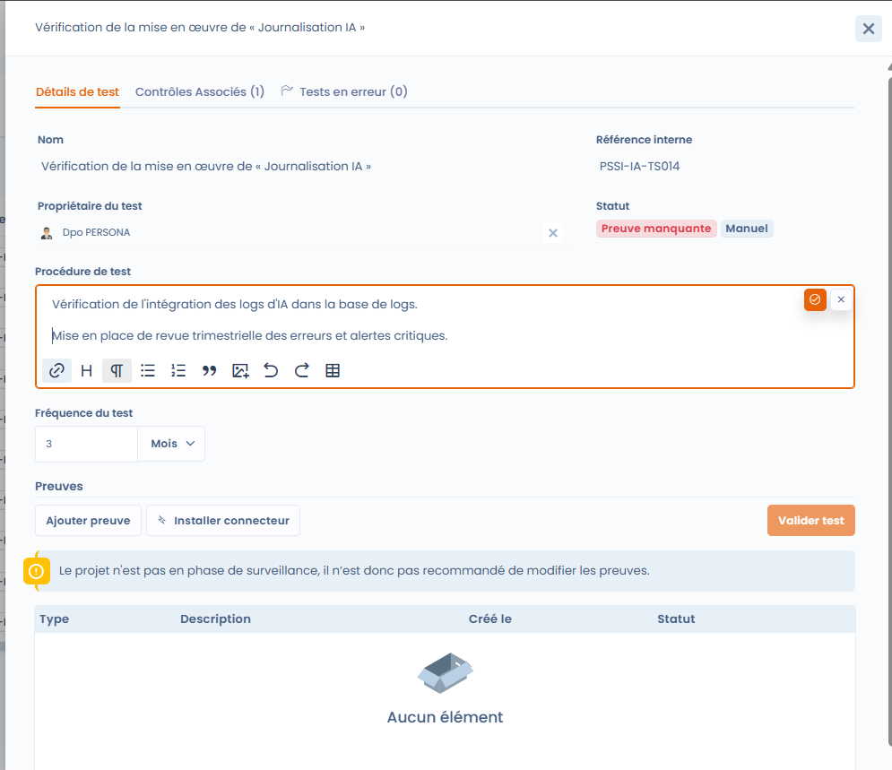
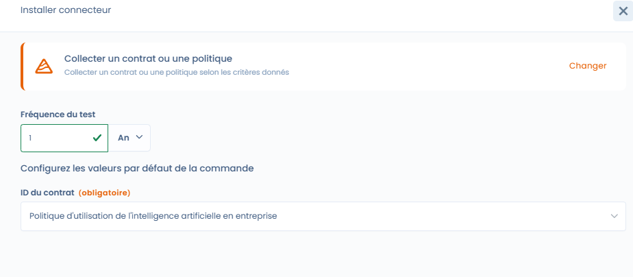
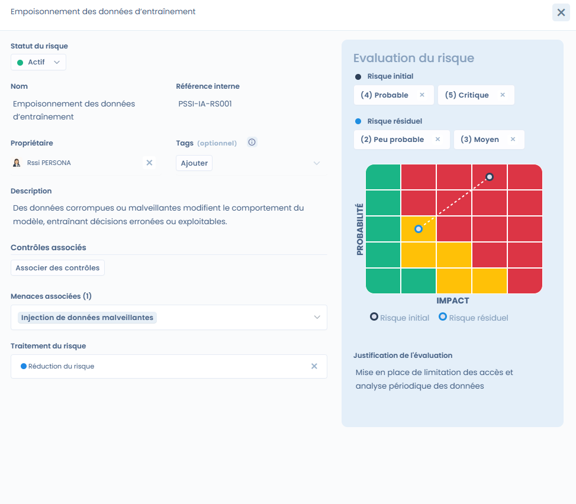
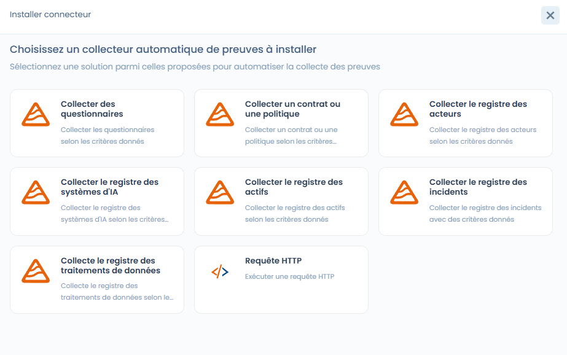

# Projektimplementierung

Die Phase **Implementierung** markiert den Übergang vom theoretischen Rahmen zur operativen Umsetzung der Compliance. Sie besteht darin, die **Kontrollen konkret zu konfigurieren**, die Überprüfungsmethoden festzulegen und die Sammlung von Nachweisen vorzubereiten.

In diesem Stadium verfügt das Projekt bereits über:

* seine Frameworks,
* seine Kontrollen,
* seine in der Konzeptionsphase initialisierten Tests und Risiken.

***

## Ziel der Phase

Das Ziel der Implementierungsphase ist es:

* festzulegen, **wie die Kontrollen überprüft werden**,
* die **Tests (manuell oder automatisiert)** zu konfigurieren,
* die **Risiken den Kontrollen zuzuordnen**,
* die **Sammlung der Compliance-Nachweise** vorzubereiten.

***

## 1. Den Status der Tests in der Implementierungsphase verstehen

Standardmäßig haben alle Tests des Projekts den Status **„Beweis fehlt“**.

Das bedeutet:

* die Kontrolle existiert,
* der Test ist definiert,
* aber **es wurde noch kein Nachweis erbracht oder gesammelt**.

Solange sich das Projekt nicht in der Phase **Überwachung** befindet, wird davon abgeraten, Nachweise zu ändern oder zu bestätigen: Dastra zeigt eine Warnung an, ohne Sie zu blockieren.

<figure><figcaption></figcaption></figure>

***

## 2. Compliance-Tests konfigurieren

Jede Kontrolle lässt sich mithilfe eines oder mehrerer **Tests** überprüfen.



Ein Test ermöglicht es, Folgendes festzulegen:

* ein **Überprüfungsverfahren**,
* eine **Ausführungshäufigkeit** (z. B. monatlich, vierteljährlich, jährlich),
* einen **Inhaber des Tests**.

Tests können sein:

* **manuell**: Sie erfordern eine menschliche Handlung und Nachweise,
* oder **automatisiert**: über einen Dastra-Konnektor oder einen benutzerdefinierten Konnektor.



<figure><figcaption></figcaption></figure>



***

## Status und Ausschluss einer Kontrolle

Jede Kontrolle des Projekts hat einen **Status der Überprüfung**, den Sie in der Liste der Registerkarte **Kontrollen** oder im Fenster der Kontrolle ändern können:

| Status | Bedeutung |
| --- | --- |
| **Entwurf** | Die Kontrolle ist identifiziert, aber noch nicht umgesetzt. Sie zählt zu den nicht umgesetzten Kontrollen. |
| **Implementiert** | Die Kontrolle ist eingerichtet. Das ist der Status von Kontrollen, die mit einem Framework importiert wurden. Sie gilt als bestätigt, wenn alle ihre Tests bestanden sind. |
| **Ausgeschlossen** | Die Kontrolle gilt für das Projekt nicht. |

Um eine Kontrolle auszuschließen, wählen Sie **Ausgeschlossen**: Der Dialog **Den Ausschluss von der Kontrolle begründen** öffnet sich. Geben Sie den Grund im Feld **Bitte erläutern Sie, warum diese Kontrolle ausgeschlossen werden sollte** ein (höchstens 2.000 Zeichen). Die Begründung ist in diesem Dialog optional, Sie sollten sie aber ausfüllen: Sie wird an der Kontrolle und bei Audits angezeigt und in die Anwendungserklärung übernommen, in der eine ausgeschlossene Kontrolle als nicht anwendbar gekennzeichnet wird (siehe [Compliance-Überwachung](monitoring.md)).

Eine ausgeschlossene Kontrolle wird nicht mehr bewertet: Bei einem Audit wird statt ihrer Tests die Begründung angezeigt. Wird eine ausgeschlossene Kontrolle in einer Sammelaktion erneut zum Projekt hinzugefügt, wird sie wieder aktiviert.

<figure><figcaption></figcaption></figure>

***

## Allen Kontrollen und Tests einer Anforderung einen Inhaber zuweisen

In der Registerkarte **Anforderungen** des Projekts öffnet die Nutzerschaltfläche rechts neben einer Anforderung den Dialog **Weisen Sie allen Kontrollen und Tests einen Inhaber zu**. Das spart zu Beginn der Implementierung Zeit, vor dem Checklistenschritt **Zuweisung von Inhabern zu Tests**.

1. Klicken Sie auf die Schaltfläche der betreffenden Anforderung. Die Aktion gilt für die Anforderung und ihre Unteranforderungen.
2. Wählen Sie unter **Wählen Sie einen Nutzer aus, der als Inhaber zugewiesen werden soll** die Person aus.
3. Schalten Sie **Bestehende Zuweisungen für Inhaber überschreiben** ein, wenn Sie die bereits festgelegten Inhaber ersetzen möchten. Andernfalls werden nur Elemente ohne Inhaber ausgefüllt.
4. Klicken Sie auf **Bestätigen**.

Dafür ist Schreibzugriff auf die operative Compliance erforderlich.

<figure><figcaption></figcaption></figure>

***

## 3. Risiken zuordnen und bewerten

Kontrollen lassen sich mit einem oder mehreren **Risiken** verknüpfen, um ihre Wirkung auf die Risikoreduzierung zu messen.

Für jedes Risiko können Sie:

* eine **anfängliche Bewertung** festlegen (Eintrittswahrscheinlichkeit × Auswirkung),
* eine **Restbewertung** festlegen, nachdem die Kontrollen angewendet wurden,
* die **Risikobehandlung** wählen (Reduzierung, Akzeptanz usw.).

So lässt sich die Wirkung der Kontrollen auf die Risikolage konkret sichtbar machen.

<figure><figcaption></figcaption></figure>

### Risiken auf einer Karte darstellen

In der Registerkarte **Risiken** des Projekts wechselt die Auswahl über der Liste zwischen der Ansicht **Tabelle**, die jedes Risiko mit seinen Werten auflistet, und der Ansicht **Kartografie**, die die Risiken in einer Matrix aus Eintrittswahrscheinlichkeit × Auswirkung darstellt.

Die Ansicht **Kartografie** zeigt drei Matrizen nebeneinander:

* **Anfängliches Risiko**: das Niveau, das bei der Identifizierung des Risikos bewertet wurde, vor jeder Abhilfemaßnahme;
* **Aktuelles Risiko**: das Niveau zu einem bestimmten Zeitpunkt, basierend auf dem tatsächlichen Fortschritt der Abhilfemaßnahmen und Kontrollen;
* **Restrisiko**: das Niveau, das erwartet wird, sobald alle geplanten Maßnahmen umgesetzt sind, das heißt das Risiko, das die Organisation akzeptiert oder toleriert.

Filtern Sie nach **Framework**, um nur die Risiken eines Frameworks zu sehen, klicken Sie auf ein Risiko, um es zu öffnen, oder auf **Drucken**, um die Seite zu drucken. Wer Risiken sowohl als Tabelle als auch als Karte liest, kann sie leichter priorisieren und den Beteiligten vermitteln.

<figure><figcaption></figcaption></figure>

***

## 4. Bedrohungen, Risiken und Kontrollen verknüpfen

**Bedrohungen** stellen die konkreten Szenarien dar, die ein Risiko auslösen können\
(z. B. Einschleusen bösartiger Daten, fehlende Überwachung, Abfluss von Informationen).

Eine Bedrohung kann:

* mit einem oder mehreren **Risiken** verknüpft sein,
* indirekt durch die eingerichteten **Kontrollen** abgedeckt werden.

Diese Verkettung ermöglicht eine vollständige Nachvollziehbarkeit:\
**Bedrohung** > **Risiko** > **Kontrolle** > **Test** > **Nachweis**

***

## 5. Einen Konnektor installieren, um Nachweise zu automatisieren

Für bestimmte Tests ist es möglich, einen **Dastra-Konnektor** zu installieren, um die Sammlung von Nachweisen zu automatisieren.

Konnektoren ermöglichen zum Beispiel:

* das Vorhandensein einer Richtlinie oder eines Vertrags zu überprüfen,
* ein Verzeichnis (KI-Systeme, Assets, Vorfälle, Verarbeitungstätigkeiten, Dritte) oder die Audits abzufragen,
* wiederkehrende Kontrollen ohne manuelle Handlung zu automatisieren.

Die Liste der Konnektoren und ihre Konfiguration sind unter [Tests](../library/tests.md) beschrieben.

Jeder Konnektor wird konfiguriert mit:

* einer **Ausführungshäufigkeit**,
* **Erfassungsparametern**, die auf den Test abgestimmt sind.

<figure><figcaption></figcaption></figure>

***

## 6. Ergebnis der Implementierungsphase

Am Ende der Implementierungsphase:

* sind die **Kontrollen konfiguriert**,
* sind die **Tests bereit zur Ausführung**,
* sind die **Risiken bewertet und verknüpft**,
* sind eventuelle **Konnektoren installiert**.

Das Projekt ist dann bereit für die nächste Phase: **Überwachung**, in der:

* die Tests regelmäßig ausgeführt werden,
* die Nachweise gesammelt werden,
* und die Compliance im Zeitverlauf gemessen wird.
