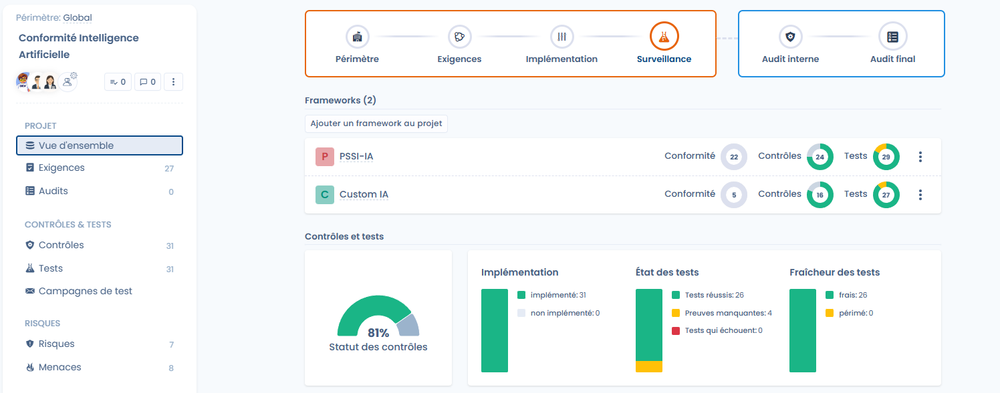
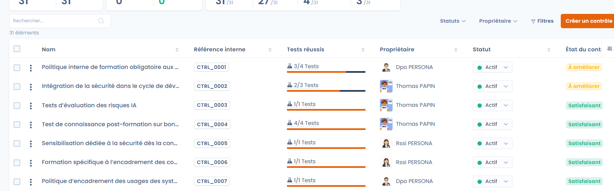
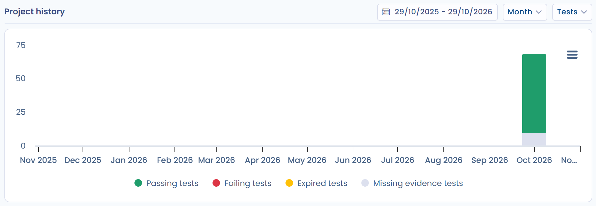
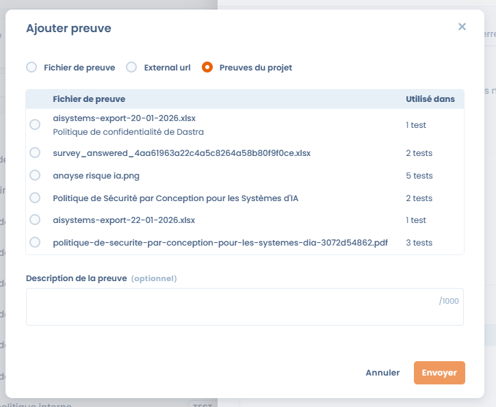
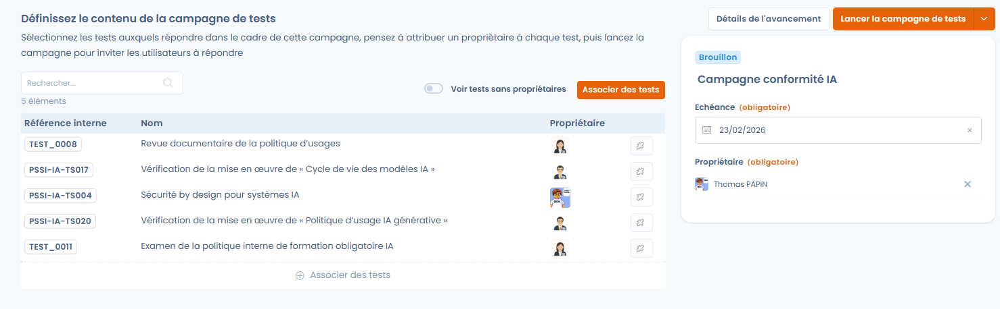
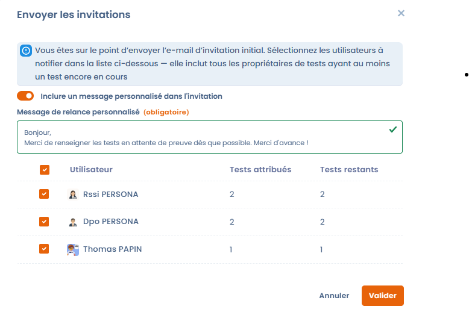
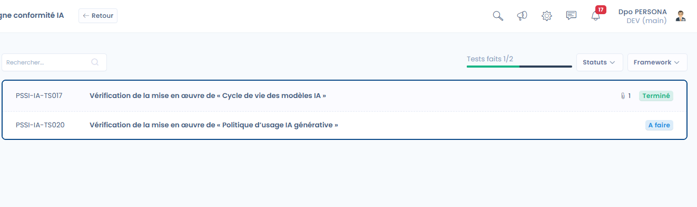
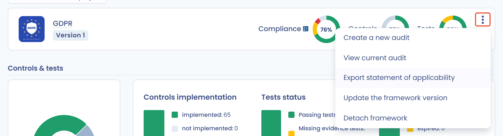

# Compliance-Überwachung

Die Phase **Überwachung** dient dazu, **die tatsächliche Wirksamkeit der Kontrollen im Zeitverlauf zu überprüfen**, die zugehörigen Nachweise zu sammeln und die Entwicklung der Compliance über wiederkehrende Testkampagnen zu verfolgen.

Ihr Ziel: Nachweise für das gesamte Projekt mithilfe von Testkampagnen sammeln, sicherstellen, dass möglichst viele Kontrollen bestanden werden, und ein im Zeitverlauf messbares Compliance-Niveau aufrechterhalten.

***

## Überblick über die Überwachungsphase

In dieser Phase wechselt das Projekt von einer Vorbereitungslogik zu einer **kontinuierlichen Ausführungslogik**:

* die Kontrollen sind bereits umgesetzt,
* die Tests werden regelmäßig ausgeführt,
* die Nachweise werden gesammelt, aktualisiert und bewertet,
* die Compliance-Kennzahlen werden aussagekräftig.

<figure><figcaption></figcaption></figure>

***

## Gesamtüberwachung der Kontrollen und Tests

Im Bereich **Kontrollen und Tests** des Projekt-**Überblicks** zeigen vier Kennzahlen kompakt den Projektstand:

* **Status der Kontrollen**: Anteil der validierten Kontrollen.
* **Implementierung**: umgesetzte oder nicht umgesetzte Kontrollen.
* **Teststatus**:
  * bestandene Tests,
  * Tests mit fehlenden Nachweisen,
  * fehlgeschlagene Tests.
* **Aktualität der Tests**:
  * aktuelle Tests,
  * abgelaufene Tests, die neue Nachweise erfordern.

Anhand dieser Kennzahlen erkennen Sie schnell, wo Handlungsbedarf besteht, und können Korrekturmaßnahmen priorisieren.

<figure><figcaption></figcaption></figure>

### Projektverlauf

Unterhalb dieser Kennzahlen zeigt die Grafik **Projektverlauf**, wie sich das Projekt im Zeitverlauf entwickelt. Wählen Sie den Zeitraum über die Datumsauswahl (höchstens 3 Jahre) und legen Sie dann fest:

* **Zeiteinheit**: **Tag**, **Woche**, **Monat** oder **Jahr**;
* **Metrik**: **Tests**, **Kontrollen**, **Anforderungen**, **Risiken** oder **Compliance**.

Mit der Grafik können Sie der Geschäftsleitung oder den Auditoren den Compliance-Fortschritt zeigen.

<figure><figcaption></figcaption></figure>

***

## Nachweisverwaltung



Nachweise sind das Herzstück der Überwachungsphase.\
Sie können direkt an einem Test mit **Nachweis hinzufügen** ergänzt und **für mehrere Tests des Projekts wiederverwendet** werden.

Zu den verfügbaren Erfassungsmethoden gehören insbesondere:

* das Hinzufügen von Nachweisdateien,
* externe Links,
* die Auswahl von Nachweisen, die bereits im Projekt vorhanden sind.

Jeder Nachweis kann mit einer **Beschreibung des Nachweises** dokumentiert werden, um spätere Audits zu erleichtern.



<figure><figcaption></figcaption></figure>



***

## Testkampagnen

**Testkampagnen** ermöglichen es, die Ausführung von Tests im großen Maßstab zu steuern. Sie werden im Tab **Testkampagnen** des Projekts verwaltet.

Mit einer Kampagne können Sie:

* eine Reihe auszuführender Tests zusammenfassen,
* jedem Test einen Inhaber zuweisen,
* eine Gesamtfrist festlegen,
* den Fortschritt zentral verfolgen.

Um eine Kampagne zu erstellen, klicken Sie auf **Erstellen Sie eine Testkampagne** und geben die **Bezeichnung der Kampagne** ein. Sie können alle Tests Ihres Projekts, die auf Nachweise warten, vorab auswählen, um den Start zu erleichtern. Die Kampagne öffnet sich dann in der Konfiguration: **Legen Sie den Inhalt der Testkampagne fest**, prüfen Sie, dass jeder Test einen Inhaber hat, und starten Sie dann die Kampagne.


Hat einer oder haben mehrere Tests der Kampagne keinen Inhaber, zeigt Dastra eine Warnung an und bittet Sie, diese vor dem Versand der Einladungen zu prüfen. Mit **Tests ohne Inhaber anzeigen** finden Sie sie.


Eine Kampagne außerhalb der Phase **Überwachung** zu starten, wird nicht empfohlen: Dastra zeigt eine Warnung an, blockiert Sie aber nicht.

<figure><figcaption></figcaption></figure>

***

## Kampagnen starten und verfolgen



Sobald die Kampagne konfiguriert ist:

* erhalten die betroffenen Nutzer eine **Einladung per E-Mail**, die Sie mit **Einladungen versenden** verschicken, nachdem Sie die zu benachrichtigenden Inhaber ausgewählt haben,
* kann eine persönliche Nachricht hinzugefügt werden, um die Anfrage in den Kontext zu stellen,
* durchläuft jeder Test einzeln seine Status (_zu erledigen_, _zur Freigabe vorgelegt_, _abgeschlossen_).

Der Gesamtfortschritt der Kampagne ist in Echtzeit sichtbar, sodass der Projektverantwortliche Verzögerungen oder Blockaden schnell erkennt.



<figure><figcaption></figcaption></figure>



### Eine Kampagne erinnern, abschließen und verfolgen

In der Liste der Kampagnen bietet das Menü **⋯** jeder Zeile:

* **Bitte senden Sie mir eine Erinnerung**: Wählen Sie die Inhaber aus, die noch Tests abzuschließen haben. Es wird eine Standarderinnerung versendet, der Sie eine **Personalisierte Erinnerungsnachricht** hinzufügen können;
* **Kampagne abschließen**: beendet die Kampagne; **Kampagne erneut starten** setzt sie wieder in Bearbeitung;
* **Link kopieren**: kopiert den Link zur Kampagne;
* **In den Papierkorb verschieben**: entfernt die Kampagne aus der Liste. Mit **Wiederherstellen** holen Sie sie zurück, mit **Löschen** entfernen Sie sie endgültig.

**Details** öffnet das Dashboard der Kampagne: Anzahl der Tests, Teilnehmer und Frameworks, validierte Tests, **Abschlussrate pro Nutzer** (abgeschlossene Tests, Tests zur Freigabe und zu erledigende Tests) und **Verteilung der Tests nach Framework**.

***

## Tests validieren

Jeder Test durchläuft einen klaren Lebenszyklus:

* das **Testverfahren** einsehen,
* die Nachweise hinzufügen oder aktualisieren,
* den Test mit **Test bestätigen** validieren.

Das Ergebnis eines Tests lautet **Erfolgreich**, **Fehler**, **Beweis fehlt** oder **Nachweis abgelaufen**. Bei einem manuellen Test setzt **Test bestätigen** ihn auf **Abgeschlossen**; **Test ungültig machen** hebt die Validierung auf. Nach der Validierung trägt der Test automatisch dazu bei, den Status der zugehörigen Kontrolle und die Gesamtkennzahlen des Projekts zu verbessern.

Die Einladung führt die Nutzer zu einem persönlichen Verfolgungs-Dashboard, in dem sie die Nachweise für die ihnen zugewiesenen Tests ausfüllen können. Diese Ansicht ist auch über **Meine Tests** erreichbar (siehe [Projekte](README.md)). Hat ein Nutzer alle seine Tests abgeschlossen, zeigt Dastra eine Glückwunschnachricht mit der Schaltfläche **Meine Aufgaben anzeigen**.

<figure><figcaption></figcaption></figure>

***

## Export der Erklärung zur Anwendbarkeit (SOA)

Die **Erklärung zur Anwendbarkeit** (Statement of Applicability, SOA) ist das Referenzdokument, das alle Kontrollen eines Frameworks des Projekts zusammenführt. Sie wird für Zertifizierungsaudits verwendet, zum Beispiel nach ISO 27001, und um Ihrer Geschäftsleitung oder Ihren Auditoren die Abdeckung der Anforderungen nachzuweisen.

Der Export erfolgt pro Framework als XLSX-Datei:

1. Öffnen Sie das Compliance-Projekt.
2. Klicken Sie im **Überblick** auf das Menü **⋯** der Framework-Karte oder öffnen Sie den Tab **Anforderungen** und verwenden Sie das Menü **⋯** des Frameworks.
3. Klicken Sie auf **Anwendungserklärung exportieren**.

Erforderlich ist der Zugriff auf den Export der operativen Compliance.

<figure><figcaption></figcaption></figure>

Die Datei enthält eine Zeile pro Kontrolle mit den folgenden Spalten:

| Spalte | Inhalt |
| --- | --- |
| `ControlId` | Referenz der Kontrolle. |
| `Label` | Name der Kontrolle. |
| `Description` | Beschreibung der Kontrolle, ohne Formatierung. |
| `Applicable` | Anwendbarkeit: Eine Kontrolle mit dem Status **Ausgeschlossen** ist nicht anwendbar. |
| `Justification` | Begründung des Ausschlusses, die an der Kontrolle eingetragen ist (siehe [Status und Ausschluss von Kontrollen](implement.md)). |
| `ImplementationStatus` | Status der Kontrolle: **Entwurf**, **Implementiert** oder **Ausgeschlossen**. |
| `Evidence` | Verweise auf die Nachweise, die an den Tests der Kontrolle erfasst wurden. |
| `Auditor` | Inhaber der Kontrolle. |
| `RequirementNodes` | Anforderungen, die von der Kontrolle abgedeckt werden. |

***

## Erwartetes Ergebnis der Überwachungsphase

Am Ende dieser Phase verfügt das Projekt über:

* **gesammelte und nachvollziehbare Nachweise**,
* **regelmäßig ausgeführte und aktualisierte Tests**,
* eine **verlässliche und messbare Sicht auf die tatsächliche Compliance**,
* eine solide Grundlage für die Vorbereitung der Phasen **interne Prüfung** und **Zertifizierung**.
