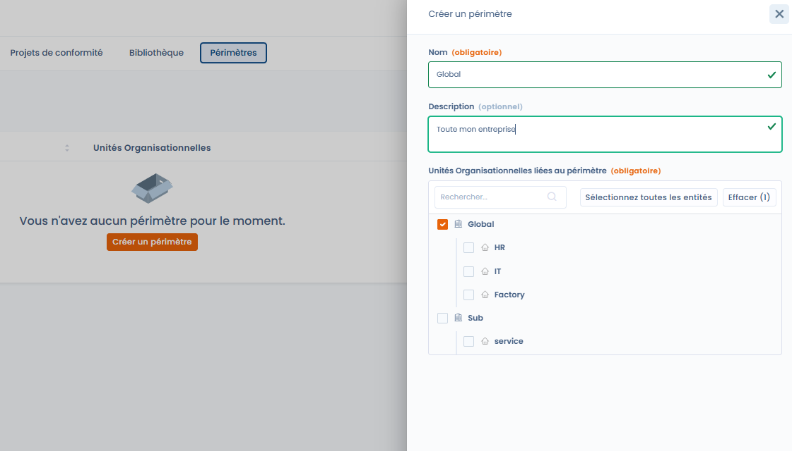

# Scopes

Mit ihnen werden **Organisationseinheiten** gruppiert, um einen Compliance-Ansatz auf die gesamte Organisation oder auf Teile davon anzuwenden.

Ein Scope beantwortet eine einfache Frage:

> _Für welche organisatorischen Einheiten gilt dieses Compliance-Projekt?_

***

## Rolle der Scopes in Dastra

In Dastra werden Scopes ausschließlich in **Compliance-Projekten** verwendet.\
Sie ermöglichen es:

* die betroffenen Einheiten genau zu bestimmen,
* die Anforderungen, Kontrollen und Tests an die richtige Ebene anzupassen,
* die Compliance an der organisatorischen Realität auszurichten.

Ein Scope ändert die Frameworks nicht:\
Er legt fest, **wo** die Compliance gilt, nicht **was** gilt.

***

## Eine flexible organisatorische Gliederung

Ein Scope wird aus den **Organisationseinheiten** gebildet, die im Mandanten vorhanden sind.

Er kann Folgendes darstellen:

* das gesamte Unternehmen (z. B. _Global_)
* einen Geschäftsbereich oder eine Abteilung (z. B. _IT_, _HR_)
* einen Standort, eine Tochtergesellschaft oder eine bestimmte Tätigkeit

Organisationseinheiten können einzeln oder gruppenweise ausgewählt werden, unter Berücksichtigung ihrer Hierarchie.

***

## Einen Scope erstellen

Beim Erstellen eines Scopes geben Sie an:

* **den Namen des Scopes** (z. B. _Global_, _IT & Sicherheit_)
* eine **optionale Beschreibung**
* die **Organisationseinheiten**, die zum Scope gehören (Pflichtangabe)

<figure><figcaption></figcaption></figure>

Ein Scope muss immer **mindestens eine Organisationseinheit** enthalten.

***

## Beispiel für einen Scope

Beispiel:

* **Name**: Global
* **Beschreibung**: Das gesamte Unternehmen
* **Organisationseinheiten**:
  * Global
  * HR
  * IT
  * Fabrik
  * Sub / Service

Dieser Scope kann anschließend in einem Compliance-Projekt ausgewählt werden, um anzugeben, dass das Projekt für die gesamte Organisation gilt.

***

## Bewährte Vorgehensweisen

* Legen Sie einen **globalen Scope** für bereichsübergreifende Ansätze an
* Legen Sie **enger gefasste Scopes** für gezielte Projekte an
* Verwenden Sie Scopes projektübergreifend wieder, um die Konsistenz zu gewährleisten
* Benennen Sie Scopes eindeutig und fachlich orientiert

***

## Verknüpfung mit Compliance-Projekten

Scopes werden **beim Erstellen eines Compliance-Projekts** ausgewählt.

Sie ermöglichen es:

* dasselbe Framework auf mehrere Einheiten anzuwenden,
* die Compliance nach Scope zu verfolgen,
* die Ergebnisse verschiedener Teile der Organisation zu vergleichen.

***

## Zusammenfassung

Scopes sind ein Werkzeug zur **organisatorischen Abgrenzung**.\
Sie ermöglichen es, die Compliance an der tatsächlichen Struktur des Unternehmens auszurichten, ohne die Referenzdaten komplizierter zu machen.
