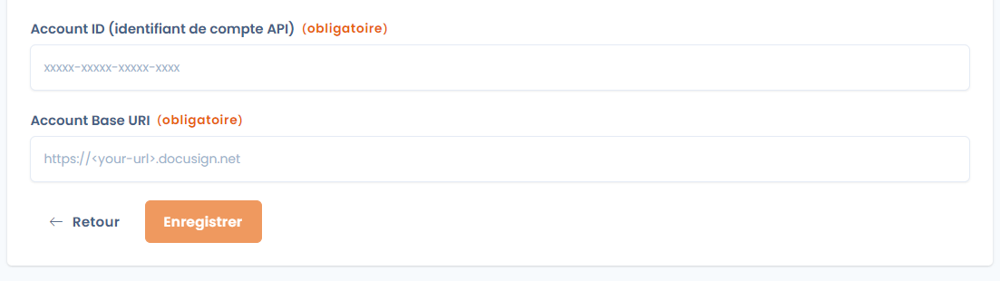

# Integration mit Docusign

Dastra ist nativ in DocuSign integriert, die Lösung für elektronische Signaturen. Sie senden ein Dokument zur Unterzeichnung, verfolgen den Status der Unterschrift und finden ihn direkt im Modul **Verträge und Richtlinien** aktuell wieder.

## Die Integration installieren

1. Öffnen Sie **Mandanteneinstellungen** > **Integrationen** und klicken Sie dann auf die Karte **Docusign**.

   <figure><figcaption>
Docusign in den Integrationen auswählen
</figcaption></figure>
2. Klicken Sie beim Anwendungsfall Verträge auf **Integration hinzufügen**.
3. Erstellen Sie im Schritt **Anmeldung** die Verbindung: Dastra leitet Sie zur Authentifizierung bei Docusign weiter, um Ihr Docusign-Konto mit Dastra zu verknüpfen.
4. Geben Sie im Konfigurationsschritt **Konto-ID (API-Konto-ID)** und **Account Base URI** ein. Beides finden Sie in Ihrem Docusign-Konto auf der Seite [Apps and Keys](https://apps.docusign.com/admin/apps-and-keys).

   <figure><figcaption>
Die Schlüssel, die Sie aus Ihrem Docusign-Konto in Dastra eingeben
</figcaption></figure>
5. Speichern Sie. Dastra prüft das Konto bei Docusign.

Damit ist die Installation abgeschlossen: Die Signatur über Docusign steht im Signaturfenster Ihrer Dokumente zur Verfügung. Wie Verbindungen und Anwendungsfälle allgemein funktionieren, ist unter [Verbindungen, Anwendungsfälle und Feld-Mapping](../integrations/connections.md) beschrieben.

## Ein Dokument zur Unterzeichnung senden

Um ein Dokument zu senden, benötigen Sie:

* einen Unterzeichner, dessen Stakeholder über eine gültige E-Mail-Adresse verfügt;
* mindestens einen Anhang zur Unterzeichnung im Format PDF, DOC oder DOCX;
* einen Betreff für die Einladungs-E-Mail.

Wählen Sie im Fenster **Signatur hinzufügen** den Modus **Bitte unterzeichnen Sie mit Docusign®.** (siehe [Ein Dokument unterzeichnen](sign.md)). Ist die Integration nicht installiert, zeigt das Fenster die Schaltfläche **Integration installieren** an, die ihre Einstellungen öffnet.

### Optionen für den Versand

Füllen Sie die folgenden Felder aus:

* **Bitte wählen Sie die Stakeholder aus, deren Unterschrift Sie erfassen möchten.**: die Unterzeichner, an die die Anfrage gesendet wird. Ein Stakeholder ohne E-Mail-Adresse oder der bereits unterzeichnet hat, kann nicht ausgewählt werden. Die Schaltfläche **Aktualisieren** lädt die Liste nach einer Änderung neu.
* **Wählen Sie die Anhänge aus, die der Signaturanforderung hinzugefügt werden sollen.**: die PDF-, DOC- oder DOCX-Dateien, die zur Unterzeichnung gesendet werden. Alle gültigen Anhänge sind standardmäßig angekreuzt.
* **Betreff der Einladungs-E-Mail**: der Betreff der E-Mail, die an die Unterzeichner gesendet wird (höchstens 80 Zeichen).
* **Bereitstellung detaillierter Anweisungen zum Unterzeichnen des Dokuments**: ein optionaler Text, der in der Einladungs-E-Mail enthalten ist und für den Unterzeichner in der Docusign-Oberfläche sichtbar ist.

Zwei optionale Einstellungen vervollständigen die Anfrage:

* **Automatisches Hinzufügen einer Signaturposition (mit Textanker)**: verfügbar, wenn alle Anhänge PDF-Dateien sind. Für jeden Unterzeichner zeigt Dastra den Text an, der an der Stelle in das Dokument eingefügt werden muss, an der er unterschreiben soll, zum Beispiel `[Signature Signer name]`. Die Unterschrift wird an diesem Text positioniert.
* **Fügen Sie automatisch Initialen auf jeder Seite des Dokuments hinzu**: verfügbar, wenn die Signaturposition aktiviert ist.

Klicken Sie auf **Senden**, um die Anfrage zu senden. Die Unterzeichner erhalten von Docusign eine Einladungs-E-Mail.

## Die Unterschrift verfolgen

Nach dem Senden der Anfrage wird der Status der Unterschrift mit Ihrem Dokument synchronisiert und aktualisiert, sobald er sich bei Docusign ändert. Im Tab **Unterzeichner** zeigt die Zeile des Unterzeichners **Unterschrift ausstehend** an, bis er unterschreibt.

<figure><figcaption>
Eine ausstehende Unterschrift
</figcaption></figure>
