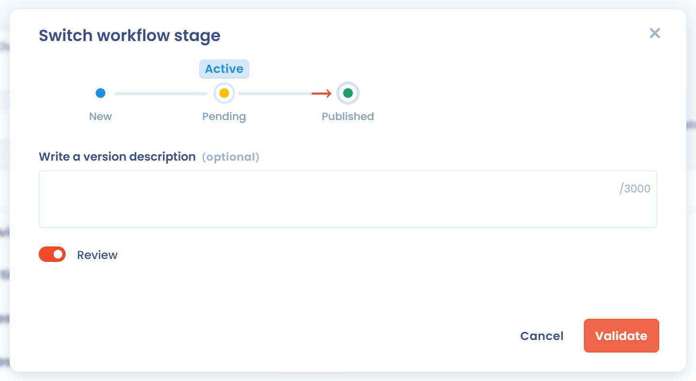

# Regelmäßige Überprüfung von Dokumenten

Die regelmäßige Überprüfung legt für Ihre Dokumente ein Überprüfungsdatum fest und senkt ihre Aktualität, je näher dieses Datum rückt. So lesen Sie Ihre Verträge und Richtlinien erneut durch, bevor sie veralten. Das Prinzip, die Status und die Anzeigeregeln sind unter [Regelmäßige Überprüfung (Aktualität)](../regular-review.md) beschrieben. Diese Seite zeigt, wo Sie die Funktion im Modul **Verträge und Richtlinien** finden.

## Die regelmäßige Überprüfung aktivieren

Klicken Sie im Verzeichnis auf den Pfeil rechts neben der Schaltfläche **Ein Dokument erstellen** und dann auf **Regelmäßige Überprüfung (Aktualität) konfigurieren**. Der Eintrag zeigt an, ob die Überprüfung für Dokumente aktiviert oder deaktiviert ist, und öffnet die Einstellungen der regelmäßigen Überprüfung des Mandanten. Er steht Nutzern mit der Berechtigung für die erweiterte Konfiguration zur Verfügung.

Die dort festgelegte Häufigkeit gilt für alle Dokumente.

## Ein Dokument überprüfen

Sobald die Überprüfung aktiviert ist, zeigt die Akte jedes Dokuments den Aktualitätsindikator im Menü der Kurzbefehle an (siehe [Struktur eines Dokuments](structure.md)). Er ist nur für veröffentlichte Dokumente aktiv. Solange das Dokument nicht veröffentlicht ist, bleibt der Indikator ausgegraut.

Klicken Sie auf den Indikator, um das Fenster zur Überprüfung zu öffnen. Wählen Sie im Tab **Neue Überprüfung** den **Verantwortlichen für die Überprüfung**, das Datum der Überprüfung (Feld **Überprüfung**) und bei Bedarf eine Beschreibung. Dastra berechnet das **Datum vor der nächsten Überprüfung** anhand der Häufigkeit des Mandanten. Mit **Ändern Sie das Datum der nächsten Überprüfung** können Sie es durch ein bestimmtes Datum ersetzen. Der Tab **Frühere Überprüfungen** enthält den Verlauf.

Wenn ein Dokument veraltet, erhält sein Inhaber eine E-Mail.

## Eine Überprüfung erfassen, wenn ein Dokument aktiv wird

Ist die regelmäßige Überprüfung aktiviert und verschieben Sie ein Dokument in einen Prozessschritt, dessen interner Status **Active** ist, öffnet sich das Fenster **Prozessschritt umschalten** mit einem Schalter **Überprüfung**, der standardmäßig eingeschaltet ist. Lassen Sie ihn eingeschaltet und klicken Sie auf **Bestätigen**: Dastra ändert den Schritt und erfasst gleichzeitig eine Überprüfung.

* Der Prüfer sind Sie, und als Datum der Überprüfung gilt der heutige Tag.
* Das **Datum vor der nächsten Überprüfung** wird anhand der Häufigkeit des Mandanten berechnet.
* Der Text, den Sie in die Versionsbeschreibung schreiben, wird als Beschreibung der Überprüfung übernommen.

<figure><figcaption>
Das Fenster für den Prozessschritt mit dem Schalter Überprüfung
</figcaption></figure>

Das Fenster erscheint, wenn Sie den Schritt von der Seite des Dokuments aus und über die Spalte **Schritt** der Liste ändern. Die Überprüfung aktualisiert die Daten der letzten und der nächsten Überprüfung des Dokuments und erscheint im Tab **Frühere Überprüfungen**. Schalten Sie den Schalter aus, wenn der Schrittwechsel nicht als Überprüfung zählen soll.

Wird der Schritt geändert, die Überprüfung aber nicht gespeichert, bittet eine Meldung Sie, sie im Fenster zur Überprüfung erneut zu erfassen.
