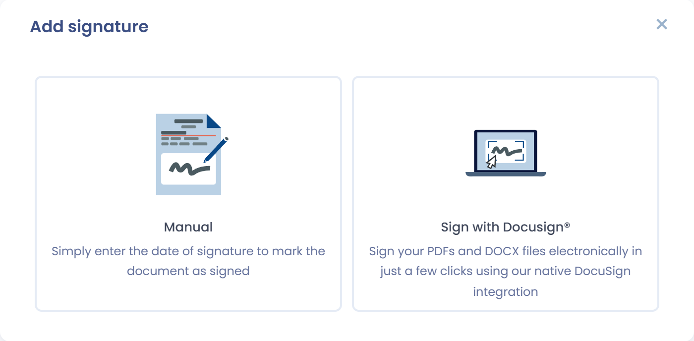
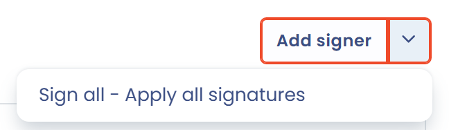
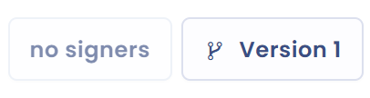

# Ein Dokument unterzeichnen

Sobald Sie Ihrem Dokument mindestens einen Unterzeichner hinzugefügt haben (siehe [Unterzeichner](signers.md)), können Sie seine Unterschrift verwalten. Speichern Sie das Dokument zuerst: Solange eine Änderung nicht gespeichert ist, sind die Schaltflächen für die Unterschrift gesperrt.

## Manuelle Unterschrift oder Docusign

Das Fenster **Signatur hinzufügen** bietet zwei Modi:

* **Manuelle**: Sie erklären, dass Unterzeichner unterschrieben haben. Wählen Sie die Stakeholder aus, deren Unterschrift Sie erfassen möchten, geben Sie das **Datum der Unterzeichnung** ein und klicken Sie dann auf **Signatur hinzufügen**.
* **Bitte unterzeichnen Sie mit Docusign®.**: Dastra sendet das Dokument zur elektronischen Unterzeichnung und verfolgt ihren Fortschritt. Dieser Modus setzt die [Integration mit Docusign](docusign.md) voraus.

<figure><figcaption>
Die beiden Signaturmodi
</figcaption></figure>

Wenn jeder Unterzeichner eine Unterschrift hat, fragt Dastra, ob Sie das Dokument veröffentlichen möchten. Bestätigen Sie, um das Dokument auf den aktiven Status zu setzen.

## Das Signaturfenster öffnen

Das Signaturfenster lässt sich auf drei Wegen öffnen.

### Für einen Unterzeichner unterschreiben

Klicken Sie im Tab **Unterzeichner** in der Zeile des betreffenden Unterzeichners auf **Signatur hinzufügen**.

### Für mehrere Unterzeichner unterschreiben

Klicken Sie auf den Pfeil rechts neben der Schaltfläche **Stakeholder hinzufügen** und dann auf **Für alle unterschreiben**. Anschließend wählen Sie die Unterzeichner aus, für die Sie die Unterschrift erfassen.

<figure><figcaption>
Für mehrere Unterzeichner aus dem Tab Unterzeichner unterschreiben
</figcaption></figure>

### Aus dem Verzeichnis unterschreiben

Öffnen Sie im Verzeichnis das Menü der Zeile des Dokuments und klicken Sie dann auf **Signatur hinzufügen**. Diese Aktion ist deaktiviert, wenn alle Unterzeichner bereits unterschrieben haben.

<figure><figcaption>
Aus dem Verzeichnis unterschreiben
</figcaption></figure>

## Die Signaturschaltfläche des Verzeichnisses

Im Menü der Hauptaktionen des Verzeichnisses (siehe [Struktur eines Dokuments](structure.md)) fasst eine Schaltfläche den Stand der Unterschriften zusammen. Ihre Beschriftung ändert sich mit der Anzahl der Unterzeichner und der Anzahl der eingegangenen Unterschriften.

### Keine Unterzeichner

Die Schaltfläche ist deaktiviert und zeigt **Keine Unterzeichner** an. Fügen Sie Unterzeichner hinzu, um sie zu verwenden.

<figure><figcaption>
Keine Unterzeichner
</figcaption></figure>

### Es fehlen Unterschriften

Die Schaltfläche zeigt **Für alle unterschreiben** gefolgt von der Anzahl der eingegangenen Unterschriften im Verhältnis zur Anzahl der Unterzeichner. Klicken Sie darauf, um die fehlenden Unterschriften zu erklären.

<figure><figcaption>
Es fehlen Unterschriften
</figcaption></figure>

### Dokument von allen Unterzeichnern unterschrieben

Die Schaltfläche zeigt **Unterzeichnet** an. Beim Daraufzeigen wird daraus **Signatur entfernen**: Nach einer Bestätigung löscht ein Klick die Unterschriften, falls Sie sie erneut einholen müssen.

<figure><figcaption>
Dokument von allen Unterzeichnern unterschrieben
</figcaption></figure>
