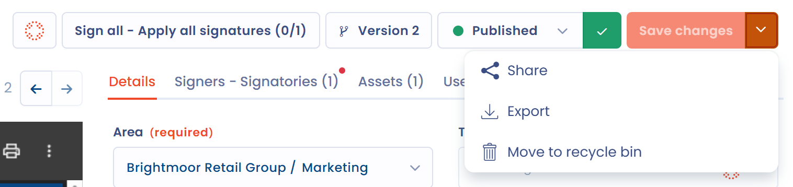

# Struktur eines Dokuments

Sobald Ihr Dokument erstellt ist, öffnet Dastra seine Akte (siehe [Ein Dokument erstellen](declare.md)). Die Dateivorschau nimmt die linke Bildschirmseite ein, die Eingabe-Tabs die rechte.

<figure><figcaption>
Die Akte eines neu erstellten Dokuments
</figcaption></figure>

## Der Titel und der Typ

Der bearbeitbare Titel des Dokuments steht oben links. Das Typ-Badge (Vertrag, Richtlinie, Hinweis, Vorgehensweise oder Sonstiges) erscheint über dem Titel: Klicken Sie darauf, um den Typ zu ändern.

<figure><figcaption>
Der Typ, der Titel, die Kurzbefehle und die Hauptaktionen
</figcaption></figure>

## Das Menü der Kurzbefehle

Unter dem Titel, links, gibt das Menü der Kurzbefehle Zugriff auf die Elemente, die dem Dokument zugeordnet sind:

* interne Diskussionen;
* zugeordnete Aufgaben, wenn die Aufgabenverwaltung aktiv ist;
* das Audit-Protokoll, wenn Audit aktiv ist, und der **Aktivitätsverlauf** des Dokuments;
* zugehörige Compliance-Tests, wenn das Modul Compliance aktiv ist (siehe [Details und Anhänge](documents.md));
* die regelmäßige Überprüfung des Dokuments (siehe [Regelmäßige Überprüfung von Dokumenten](review.md)).

Wenn Sie aus dem Verzeichnis kommen, können Sie mit Pfeilen von einem Dokument zum anderen wechseln.

## Die Hauptaktionen

Das Menü der Hauptaktionen oben rechts vereint:

* die Schaltfläche **KI-Analyse** (Beta): Sie öffnet die KI-Analyse des Dokuments. Diese Funktion befindet sich in der Beta-Phase, setzt die Funktionen KI-Analyse und KI-Agent voraus, und ihre Ergebnisse sind mit Vorsicht zu interpretieren;
* die Signaturschaltfläche, deren Beschriftung dem Stand des Dokuments folgt (siehe [Ein Dokument unterzeichnen](sign.md));
* die Schaltfläche **Version** gefolgt von der Versionsnummer, die den Versionsmanager öffnet (siehe [Dokumentversionen](versions.md));
* die Auswahl des Schritts im Prozess;
* die Schaltfläche **Speichern**.

Der Pfeil rechts neben **Speichern** öffnet drei Aktionen:

* **Teilen**: einen Freigabelink für das Dokument erstellen.
* **Exportieren**: das Dokument exportieren (siehe [Verträge und Richtlinien](README.md#import-und-export)).
* **In den Papierkorb verschieben**: das Dokument in den Papierkorb legen.

Ein Dokument im Papierkorb trägt das Badge **Im Papierkorb**. Dasselbe Menü bietet dann **Wiederherstellen** an, um es wieder in das Verzeichnis zu legen, und **Löschen**, um es zu löschen.

<figure><figcaption>
Die Aktionen der Schaltfläche Speichern
</figcaption></figure>

## Die Eingabe-Tabs

Vier Tabs werden auf der rechten Bildschirmseite angezeigt. Ihr Inhalt ändert sich, wenn Sie von einem zum anderen wechseln:

* **Details**: die allgemeinen Informationen, die Anhänge und die benutzerdefinierten Felder (siehe [Details und Anhänge](documents.md)).
* **Unterzeichner**: die Parteien, die das Dokument unterzeichnen (siehe [Unterzeichner](signers.md)).
* **Assets**: die Assets, die das Dokument betrifft (siehe [Assets](assets.md)).
* **Nutzer**: die Nutzer des Mandanten, die am Dokument arbeiten (siehe [Zugeordnete Nutzer](users.md)).

Mit Ausnahme von **Details** zeigt jeder Tab in Klammern die Anzahl der Elemente an, die er enthält.

<figure><figcaption>
Die Tabs der Akte eines Dokuments
</figcaption></figure>

## Die Vorschau der Anhänge

Der Bereich links zeigt eine Vorschau der Dateien des Dokuments: des Vertrags oder der Richtlinie und eventueller Anlagen. Sie bleibt angezeigt, egal welcher Tab geöffnet ist. Hat das Dokument noch keine Datei, bietet sie an, eine Datei abzulegen oder eine Richtlinie zu verfassen.
