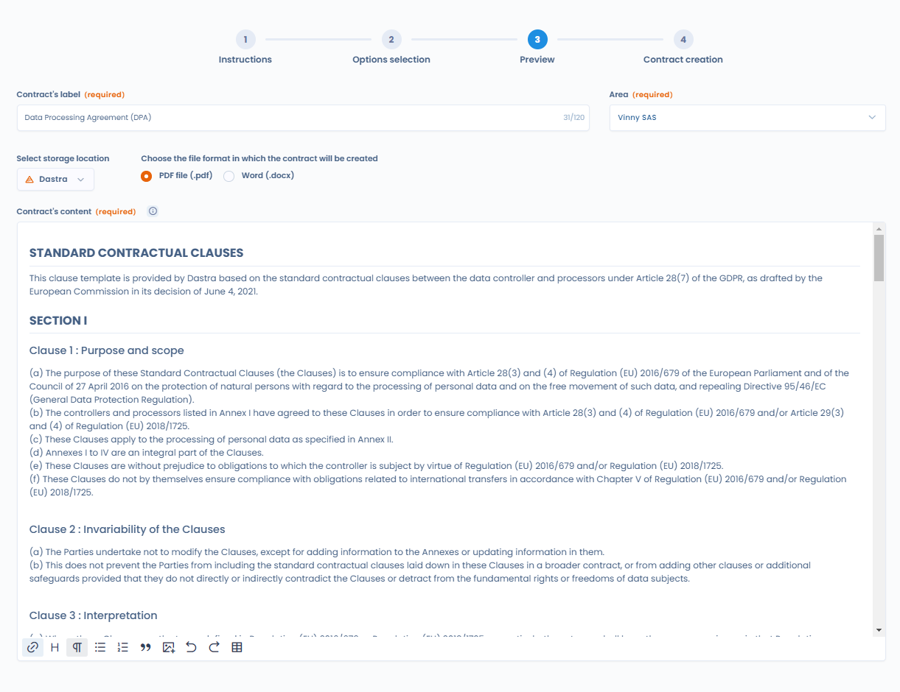

# Vertragsvorlagen

## Eine Vorlage verwenden

Wenn Sie [ein Dokument in Dastra erstellen](declare.md), wählen Sie die Option **Automatisch generieren**, um eine dynamische Vorlage zu verwenden. Sie erhalten die Liste der verfügbaren Vorlagen, zum Beispiel die Vorlage für die Standardvertragsklauseln Ihrer Auftragsverarbeitungsverträge (DPA).

Bei der Vorlage mit den Standardklauseln wird das Dokument mit den Informationen aus Ihrem Verzeichnis der Verarbeitungstätigkeiten und Ihren Referenzen ausgefüllt. Je vollständiger diese sind, desto passender ist das generierte Dokument.

<figure><figcaption>
Die zu verwendende Vorlage auswählen
</figcaption></figure>

Sobald Sie die Vorlage ausgewählt haben, führt Sie ein Bereich durch mehrere Schritte. Die Schaltflächen **Weiter** und **Zurück** gehen vor oder zurück.

1. **Anweisungen**: die Hinweise der Vorlage, sofern sie welche hat.
2. **Auswahl der Optionen**: ein für jede Vorlage spezifisches Formular, das von den auszufüllenden Feldern abhängt. Für den DPA wählen Sie die betroffene Verarbeitungstätigkeit des Verzeichnisses und den Auftragsverarbeiter, mit dem Sie den Vertrag abschließen, und beantworten Fragen zu optionalen Klauseln. Klicken Sie auf **Vorlage generieren**, um zum nächsten Schritt zu gelangen.
3. **Übersicht**: das generierte Dokument. Klicken Sie auf **Bearbeiten**, um Inhalt oder Layout zu ändern. Dastra weist Sie darauf hin, dass beim Bearbeiten von der Vorlage definierte Layoutelemente verloren gehen können.

<figure><figcaption>
Die Fragen der Vorlage beantworten
</figcaption></figure>

Geben Sie im Schritt **Übersicht** den **Dokumentennamen** und die **Organisationseinheit** ein. Wählen Sie den Speicherort und das Format der generierten Datei, **PDF-Datei (.pdf)** oder **Word (.docx)**, und klicken Sie dann auf **Ein Dokument erstellen**.

<figure><figcaption>
Das Dokument vor der Erstellung prüfen und bearbeiten
</figcaption></figure>

Dastra erstellt das Dokument, fügt es dem Verzeichnis hinzu und öffnet die Seite seiner Akte.

## Einen DPA aus einer Verarbeitungstätigkeit generieren

Sie können auch von der betroffenen Verarbeitungstätigkeit ausgehen, ohne das Modul **Verträge und Richtlinien** zu durchlaufen. Öffnen Sie die Verarbeitungstätigkeit und dann den Schritt **Empfänger**. Öffnen Sie in der Zeile des Empfängers vom Typ Auftragsverarbeiter, mit dem Sie den DPA abschließen, das Menü und klicken Sie auf **DPA generieren**. Für diese Aktion ist die Berechtigung zum Schreiben von Verträgen erforderlich.

<figure><figcaption>
Einen DPA mit einem Auftragsverarbeiter aus einer Verarbeitungstätigkeit generieren
</figcaption></figure>

Dastra öffnet die Generierung mit der bereits ausgewählten DPA-Vorlage, ausgefüllt mit der Verarbeitungstätigkeit und dem von Ihnen gewählten Auftragsverarbeiter. Dieselbe Aktion gibt es in einer Verarbeitungstätigkeit als **Auftragsverarbeiter**, um im Tab für Kunden einen DPA mit einem Kunden abzuschließen.

## Eigene Vorlagen erstellen

Der Eintrag **Dokumentvorlagen** des Moduls listet die Vorlagen Ihres Mandanten auf. Jede Karte zeigt den Namen der Vorlage, ihren Zustand (aktiviert oder deaktiviert) und ihre Kategorie. Das Menü der Karte bietet **Bearbeiten**, **Exportieren** und **Dauerhaft löschen**.

So erstellen Sie eine Vorlage:

1. Klicken Sie auf **Vertragsvorlage hinzufügen**.
2. Wählen Sie **Von Grund auf neu** und geben Sie den **Namen des Modells** ein, oder importieren Sie eine aus einer anderen Vorlage exportierte JSON-Datei über die Importoption des Fensters.
3. Dastra öffnet den Vorlageneditor.

Im Editor schreiben Sie den **Modelltext** in HTML. Mit der Syntax von [Liquid](https://shopify.github.io/liquid/) fügen Sie die Antworten ein, die das Formular der Vorlage erfasst. Diese Felder definieren Sie mit **Feld hinzufügen**, ebenso die oben im Formular angezeigten Anweisungen, die Sprache, die Kategorie und die Beschreibung der Vorlage. Eine Vorschau und ein Testformular ermöglichen es, das Ergebnis zu prüfen, bevor Sie die Vorlage veröffentlichen.

Aktivieren Sie die Vorlage mit dem Schalter für den Zustand aktiviert und klicken Sie dann auf **Speichern**, um sie in der Option **Automatisch generieren** verfügbar zu machen. Eine deaktivierte Vorlage wird bei der Erstellung nicht angeboten.

<figure><figcaption>
Der Editor für Dokumentvorlagen
</figcaption></figure>
