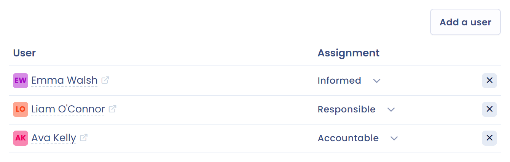

# Zugeordnete Nutzer

Ordnen Sie dem Dokument im Tab **Nutzer** Nutzer Ihres Mandanten zu und geben Sie ihnen eine Rolle: **Genehmiger**, **Verantwortlicher** oder **Informiert**. Klicken Sie auf **Nutzer hinzufügen** und wählen Sie dann den Nutzer und seine Rolle.

So können Sie die Rollen für Ihre Dokumente aufteilen:

* **Genehmiger**: der Nutzer, der dafür zuständig ist zu bestätigen, dass das Dokument und die zugehörigen Elemente, so wie sie in Dastra dokumentiert sind, den Erwartungen der Organisation entsprechen. Diese Rolle kann von der des Unterzeichners des Dokuments abweichen.
* **Verantwortlicher**: der Nutzer, der dafür zuständig ist, die Maßnahmen durchzuführen, die zur Erfüllung der Anforderungen des Dokuments erforderlich sind. Dazu können die Umsetzung von Maßnahmen zur Datensicherheit, die Verwaltung von Zugriffen oder jede andere Aufgabe gehören, die zur Einhaltung der Vertragsbedingungen erforderlich ist.
* **Informiert**: die Nutzer, die über den Fortschritt und den Stand des Dokuments auf dem Laufenden gehalten werden müssen, ohne eine aktive Rolle bei seiner Genehmigung oder Umsetzung zu haben. Dazu können die Geschäftsleitung, Projektleiter oder andere Beteiligte gehören.

Ein Nutzer hat in einem Dokument nur eine Rolle: Er kann zum Beispiel nicht gleichzeitig Genehmiger und Informiert sein. Nutzer, die dem Dokument bereits zugeordnet sind, erscheinen nicht mehr in der Auswahlliste. Um einem Nutzer eine andere Rolle zu geben, ändern Sie seine Rolle in der Tabelle.

<figure><figcaption>
Nutzer mit einem Dokument verknüpfen
</figcaption></figure>
