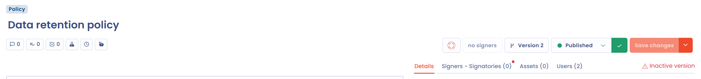
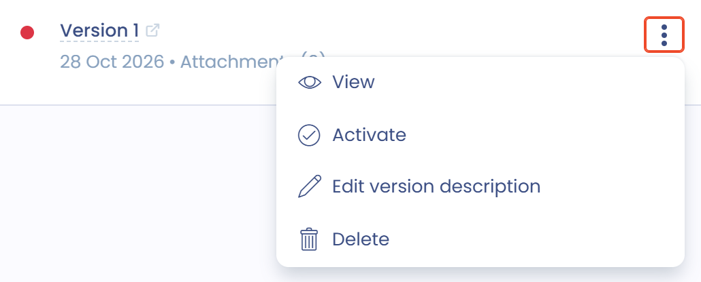

# Dokumentversionen

Um Änderungen, Aktualisierungen oder die Verlängerung eines Dokuments nachzuverfolgen, erstellen Sie eine neue Version davon.

Jede Version hat eine Revisionsnummer, die bei der Erstellung automatisch hochgezählt wird. Diese Nummer ist im Verzeichnis sichtbar. Ein Dokument hat zu jedem Zeitpunkt nur eine aktive Version: Sie wird im Verzeichnis angezeigt, inaktive Versionen erscheinen dort nicht.

Im Versionsmanager können Sie die Versionen eines Dokuments durchsuchen, eine frühere Version anzeigen und jede Version jederzeit aktiv setzen, auch eine neuere.

## Der Versionsmanager

Wenn Sie ein Dokument erstellen, legt Dastra seine Version 1 an. Die Schaltfläche **Version** gefolgt von der Nummer im Menü der Hauptaktionen öffnet den Versionsmanager.

<figure><figcaption>
Die Schaltfläche, die den Versionsmanager öffnet
</figcaption></figure>

Der Manager listet alle Versionen des Dokuments auf. Jede Karte zeigt die Versionsnummer, ihre Beschreibung, ihr Erstellungsdatum und die Anzahl ihrer Anhänge. Ein Punkt gibt den Zustand der Version an: grün für die aktive Version, rot für eine deaktivierte. Der Zusatz **Wird angezeigt** kennzeichnet die Version, die Sie gerade auf dem Bildschirm sehen.

<figure><figcaption>
Der Versionsmanager
</figcaption></figure>

## Eine neue Version erstellen

Die neue Version geht von der aktuell angezeigten Version aus: Wechseln Sie also zuerst zu der Version, von der Sie ausgehen möchten.

1. Klicken Sie im Versionsmanager auf **Neue Version erstellen**.
2. Geben Sie das **Startdatum** und bei Bedarf das **Enddatum** ein. Sie können sie später bearbeiten.
3. Fügen Sie bei Bedarf eine **Beschreibung der Version** hinzu.
4. Aktivieren Sie **Anhänge in die neue Version kopieren**, um die Dateien zu übernehmen.
5. Klicken Sie auf **Neue Version erstellen**.

<figure><figcaption>
Das Fenster zum Erstellen einer Version
</figcaption></figure>

Der Dokumentenname, die Beschreibung, die Organisationseinheit, die Assets, die Unterzeichner und die Nutzer bleiben in der neuen Version erhalten. Die erstellte Version wird zur aktiven Version und zur angezeigten Version.

## Eine Version anzeigen

Öffnen Sie im Versionsmanager das Menü der Version (die drei Punkte) und klicken Sie dann auf **Anzeigen**. Diese Aktion wird für die bereits angezeigte Version nicht angeboten.

Sie können eine Version, die nicht die aktive Version ist, anzeigen und bearbeiten. Dastra erinnert Sie daran mit einer Meldung im Manager und mit dem Zusatz **Inaktive Version** über den Tabs der Akte. Verwechseln Sie nicht die aktive Version, die eindeutig ist und als Referenz dient, mit der angezeigten Version.

<figure><figcaption>
Version 4 ist die aktive Version, aber Sie können Version 2 anzeigen und bearbeiten
</figcaption></figure>

## Eine Version aktiv setzen

Eine erstellte Version wird automatisch zur aktiven Version. Um eine andere Version aktiv zu setzen, öffnen Sie im Versionsmanager ihr Menü und klicken auf **Aktivieren**. Diese Aktion wird nur für inaktive Versionen angeboten.

<figure><figcaption>
Eine Version als aktive Version festlegen
</figcaption></figure>

## Die Beschreibung einer Version bearbeiten

Um die Beschreibung einer vorhandenen Version zu ändern, öffnen Sie ihr Menü und klicken auf **Die Versionsbeschreibung bearbeiten**. Bearbeiten Sie den Text im Fenster, das sich öffnet, und klicken Sie dann auf **Version bearbeiten**.

## Eine Version löschen

Öffnen Sie das Menü einer inaktiven Version und klicken Sie auf **Löschen**. Die aktive Version und die aktuell angezeigte Version können Sie nicht löschen: Zeigen Sie eine andere Version an, um diese zu löschen.

<figure><figcaption>
Eine Version löschen
</figcaption></figure>

Wird ein Dokument gelöscht, werden seine aktive Version und alle seine inaktiven Versionen gelöscht.
