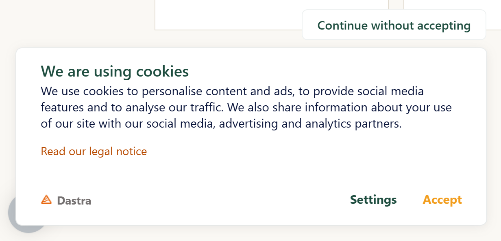

# Das Cookie-Einwilligungsbanner einrichten

Mit Dastra richten Sie auf Ihrer Website ein Cookie-Einwilligungsbanner ein, das den Empfehlungen der CNIL (französische Datenschutzbehörde) zu Cookies und anderen Trackern folgt.

## Woraus das Cookie-Einwilligungsbanner besteht

Das Banner besteht aus mehreren Elementen:

* einer schwebenden Schaltfläche „Cookies“, die sichtbar bleibt, damit Besucher ihre Entscheidungen ändern können;
* einem aufklappbaren Einführungsfenster;
* der Liste der von der Website verwendeten Cookies, nach Zweck geordnet.

<figure><figcaption><p>Die schwebende Schaltfläche</p></figcaption></figure>

<figure><figcaption><p>Das Einführungsfenster</p></figcaption></figure>

<figure><figcaption><p>Die Liste der Cookies nach Zweck</p></figcaption></figure>

## Voraussetzungen

Um das Banner einzurichten, müssen Sie zuerst die auf Ihrer Website gesetzten Cookies **identifizieren** und nach Zweck **klassifizieren**. Das Modul **Cookie-Banner** vereint alle Schritte, von diesen Voraussetzungen bis zum Code, der installiert werden muss.

Um die auf Ihrer Website gesetzten Cookies zu scannen, gehen Sie zu folgender Seite:


[Cookies scannen](scan.md)


Um Cookies nach Einwilligungskategorien zu klassifizieren, gehen Sie zu folgender Seite:


[Cookies nach Einwilligungskategorien klassifizieren](classify.md)


## Den Banner-Editor öffnen

1. Klicken Sie im Menü auf **Cookie-Banner** > **Banner**.
2. Klicken Sie auf das Banner, das Sie bearbeiten möchten.

Der Editor ist eine einzelne Seite aus aufklappbaren Abschnitten: **Installation**, **Konfiguration**, **Dienstleistungen**, **Texte und Übersetzungen**, **Erscheinungsbild und Design**, **Auslöser**, **Integration der Einwilligung** und **Cookie-Richtlinie**. Die Abschnitte **Installation** und **Konfiguration** gibt es nur für die Standardkonfiguration: Eine [geografisch ausgerichtete Variante](geo-targeting.md) zeigt sie nicht an.

<figure><figcaption><p>Der Banner-Editor</p></figcaption></figure>

Oben im Editor:

* der Schalter **Status** aktiviert oder deaktiviert das Banner (Zustand **Deaktiviert**);
* die Auswahlliste der Varianten zeigt **Standardkonfiguration** und lässt Sie [eine geografisch ausgerichtete Variante erstellen](geo-targeting.md);
* **Vorschau** zeigt das Banner auf einer Seite Ihrer Website an (siehe [Die Integration eines Banners testen](../integration/test.md)). Die Schaltfläche ist deaktiviert, solange nicht mindestens eine URL unter **Zulässige URLs (CORS)** eingetragen ist;
* **Speichern** und **Speichern und beenden** veröffentlichen Ihre Änderungen;
* das Menü **Aktionen** gibt Zugriff auf **Zurücksetzen der Erfassung von Einwilligungsnachweisen** und **Löschen**.


Um ein Banner zu duplizieren, verwenden Sie das Menü rechts neben dem Banner in der Liste der Banner.


## Referenz der Einstellungen

### Konfiguration

Der Abschnitt **Konfiguration** enthält die Grundeinstellungen des Banners.

<figure><figcaption><p>Der Abschnitt „Konfiguration“</p></figcaption></figure>

| Einstellung | Zweck |
| --- | --- |
| Name des Banners | Name des Banners in der Liste. |
| **Zulässige URLs (CORS)** | Pflichtfeld. Geben Sie die Adresse jeder Website ein, die das Banner anzeigt, in der Form `https://www.example.com`, ohne Pfad. Die Adresse muss genau dem Ursprung der Website entsprechen: `www.example.com` und `example.com` sind zwei verschiedene Adressen. Ein in dieser Liste fehlender Ursprung ist die häufigste Ursache für ein Banner, das nicht erscheint. |
| **Automatische Generierung der Cookie-Richtlinie?** | Wenn aktiviert, bietet das Banner einen Link zur von Dastra generierten Cookie-Richtlinie an. Andernfalls geben Sie die Adresse Ihrer eigenen Richtlinie im Feld für die URL des Hinweises zur Cookie-Richtlinie ein. |

Der Block mit den erweiterten Einstellungen enthält die folgenden Optionen.

| Einstellung | Zweck |
| --- | --- |
| **Vorschau-Modus** | Deaktiviert den Konfigurations-Cache und die Erfassung von Statistiken. Lassen Sie ihn in der Produktion nicht aktiviert. |
| Option zur Deaktivierung der Banner-Anzeige (alle Cookies mit Standardeinwilligung werden ausgelöst) | Zeigt kein Banner an: Alle Dienste werden mit ihrer Standardeinwilligung angewendet. Verwenden Sie sie nur für Gebiete ohne vorherige Einwilligungspflicht. |
| **Aktivieren Sie die Global Privacy Control (GPC)** | Lehnt nicht notwendige Cookies automatisch ab, wenn der Browser des Besuchers das GPC-Signal sendet. Siehe [US-Compliance](us-privacy.md). |
| **Speicherung der Einwilligung** | Wenn deaktiviert, speichert Dastra keinen Einwilligungsnachweis und keine Anzeigestatistiken. |
| **Lebensdauer des Einwilligungs-Cookies (standardmäßig 180 Tage)** | Von 1 bis 365 Tage. Nach Ablauf wird das Banner erneut angezeigt. |
| **Aktivieren Sie den localStorage-Speicher für Einwilligung-Cookies.** | Speichert die Entscheidungen im `localStorage` des Browsers statt in einem Cookie. Die Einwilligung wird dann nicht zwischen Subdomains geteilt. |
| **Cookie-Domäne (standardmäßig die Subdomäne der Seite)** | Verfügbar bei der Speicherung in einem Cookie. Geben Sie zum Beispiel `.example.com` ein, um die Einwilligung zwischen allen Subdomains zu teilen. |
| **Name des Cookies zur Speicherung der Einwilligung** | Name des Cookies oder des `localStorage`-Schlüssels, der die Entscheidungen des Besuchers enthält. Standardwert: `consent-eu`. |

### Dienstleistungen

Der Abschnitt **Dienstleistungen** listet die im Banner deklarierten Dienste auf. Klicken Sie auf **Cookie-Scan**, um die Website erneut zu scannen, auf **Auswahl aus der Bibliothek...**, um einen Dienst aus der Dastra-Bibliothek hinzuzufügen, oder auf **Einen Dienst hinzufügen**, um einen Dienst zu erstellen. Siehe [Cookies klassifizieren](classify.md) und [Cookies scannen](scan.md).

### Texte und Übersetzungen

In diesem Abschnitt fügen Sie Sprachen hinzu und bearbeiten die Texte des Banners. Siehe [Sprachverwaltung](../integration/languages.md).

### Erscheinungsbild und Design

Hier legen Sie das Aussehen des Banners fest. Die Vorschau rechts wird bei jeder Änderung aktualisiert.

<figure><figcaption><p>Der Abschnitt „Erscheinungsbild und Design“</p></figcaption></figure>

| Einstellung | Zweck |
| --- | --- |
| **Position des Banners** | Fünf Positionen: **Oben links**, **Oben rechts**, **Zentralisiert**, **Unten links**, **Unten rechts**. |
| **Primärfarbe**, **Hintergrundfarbe des Popups**, **Hauptfarbe der Texte**, **Farbe der Überschriften**, **Farbe der Schaltflächen**, **Farbe der Schaltfläche „Akzeptieren“** (Sekundärfarbe) | Farben des Banners. |
| **Name der Schriftart** | Vom Banner verwendete Schriftart: eine Basis-Webschrift oder eine auf Ihrer Website installierte Schrift. |
| **Anpassen der Schaltfläche des Banners** | Ersetzt die Öffnungsschaltfläche durch ein Bild Ihrer Wahl, vorzugsweise quadratisch. Sobald das Bild hochgeladen ist, bietet **Form des Buttons** die Werte **Cercle**, **Abgerundet** oder **Carré** an. |
| **Die Schaltfläche „Ohne Zustimmung fortfahren“ anzeigen** | Fügt diese Schaltfläche zum Banner hinzu. |
| **Die Schaltfläche zum Öffnen des Fensters sollte stets sichtbar sein** | Lässt die schwebende Schaltfläche nach dem ersten Bildschirm angezeigt. |
| **Schaltfläche zum Schließen des Banners anzeigen** | Fügt ein Schließen-Kreuz hinzu. Ausgeblendet, wenn die Schaltfläche **Ohne Zustimmung fortfahren** aktiviert ist. |
| **Das Copyright von Dastra ausblenden** | Hängt von Ihrem Tarif ab. |
| **Individuelles CSS** | CSS-Regeln, die auf das Banner angewendet werden. Siehe [Erweiterte Gestaltung](../integration/design.md). |

### Auslöser

Auslöser legen fest, wann das Banner erscheint:

* **Scrollhöhe in % der Seitengröße (0 % = Seitenanfang)**: Das Banner erscheint, sobald der Besucher diesen Prozentsatz der Seite gescrollt hat;
* **Zeit bis zur Auslösung (Millisekunden)**: Verzögerung, bevor das Banner angezeigt wird.


Ein zu hoher Scrollwert verhindert, dass das Banner erscheint, wenn der Besucher auf die Seite kommt. Um die Einwilligung ab der ersten Seite einzuholen, lassen Sie beide Werte bei 0.


### Integration der Einwilligung

Dieser Abschnitt erzeugt für jeden Dienst die Codeausschnitte, die Sie in Ihre Seiten einfügen, um Cookies tatsächlich zu blockieren: HTML-Integration, benutzerdefiniertes JavaScript und Google Tag Manager. Er enthält eine Checkliste. Siehe [Cookies blockieren](../integration/blocking/README.md).

### Cookie-Richtlinie

Dieser Abschnitt generiert die Cookie-Richtlinie. Siehe [Die Cookie-Richtlinie generieren](#die-cookie-richtlinie-generieren).

### Zurücksetzen der Erfassung von Einwilligungsnachweisen

Die Aktion **Zurücksetzen der Erfassung von Einwilligungsnachweisen** im Menü **Aktionen** erzeugt den Versionsschlüssel des Banners neu: Besuchern, die bereits eine Entscheidung getroffen haben, wird das Banner bei ihrem nächsten Besuch erneut angezeigt. Verwenden Sie sie, nachdem Sie einen Dienst hinzugefügt haben. Bereits erfasste Nachweise werden dabei nicht gelöscht.


Diese Aktion hat keine Wirkung, wenn unter **Cookie-Domäne** eine Domäne eingetragen ist, da die Entscheidung dann zwischen mehreren Subdomains geteilt wird.


## Den Banner-Code in Ihre Website einfügen

Sobald das Banner konfiguriert ist, installieren Sie die von Dastra generierten Codezeilen.

1. Öffnen Sie den Abschnitt **Installation** des Banners.
2. Klicken Sie auf die Karte **Javascript**.
3. Kopieren Sie den generierten Code.
4. Fügen Sie ihn vor dem schließenden `</body>`-Tag jeder Seite Ihrer Website ein.

<figure><figcaption><p>Der generierte Integrationscode</p></figcaption></figure>

Bitten Sie Ihren Webmaster um diesen Schritt. Sobald der Code installiert ist, erscheint das Banner auf Ihrer Website. Die Schaltfläche **Kopieren** kopiert den Code, und ein zweiter Codeausschnitt zeigt, wie Sie das Banner über eine Schaltfläche Ihrer Website wieder öffnen. Siehe [Schnellstart](../integration/quickstart/README.md).


Sie können Google Tag Manager verwenden, um diesen Code dynamisch auf jeder Seite einzufügen.



Der generierte Code hängt von der Hosting-Region Ihrer Organisation ab. Kopieren Sie ihn immer aus der Anwendung.


## Die Cookie-Richtlinie generieren

Der Abschnitt **Cookie-Richtlinie** des Banners generiert Ihre Cookie-Richtlinie automatisch aus der Konfiguration des Banners: Dienste, Cookies, Zwecke und Laufzeiten. Wählen Sie zuerst die Sprache im Feld **Sprache**, dann das Format:

* **Link kopieren**: die Adresse einer öffentlichen Seite, die die Richtlinie anzeigt;
* **Roh-HTML**: der HTML-Code der Richtlinie zum Kopieren;
* **Skript (automatische Aktualisierung)**: ein Codeausschnitt, den Sie in Ihre Richtlinienseite einfügen. Er lädt das Dastra-SDK, das die Richtlinie anzeigt und automatisch aktualisiert, wenn Sie das Banner ändern;
* **Markdown**, **PDF-Datei (.pdf)** und **Word (.docx)**: Dokumente zum Herunterladen.

Um das Skriptformat zu verwenden, fügen Sie Ihrer Seite das folgende Element hinzu und ersetzen die Werte durch die in der Anwendung angezeigten:

```html
<div id="dastra-cookie-policy" data-widgetid="{your_widget_id}" data-lang="{lang}"></div>
<script src="https://cdn.dastra.eu/sdk/dastra.js?key={your_public_key}" async></script>
```

Der Abschnitt ist verfügbar, wenn Ihre Änderungen gespeichert sind. Jede Sprache des Banners erzeugt eine Richtlinie in dieser Sprache. Wenn Sie im Abschnitt **Konfiguration** die Option **Automatische Generierung der Cookie-Richtlinie?** aktivieren, leitet das Banner seine Besucher zu dieser Richtlinie weiter.

<figure><figcaption><p>Die Formate der Cookie-Richtlinie</p></figcaption></figure>
