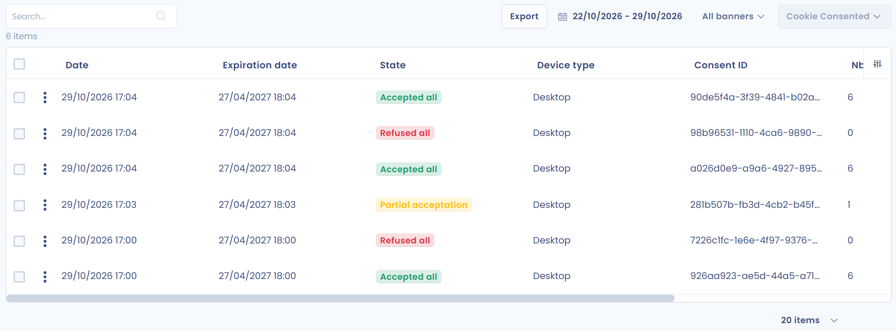

# Nachweise der Cookie-Einwilligung sammeln

Sobald das Cookie-Einwilligungsbanner auf Ihrer Website installiert ist, erfasst, speichert und exportiert das Modul **Cookie-Banner** **Einwilligungsnachweise**. Es zeigt außerdem die **Statistiken** des Banners an.

## Voraussetzungen

Sie müssen das Banner auf Ihrer Website installiert haben.


[Das Cookie-Einwilligungsbanner einrichten](configure.md)


## Die Einwilligungsnachweise anzeigen

Sobald das Banner installiert ist, erfasst Dastra automatisch Einwilligungsnachweise der Besucher Ihrer Website. So zeigen Sie sie an:

1. Klicken Sie im Menü auf **Cookie-Banner** > **Einwilligungen**.
2. Verwenden Sie die Filter über der Liste: den Zeitraum (standardmäßig die letzten 7 Tage), das Banner (**Alle Banner**) und, sobald ein Banner gewählt ist, die eingewilligten Dienste.
3. Klicken Sie auf eine Zeile, um den Nachweis zu öffnen.

<figure><figcaption>
Die Liste der Einwilligungen
</figcaption></figure>

Der Nachweis der Cookie-Einwilligung zeigt das Datum, das Land, den Fingerabdruck der Einwilligung und die Liste der Dienste, jeweils mit dem Vermerk **Consenti** (Einwilligung erteilt) oder **Ablehnung**. Sie können ihn drucken oder löschen.

<figure><figcaption>
Das Detail eines Einwilligungsnachweises
</figcaption></figure>

In der Liste lädt die Schaltfläche **Exportieren** den Nachweis für den gewählten Zeitraum und das gewählte Banner herunter. Um Nachweise zu löschen, verwenden Sie das Zeilenmenü oder die Sammelaktion **Löschen**.

Die Aufbewahrungsdauer des Einwilligungsnachweises beträgt ein Jahr.


Die Erfassung der Nachweise hängt von der Option **Speicherung der Einwilligung** im Abschnitt **Konfiguration** des Banners ab. Ist sie deaktiviert, wird kein Nachweis gespeichert. Um einen Nachweis einem Nutzer Ihres Systems zuzuordnen, siehe [Nutzeridentifikation](../integration/identification.md).


## Die Statistiken anzeigen

Die Seite **Statistiken** verfolgt die Aktivität Ihrer Banner.

1. Klicken Sie im Menü auf **Cookie-Banner** > **Statistiken**. Sie können auch das Menü eines Banners in der Liste der Banner öffnen und **Statistiken** wählen.
2. Wählen Sie den Zeitraum (standardmäßig die letzten 7 Tage) und bei Bedarf ein Banner unter **Alle Banner**.

Es werden drei Diagramme angezeigt, jeweils im Vergleich zum vorherigen Zeitraum:

* **Eingeholte Einwilligungen**: das Volumen der erfassten Entscheidungen, mit den Indikatoren **Gesamt**, **Vollständige Akzeptanz**, **Teilweise Zustimmung** und **Vollständige Ablehnung**;
* **Anzahl der Widget-Anzeigen**: die Anzahl der Sitzungen, in denen das Banner angezeigt wurde. Der Zähler erhöht sich einmal pro Besuchersitzung, und eine Sitzung dauert mindestens eine Stunde;
* ein drittes Diagramm zählt, wie oft ein Besucher das Banner mit dem Schließen-Kreuz geschlossen hat (**Schließungen des Banners**).


Im Vorschau-Modus werden keine Statistiken erfasst. Anzeigen werden auch nicht gezählt, wenn die Option **Speicherung der Einwilligung** deaktiviert ist.


Um die Entscheidungen der Besucher auf Ihrer Website tatsächlich anzuwenden, gehen Sie zur nächsten Seite:


[Weiterführende Cookie-Einwilligung](go-further.md)

