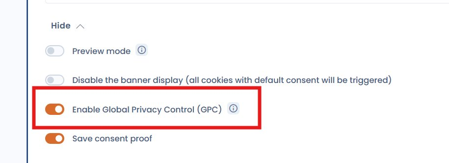

# US-Compliance: CCPA, GPC und DoNotTrack

## Regulatorischer Kontext

Im Gegensatz zur DSGVO, die ein **Opt-in** (vorherige Einwilligung) vorschreibt, beruht das US-Datenschutzrecht überwiegend auf einem **Opt-out**-Modell: Tracker dürfen standardmäßig gesetzt werden, aber die Nutzer müssen ohne Schwierigkeiten widersprechen können.

Die wichtigsten Vorschriften im Überblick:

| Gesetz      | Bundesstaat | Modell  | In Kraft seit |
| ----------- | ----------- | ------- | ------------- |
| CCPA / CPRA | Kalifornien | Opt-out | 2020 / 2023   |
| CPA         | Colorado    | Opt-out | 2023          |
| VCDPA       | Virginia    | Opt-out | 2023          |
| CTDPA       | Connecticut | Opt-out | 2023          |


**GPC ist in Kalifornien verpflichtend**

Seit der CPRA (2023) müssen Unternehmen das Signal **Global Privacy Control (GPC)** als Opt-out-Anfrage gegen den Verkauf und die Weitergabe personenbezogener Daten beachten.


---

## Empfohlenes Vorgehen mit Dastra

### 1. Eine geografisch ausgerichtete Variante für die USA erstellen

Der einfachste Weg, Ihre US-Nutzer zu berücksichtigen, ist eine **geografisch ausgerichtete Variante**. Sie erstellen sie im Dropdown-Menü für die Varianten oben rechts im Editor Ihres Banners (siehe [Geografisch ausgerichtete Varianten](geo-targeting.md)).

Konfigurieren Sie die Variante für **Kalifornien (CCPA/CPRA)** mit einem Opt-out-Modell: Nicht notwendige Cookies sind standardmäßig aktiv, und die Nutzer können widersprechen. Erwägen Sie außerdem, in der Fußzeile Ihrer Website einen Link **„Do Not Sell or Share My Personal Information“** hinzuzufügen, der das Widget direkt öffnet.

Für **andere US-Bundesstaaten** ohne Bannerpflicht können Sie die Option zum Ausblenden des Banners aktivieren und die Standardwerte der Einwilligung gemäß Ihrer Richtlinie festlegen.


[Geo-Targeting-Varianten](geo-targeting.md)


---

### 2. GPC- und DoNotTrack-Signale beachten

Zwei Browsersignale ermöglichen es Nutzern, ihre Ablehnung des Trackings auszudrücken, ohne mit einem Banner zu interagieren:

| Signal                           | Standard | Rechtlich bindend (CA) | Beschreibung                                                    |
| -------------------------------- | -------- | ---------------------- | --------------------------------------------------------------- |
| **GPC** (`globalPrivacyControl`) | W3C      | Ja (CPRA)              | Opt-out-Signal gegen Verkauf und Weitergabe personenbezogener Daten |
| **DNT** (`doNotTrack`)           | W3C      | Nein                   | Präferenzsignal „Nicht verfolgen“ (rechtlich nicht durchsetzbar) |

#### Native Aktivierung (empfohlen)

Dastra unterstützt diese Signale jetzt **nativ** über einen Schalter in der Konfiguration des Widgets. Aktivieren Sie im Abschnitt **Konfiguration** des Banners (erweiterte Einstellungen) die Option **Aktivieren Sie die Global Privacy Control (GPC)**.

<figure><figcaption><p>GPC-Option in den erweiterten Einstellungen des Cookie-Einwilligungs-Widgets</p></figcaption></figure>

Ist diese Option aktiviert und hat der Besucher noch keine Auswahl getroffen, lehnt das Widget automatisch alle Cookie-Kategorien außer den notwendigen Cookies ab (Präferenzen, Analyse, Marketing, Sonstige und Nicht klassifiziert), sobald der Browser ein GPC- oder DoNotTrack-Signal sendet, ganz ohne zusätzlichen Code. Das Banner wird diesem Besucher nicht angezeigt.

Derselbe Schalter existiert in jeder **geografisch ausgerichteten Variation**: Aktivieren Sie ihn in der Variation, die Kalifornien abdeckt.


Die native Aktivierung ist ab der aktuellen Version des Dastra-Widgets verfügbar. Sie deckt sowohl das Signal `globalPrivacyControl` als auch das Signal `doNotTrack` ab.


#### Erweiterte Option: eigenes JS-Snippet

Wenn Sie mehr Kontrolle benötigen (zum Beispiel um eine Bestätigungsmeldung anzuzeigen oder das Opt-out auf bestimmte Kategorien anzuwenden), können Sie das folgende JS-Snippet **zusätzlich** zum nativen Schalter verwenden, oder anstelle des Schalters, wenn Sie das Widget über die JS-API verwalten:

```html
<script>
  var isOptOut =
    navigator.globalPrivacyControl === true ||
    navigator.doNotTrack === '1' ||
    window.doNotTrack === '1'

  if (isOptOut) {
    window.dastra = window.dastra || []
    window.dastra.push([
      'cookieReady',
      function (manager) {
        if (!manager.consent.hasConsented()) {
          manager.consent.setPurposeConsent('Analytical', false)
          manager.consent.setPurposeConsent('Marketing', false)
          manager.consent.dispatchEvents() // apply choices without persisting them
        }
      }
    ])
  }
</script>
```


**`dispatchEvents()` oder `save()`: Was ist der Unterschied?**

- **`dispatchEvents()`** wendet die Einwilligungsentscheidungen für die aktuelle Sitzung an, **ohne etwas** im Einwilligungsspeicher **zu schreiben** (standardmäßig das Cookie `consent-eu`, oder localStorage, wenn diese Option aktiviert ist). Das GPC- oder DNT-Signal wird bei jedem Laden der Seite neu ausgewertet. Deaktiviert der Nutzer GPC später in seinem Browser, gilt automatisch wieder das normale Verhalten. Dies ist der empfohlene Weg, um diese Signale zu beachten.
- **`save()`** speichert die Einwilligung in diesem Speicher, als hätte der Nutzer über das Widget eine ausdrückliche Entscheidung getroffen. Verwenden Sie es nur, wenn Sie eine Entscheidung sitzungsübergreifend merken möchten.



**Was bewirkt `hasConsented()`?**

Diese Prüfung stellt sicher, dass das automatische Opt-out keine Entscheidung überschreibt, die der Nutzer bereits ausdrücklich über das Widget getroffen hat. Hat der Nutzer bereits eine Präferenz geäußert, wird sie respektiert.



Dieses Snippet muss **vor** dem Ladetag des Dastra-Widgets stehen, damit es schon beim allerersten Laden der Seite berücksichtigt wird.


Kategoriebezeichnungen für `setPurposeConsent`:

| Kategorie        | Bezeichnung    |
| ---------------- | -------------- |
| Notwendig        | `Necessary`    |
| Präferenzen      | `Preference`   |
| Analyse          | `Analytical`   |
| Marketing        | `Marketing`    |
| Sonstige         | `Other`        |
| Nicht klassifiziert | `Unclassified` |

### 3. Eine Bestätigungsmeldung „Opt-Out Request Honored“ anzeigen

Wird ein GPC- oder DNT-Signal erkannt, empfehlen Vorschriften wie die CPRA, den Nutzer darüber zu informieren, dass seine Opt-out-Anfrage berücksichtigt wurde.

Bei nativer Aktivierung zeigt das Widget diese Meldung 6 Sekunden lang anstelle des Banners an. Standardtext: „Global Privacy Control detected: analytics and marketing cookies have been disabled.“ Um ihn zu ändern, öffnen Sie im Banner den Abschnitt **Texte und Übersetzungen**, Gruppe **Home page**, und bearbeiten Sie das Feld, das als „Message displayed when the browser sends a Global Privacy Control or Do Not Track signal“ beschrieben ist.

Das Widget löst außerdem das Ereignis `dastra:gpc:applied` auf `window` aus, auf das Sie für Ihre eigene Verarbeitung reagieren können.

Wenn Sie die native Aktivierung nicht verwenden oder eine andere Darstellung wünschen, stehen zwei Ansätze auf Basis von Snippets zur Verfügung.

#### Option A: Kurze Einblendung

Eine Meldung, die einige Sekunden erscheint und dann automatisch verschwindet. Sie lässt sich mit wenig Aufwand umsetzen, aber der Nutzer kann sie verpassen, wenn er nicht im richtigen Moment auf die Seite schaut.

```html
<script>
var isOptOut = navigator.globalPrivacyControl === true
            || navigator.doNotTrack === "1"
            || window.doNotTrack === "1";

if (isOptOut) {
  window.dastra = window.dastra || [];
  window.dastra.push(['cookieReady', function(manager) {
    if (!manager.consent.hasConsented()) {
      manager.consent.setPurposeConsent('Analytical', false);
      manager.consent.setPurposeConsent('Marketing', false);
      manager.consent.dispatchEvents();

      var notice = document.createElement('div');
      notice.setAttribute('role', 'status');
      notice.style.cssText = 'position:fixed;bottom:16px;left:16px;background:#222;color:#fff;padding:12px 18px;border-radius:6px;font-size:14px;z-index:9999;max-width:320px;';
      notice.textContent = 'Opt-Out Request Honored: analytics and marketing cookies have been disabled.';
      document.body.appendChild(notice);
      setTimeout(function() { notice.remove(); }, 6000);
    }
  }]);
}
</script>
```

#### Option B: Dauerhafte Leiste

Eine feste Leiste am unteren Seitenrand, die sichtbar bleibt, solange GPC im Browser aktiv ist. Sie ist für die Compliance besser geeignet: Der Hinweis bleibt dauerhaft sichtbar, auch nach dem ersten Laden. Mit einer Schaltfläche „Dismiss“ kann der Nutzer sie schließen.

```html
<script>
var isOptOut = navigator.globalPrivacyControl === true
            || navigator.doNotTrack === "1"
            || window.doNotTrack === "1";

if (isOptOut) {
  window.dastra = window.dastra || [];
  window.dastra.push(['cookieReady', function(manager) {
    if (!manager.consent.hasConsented()) {
      manager.consent.setPurposeConsent('Analytical', false);
      manager.consent.setPurposeConsent('Marketing', false);
      manager.consent.dispatchEvents();

      var bar = document.createElement('div');
      bar.setAttribute('role', 'status');
      bar.setAttribute('aria-live', 'polite');
      bar.style.cssText = 'position:fixed;bottom:0;left:0;right:0;background:#1a1a1a;color:#fff;font-size:13px;padding:10px 20px;display:flex;align-items:center;justify-content:space-between;z-index:9999;border-top:1px solid #333';
      bar.innerHTML = '<span>🔒 Opt-Out Request Honored, analytics and marketing cookies are disabled.</span>'
        + '<button onclick="this.parentNode.remove()" style="background:none;border:1px solid #555;color:#fff;padding:4px 12px;border-radius:4px;cursor:pointer;font-size:12px;margin-left:16px">Dismiss</button>';
      document.body.appendChild(bar);
    }
  }]);
}
</script>
```


Passen Sie den Meldungstext an Ihren redaktionellen Stil und die Sprache Ihrer Nutzer an. Legen Sie bei mehrsprachigen Websites den Text abhängig von der Sprache der Seite fest.


***

## Zusammenfassung

| Mechanismus                      | Umsetzung                                           | Gesetzlich vorgeschrieben (CA) |
| -------------------------------- | --------------------------------------------------- | ------------------------------ |
| Geografisch ausgerichtete CCPA-Variante | Dastra-Oberfläche                            | Ja                             |
| GPC-Erkennung                    | Nativer Schalter (Widget-Konfiguration), empfohlen  | Ja (CPRA)                      |
| DNT-Erkennung                    | Nativer Schalter (Widget-Konfiguration), empfohlen  | Nein (empfohlen)               |
| Bestätigungsmeldung              | Nativ (bearbeitbarer Text) oder JS-Snippet          | Nein (empfohlen)               |
