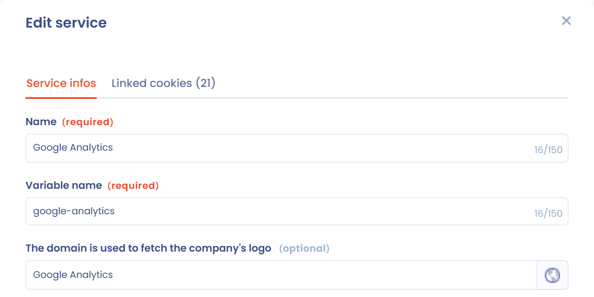

# Cookie-Blockierung

Um Cookies wirksam zu blockieren, gibt es mehrere Methoden: das Löschen von Cookies, das Blockieren eines Snippets, eigenes JavaScript oder Google Tag Manager.

## Cookies löschen

Diese Methode ist am schnellsten einzurichten, aber auch am wenigsten zuverlässig. Wenn Sie im Abschnitt **Dienstleistungen** des Banners bei jedem Dienst die Namen der zugehörigen Cookies eintragen (Tab **Verbundene Cookies** des Dienstes), löscht das SDK diese Cookies automatisch, sobald für den Dienst eine Ablehnung erfasst wird.

<figure><figcaption><p>Die mit einem Dienst verbundenen Cookies</p></figcaption></figure>

Diese Methode funktioniert in manchen Fällen, kann aber die Zuverlässigkeit von Drittanbieter-Tools beeinträchtigen, insbesondere von Web-Analyse-Tools. Verwenden Sie sie zusätzlich zu einer der folgenden Methoden.

## Ein Code-Snippet in der Seite blockieren

Mit dieser Methode deaktivieren Sie ein Tracking-Code-Snippet vollständig.

Ersetzen Sie im HTML-Code Ihrer Seite das folgende Snippet:

```html
<script>
  alert("hello, I'm a tracking javascript tag");
</script>
```

durch:

```html
<script data-consent="{your-service-slug}" type="dastra/script">
  alert("hello, I'm a tracking javascript tag");
</script>
```

Ersetzen Sie `{your-service-slug}` durch die Kennung des Dienstes. Sie finden sie im Feld **Name der Variablen (wichtig für die Einbindung der Einwilligung)** des Dienstformulars:

<figure><figcaption><p>Die Kennung des Dienstes</p></figcaption></figure>

Hat der Besucher den Dienst akzeptiert, wird der Inhalt des Skripts automatisch ausgeführt.

Um ein externes Skript zu laden, fügen Sie das Attribut `src` hinzu: Der Browser lädt es erst nach der Einwilligung herunter.

```html
<script data-consent="{your-service-slug}" type="dastra/script" src="https://example.com/tracker.js"></script>
```


Diese Methode hat Nebenwirkungen: Die Syntaxhervorhebung der meisten Code-Editoren erkennt den Typ `dastra/script` nicht. Das Skript wird nie ausgeführt, wenn das Dastra-Banner nicht geladen werden kann.


### Die von der Anwendung erzeugten Snippets verwenden

Für jeden Dienst erzeugt der Abschnitt **Integration der Einwilligung** des Banners fertig kopierbare Snippets und eine Checkliste. Es stehen drei Tabs zur Verfügung: **Html integration** (das Snippet oben), **Custom javascript** (die unten beschriebene Blockierung in reinem JavaScript) und **Google tag manager** (die Ereignisse, die Sie in Google Tag Manager verbinden).

## Blockierung in reinem JavaScript

In JavaScript können Sie auf die Ereignisse hören, die auf `window` ausgelöst werden, um die Einwilligung zu erfassen und je nachdem, ob Cookies akzeptiert oder abgelehnt werden, ein bestimmtes Verhalten umzusetzen. Diese Methode bietet Ihnen mehr Flexibilität:

```html
<script>
  (function () {

    /*
     * Trigger a custom service tag with the expected cookies
     */
    function customTagsTrigger() {
      /* If the vendor provides a specific function to make the service work without cookies, call it here.
       * Otherwise, copy the default code snippet provided by the vendor. */
    }

    /*
     * Handle the global scope consent event.
     * If the user consented to the vendor's cookies, this event is fired on each page load
     * where the cookie consent banner is installed.
     */
    window.addEventListener('dastra:consent:{your-service-slug}', function () {
      /* The visitor opted in to the vendor's cookies */
      customTagsTrigger();
    });

    /*
     * Handle the global scope refused event (optional)
     */
    window.addEventListener('dastra:refused:{your-service-slug}', function () {
      /* The vendor's cookies are refused */
    });

  })();
</script>
```

## Google Tag Manager

Siehe die folgende Seite:


[Google Tag Manager](google-tag-manager.md)


## Erinnerung an den Lebenszyklus der Einwilligung

<figure><figcaption><p>Lebenszyklus der Einwilligung</p></figcaption></figure>

## JavaScript-Ereignisse

Das Banner löst mehrere Ereignisse auf dem Element `window` der Seite aus. Die Einwilligungsereignisse werden bei jedem Laden der Seite ausgelöst, wenn das Banner die bereits gespeicherten Entscheidungen anwendet, und anschließend bei jedem Speichern einer Entscheidung.

| Ereignisname | Hinweise |
| --- | --- |
| `dastra:consent:<service slug>` | Wird ausgelöst, wenn der Dienst akzeptiert wird, durch den Besucher oder standardmäßig (unbedingt notwendige Dienste sind nicht betroffen). Ist der Dienst auf „standardmäßig akzeptiert“ eingestellt, wird das Ereignis ab dem ersten Laden der Seite ausgelöst. |
| `dastra:refused:<service slug>` | Wird ausgelöst, wenn der Dienst nicht akzeptiert wird: standardmäßig, wenn keine Einwilligung erteilt wurde, oder nach einer ausdrücklichen Ablehnung. |
| `dastra:consents:ready` | Wird ausgelöst, wenn die gespeicherte Einwilligung (standardmäßig das Cookie `consent-eu`) gelesen und die ersten Ereignisse ausgelöst wurden. |
| `dastra:consents:updated` | Wird bei jedem Laden der Seite und bei jedem Speichern von Entscheidungen ausgelöst (akzeptiert, abgelehnt oder angepasst). Das Ereignisdetail enthält die Liste der Einwilligungen. |
| `dastra:consents:any_refused` | Wird ausgelöst, wenn mindestens eine gespeicherte Einwilligung eine Ablehnung ist, bei jedem Laden der Seite und bei jedem Speichern von Entscheidungen. |
| `dastra:consents:all_accepted` | Wird ausgelöst, wenn keine gespeicherte Einwilligung eine Ablehnung ist, bei jedem Laden der Seite und bei jedem Speichern von Entscheidungen. |
| `dastra:consents:closed` | Wird ausgelöst, wenn der Besucher das Banner mit dem Schließen-Kreuz schließt. |
| `dastra:gpc:applied` | Wird ausgelöst, wenn das Banner nicht notwendige Cookies automatisch ablehnt, weil ein Signal Global Privacy Control oder Do Not Track vorliegt. Siehe [US-Compliance](../../banner/us-privacy.md). |


Da die Ereignisse `dastra:consent:*` und `dastra:consents:*` auch beim Laden der Seite ausgelöst werden, registrieren Sie Ihre Listener für das erneute Laden innerhalb von `dastra:consents:ready`. Siehe [Google Tag Manager](google-tag-manager.md).


Um auf jede Aktualisierung der Einwilligung zu reagieren, können Sie auch `dastra.addConsentDastraListener(callback)` verwenden: Die Funktion wird bei jedem Ereignis `dastra:consents:updated` aufgerufen.

---

## Häufig gestellte Fragen

**Kann ich ein Skript nach Kategorie statt nach Dienst blockieren? (z. B. `data-consent="analytics"`)**

Nein. Das Attribut `data-consent` erwartet einen **Dienst-Slug**, keinen Kategorie-Slug. Die Schreibweise `<script data-consent="analytics" type="dastra/script">`, um alle Dienste einer Kategorie mit einer einzigen Anweisung zu blockieren, wird nicht unterstützt.

Der Grund: Ein Nutzer kann einige Dienste einer Kategorie akzeptieren und andere derselben Kategorie ablehnen. Das Banner verwaltet die Einwilligung auf Ebene der Dienste, nicht der Kategorien.

Um ein Skript zu laden, je nachdem, ob eine ganze Kategorie akzeptiert wurde, verwenden Sie die programmatische API:

```javascript
window.addEventListener('dastra:consents:updated', function () {
  if (window.dastra.cookieConsent.consent.getPurposeConsent('Analytical')) {
    // load your analytics scripts here
  }
});
```


`getPurposeConsent` gibt nur dann `true` zurück, wenn **alle** Dienste der Kategorie akzeptiert sind. Hat das Banner in dieser Kategorie keinen Dienst, löst der Aufruf einen Fehler aus: Sichern Sie ihn ab, zum Beispiel mit einem `try ... catch`.

