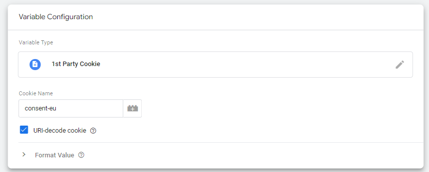
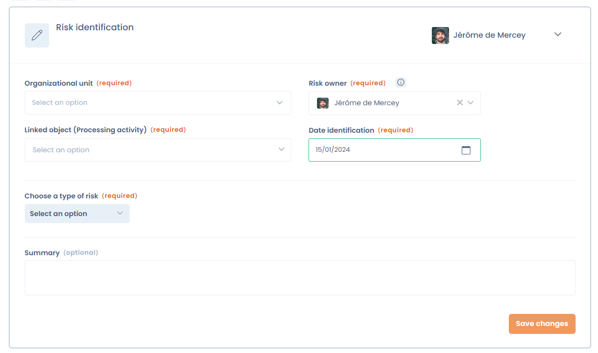
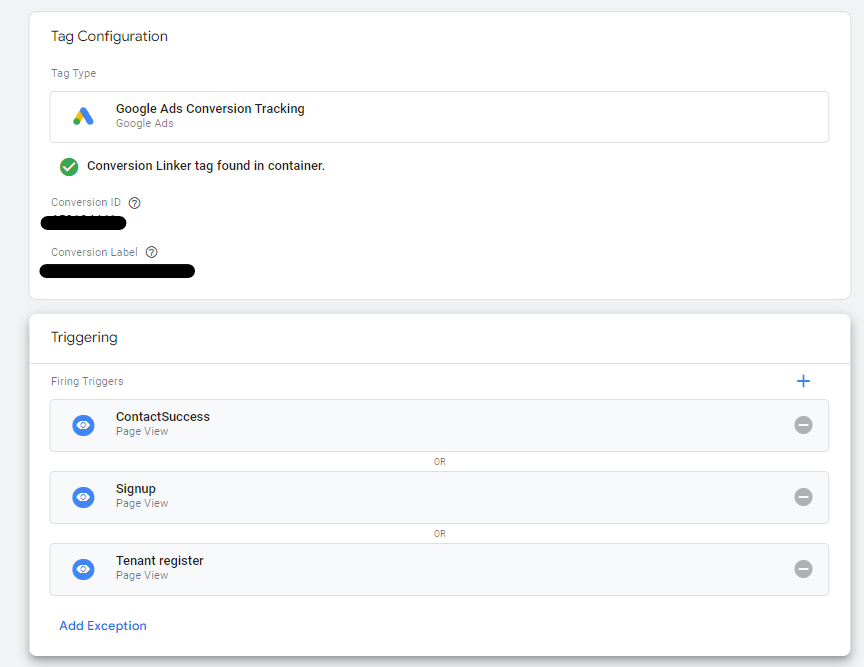

# Google Tag Manager

## Einführung

Google Tag Manager ist ein Tagging-Tool, das alle Code-Snippets zentralisiert, die Sie in Ihre Website integrieren möchten (Dastra kann dazugehören).\
Diese Tagging-Lösung ist sehr effektiv für die Implementierung der effektiven Cookie-Einwilligung, da sie es nicht erfordert, die gesamte Website bei jeder Tag-Änderung neu zu deployen.

## Google Consent Mode V2

Dastra unterstützt nativ den **Google Consent Mode V2**. Die Voraussetzungen, die Aktivierung für einen Dienst und das Standard-Einwilligungs-Snippet werden auf einer eigenen Seite beschrieben:


[google-consent-mode-v2.md](google-consent-mode.md)


## An GTM im DataLayer gesendete Ereignisse

Die folgenden Ereignisse werden automatisch an den Google dataLayer gesendet:

| Name                              | Bedeutung                                                                                         |
| --------------------------------- | ------------------------------------------------------------------------------------------------- |
| dastra:consent:{your-vendor-name} | Dieses Ereignis wird gesendet, wenn der Nutzer die Cookies dieses Anbieters akzeptiert hat        |
| dastra:refused:{your-vendor-name} | Dieses Ereignis wird ausgelöst, wenn der Nutzer den Cookies dieses Anbieters nicht zugestimmt hat |

Sie können daher die Tags, die den verschiedenen im Widget konfigurierten Anbietern entsprechen, mithilfe dieser beiden Ereignisse auslösen.

## Beispiel

In diesem Beispiel lösen wir das Google Ads-Conversion-Tag aus, wenn der Besucher dem Dienst Google Ads zustimmt.

1. Erstellen Sie in Ihrem GTM-Container einen Trigger vom Typ **Custom Event** (Benutzerdefiniertes Ereignis), dessen Ereignisname `dastra:consent:google-ads` lautet.
2. Verknüpfen Sie diesen Trigger mit Ihrem Google Ads-Conversion-Tag.

Das Tag wird dann nur bei diesem Ereignis ausgelöst.

## Spezialfall der „Blocking Triggers“

In bestimmten Fällen müssen Sie bestimmte Tags deaktivieren, wenn die Einwilligung nicht erteilt wurde. Da das Ereignis „dastra:consent:\<Dienstname>“ nur beim Laden einer Seite ausgeführt wird, kann dies in bestimmten Fällen unzureichend sein, wenn Sie andere Interaktions-Trigger auf der Seite verwenden, wie Klicks auf Seitenelemente, Scroll-Höhen usw.

In diesem Fall müssen bestimmte Konfigurationen vorgenommen werden, um **den Einwilligungswert direkt aus dem Einwilligungs-Cookie zu lesen**.


Diese Methode funktioniert nur mit der Speicherung im Cookie: Sie eignet sich nicht, wenn die Option **Aktivieren Sie den localStorage-Speicher für Einwilligung-Cookies** aktiviert ist. Wenn Sie unter **Name des Cookies zur Speicherung der Einwilligung** einen eigenen Cookie-Namen festgelegt haben, verwenden Sie ihn in der Variablen.


### 1. Eine Variable „DastraConsents“ erstellen

#### Die Variable definieren

**Melden Sie sich** bei Ihrem Google Tag Manager-Konto an und gehen Sie zu „Variablen“, dann erstellen Sie eine neue „Benutzerdefinierte Variable“.

#### „1st party cookies“ auswählen

Benennen Sie Ihr Tag z. B. „DastraConsents“. Geben Sie im Feld Cookie-Name (Cookie name) den Namen des Einwilligungs-Cookies ein (Standard: **consent-eu**).\
Denken Sie daran, **die Option „URI-decode cookie“ zu aktivieren**

<figure><figcaption></figcaption></figure>

#### Konfigurieren Sie anschließend Ihren Trigger folgendermaßen:

In diesem Fall wird unser Tag ausgelöst, wenn die Scroll-Tiefe auf der Seite > 20% beträgt. Wir möchten, dass dieses Tag nur ausgelöst wird, wenn der Google Analytics-Dienst vom Nutzer autorisiert wurde. So konfigurieren Sie den Tag-Trigger.

<figure><figcaption></figcaption></figure>

Im Bereich „Some Pages“, wenn Sie das Tag nur aktivieren möchten, wenn die Nutzung eines Dienstes genehmigt wurde, geben Sie die Formel ein: **DastraConsents contains "{serviceName}":true** (Beispiel: "crisp":true) ohne Leerzeichen

Wenn Sie das Tag im Falle einer Ablehnung auslösen möchten, verwenden Sie die Formel:

**DastraConsents contains "{serviceName}":false** (Beispiel: "google-analytics":false)

### Fall mehrerer Trigger desselben Typs mit einer Ausnahme

Wenn Sie viele verschiedene Trigger für ein und dasselbe Tag haben, ist es auch durchaus möglich, eine Ausnahme auf diese Weise zu erstellen.\
Beispiel eines Tags mit mehreren Triggern:

<figure><figcaption></figcaption></figure>

In diesem Fall möchten wir eine Ausnahme hinzufügen: Wenn das Google Ads-Tag (google-ads) nicht akzeptiert wurde, soll das Tag nicht ausgelöst werden.

Klicken Sie auf **„Ausnahme hinzufügen“** (Add Exception)


Achtung: Ausnahmen funktionieren nur dann korrekt, wenn sie vom gleichen Typ sind. Wenn Ihre Trigger vom Typ „Page view“ sind, muss die Ausnahme ebenfalls vom Typ Page view sein


Erstellen Sie einen Trigger desselben Typs mit dem Namen z. B. „Seitenaufrufe mit explizit abgelehntem Google Ads-Dienst“.


Wenn Sie das Standard-Tag auch dann deaktivieren möchten, wenn der Nutzer nicht auf das Einwilligungs-Modal geklickt hat (und daher kein Cookie mit den Präferenzen gespeichert ist), können Sie einen Trigger mit einer Negation verwenden:

**DastraConsents Does not contain "google-ads":true**


<figure><figcaption></figcaption></figure>

Klicken Sie auf **Speichern**. Sie sollten Folgendes sehen:

<figure><figcaption></figcaption></figure>

Speichern Sie Ihre Änderungen und Sie sollten feststellen, dass Ihre Tags auf den betreffenden Seiten korrekt deaktiviert sind, wenn die Einwilligung nicht erteilt wurde.

### Spezialfall: Seitenaktualisierung bei Änderung der Einwilligungskonfiguration


Die Ereignisse `dastra:consents:*` und `dastra:consent:<slug>` werden auch bei jedem Laden der Seite ausgelöst, wenn das Widget die bereits gespeicherte Auswahl anwendet. Ein `location.reload()`, das direkt an diese Ereignisse gebunden ist, lädt die Seite in einer Endlosschleife neu. Registrieren Sie den Listener immer innerhalb von `dastra:consents:ready`, wie in den Beispielen unten: Dann löst nur eine Auswahl des Besuchers das Neuladen aus.


#### Ablehnung von Cookies nach Akzeptierung:

In bestimmten Fällen werden einige Tags nach der Ablehnung von Cookies nicht korrekt bereinigt. Dies geschieht insbesondere, wenn ein Nutzer sich entscheidet, die Cookies zu akzeptieren, dann erneut auf das Widget klickt und seine Einwilligung zurücknimmt. In den meisten Fällen stellt dies kein Problem dar, da die Marker ohnehin nicht mehrmals auf der Seite ausgeführt werden und es daher nicht mehr notwendig ist, die in die Seite eingefügten Script-Tags zu entfernen.

In bestimmten Situationen ist es möglich, dass die Tags weiterhin aktiv sind.

Um diese Art von Problemen zu verhindern, ist es möglich, eine Seitenaktualisierung zu erzwingen, die alle Marker oder JavaScript-SDKs, die von den Diensten geladen werden, vollständig zurücksetzt.

Fügen Sie den folgenden Code ein (wenn möglich unterhalb des Initialisierungs-Tags des Dastra-Widgets)

```markup
<script>
// If any service is refused explicitely in the modal
// Consent events also fire on every page load: listen only once the widget is ready
window.addEventListener('dastra:consents:ready', function(){
    window.addEventListener('dastra:consents:any_refused', function(){
        // Refresh the current page
        location.reload();
    })
})
</script>
```

#### Aktualisierung der Einwilligung:

Um die Seite neu zu laden, wenn eine Einwilligung auf irgendeine Weise geändert wird, verwenden Sie die Funktion _updated_ mit dem folgenden Code:

```markup
<script>
// Consent events also fire on every page load: listen only once the widget is ready
window.addEventListener('dastra:consents:ready', function(){
    window.addEventListener('dastra:consents:updated', function(){
        // Refresh the current page
        location.reload();
    })
})
</script>
```

#### Vollständige Akzeptierung der Tracker:

Um die Seite beim vollständigen Akzeptieren der Tracker neu zu laden (Schaltfläche „Alle akzeptieren“):

```markup
<script>
// Consent events also fire on every page load: listen only once the widget is ready
window.addEventListener('dastra:consents:ready', function(){
    window.addEventListener('dastra:consents:all_accepted', function(){
        // Refresh the current page
        location.reload();
    })
})
</script>
```

#### Akzeptierung eines bestimmten Dienstes:

Um die Seite bei der Akzeptierung eines bestimmten Dienstes neu zu laden:

```markup
<script>
// Consent events also fire on every page load: listen only once the widget is ready
window.addEventListener('dastra:consents:ready', function(){
    window.addEventListener('dastra:consent:<service-slug>', function(){
        // Refresh the current page
        location.reload();
    })
})
</script>
```
