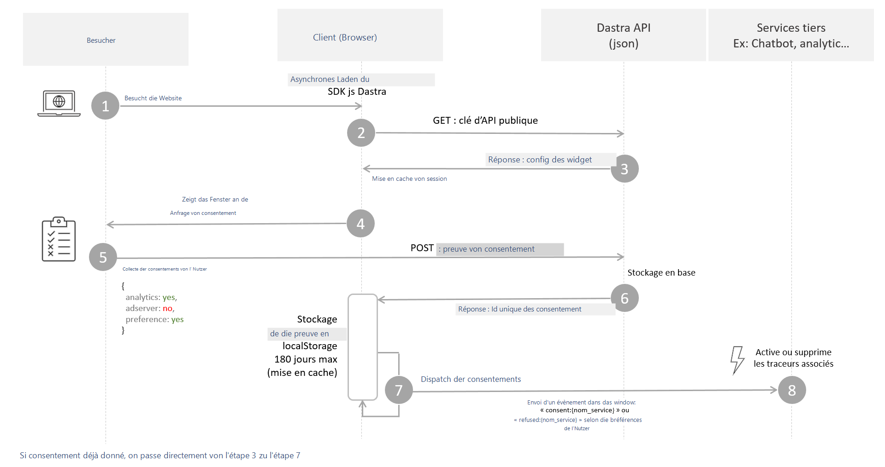

# Funktionsweise des Banners

## So funktioniert die Lizenz

Anders als andere Lösungen, die Einwilligungsbanner pro Domain verkaufen, beruht die Dastra-Lizenz auf zwei Kriterien:

* **Maximaler monatlicher Traffic**: die Gesamtzahl der Nutzersitzungen (oder Besuche) auf Ihren Websites innerhalb eines Monats.
* **Die Anzahl der Banner**: Sie konfigurieren ein Banner mit einer Reihe von Cookies und Diensten, das Sie auf mehreren Websites oder Subdomains wiederverwenden können. Das Einwilligungs-Cookie kann über mehrere Subdomains hinweg funktionieren (zum Beispiel `*.example.com`).

Die Anzahl der **Domains und Subdomains ist daher pro Banner unbegrenzt**.

<figure><figcaption><p>Ein Banner kann mehrere Websites und Subdomains bedienen</p></figcaption></figure>

## Gesamtablauf

Das Einwilligungsbanner funktioniert in drei Hauptschritten:

1. Die **Anzeige** des Einwilligungsfensters.
2. Die **Erfassung** der Einwilligung (Speicherung des Nachweises).
3. Die tatsächliche **Umsetzung** der Einwilligung des Nutzers.


Das Dastra-Banner deckt die ersten beiden Schritte weitgehend automatisch ab. Für den dritten Schritt, der die Cookie-Präferenzen des Nutzers anwendet, müssen Sie das Einwilligungssystem technisch mit den Drittanbieter-Diensten verbinden, die Cookies setzen können. Siehe den [Leitfaden zur Cookie-Blockierung](blocking/README.md).


Das JavaScript-SDK des Banners muss auf allen Seiten der Website eingebunden werden, die Cookies verwenden.



### 1. Besuch der Website des Kunden

Der Besucher öffnet die Website, auf der das JavaScript-Code-Snippet installiert ist. Um die Leistung und die Suchmaschinenoptimierung Ihrer Seiten nicht zu beeinträchtigen, wird das SDK asynchron geladen und einen Tag lang zwischengespeichert.

### 2. und 3. Die Banner-Konfiguration abrufen und zwischenspeichern

Damit das Banner funktioniert, benötigt es eine aktuelle Konfiguration von den Dastra-Servern. Um die neueste Version zu erhalten, sendet es eine GET-Anfrage mit dem öffentlichen API-Schlüssel, der prüft, ob das Banner zum Kunden gehört.


Ist die Domain der Website im Banner nicht festgelegt, wird die Anfrage abgelehnt und das Banner erscheint nicht. Öffnen Sie zur Behebung das Banner unter **Cookie-Banner** > **Banner** und fügen Sie dann im Abschnitt **Konfiguration** im Feld **Zulässige URLs (CORS)** die Adresse der Website hinzu.


### 4. Die Einwilligung des Nutzers einholen

Fehlt das Cookie `consent-eu` (Sie können den Namen des Cookies ändern), erscheint das Einwilligungsfenster. Um zu testen, ob das Banner korrekt angezeigt wird, löschen Sie dieses Cookie aus Ihrem Browser.

### 5. Die Einwilligung erfassen

Einwilligungen werden von der Dastra-API automatisch mit einer POST-Anfrage im JSON-Format erfasst.

In der Oberfläche des Banners wird die Einwilligung pro Zweck ausgedrückt, aber pro Dienst gespeichert.

So sieht ein Einwilligungsnachweis aus, wie er in unseren Datenbanken gespeichert ist. Interne technische Felder werden nicht angezeigt.

```json
{
    "id": "6185fe65-0924-410d-9132-3cde838c4627",
    "sessionId": "0b93b823-ff36-4d61-8959-e9e8deee5ef8",
    "date": "2026-10-12T16:54:03.272Z",
    "dateExpiration": "2027-04-10T16:54:03.272Z",
    "type": 2,
    "widgetId": 43,
    "typeDevice": 2,
    "workSpaceId": 19,
    "consentId": "8a5e89c4-2243-4598-97c5-ba3cfb35a138",
    "countryCode": "FR",
    "referrer": "https://www.example.com/pricing",
    "consents": {
        "lang": "fr-FR",
        "versionKey": "6f65cb1d-85eb-4a64-976d-519679189f8d",
        "cookieConsents": [
            {
                "id": "584ffef3-251c-4e9a-efb8-08d7fbfbee92",
                "tenantId": 0,
                "name": "Drift",
                "slug": "drift",
                "consent": true,
                "version": "6f65cb1d-85eb-4a64-976d-519679189f8d",
                "date": "2026-10-12T16:53:59.511Z",
                "purpose": 3
            }, {
                "id": "1c3baa61-0d05-44e4-da3d-08d7eeadee05",
                "tenantId": 0,
                "name": "Google Analytics",
                "slug": "google-analytics",
                "consent": true,
                "version": "6f65cb1d-85eb-4a64-976d-519679189f8d",
                "date": "2026-10-12T16:54:00.568Z",
                "purpose": 2
            }
        ]
    }
}
```

Als Antwort gibt die API eine `consentId` zurück, die zusammen mit den Entscheidungen des Besuchers im Einwilligungsspeicher abgelegt wird: standardmäßig im Cookie `consent-eu`, oder in `localStorage`, wenn Sie diesen Modus gewählt haben. Ihre Lebensdauer entspricht der Einstellung **Lebensdauer des Einwilligungs-Cookies (standardmäßig 180 Tage)** (standardmäßig 180 Tage, von 1 bis 365 Tagen). Diese Kennung ist die eindeutige Kennung des Einwilligungsnachweises. Im Streitfall ist sie diejenige, nach der Sie im Browser des Kunden suchen.

### 6. Die Einwilligung umsetzen

Sobald die Einwilligung erfasst ist, müssen Sie die Entscheidung des Nutzers anwenden, indem Sie die Einwilligungsinformationen an alle Dienste der Website weitergeben.

Für diese Phase siehe den Leitfaden zur Cookie-Blockierung:


[Cookie-Blockierung](blocking/README.md)



Mit Ausnahme der unbedingt notwendigen Cookies müssen alle Tracking-Dienste von Drittanbietern standardmäßig blockiert werden.


Sie können nun mit der technischen Integration des Banners beginnen:


[Schnellstart](quickstart/README.md)

