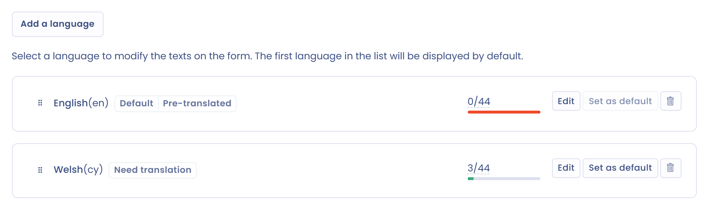

# Sprachverwaltung

## Sprachen zum Banner hinzufügen

1. Klicken Sie im Menü auf **Cookie-Banner** > **Banner** und dann auf Ihr Banner.
2. Klappen Sie den Abschnitt **Texte und Übersetzungen** auf.
3. Klicken Sie auf **Sprache hinzufügen**, wählen Sie die Sprache in der Liste aus und klicken Sie dann auf **Sprache hinzufügen**.

<figure><figcaption><p>Der Abschnitt „Texte und Übersetzungen“</p></figcaption></figure>

Die erste Sprache in der Liste ist die Standardsprache. Um eine andere festzulegen, klicken Sie neben der Sprache auf **Standardmäßig festlegen**. Klicken Sie auf **Bearbeiten**, um die Texte einer Sprache anzupassen.

In der Auswahlliste sind die Sprachen der Gruppe **Sprachen mit Übersetzungen** bereits von Dastra übersetzt: Englisch (US), Englisch (UK), Französisch, Deutsch, Spanisch, Italienisch, Niederländisch, Griechisch, Polnisch und Portugiesisch. Die übrigen Sprachen stehen in der Gruppe **Nicht übersetzte Sprachen**: Sie geben die Texte selbst ein.

Jede hinzugefügte Sprache trägt eine Kennzeichnung:

* **Vorübersetzt**: Die Sprache gehört zu denen, die Dastra übersetzt;
* **Übersetzung erforderlich**: Einige Texte der Sprache sind noch leer;
* **Vollständig übersetzt**: Alle Texte sind ausgefüllt.

Ein Zähler zeigt die Anzahl der individuellen Texte im Verhältnis zur Gesamtzahl der Texte an.

## Erkennung der Sprache des Banners

Standardmäßig verwendet das Banner die Sprache, die das Attribut `lang` des Tags `<html>` der Seite festlegt. Fehlt dieses Attribut, verwendet es die Sprache des Browsers.

Befindet sich diese Sprache (oder ihre Hauptsprache, zum Beispiel `fr` für `fr-FR`) nicht in der Liste des Banners, erscheint das Banner in der ersten Sprache der Liste.

## Die Sprache des Banners erzwingen

Um die Sprache zu erzwingen, fügen Sie dem `div` des Banners das Attribut `data-lang` hinzu:

```html
<div id="dastra-cookie-consent" data-widgetid="{your_widget_id}" data-lang="fr"></div>
```

Wenn Sie das Banner mit der Methode `loadCookieConsent` laden, übergeben Sie stattdessen die Option `lang`:

```javascript
dastra.push(['loadCookieConsent', {
    widgetId: {your_widget_id},
    selector: '#cookie-consent',
    lang: 'fr'
}]);
```
