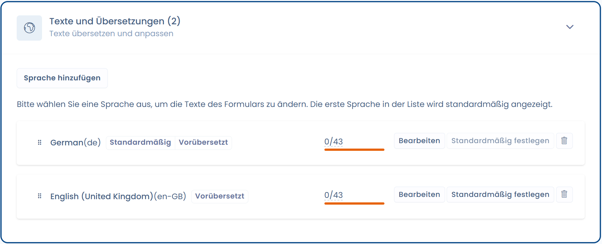

# Sprachverwaltung

## Wie verwaltet man mehrere Sprachen für das Widget?

Gehen Sie auf die Einstellungsseite des gewünschten Widgets und dann auf den Tab „Texte und Übersetzungen". Sie können eine oder mehrere Sprachen hinzufügen.



## Wie wird die Sprache des Widgets erkannt?

Standardmäßig verwendet das Widget die Sprache aus dem Attribut `lang` des `<html>`-Tags der Seite. Fehlt dieses Attribut, wird die Browsersprache verwendet.

## Wie erzwingt man die Sprache des Widgets?

Um die Sprache des Widgets zu erzwingen, fügen Sie dem Widget-div das Attribut `data-lang` hinzu:

```html
<div id="dastra-cookie-consent" data-widgetid="{your_widget_id}" data-lang="fr"></div>
```

Wenn Sie das Widget mit der Methode `loadCookieConsent` laden, übergeben Sie stattdessen die Option `lang`:

```javascript
dastra.push(['loadCookieConsent', {
    widgetId: {your_widget_id},
    selector: '#cookie-consent',
    lang: 'fr'
}]);
```
