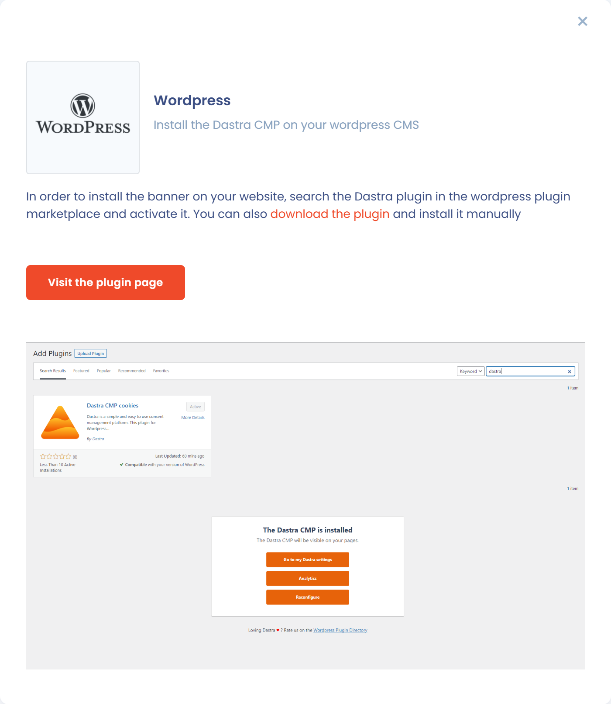

# Wordpress

## Das Dastra-Plugin installieren

Das Dastra-Plugin ist die empfohlene Methode: Theme-Updates überschreiben es nicht.

1. Öffnen Sie im Banner den Abschnitt **Installation** und klicken Sie auf die Karte **Wordpress**.
2. Klicken Sie auf **Bitte besuchen Sie die Plugin-Seite** oder suchen Sie in der Plugin-Liste Ihrer WordPress-Verwaltung nach dem Plugin „Dastra“. Sie können das Plugin auch in diesem Fenster herunterladen und manuell installieren.
3. Installieren und aktivieren Sie das Plugin.
4. Öffnen Sie in WordPress **Settings** > **Dastra** und klicken Sie auf **Link with Dastra**, um das Plugin mit Ihrem Banner zu verknüpfen.

<figure><figcaption>
Die Karte „Wordpress“ im Abschnitt Installation
</figcaption></figure>

## Oder den Code im Theme einfügen

Wenn Sie kein Plugin installieren können, fügen Sie den Code des Banners im Theme ein. Ein Theme-Update überschreibt diese Änderung: Nehmen Sie sie stattdessen in einem Child-Theme vor.

1. Klicken Sie im Abschnitt **Installation** des Banners auf die Karte **Javascript** und kopieren Sie den Code.
2. Klicken Sie in der Verwaltung Ihrer WordPress-Website auf **Appearance** und dann auf **Theme Editor**.
3. Wählen Sie die Datei `footer.php` aus und fügen Sie den Code unmittelbar vor dem `</body>`-Tag ein.

4. Klicken Sie auf **Update File** und aktualisieren Sie dann die Seite Ihrer Website. Das Banner erscheint.

Fügen Sie außerdem eine Schaltfläche hinzu, die das Banner erneut öffnet, wie unter [Schnellstart](README.md#das-banner-uber-eine-schaltflache-erneut-offnen) beschrieben.
