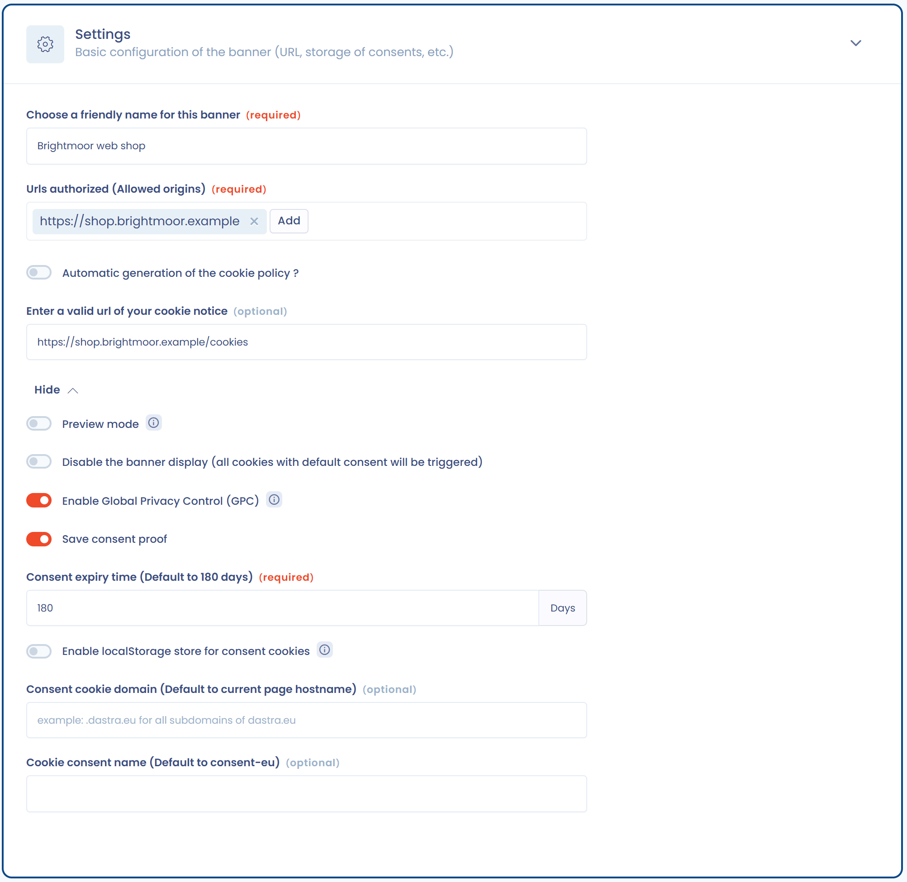

# Fehlerbehebung

Wenn das Cookie-Banner nicht angezeigt wird, prüfen Sie der Reihe nach die folgenden Punkte.

1. Prüfen Sie die zulässigen URLs. Klicken Sie im Menü auf **Cookie-Banner** > **Banner**, öffnen Sie das Banner und dann den Abschnitt **Konfiguration**. Die Adresse Ihrer Website muss unter **Zulässige URLs (CORS)** aufgeführt sein, im Format `https://myurl.com`, ohne Pfad. Das ist die häufigste Ursache: Ein Origin, der in der Liste fehlt, wird abgelehnt.

   <figure><figcaption>
Das Feld „Zulässige URLs (CORS)“
</figcaption></figure>
2. Prüfen Sie den Status des Banners. Im Editor muss der Schalter **Status** auf aktiviert stehen.
3. Prüfen Sie die Gültigkeit Ihres öffentlichen API-Schlüssels (verwenden Sie nicht den privaten Schlüssel). Klicken Sie in der oberen Leiste auf das Zahnradsymbol (**Organisationseinstellungen**) und dann auf **API-Schlüssel & MCP**. Prüfen Sie, ob der Schlüssel existiert und nicht abgelaufen ist. Siehe [API-Schlüssel verwalten](../settings/api-keys.md).

   <figure><figcaption>
Die Seite „API-Schlüssel & MCP“
</figcaption></figure>
4. Prüfen Sie, ob Sie versehentlich einen Anzeige-Auslöser festgelegt haben. Im Abschnitt **Auslöser** verhindert ein zu hoher Wert bei **Scrollhöhe in % der Seitengröße (0 % = Seitenanfang)**, dass das Banner erscheint, wenn der Besucher auf der Seite ankommt.
5. Prüfen Sie die Optionen, die das Banner ausblenden. Die Option **Bitte aktivieren Sie das Banner nicht (alle standardmäßig durch Einwilligung zugelassenen Cookies werden aktiviert).** blendet das Banner aus, ebenso **Aktivieren Sie die Global Privacy Control (GPC)** bei Besuchern, deren Browser dieses Signal sendet. Ein Besucher, der bereits eine Auswahl getroffen hat, sieht das Banner nicht mehr: Löschen Sie zum Testen das Cookie `consent-eu` aus Ihrem Browser.
6. Prüfen Sie Ihr Abonnement. Um das Cookie-Banner zu nutzen, muss Ihr Abonnement die Funktion enthalten. Erscheint das Menü **Cookie-Banner** nicht in der Navigation, ist die Funktion wahrscheinlich nicht enthalten: Wenden Sie sich an den Inhaber Ihrer Organisation. Ist das Abonnement abgelaufen, lehnt die API die Konfiguration des Banners ab. Weitere Informationen erhalten Sie beim [Support](mailto:support@dastra.eu).
7. Bei jedem anderen Problem [wenden Sie sich an den Support](../../getting-started/support/request.md).
