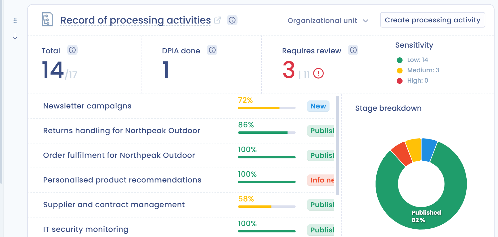

# Dashboard

Das Dashboard ist die erste Seite, die Sie beim Betreten eines Mandanten sehen. Es fasst den Stand Ihrer DSGVO-Compliance zusammen und gibt Zugriff auf die Module. Um von jeder Seite dorthin zurückzukehren, klicken Sie oben im linken Menü auf **Dashboard**.

## Die Bereiche des Bildschirms

Der Bildschirm hat drei Bereiche:

* **Das linke Menü**: die Auswahl des Mandanten, die auch Ihre Rollen im Mandanten anzeigt, dann die Module, gruppiert unter **Dateninventar**, **Betrieb**, **Governance**, **Automatisierungen** und **Ressourcen**. Die Schaltfläche **Ein Mitglied einladen** und der Eintrag **Mandanteneinstellungen** stehen unten im Menü. Ein Modul erscheint nur, wenn Ihr Abonnement es enthält und Ihre Berechtigungen Ihnen Zugriff darauf geben.
* **Der zentrale Bereich**: Über den Kacheln finden Sie, je nach Ihren Berechtigungen und Ihrem Abonnement, die Eingabe für den KI-Agenten (**Wie kann ich Ihnen heute helfen?**), die Karte der neuesten Versionshinweise, die Karte **Fortschritt** (der Leitfaden für den Einstieg) und die **Vorstellung des Mandanten**, ein freier Text, der den Mandanten seinen Nutzern vorstellt.
* **Der Community-Tab** rechts auf dem Bildschirm: Er öffnet den Bereich **Kommende Webinare**. Sie können den Bereich einklappen; der Tab bleibt dann rechts auf dem Bildschirm, um ihn wieder zu öffnen, und Ihre Wahl wird in Ihrem Browser gespeichert.

<figure><figcaption>
Das Dashboard eines Mandanten
</figcaption></figure>

## Die Kacheln des Dashboards

Die Kacheln fassen die Aktivität jedes Moduls zusammen. Standardmäßig erscheinen sie in dieser Reihenfolge, für die Module, auf die Sie Zugriff haben:

* **Datenverarbeitung** (Verarbeitungsverzeichnis)
* **Compliance**
* **Aktuelles und Marktbeobachtung**
* **Kanban-Board** (Aufgaben)
* **Anfragen in den letzten 90 Tagen**
* **Aktuelle Vorfälle**
* **Verzeichnis der Verträge und Richtlinien**
* **KI-Register** (KI-Systeme)
* **Risikomanagement**
* **Ihre Fragebögen**
* **Assets**

Die meisten Kacheln (Verarbeitungstätigkeiten, Aufgaben, Anfragen, Vorfälle, Verträge, KI-Systeme, Risiken und Fragebögen) haben einen Filter für die Organisationseinheit. Damit beschränken Sie die Kachel auf die Elemente einer Einheit oder Abteilung.

### Die Kacheln neu anordnen

Um die Reihenfolge der Kacheln zu ändern, ziehen Sie den Griff neben einer Kachel oder klicken Sie auf die Schaltflächen **Nach oben** und **Nach unten**, die dazugehören. Die Reihenfolge wird in Ihrem Browser gespeichert: Für andere Nutzer ändert sie sich nicht.

<figure><figcaption>
Eine Kachel und ihre Schaltflächen zum Verschieben
</figcaption></figure>

## Ein Mitglied einladen

Wenn Sie berechtigt sind, Nutzer zu verwalten, erscheint die Schaltfläche **Ein Mitglied einladen** unten im linken Menü. Sie öffnet das Formular, um einen neuen Nutzer einzuladen. Einzelheiten zu den Feldern finden Sie unter [Nutzer einladen](../getting-started/setup/users.md).

<figure><figcaption>
Das Formular, um ein Mitglied einzuladen
</figcaption></figure>

## Weiterführende Informationen

Entdecken Sie die Funktionen:


[Verarbeitungsverzeichnis](ropa/README.md)



[Datenvisualisierung](ropa/visualization/README.md)



[Risikomanagement](risks/README.md)



[Planung](tasks/README.md)



[Betroffenenanfragen](requests/README.md)



[Datenschutzvorfälle](incidents/README.md)



[Cookie-Einwilligung verwalten](cookies/README.md)



[Fragebögen](questionnaires/README.md)



[Erweiterte Konfiguration](settings/README.md)

