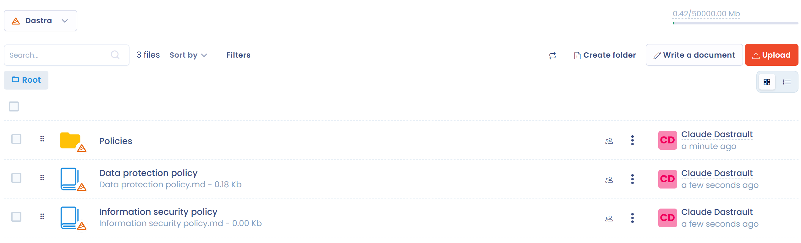

# Dokumentenmanagement (DMS)

Dastra enthält nativ einen Dateimanager, im Französischen auch GED (Gestion électronique des documents) genannt. Er bündelt alle Dokumente, die zu Ihrer Arbeit in Dastra gehören, und macht sie gemeinsam zugänglich. Sie finden das Modul im linken Menü unter **Ressourcen** > **Dateimanager**.

Hier können Sie die gesamte Dokumentation ablegen, die Ihre DSGVO-Compliance belegen hilft.


**Schwerpunkt Dokumentation zur DSGVO**

Die Dokumentationspflicht ergibt sich aus dem **Grundsatz der Rechenschaftspflicht** nach Artikel 24 DSGVO.

In der Praxis geht sie über das Verzeichnis von Verarbeitungstätigkeiten hinaus und umfasst (nicht abschließende Liste):

* Interne Verfahren zur Einführung neuer Verarbeitungen personenbezogener Daten
* Methodik der DSFA und durchgeführte Folgenabschätzungen
* Schriftliche Datenschutzrichtlinien
* Verfahren zur Datenkartierung und zum Inventar
* Schulungsnachweise für die Mitarbeitenden, die an der Datenverarbeitung beteiligt sind
* Verfahren zur Verwaltung der Betroffenenrechte
* Interne Mechanismen zur Bearbeitung von Beschwerden
* Verfahren zur Behandlung und Meldung von Datenschutzverletzungen
* Berichte und Feststellungen interner oder externer Audits
* Vertragsdokumentation für Auftragsverarbeiter und gemeinsam Verantwortliche


## Akzeptierte Dateiformate

Viele Formate werden unterstützt:

* PDF
* Word (.docx)
* Excel (.xlsx)
* Bilder (JPG, PNG usw.)
* Archive (.zip)
* und weitere

Wird ein Format nicht akzeptiert, legen Sie die Datei in ein `.zip`-Archiv und laden Sie dieses hoch.

## Ein Dokument erstellen

Sie können ein Dokument direkt in Dastra schreiben, zum Beispiel für Notizen. Klicken Sie im Dateimanager auf **Datei erstellen**.

<figure><figcaption>
Die Schaltfläche Datei erstellen
</figcaption></figure>

Geben Sie die Bezeichnung des Dokuments und dann seinen Inhalt im Markdown-Editor ein. Das Dokument wird im Markdown-Format (.md) gespeichert.

<figure><figcaption>
Der Dokumenteditor
</figcaption></figure>

### Ein Dokument mit KI generieren

Der KI-Assistent kann aus einer Beschreibung und bei Bedarf aus Dateien oder einer Website-Adresse als Kontext **ein Dokument generieren**.

Klicken Sie dazu auf **Datei erstellen** und dann im Editor auf **Mit KI generieren**. Beschreiben Sie kurz das benötigte Dokument (Art, Zweck, erwarteter Inhalt) und fügen Sie optional Dateien hinzu, um den Kontext anzureichern. Der erzeugte Text erscheint im Editor: Prüfen Sie ihn, bearbeiten Sie ihn und speichern Sie ihn. Die Schaltfläche ist nur aktiv, wenn der KI-Assistent in Ihrem Abonnement verfügbar ist.


Diese Funktion ist nützlich, um eine erste Fassung einer Datenschutzrichtlinie, einer internen Verfahrensanweisung oder eines anderen Compliance-Dokuments zu entwerfen.


## Einen Ordner erstellen

Ordnen Sie Ihre Dokumente in Ordnern, damit Sie sie wiederfinden. Klicken Sie auf **Neuer Ordner**, benennen Sie ihn und wählen Sie seinen Speicherort: Unterordner werden unterstützt.

<figure><figcaption>
Das Fenster zum Erstellen eines Ordners
</figcaption></figure>

## Zugriffsrechte verwalten

Sie können den Zugriff auf Ordner und Dateien einschränken. Die Rechte gelten für Ordner wie für Dateien. Sie werden vom Administrator des Mandanten oder von einem Nutzer eingerichtet, der Dateien verwalten darf.


Standardmäßig gelten für die Ordnerstruktur keine Einschränkungen. Die mit den Rollen des Nutzers verknüpften Berechtigungen gelten weiterhin.


Klicken Sie in der Zeile eines Ordners oder einer Datei auf die Schaltfläche **File access**, und fügen Sie dann die Teams und Nutzer mit der gewünschten Berechtigungsstufe hinzu.

<figure><figcaption>
Das Fenster für die Zugriffsrechte
</figcaption></figure>

Diese Berechtigungen gelten für alle untergeordneten Elemente, also für alles, was der Ordner enthält, einschließlich der Unterordner.


Ein Ordner ohne festgelegte Berechtigungen ist für alle Nutzer zugänglich.

Sind für ein Element Berechtigungen festgelegt oder geerbt, wird es vor Nutzern verborgen, die nicht über die erforderlichen Berechtigungen verfügen.


## Dateien aus anderen Modulen

Die Dateien, die an Verarbeitungstätigkeiten, Assets, Stakeholder und Verträge angehängt sind, können im Dateimanager in einem eigenen Ordner abgelegt werden. Sie sind dann für alle Nutzer sichtbar, die Dateien einsehen dürfen: Sie müssen den Zugriff auf die Ordner verwalten.

Um dieses Standardverhalten zu wählen, klicken Sie auf **Mandanteneinstellungen** > **Allgemeines** und aktivieren Sie dann in der Karte **Dateimanager** die Option **Bitte laden Sie die Dateien in den gemeinsamen Standard-Dateimanager hoch.** Wenn Sie die Option deaktivieren, bleiben die Dateien an ihrem Element angehängt und erscheinen nicht im Dateimanager, was die Zugriffsverwaltung vereinfachen kann.

<figure><figcaption>
Die Option zum standardmäßigen Hochladen von Dateien
</figcaption></figure>

Nutzer, die Dateien verwalten dürfen, haben drei zusätzliche Befehle:

* **Dateien außerhalb des Managers anzeigen** im Menü **Filter** des Dateimanagers listet die Dateien auf, die dort nicht abgelegt sind.
* **Wechseln Sie zum gemeinsamen Dateimanager (GED)** verschiebt eine Datei in den Dateimanager, in den Ordner Ihrer Wahl.
* **Verlassen Sie den gemeinsamen Dateimanager (GED).** nimmt die Datei aus dem Dateimanager heraus: Die Datei bleibt erhalten, aber andere Nutzer können sie nicht mehr entdecken.

## Cloud-Speicher

Standardmäßig speichert Dastra Dateien in Azure Blob Storage: Sie sind verschlüsselt, werden auf Viren geprüft und redundant gehalten. Sie können auch Ihren eigenen Speicher verbinden, Microsoft OneDrive & SharePoint oder Google Drive, um doppelte Dateien zwischen Systemen zu vermeiden.


[OneDrive/SharePoint- und Google-Drive-Integrationen](../settings/cloud-storage.md)


## Dokumentvorlagen

Dastra stellt gebrauchsfertige Dokumentvorlagen bereit, mit denen Sie Ihre Compliance-Dokumentation aufbauen.


[Dokumentvorlagen](templates.md)

