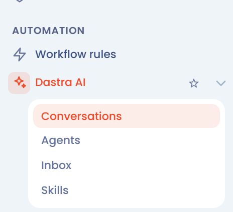
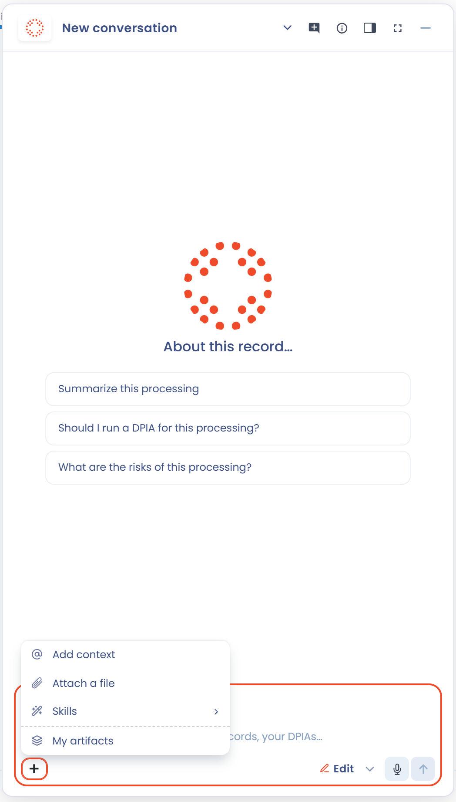
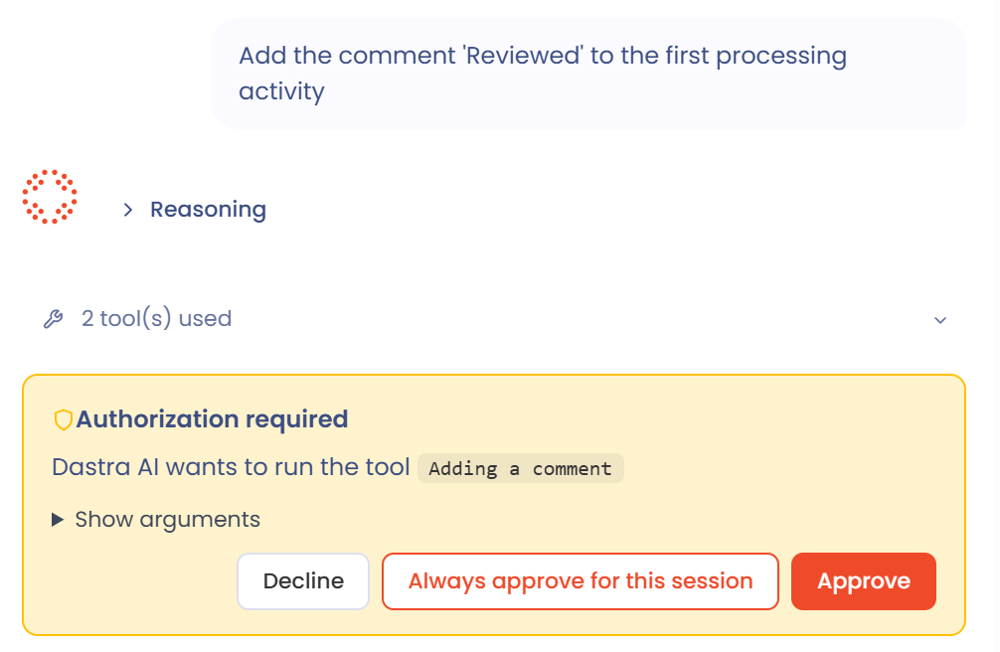

# Dastra AI

Dastra AI fasst alle KI-Funktionen von Dastra zusammen. Sie chatten damit über Ihren Mandanten, übertragen ihm Aufgaben, bauen eigene Agenten und verbinden Ihre KI-Werkzeuge mit Dastra. Es basiert auf generativen KI-Modellen, die auf Azure in Frankreich und im Europäischen Wirtschaftsraum gehostet werden, ohne dass Daten Ihrer Organisation zum Training dieser Modelle verwendet werden.

Die Funktionen bilden zwei Gruppen:

* Der **Gesprächsmodus** umfasst den Dastra-AI-Chat, die [Funktionen](agents/skills.md), die [Agenten](agents/README.md), die [Artefakte](artifacts.md) und den [MCP-Server](mcp.md). Er ist offen: Sie stellen Fragen und übertragen Aufgaben in natürlicher Sprache.
* Die **KI-Assistenten** sind eng begrenzte Erstellungsfunktionen. Eine Schaltfläche in einem Modul deckt einen genau definierten Anwendungsfall ab: eine Verarbeitungstätigkeit, einen Datenschutzhinweis oder eine Risikoanalyse erstellen.

Die Verfügbarkeit jeder Funktion hängt vom Tarif Ihrer Organisation ab, Modul für Modul, und von den Berechtigungen der einzelnen Nutzer. In einem Modul, das Ihr Tarif nicht enthält, sind die KI-Schaltflächen ausgegraut, bei einigen Funktionen erscheinen sie gar nicht. Um den Umfang Ihres Tarifs zu ändern, wenden Sie sich an unser Team.

## Was Sie mit Dastra AI tun können

<table data-view="cards"><thead><tr><th></th><th></th></tr></thead><tbody><tr><td><strong>Über Ihren Mandanten chatten</strong></td><td>Fordern Sie eine Zusammenfassung, eine Liste überfälliger Anfragen oder die Verarbeitungstätigkeiten ohne DSFA an. Im Bearbeitungsmodus erstellt und ändert Dastra AI nach Ihrer Genehmigung auch Einträge. Siehe <a href="#mit-dastra-ai-chatten">Mit Dastra AI chatten</a>.</td></tr><tr><td><strong>Eine Funktion ausführen</strong></td><td>Geben Sie <code>/</code> in das Nachrichtenfeld ein, um einen wiederverwendbaren Prompt anzuwenden, der in Dastra integriert ist oder von Ihrem Team geschrieben wurde. Siehe <a href="agents/skills.md">Funktionen</a>.</td></tr><tr><td><strong>Eigene Agenten erstellen</strong></td><td>Ein Konversationsagent antwortet mit eigenen Anweisungen und Tools. Ein autonomer Agent erledigt eine Aufgabe selbstständig, wenn Sie ihn starten, nach Zeitplan oder durch eine Workflow-Regel, und seine Ausführungen stehen im <strong>Posteingang</strong>. Siehe <a href="agents/README.md">Dastra AI Agenten</a>.</td></tr><tr><td><strong>Artefakte aufbewahren</strong></td><td>Die Dashboards, Diagramme und Dokumente, die Dastra AI in einer Unterhaltung erstellt, werden als Artefakte gespeichert, die Sie wieder öffnen und teilen können. Siehe <a href="artifacts.md">Artefakte</a>.</td></tr><tr><td><strong>Ihre KI-Werkzeuge verbinden</strong></td><td>Claude, ChatGPT, Microsoft Copilot und andere Werkzeuge greifen über den MCP-Server auf Ihre Dastra-Daten zu. Siehe <a href="mcp.md">Der MCP-Server</a>.</td></tr></tbody></table>



Sie öffnen Dastra AI im Dashboard, über die Schaltfläche **Dastra AI öffnen** unten rechts auf dem Bildschirm, mit **Strg+J** (**Cmd+J** auf dem Mac) oder über den Eintrag **Dastra AI** des Menüs **Automatisierung**. Dieser Eintrag fasst den Chat in voller Größe (**Conversations**, mit der Liste **Artefakte**), **Agenten**, **Posteingang** und **Funktionen** zusammen. Die letzten drei erscheinen, wenn Ihr Tarif eigene Agenten enthält und Ihre Rolle sie erlaubt.



<figure><figcaption>
Automatisierung &#x3E; Dastra AI
</figcaption></figure>



Alle KI-Funktionen teilen sich das monatliche Kontingent an KI-Credits, das unter [Funktionsweise](how-it-works.md#ki-credits-und-kontingente) beschrieben ist.

## Mit Dastra AI chatten

**Dastra AI** beantwortet in einer Unterhaltung Fragen zu Ihrem Mandanten. Der Assistent durchsucht Ihre Einträge mit Werkzeugen, die nur lesen, sodass Sie eine Zusammenfassung, eine Liste überfälliger Anfragen oder die Verarbeitungstätigkeiten ohne DSFA anfordern können.

Für seine Antworten kann sich Dastra AI auch auf die von Dastra indexierte Rechtsgrundlage, auf die Dastra-Dokumentation und auf eine Websuche stützen. Im Bearbeitungsmodus kann der Assistent Einträge erstellen, Felder ändern, einen Aktionsplan, einen Fragebogen, einen Kommentar oder ein Tag erstellen und Eintragsaktionen wie den Wechsel der Workflow-Phase starten. Er kann [Artefakte](artifacts.md) erstellen, Ihnen vor der Ausführung Rückfragen stellen und Sie zum betreffenden Eintrag führen.



1. Klicken Sie unten rechts auf dem Bildschirm auf **Dastra AI öffnen** oder drücken Sie **Strg+J** (**Cmd+J** auf dem Mac). Im Dashboard können Sie Ihre Frage auch in das Nachrichtenfeld unter **Wie kann ich Ihnen heute helfen?** eingeben: Das Fenster öffnet sich und antwortet.
2. Geben Sie Ihre Frage ein oder wählen Sie einen der **Vorschläge**. Sie ändern sich mit der Seite, auf der Sie sind: der Eintrag, den Sie ansehen, das Verzeichnis, Anfragen, KI-Systeme.
3. Lesen Sie die Antwort. Stützt sich der Assistent auf Ihre Einträge, zeigt er seine Schritte und nennt sie als Quellen. Mit den **Vorschlägen für Fragen** setzen Sie die Unterhaltung fort. Für vollständige Antworten mit Quellen siehe [Wirksame Anfragen formulieren](prompting.md).



<figure><figcaption>
Das Dastra-AI-Fenster mit geöffnetem Menü +
</figcaption></figure>



Der Eintrag oder das Verzeichnis, das Sie gerade ansehen, wird dem Assistenten als Kontext übergeben. Sie können also „Fassen Sie diese Verarbeitung zusammen“ schreiben, ohne sie zu nennen. Eine geführte Tour durch das Fenster steht zur Verfügung: Klicken Sie auf **Leitfaden anzeigen**, das Informationssymbol in der Kopfzeile des Fensters.

Das Fenster bietet mehrere Werkzeuge:

**Anzeige**

* **Open in full view** öffnet die Unterhaltung auf der Seite Dastra AI im Menü **Automatisierung**, wo Ihre Unterhaltungen links aufgelistet sind. Ältere Links zur KI-Agenten-Seite eines Mandanten führen auf dieselbe Seite.
* **Dock to the right** hält das Fenster in einer Spalte neben der Seite, **Undock** legt es wieder über die Seite, und **Reduzieren** schließt es. Das Andocken wird auf Bildschirmen mit mindestens 1.480 Pixeln Breite angeboten. Dastra merkt sich Ihre Wahl.
* **Neue Unterhaltung** startet eine frische Unterhaltung. Die Unterhaltungsliste bewahrt die früheren Unterhaltungen auf, nach Datum gruppiert und mit einem Suchfeld: Benennen Sie sie dort um oder löschen Sie sie. Das Löschen einer Unterhaltung löscht alle ihre Nachrichten.

**Kontext**

* **Einen Agenten auswählen** wechselt zwischen dem **Standard-Chat** und den [Agenten](agents/README.md), die Ihr Mandant aktiviert hat.
* **Kontext hinzufügen** gibt dem Assistenten einen Eintrag oder einen Nutzer zur Bearbeitung. Geben Sie `@` in die Nachricht ein, um einen Eintrag oder einen Nutzer zu erwähnen.
* **Datei anhängen**, oder ziehen Sie eine Datei in das Nachrichtenfeld. Dastra AI liest PDF-, PNG- und JPEG-Dateien selbst. CSV-, XLSX-, DOCX-, JSON-, TXT- und Markdown-Dateien werden ebenfalls akzeptiert, aber nur die Codeausführung kann sie öffnen, wo sie verfügbar ist. Eine Datei darf höchstens 10 MB groß sein.
* **My artifacts** im Menü **+** öffnet die Liste der [Artefakte](artifacts.md) des Mandanten.
* Geben Sie `/` ein oder klicken Sie auf **Funktionen**, um eine [Funktion](agents/skills.md) auszuführen, einen wiederverwendbaren Prompt. Eine Nachricht wendet höchstens fünf Funktionen an.

**Nachrichten**

* **Eine Nachricht diktieren** nimmt Ihre Stimme auf und überträgt sie als Text in das Nachrichtenfeld. Ihr Browser fragt beim ersten Mal nach dem Zugriff auf das Mikrofon.
* **Kopieren** legt eine Antwort in die Zwischenablage.
* Bewerten Sie eine Antwort mit **Richtige Antwort** oder **Falsche Antwort**. Bei **Falsche Antwort** öffnet sich ein Fenster, in dem Sie einen Kommentar hinzufügen können. Dastra speichert die Bewertung und den Kommentar mit der Nachricht.

Dastra stellt nach dem Neuladen der Seite wieder her, was Sie gerade getan haben: den Text, den Sie eingegeben haben, und, wenn Ihr letzter Austausch weniger als sechs Stunden zurückliegt, die Unterhaltung.

Wird eine Unterhaltung lang, erscheint neben dem Nachrichtenfeld ab 50 % des verfügbaren Platzes eine Anzeige **Context**. Ab 80 % wird die Anzeige orange und schlägt eine neue Unterhaltung vor. Senden bleibt möglich, aber der Assistent kann den Anfang der Unterhaltung verlieren, sobald der Platz aufgebraucht ist.

### Der Modus Frage und der Bearbeitungsmodus

Im Modus **Frage** liest der Assistent nur: Nichts in Ihrem Mandanten ändert sich. Im Bearbeitungsmodus, mit der Option **Bearbeiten**, kann er außerdem Einträge erstellen und aktualisieren. Die Auswahl des Modus erscheint für Nutzer mit der Schreibberechtigung für den Assistenten. Der Bearbeitungsmodus setzt die entsprechende Option im Tarif Ihrer Organisation voraus. Ohne sie ist die Option gesperrt.



**Verfügbare Werkzeuge im Modus Frage.** Den Mandanten, die Dokumentation, die Vorschriften und das Web durchsuchen. Einträge, Kommentare, Dateien, Organisationseinheiten, Fragebögen und das Profil des Mandanten durchsuchen und lesen. Die Struktur eines Eintragstyps, seine bearbeitbaren Felder und seine verfügbaren Aktionen untersuchen. Nutzer, Tags, Workflow-Phasen und Kategorien von Vorschriften auflisten. Einträge exportieren, [Artefakte](artifacts.md) erstellen, Code ausführen (wo verfügbar) und eine Teilaufgabe delegieren. Der Assistent kann Ihnen außerdem Fragen stellen und Sie zu einer Seite von Dastra führen.



**Zusätzliche Werkzeuge im Bearbeitungsmodus.** Einen Eintrag erstellen, einen oder mehrere Einträge aktualisieren, eine Eintragsaktion ausführen (archivieren, wiederherstellen, klonen, die Workflow-Phase ändern usw.), einen Kommentar hinzufügen, einen Aktionsplan oder ein Tag erstellen, einen Fragebogen planen und ausfüllen, ein Dokument schreiben, eine Datei verknüpfen oder speichern, einen Eintrag aus einer Beschreibung entwerfen, einen Eintrag analysieren und einen Agenten erstellen oder aktualisieren. Löschen und Anonymisieren werden nicht angeboten.

Bevor Dastra AI eines dieser Werkzeuge ausführt, zeigt es eine Karte **Genehmigung erforderlich** an, die das Werkzeug nennt. Klicken Sie auf **Argumente anzeigen**, um zu sehen, was gesendet werden soll, und wählen Sie dann:

* **Genehmigen**, um das Werkzeug dieses Mal auszuführen;
* **Für diese Sitzung immer zustimmen**, um für die Werkzeuge dieser Unterhaltung nicht mehr gefragt zu werden;
* **Ablehnen**, um es zu verweigern.

<figure><figcaption>
Die Genehmigungskarte des Bearbeitungsmodus
</figcaption></figure>

Senden Sie eine weitere Nachricht, während eine Karte wartet, gilt die Karte nicht mehr.




Dastra AI steht zur Verfügung, wenn Ihr Tarif es enthält und Ihre Rolle die Berechtigung für den KI-Assistenten hat. Die Nachrichten zählen zum monatlichen Kontingent an KI-Credits, und ein Banner warnt Sie, wenn das Kontingent fast aufgebraucht ist.


## KI-Assistenten in den Modulen

Die KI-Assistenten sind Schaltflächen in den Modulen der Plattform, jede für eine genau definierte Aufgabe:

* **Verarbeitungstätigkeiten**: Beschreibungen, Datenkategorien, Sicherheitsmaßnahmen, Datenschutzerklärungen, die Bewertung der DSFA-Kriterien und Compliance-Analysen erstellen
* **KI-Systeme**: Beschreibungen, Hinweise, die Begründung der Rolle, Risikoanalysen und die Bewertung des geschäftlichen Nutzens erstellen
* **Fragebögen**: eine Vorlage erstellen, sie übersetzen und KI-gestützte Antworten auf DSFA und Risikoanalysen erstellen
* **Betroffenenanfragen**: Antworten in mehreren Sprachen und Sprachregistern entwerfen und Dokumente automatisch schwärzen
* **Datenschutzvorfälle**: eine Nachbetrachtung erstellen
* **Assets und Stakeholder**: strukturierte Einträge aus einer URL oder einer freien Beschreibung erstellen
* **Verträge**: Metadaten aus einem importierten Dokument extrahieren
* **Compliance**: Kontrollen, Tests und Anforderungsreferenzen vorschlagen und Testnachweise analysieren
* **Workflow-Regeln und Integrationen**: eine HTTP-Aktion erstellen oder ein Feld-Mapping vorschlagen
* **Eigene Dokumente und Berichte**: Inhalte nach Ihren eigenen Anweisungen erstellen

Eine Schritt-für-Schritt-Anleitung zu jeder Funktion finden Sie unter [Anwendungsfälle](use-cases.md).

## KI als Ausgangspunkt, nicht als endgültige Antwort

Dastra AI ist darauf ausgelegt, **Ihre Compliance-Arbeit zu beschleunigen**, nicht menschliche Expertise zu ersetzen. Jeder von Dastra AI erstellte Inhalt, sei es eine Verarbeitungsbeschreibung, eine Datenschutzerklärung oder eine Compliance-Analyse, ist **ein Vorschlag, der vor der Verwendung von einer qualifizierten Person geprüft und bestätigt werden muss**.

Insbesondere gilt:


**KI-generierte Inhalte stellen keine Rechtsberatung dar.** Sie können das Urteil einer Fachperson für Datenschutz oder einer Rechtsberatung nicht ersetzen.

**Compliance-Bewertungen sind Analysehilfen.** Bewertungen und Empfehlungen der KI beruhen ausschließlich auf den in Ihrem Mandanten erfassten Informationen. Sie spiegeln die Qualität dieser Dokumentation wider, nicht eine unabhängige rechtliche Einschätzung.

**Sie behalten die Kontrolle.** Kein KI-Ergebnis wird automatisch angewendet oder mitgeteilt. Jedes Ergebnis erfordert eine bewusste menschliche Handlung, bevor es verwendet wird. Die einzige Ausnahme ist ein [autonomer Agent](agents/autonomous.md), den Sie selbst konfigurieren: Er läuft, ohne dass jemand zusieht, und wendet die Änderungen an, die seine Bearbeitungstools erlauben. Deshalb wählen Sie diese Tools selbst aus.


## Datenschutz und Vertraulichkeit

Die Daten Ihrer Organisation werden niemals zum Training von KI-Modellen verwendet. Die von Dastra genutzten Modelle werden auf der Infrastruktur von Microsoft Azure in Frankreich gehostet, mit vertraglichen Garantien, die Ihre Daten von jedem Training und jeder Weitergabe an Dritte ausschließen. Alle Einzelheiten finden Sie unter [Funktionsweise](how-it-works.md).

## Beta-Funktionen

Einige KI-Funktionen werden als Beta veröffentlicht: Sie sind einsatzbereit, werden aber auf Grundlage des Feedbacks der Nutzer weiter verfeinert. Beta-Funktionen sind in der Oberfläche eindeutig gekennzeichnet.

Bei der Nutzung einer Beta-Funktion gilt:

* Die Ergebnisse können weniger konsistent sein als bei stabilen Funktionen und sollten mit besonderer Sorgfalt behandelt werden.
* Die zugrunde liegenden Prompts und Kriterien werden aktiv verbessert, sodass sich die Ergebnisse zwischen den Versionen ändern können.
* Feedback ist willkommen und hilft Dastra, die Funktion zu verbessern. Nutzen Sie dafür die Feedback-Option in der Oberfläche.


Beta-Funktionen sollten niemals die alleinige Grundlage einer Compliance-Entscheidung sein. Sie sollen eine gründliche menschliche Prüfung unterstützen, nicht ersetzen.


**Derzeit in der Beta**: die KI-Compliance-Analyse, verfügbar für Verarbeitungstätigkeiten, KI-Systeme, Verträge, Assets, Stakeholder und Zusammenfassungen von Fragebogenantworten. Öffnen Sie sie mit der Schaltfläche **KI-Analyse (Beta)** des Eintrags oder bitten Sie Dastra AI im Bearbeitungsmodus, einen Eintrag zu analysieren. Das Ergebnis liefert eine Bewertung von A bis F, die bewerteten Kriterien und vorgeschlagene Aufgaben und kann gedruckt, neu gestartet oder im Chat fortgesetzt werden.

***

<table data-view="cards"><thead><tr><th></th><th></th><th data-hidden data-card-target data-type="content-ref"></th></tr></thead><tbody><tr><td><strong>Wirksame Anfragen formulieren</strong></td><td>Fünf Gewohnheiten, erprobte Beispielanfragen und wie Sie eine Antwort prüfen.</td><td><a href="prompting.md">prompting.md</a></td></tr><tr><td><strong>Anwendungsfälle</strong></td><td>Jeder KI-Assistent der Module, Schritt für Schritt.</td><td><a href="use-cases.md">use-cases.md</a></td></tr><tr><td><strong>Funktionsweise</strong></td><td>Modelle und Hosting, an das Modell übermittelte Daten, KI-Credits und Kontingente.</td><td><a href="how-it-works.md">how-it-works.md</a></td></tr><tr><td><strong>Häufig gestellte Fragen</strong></td><td>Datenschutz und Daten, Qualität und Zuverlässigkeit, Konfiguration und Zugriff, KI-Verordnung.</td><td><a href="faq.md">faq.md</a></td></tr></tbody></table>
