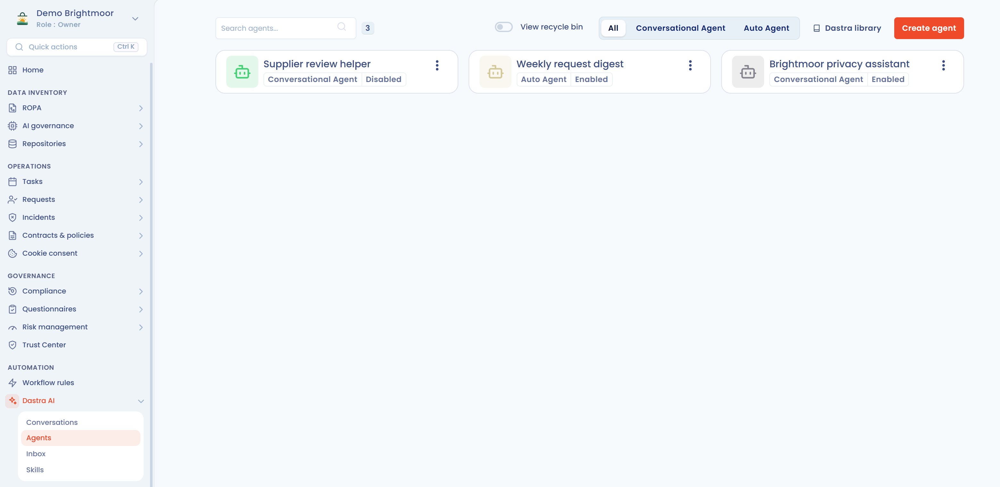
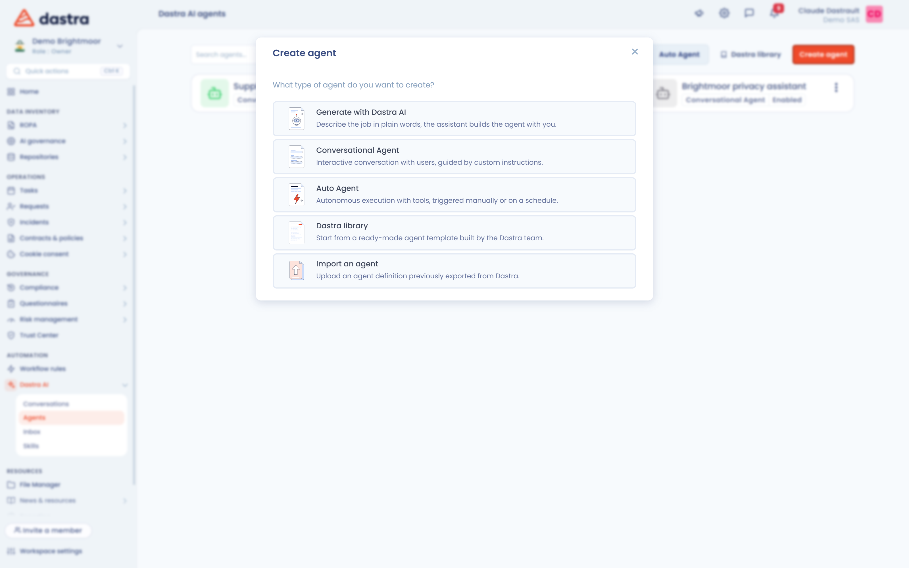

# Dastra AI Agenten

Ein **Dastra AI Agent** ist ein Assistent, den Sie selbst konfigurieren: Sie geben ihm eine Rolle, Anweisungen und die Liste der Tools, die er in Ihrem Mandanten nutzen darf. Während der Standard-[KI-Assistent](../README.md) alle Fragen beantwortet, ist ein Agent auf eine einzige Aufgabe spezialisiert und verhält sich immer gleich.

Agenten konfigurieren Sie unter **Automatisierung** > **Dastra AI** > **Agenten**. Die Einträge **Agenten**, **Posteingang** und **Funktionen** erscheinen, wenn Ihr Tarif eigene Agenten enthält und Ihre Rolle die Berechtigung **Custom AI agents** hat.

<figure><figcaption>
Automatisierung &#x3E; Dastra AI &#x3E; Agenten: die Liste der konfigurierten Agenten
</figcaption></figure>


Verwechseln Sie diese Funktion nicht mit dem Verzeichnis der KI-Systeme. Im Bereich [KI-Systeme](../../../ai-systems/README.md) dokumentieren Sie **Ihre eigenen** KI-Systeme für die KI-Verordnung. Die hier beschriebenen Agenten sind eine Dastra-Funktion, mit der Sie an Ihren Daten arbeiten.


***

## Zwei Arten von Agenten

| | Konversationsagent | Autonomer Agent |
| --- | --- | --- |
| **Wofür er gedacht ist** | Ein spezialisierter Chat-Assistent mit eigener Persönlichkeit und eigenen Regeln | Eine wiederkehrende Aufgabe, die ohne Aufsicht läuft |
| **Was ihn startet** | Ein Nutzer, der eine Unterhaltung öffnet | Eine manuelle Ausführung, ein Zeitplan oder eine Workflow-Regel |
| **Interaktion** | Der Agent kann Fragen stellen und um Bestätigung bitten | Der Agent kann weder Fragen stellen noch um Bestätigung bitten: Er führt die Aufgabe vollständig aus und liefert sein Ergebnis |
| **Wo Sie ihn finden** | Im Dastra-AI-Bereich über die Auswahl **Einen Agenten auswählen** | Unter **Agenten**, seine Ausführungen im **Posteingang** |
| **Was Sie konfigurieren** | **Begrüßungsnachricht**, **Assistentenanweisung**, **Beispielanfragen** | **Systemanweisung**, **Eingabefelder**, **Planung** |

***

## Einen Agenten erstellen

Klicken Sie auf **Einen Agenten anlegen**. Es stehen fünf Ausgangspunkte zur Auswahl:

<figure><figcaption>
Die fünf Wege, einen Agenten zu erstellen
</figcaption></figure>

* **Mit Dastra AI generieren**: Beschreiben Sie die Aufgabe in wenigen Worten und klicken Sie auf **Agent generieren**. Der Assistent stellt einige Fragen und erstellt dann den Agenten, den Sie prüfen und anpassen. Dahinter steht die integrierte Funktion `/design_agent`.
* **Konversationsagent**: Sie beginnen mit einer leeren Seite für einen Chat-Assistenten. Siehe [Einen Chat-Agenten erstellen](conversational.md).
* **Autonomer Agent**: Sie beginnen mit einer leeren Seite für eine Ausführung mit Tools. Siehe [Einen autonomen Agenten erstellen](autonomous.md) und [Einen autonomen Agenten bauen](../../../../examples/autonomous-agent.md) für ein ausgeführtes Beispiel.
* **Dastra-Bibliothek**: Sie beginnen mit einer fertigen Vorlage. Die Bibliothek bietet die Vorlagen des Dastra-Teams, die Ihrer Partnerbibliothek, wenn Sie eine haben, und die Agenten eines anderen Mandanten, auf den Sie Zugriff haben. Klicken Sie auf **Install**: Die Vorlage wird **als Entwurf** importiert, deaktiviert und ohne benachrichtigte Nutzer. Prüfen Sie ihre Anweisungen und Tools, bevor Sie sie aktivieren. Die Schaltfläche **Dastra library** der Agentenliste öffnet dieselbe Galerie.
* **Einen Agenten importieren**: Sie laden eine Agentendefinition hoch, die Sie zuvor aus Dastra exportiert haben.

In jedem Fall erfolgt die Erstellung in zwei Schritten: Sie wählen die Art, geben einen **Namen** (höchstens 120 Zeichen) und optional eine **Beschreibung** ein, dann öffnet sich der vollständige Editor. Der Editor akzeptiert Beschreibungen von bis zu 3000 Zeichen mit einfacher Markdown-Formatierung.

Der Editor **speichert automatisch**: Der Zeitpunkt der letzten Speicherung steht oben rechts. Es gibt keine Schaltfläche zum Speichern.

***

## Aktivieren, deaktivieren, in den Papierkorb verschieben, löschen

* **Deaktivieren** und **Aktivieren**, im Editor oder im Menü der Zeile, schalten einen Agenten zwischen deaktiviert und aktiviert um. Ein deaktivierter Agent erscheint nicht mehr in der Agentenauswahl, und ein Zeitplan oder eine Workflow-Regel kann ihn nicht starten. Sie können ihn weiterhin manuell mit **Ausführen** starten, so testen Sie ihn. Nutzen Sie diesen Zustand, solange Sie die Anweisungen noch abstimmen.
* **In den Papierkorb verschieben**: Der Agent landet im Papierkorb und läuft nie, auch wenn eine Workflow-Regel ihn weiterhin nennt. Aktivieren Sie in der Liste **Papierkorb anzeigen**, um ihn zu finden, und klicken Sie auf **Wiederherstellen**. Seine bisherigen Ausführungen bleiben erhalten.
* **Löschen**: möglich für einen Agenten im Papierkorb. Das Löschen ist endgültig und entfernt **auch alle Sitzungen und Nachrichten** des Agenten. Nutzen Sie es, wenn Sie diese Daten löschen müssen.

## Einen Agenten exportieren und importieren

Die Schaltfläche **Exportieren**, im Editor oder im Menü der Zeile, erzeugt eine JSON-Datei mit der Agentendefinition (Anweisungen, Tools, Eingabefelder, Planung). Sie können sie in einen anderen Mandanten importieren, über **Einen Agenten anlegen** > **Einen Agenten importieren**.

Beim Import setzt Dastra einige Werte zurück: Der Agent wird deaktiviert, ohne Logo und ohne benachrichtigte Nutzer erstellt. Prüfen Sie ihn und klicken Sie dann auf **Aktivieren**.

***

## Wer was tun darf

Der Zugriff auf Agenten hängt von Ihrem **Tarif** und von Ihren **Berechtigungen** ab. Im Rolleneditor sind zwei Berechtigungen beteiligt, jede mit einer Leseebene und einer Schreibebene:

| Berechtigung | Ebene | Was sie erlaubt |
| --- | --- | --- |
| **AI Assistant** | Lesen | Den Chat-Assistenten im Modus Frage und die Funktionen nutzen |
| **AI Assistant** | Schreiben | Den Bearbeitungsmodus nutzen, in dem der Assistent Einträge erstellt und ändert (der Tarif muss ihn ebenfalls enthalten) |
| **Custom AI agents** | Lesen | Die Agenten des Mandanten sehen, mit ihnen chatten und sie ausführen |
| **Custom AI agents** | Schreiben | Agenten erstellen, ändern, exportieren, importieren, in den Papierkorb verschieben und löschen; [Funktionen](skills.md) erstellen und bearbeiten |

Berechtigungen legen Sie im Rolleneditor fest, siehe [Rollen](../../../settings/roles.md). Der [MCP-Server](../mcp.md) ist in einem separaten Tarif enthalten.


Ein Chat-Agent hat nie mehr Rechte als die Person, die mit ihm spricht. Seine Tools laufen mit Ihren eigenen Berechtigungen: Wenn Sie auf einen Eintrag nicht zugreifen können, kann es der Agent auch nicht. Löschen und Anonymisieren werden Agenten nicht angeboten.

**Ein autonomer Agent ist nicht an die Berechtigungen eines Nutzers gebunden.** Eine Ausführung, die durch einen Zeitplan, durch eine Workflow-Regel oder mit **Ausführen** gestartet wird, arbeitet mit den Rechten des Mandanten, wer auch immer sie ausgelöst hat. Geben Sie ihm nur die Tools, die seine Aufgabe erfordert.


***

## Credits und Verbrauch

Nachrichten an einen Agenten und Ausführungen eines autonomen Agenten werden im monatlichen KI-Credit-Kontingent Ihrer Organisation gezählt, wie die Nachrichten an Dastra AI. Siehe [KI-Credits und Kontingente](../how-it-works.md#ki-credits-und-kontingente).

Das monatliche Kontingent Ihrer Organisation und sein Verbrauch werden unter **Organisationseinstellungen** > **KI-Assistent** verfolgt. Ist das Kontingent erreicht, werden Unterhaltungen und Ausführungen abgelehnt, und die Schaltfläche **Ausführen** eines autonomen Agenten ist deaktiviert.

Modellfamilien, Hosting und die an die Modelle gesendeten Daten sind unter [Funktionsweise](../how-it-works.md) beschrieben.

***

<table data-view="cards"><thead><tr><th></th><th></th><th data-hidden data-card-target data-type="content-ref"></th></tr></thead><tbody><tr><td><strong>Einen Chat-Agenten erstellen</strong></td><td>Bauen Sie einen spezialisierten Chat-Assistenten mit eigener Persönlichkeit, eigenen Regeln und eigenen Tools.</td><td><a href="conversational.md">conversational.md</a></td></tr><tr><td><strong>Einen autonomen Agenten erstellen</strong></td><td>Konfigurieren Sie einen Agenten, der selbstständig läuft: manuell, nach Zeitplan oder durch eine Workflow-Regel.</td><td><a href="autonomous.md">autonomous.md</a></td></tr><tr><td><strong>Funktionen</strong></td><td>Speichern Sie Ihre wiederkehrenden Anweisungen als wiederverwendbare Befehle im Dastra-AI-Chat.</td><td><a href="skills.md">skills.md</a></td></tr><tr><td><strong>Ausführungen verfolgen</strong></td><td>Rufen Sie den Verlauf der Ausführungen Ihrer Agenten, ihren Status und die Details ihrer Arbeit ab.</td><td><a href="inbox.md">inbox.md</a></td></tr></tbody></table>
