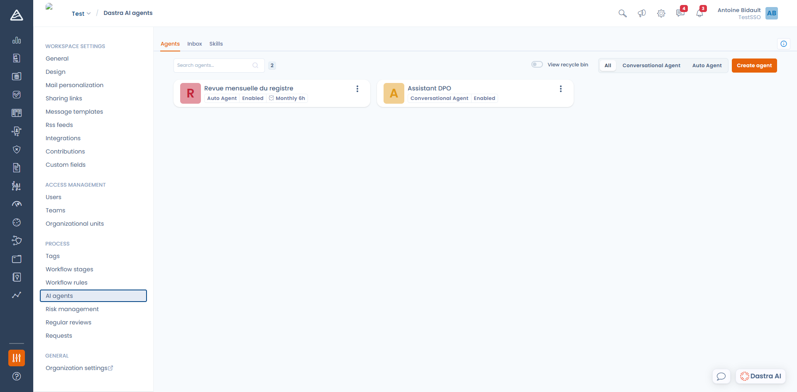

# Dastra-KI-Agenten

Ein **Dastra-KI-Agent** ist ein Assistent, den Sie selbst konfigurieren: Sie geben ihm eine Rolle, Anweisungen und die Liste der Tools, die er in Ihrem Mandanten nutzen darf. Während der Standard-[KI-Assistent](../README.md) alle Fragen beantwortet, ist ein Agent auf eine einzige Aufgabe spezialisiert und verhält sich immer gleich.

Agenten konfigurieren Sie unter **Mandanteneinstellungen** > **KI-Agenten** ([direkter Zugriff](https://app.dastra.eu/workspace/0/settings/ai-agents)).

<figure><figcaption>
Mandanteneinstellungen &#x3E; KI-Agenten: die Liste der konfigurierten Agenten
</figcaption></figure>


Verwechseln Sie diese Funktion nicht mit dem Verzeichnis der KI-Systeme. Im Bereich [KI-Systeme](../../../ai-systems/README.md) dokumentieren Sie **Ihre eigenen** KI-Systeme für die KI-Verordnung. Die hier beschriebenen Agenten sind eine Dastra-Funktion, mit der Sie an Ihren Daten arbeiten.


***

## Zwei Arten von Agenten

| | Chat-Agent (**Chat**) | Autonomer Agent (**Agent**) |
| --- | --- | --- |
| **Wofür er gedacht ist** | Ein spezialisierter Chat-Assistent mit eigener Persönlichkeit und eigenen Regeln | Eine wiederkehrende Aufgabe, die ohne Aufsicht läuft |
| **Was ihn startet** | Ein Nutzer, der eine Unterhaltung öffnet | Eine manuelle Ausführung, ein Zeitplan oder eine Workflow-Regel |
| **Interaktion** | Der Agent kann Fragen stellen und um Bestätigung bitten | Der Agent kann weder Fragen stellen noch um Bestätigung bitten: Er führt die Aufgabe vollständig aus und liefert sein Ergebnis |
| **Wo Sie ihn finden** | Im Dastra-AI-Bereich über die Auswahl **Einen Mitarbeiter auswählen** | Unter **KI-Agenten**, seine Ausführungen im **Posteingang** |
| **Was Sie konfigurieren** | **Begrüßungsnachricht**, **Assistentenanweisung**, **Beispielanfragen** | **Systemanweisung**, **Eingabefelder**, **Planung** |

***

## Einen Agenten erstellen

Klicken Sie auf **Einen Agenten anlegen**. Es stehen fünf Ausgangspunkte zur Auswahl:

<figure><figcaption>
Die fünf Wege, einen Agenten zu erstellen
</figcaption></figure>

* **Generate with Dastra AI**: Beschreiben Sie die Aufgabe in wenigen Worten, der Assistent erstellt den Agenten gemeinsam mit Ihnen und speichert ihn, sobald Sie zustimmen. Dahinter steht die integrierte Kompetenz `/scaffold_agent`.
* **Chat**: Sie beginnen mit einer leeren Seite für einen Chat-Assistenten. Siehe [Einen Chat-Agenten erstellen](conversational.md).
* **Agent**: Sie beginnen mit einer leeren Seite für eine Ausführung mit Tools. Siehe [Einen autonomen Agenten erstellen](autonomous.md).
* **Dastra-Bibliothek**: Sie beginnen mit einer fertigen Vorlage des Dastra-Teams. Die Vorlage wird **als Entwurf** importiert: Prüfen Sie ihre Anweisungen und Tools, bevor Sie sie veröffentlichen.
* **Einen Agenten importieren**: Sie laden eine Agentendefinition hoch, die Sie zuvor aus Dastra exportiert haben.

In jedem Fall erfolgt die Erstellung in zwei Schritten: Sie wählen die Art, geben einen **Namen** (höchstens 120 Zeichen) und optional eine **Beschreibung** (1000 Zeichen) ein, dann öffnet sich der vollständige Editor.


Der Editor **speichert automatisch**: Der Zeitpunkt der letzten Speicherung steht oben rechts. Es gibt keine Schaltfläche zum Speichern.


***

## Veröffentlichen, deaktivieren, in den Papierkorb verschieben, löschen

* **Deaktiviert**: Ein deaktivierter Agent erscheint nicht mehr bei den Nutzern, und seine Zeitpläne lösen nicht mehr aus. Nutzen Sie diesen Zustand, solange Sie die Anweisungen noch abstimmen.
* **In den Papierkorb verschieben**: Der Agent landet im Papierkorb. Aktivieren Sie in der Liste **Papierkorb anzeigen**, um ihn zu finden und wiederherzustellen. Seine bisherigen Ausführungen bleiben erhalten.
* **Löschen**: Das Löschen ist endgültig und entfernt **auch alle Sitzungen und Nachrichten** des Agenten. Nutzen Sie es, wenn Sie diese Daten löschen müssen.

## Einen Agenten exportieren und importieren

Mit **Exportieren** erzeugen Sie eine JSON-Datei mit der Agentendefinition (Anweisungen, Tools, Eingabefelder, Planung). Sie können sie in einen anderen Mandanten importieren, über **Einen Agenten anlegen** > **Einen Agenten importieren**.

Beim Import setzt Dastra einige Werte zurück: Der Agent wird **deaktiviert**, ohne Logo und ohne benachrichtigte Nutzer erstellt. Prüfen Sie ihn und aktivieren Sie ihn dann.

***

## Wer was tun darf

Der Zugriff auf Agenten hängt von Ihrem **Tarif** und von Ihren **Berechtigungen** ab.

| Berechtigung | Was sie erlaubt |
| --- | --- |
| **AI Assistant usage** | Den Chat-Assistenten nutzen: Fragen stellen und den Agenten seine Lese-Tools verwenden lassen |
| **AI Assistant edit mode** | Den Assistenten Einträge aus der Unterhaltung heraus erstellen und ändern lassen |
| **Custom AI agents execution** | Die Agenten des Mandanten sehen und ausführen |
| **Custom AI agents management** | Die Agenten des Mandanten erstellen, ändern und löschen |

Berechtigungen legen Sie unter **Organisationseinstellungen** > **Rollen und Berechtigungen** fest. Der [MCP-Server](../mcp.md) ist in einem separaten Tarif enthalten.


Ein Agent hat nie mehr Rechte als die Person, die ihn auslöst. Seine Tools laufen mit Ihren eigenen Berechtigungen: Wenn Sie auf einen Eintrag nicht zugreifen können, kann es der Agent auch nicht.


***

## Credits und Verbrauch

Jede **Nachricht, die Sie senden**, kostet **1 Dastra-AI-Credit**, unabhängig davon, wie viele Tools der Agent zur Antwort nutzt. Wenn Sie eine Unterhaltung nach einer Bestätigungsanfrage fortsetzen, entstehen keine weiteren Kosten.

Das monatliche Kontingent Ihrer Organisation und sein Verbrauch werden unter **Organisationseinstellungen** > **KI-Assistent** verfolgt. Ist das Kontingent erreicht, werden Unterhaltungen und Ausführungen abgelehnt, und die Schaltfläche **Ausführen** eines autonomen Agenten ist deaktiviert.

Modellfamilien, Hosting und die an die Modelle gesendeten Daten sind unter [Funktionsweise](../how-it-works.md) beschrieben.

***


[Einen Chat-Agenten erstellen](conversational.md)



[Einen autonomen Agenten erstellen](autonomous.md)



[Kompetenzen](skills.md)



[Ausführungen verfolgen](inbox.md)

