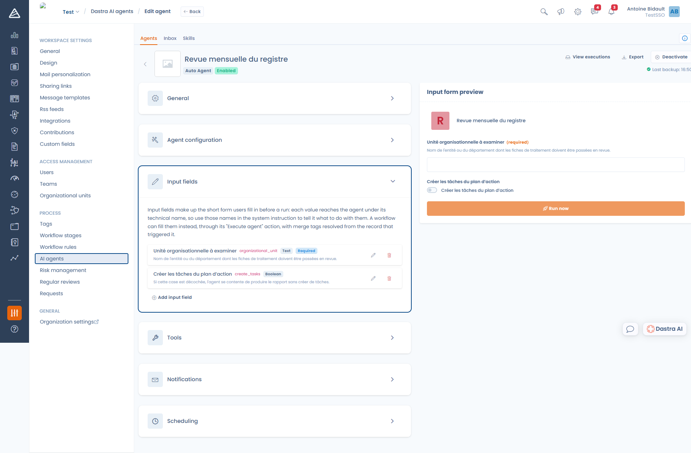

# Einen autonomen Agenten erstellen

Ein autonomer Agent erledigt eine Aufgabe von Anfang bis Ende, ohne dass jemand zusieht: einen Teil des Verarbeitungsverzeichnisses prüfen, einen Maßnahmenplan vorbereiten, eine monatliche Zusammenfassung erstellen.

Öffnen Sie **Mandanteneinstellungen** > **KI-Agenten**, klicken Sie auf **Einen Agenten anlegen** und dann auf **Agent**.


Ein autonomer Agent kann Ihnen keine Fragen stellen. Tools, die eine Interaktion erfordern, wie eine Frage stellen, in der Oberfläche navigieren oder um Bestätigung bitten, werden ihm entzogen. Seine Anweisung muss daher jeden Fall abdecken, auch den, dass Informationen fehlen.


***

## Konfiguration des Agenten

Die **Systemanweisung** (höchstens 10.000 Zeichen) beschreibt die gesamte Aufgabe. Anders als bei einem Chat-Agenten, bei dem Sie vor allem eine Persönlichkeit festlegen, ist sie hier ein Verfahren.

Eine wirksame Systemanweisung ist nummeriert, nennt ihre Grenzen ausdrücklich und legt das erwartete Ergebnis genau fest:

```
Sie führen die monatliche Prüfung des Verarbeitungsverzeichnisses durch.

Auszuführende Schritte:
1. Listen Sie die Verarbeitungstätigkeiten der Organisationseinheit auf,
   die im Eingabefeld angegeben ist.
2. Prüfen Sie bei jedem Eintrag, dass Zweck, Rechtsgrundlage, Speicherdauer
   und Sicherheitsmaßnahmen ausgefüllt sind.
3. Gruppieren Sie die festgestellten Lücken nach Eintrag.
4. Erstellen Sie einen Maßnahmenplan mit einer Aufgabe je unvollständigem
   Eintrag und geben Sie an, welche Felder vervollständigt werden müssen.

Ändern Sie keine Verarbeitungstätigkeit: Beschränken Sie sich darauf, die
Aufgaben des Maßnahmenplans zu erstellen.

Schließen Sie mit einer Zusammenfassung ab, die die Zahl der geprüften
Einträge, die Zahl der unvollständigen Einträge und die erstellten Aufgaben
nennt.
```

***

## Eingabefelder

Die Eingabefelder bilden das kurze Formular, das vor einer Ausführung ausgefüllt wird. Jeder Wert erreicht den Agenten **unter seinem technischen Namen**: Verwenden Sie diese Namen in der Systemanweisung, um dem Agenten zu sagen, was er damit tun soll.

<figure><figcaption><p>Die Eingabefelder und ihre Vorschau, rechts</p></figcaption></figure>

Jedes Feld wird durch folgende Einstellungen definiert:

| Einstellung | Zweck |
| --- | --- |
| **Bezeichnung** | Was die Person sieht, die die Ausführung startet |
| **Name** | Der technische Name, unter dem der Wert den Agenten erreicht |
| **Typ** | Text, Number, Boolean oder Select |
| **Erforderlich** | Verhindert den Start der Ausführung, solange das Feld leer ist |
| **Standard** | Vorausgefüllter Wert |
| **Beschreibung** | Hilfetext unter dem Feld |

Ein Agent ganz ohne Eingabefeld läuft, ohne etwas abzufragen.


Der **Name** wird automatisch aus der Bezeichnung erzeugt. Prüfen Sie den endgültigen Wert, wenn Sie ihn ändern: Genau diesen müssen Sie in der Systemanweisung verwenden.


Die **Formularvorschau** rechts im Editor zeigt genau, was Ihre Nutzer sehen werden. Über sie starten Sie auch einen Testlauf.

***

## Tools

Das funktioniert genau wie bei einem [Chat-Agenten](conversational.md#tools): Standardmäßig sind alle Tools verfügbar, und Sie können die Liste einschränken.

Hier steht allerdings mehr auf dem Spiel, denn niemand kontrolliert den Agenten bei der Arbeit. Geben Sie ihm die Lese-Tools, die er braucht, und **nur die Bearbeitungstools, die seine Aufgabe erfordert**.

## Benachrichtigungen

Die benachrichtigten Nutzer erhalten eine Dastra-Benachrichtigung, wenn der Agent eine Ausführung **abschließt**, und eine weitere, wenn eine Ausführung **fehlschlägt**. Eine Ausführung, die mit der Anforderung einer menschlichen Prüfung endet, gilt als abgeschlossen.

***

## Planung

<figure><figcaption><p>Einen autonomen Agenten planen</p></figcaption></figure>

Wählen Sie eine **Häufigkeit**: Keine Planung, Täglich, Wöchentlich oder Monatlich. Legen Sie dann die Uhrzeit fest und je nach Fall den Wochentag oder den Tag des Monats.


Die Uhrzeiten werden in Ihrer eigenen Zeitzone angezeigt, wie unter dem Formular angegeben. Dastra speichert sie in UTC. Deshalb kann die Karte des Agenten in der Liste eine andere Uhrzeit anzeigen als die, die Sie eingegeben haben.

Der Auslöser läuft **einmal pro Stunde, zur vollen Stunde**. Ein Zeitplan kann daher keine bestimmte Minute treffen.


Nur **aktivierte**, nicht in den Papierkorb verschobene autonome Agenten werden vom Planer berücksichtigt.

***

## Die drei Arten, eine Ausführung zu starten

### 1. Manuell

Füllen Sie das Formular in der Vorschau aus und klicken Sie auf **Ausführen**. Die Ausführung wird in die Warteschlange gestellt: Sie werden zum Posteingang weitergeleitet, wo Sie verfolgen, wie sie von **In Arbeit** zu ihrem Endstatus wechselt.

### 2. Nach Zeitplan

Der Agent startet von selbst mit der konfigurierten Häufigkeit. Dabei werden die Standardwerte seiner Eingabefelder verwendet.

### 3. Durch eine Workflow-Regel

Unter **Mandanteneinstellungen** > **Workflow-Regeln** startet die Aktion **Einen KI-Agenten ausführen** einen Agenten aufgrund eines Ereignisses an einem Eintrag: einem Statuswechsel, einer Erstellung, einer Frist.

Dort wählen Sie den Agenten, eine Nachricht und die Werte seiner Eingabefelder. Diese Werte akzeptieren **benutzerdefinierte Variablen**, die aus dem Eintrag aufgelöst werden, der die Regel ausgelöst hat. Der Agent erhält so bei jeder Ausführung einen anderen Kontext.

***

## Grenzen einer Ausführung

| Grenze | Verhalten |
| --- | --- |
| **30 Tool-Iterationen** pro Durchgang | Danach muss der Agent zum Abschluss kommen: Die Ausführung endet mit dem Status **Incomplete execution** |
| **Kontextgröße** | Die ältesten Tool-Aufrufe werden zusammengefasst. Bei Überlauf endet die Ausführung mit dem Status **Context limit reached** |
| **10.000 Zeichen** Eingabe | Eine längere Nachricht wird abgelehnt |
| **Credit-Kontingent** | Eine Ausführung wird abgelehnt, wenn das monatliche Kontingent erreicht ist |

Diese und die übrigen Status sind unter [Ausführungen verfolgen](inbox.md) beschrieben.

***


[Ausführungen verfolgen](inbox.md)

