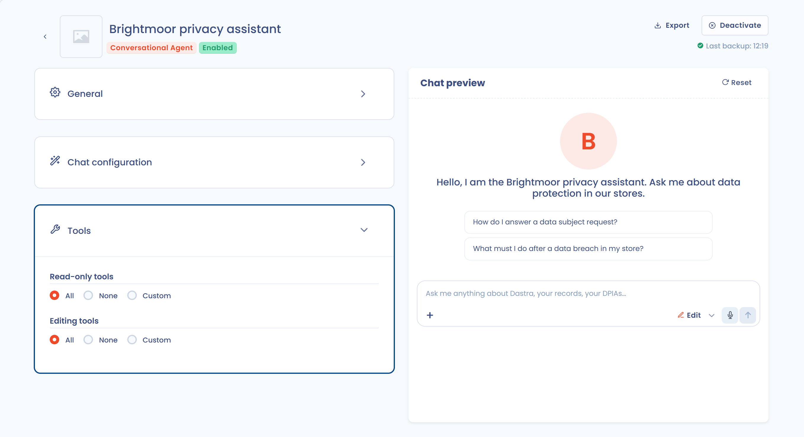
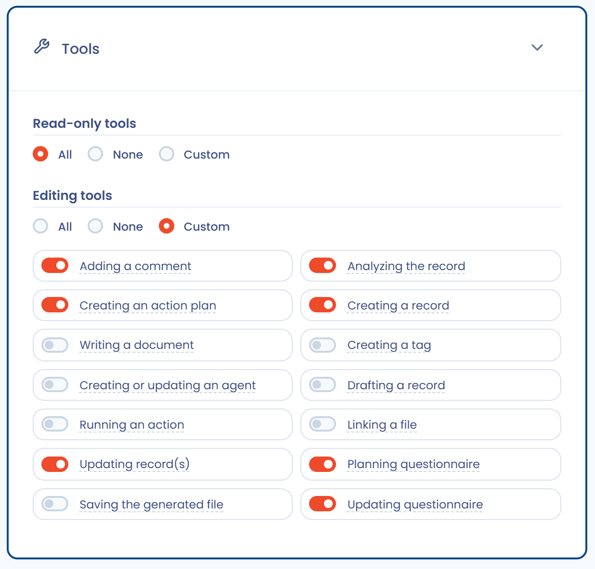
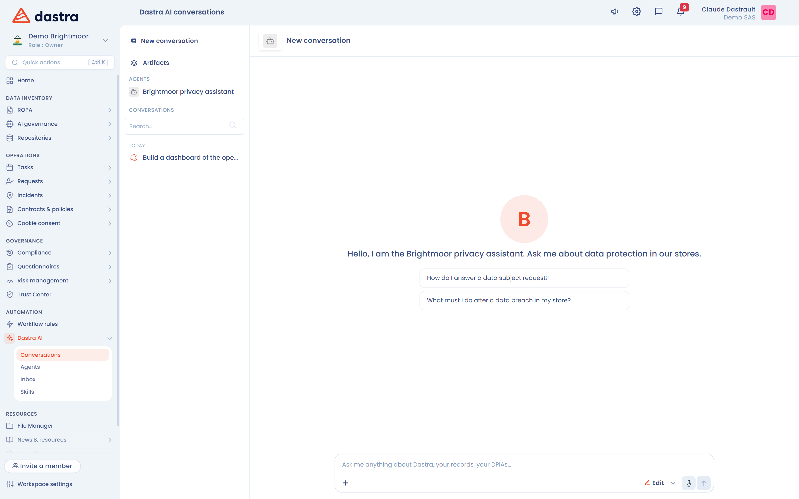

# Einen Chat-Agenten erstellen

Ein Chat-Agent ist ein Chat-Assistent, den Sie auf ein Thema spezialisieren: ein DSB-Assistent, der nur aus dem Verarbeitungsverzeichnis antwortet, ein Einkaufsassistent, der Verträge von Dienstleistern prüft, oder ein Sicherheitsassistent, der bei der Einstufung eines Vorfalls hilft.

Öffnen Sie **Automatisierung** > **Dastra AI** > **Agenten**, klicken Sie auf **Einen Agenten anlegen** und dann auf **Konversationsagent**.

***

## Allgemeines

Name und Beschreibung identifizieren den Agenten in der Liste und in der Agentenauswahl. Sie können ihm außerdem ein **Logo** geben, das in der Unterhaltung als sein Avatar erscheint.

Der Name ist auf 120 Zeichen begrenzt. Die Beschreibung, auf 3000 Zeichen begrenzt, akzeptiert einfache Markdown-Formatierung.

## Einrichtung des Chats

<figure><figcaption>
Der Editor eines Chat-Agenten, rechts die Chat-Vorschau
</figcaption></figure>

### Begrüßungsnachricht

Die erste Nachricht, die dem Nutzer beim Öffnen der Unterhaltung angezeigt wird (höchstens 1000 Zeichen). Teilen Sie hier mit, was der Agent kann und was er nicht kann.

### Assistentenanweisung

Sie ist das Herzstück des Agenten: seine Persönlichkeit und seine Verhaltensregeln, auf **10.000 Zeichen** begrenzt.


Ihre Anweisung ersetzt nicht den gesamten Prompt. Sie legt die Persona des Agenten fest. Dastra ergänzt automatisch eigene Regeln: das Produktvokabular, die Beschreibung der verfügbaren Tools und die Regeln des Modus **Frage** oder des Bearbeitungsmodus. Sie müssen also nicht erklären, was eine Verarbeitungstätigkeit ist oder wie ein Tool funktioniert.


Eine wirksame Anweisung nennt:

* **die Rolle**: „Sie sind der Datenschutzbeauftragte der Organisation.“
* **die maßgebliche Quelle**: „Antworten Sie immer anhand der im Mandanten gespeicherten Einträge: Suchen Sie vor der Antwort den passenden Eintrag und zitieren Sie ihn immer.“
* **was zu tun ist, wenn etwas fehlt**: „Wenn die Information im Mandanten nicht vorhanden ist, sagen Sie das ausdrücklich, statt sie zu erfinden.“
* **das erwartete Format**: Sprache, Länge, verpflichtende Angaben.

### Beispielanfragen

Die vorgeschlagenen Fragen unter der Begrüßungsnachricht. Sie wirken wie eine implizite Anleitung: Wählen Sie diejenigen, mit denen Sie die gewünschten Einsatzzwecke zeigen. Mit **Beispielanfrage hinzufügen** ergänzen Sie beliebig viele.

***

## Tools



Standardmäßig hat ein Agent Zugriff auf **alle** Tools. Jede Gruppe unten hat drei Optionen: **Alle**, **Keine** und **Personalisiert**. Wählen Sie **Personalisiert**, um nur die gewünschten Tools einzuschalten. Ein Agent braucht mindestens ein Tool.

Es gibt zwei Gruppen von Tools:

* **Lesetools**: den Mandanten, die Dastra-Dokumentation, das Regelwerk und das Web durchsuchen, Einträge, Kommentare, Dateien und Fragebögen durchsuchen und lesen, [Artefakte](../artifacts.md) erstellen, Einträge exportieren.
* **Bearbeitungstools**: Einträge erstellen und ändern, Eintragsaktionen wie den Wechsel der Workflow-Phase ausführen, Kommentare hinzufügen, Aktionspläne und Tags erstellen, Fragebögen planen und ausfüllen, Dokumente schreiben, Dateien verknüpfen.

Eine Frage an Sie stellen und Sie zu einer Seite von Dastra führen sind in einer Unterhaltung immer verfügbar: Sie stehen nicht in der Liste.



<figure><figcaption>
Die Tools sind in Lesetools und Bearbeitungstools gruppiert
</figcaption></figure>




Die Einschränkung der Tools ist der sicherste Weg, einen Agenten in seinen Grenzen zu halten. Ein Assistent, der nur Fragen beantworten soll, braucht kein Bearbeitungstool: Geben Sie ihm keines.


***

## Der Modus Frage und der Bearbeitungsmodus

In der Unterhaltung wechselt eine Auswahl zwischen zwei Modi:

* **Frage**: Der Agent hat nur Lesezugriff. Er kann suchen und lesen, aber nichts wird geändert.
* **Bearbeiten**: Der Agent kann Einträge erstellen und ändern. Bearbeitungstools sind nur in diesem Modus verfügbar.

Der Bearbeitungsmodus hängt von Ihrem Tarif und von der entsprechenden Berechtigung ab. Enthält Ihr Tarif ihn nicht, ist die Option **Bearbeiten** gesperrt. Ohne die Schreibberechtigung für den Assistenten erscheint die Auswahl nicht. In beiden Fällen bleiben die Bearbeitungstools inaktiv, selbst wenn sie in der Agentendefinition angehakt sind.

In der Unterhaltung zeigt jedes Bearbeitungstool vor der Ausführung eine Karte **Genehmigung erforderlich** an: Wählen Sie **Genehmigen**, **Für diese Sitzung immer zustimmen** oder **Ablehnen**. Der Agent kann einen Eintrag weder löschen noch anonymisieren: Diese Aktionen werden ihm nicht angeboten.

***

## Vor der Veröffentlichung testen

Die **Chat-Übersicht** rechts im Editor ist eine echte Unterhaltung mit dem Agenten, genau so, wie er gerade konfiguriert ist. Prüfen Sie damit Tonfall, Länge der Antworten und die Einhaltung Ihrer Regeln, bevor Sie den Agenten aktivieren. Mit **Zurücksetzen** beginnen Sie eine neue Unterhaltung.

## Den Agenten im Alltag nutzen

Sobald der Agent aktiv ist, erreichen ihn die Nutzer des Mandanten, die eigene Agenten ausführen dürfen:

* über den Bereich **Dastra AI** unten rechts auf dem Bildschirm,
* mit der Tastenkombination **Strg+J** (auf dem Mac **Cmd+J**),
* über die Dastra-AI-Seite unter **Automatisierung** > **Dastra AI** > **Conversations**, wo die Agenten unter **Agenten** aufgelistet sind,
* mit **Open in chat** im Detailfenster des Agenten in der Liste.

Die Auswahl **Einen Agenten auswählen** oben in der Unterhaltung wechselt zwischen den Agenten.

<figure><figcaption>
Der Agent zeigt seine Begrüßungsnachricht und seine Beispielanfragen
</figcaption></figure>

Jede Antwort können Sie mit **Richtige Antwort** oder **Falsche Antwort** bewerten. Bei **Falsche Antwort** öffnet sich ein Fenster, in dem Sie einen Kommentar hinzufügen können.

***


[Einen autonomen Agenten erstellen](autonomous.md)

