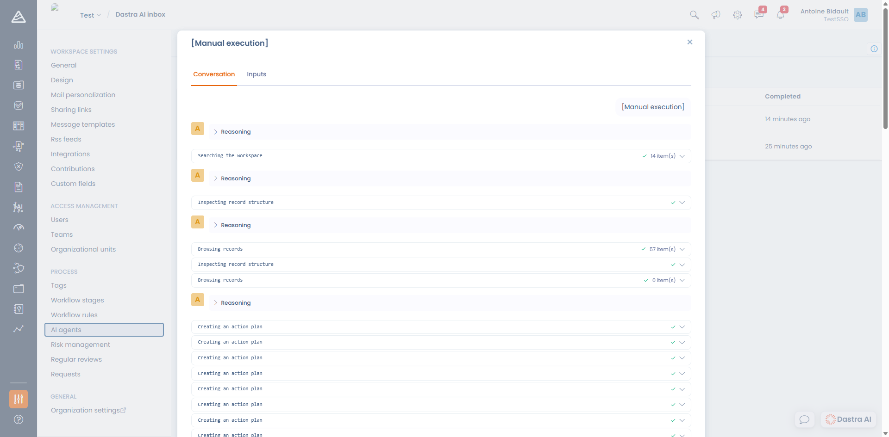

# Ausführungen verfolgen

Der **Posteingang** sammelt den Ausführungsverlauf Ihrer Agenten: was gestartet wurde, wodurch, wann und mit welchem Ergebnis.

Sie finden ihn unter **Mandanteneinstellungen** > **KI-Agenten** > **Posteingang**.

<figure><figcaption>
Der Posteingang mit Status und Quelle jeder Ausführung
</figcaption></figure>

Jede Zeile zeigt die **Sitzung**, ihren **Status**, ihre **Quelle** (manuell, Zeitplan oder Workflow), den Zeitpunkt, zu dem sie **Gestartet** wurde, und den Zeitpunkt, zu dem sie **Abgeschlossen** wurde. Mit der Auswahl oben in der Liste beschränken Sie die Ansicht auf einen einzelnen Agenten.

Laufende Ausführungen werden live aktualisiert: Sie müssen die Seite nicht neu laden.

***

## Die Details einer Ausführung

Klicken Sie auf eine Zeile, um die Details zu öffnen. Sie haben zwei Tabs:

* **Konversation**: der vollständige Verlauf mit den Überlegungen des Agenten, den aufgerufenen Tools und seiner endgültigen Antwort.
* **Eingabedaten**: die Werte der Eingabefelder, mit denen die Ausführung gestartet wurde.

<figure><figcaption>
Die Details einer Ausführung
</figcaption></figure>

Die Schaltfläche **Im Chat fortfahren** überträgt das Ergebnis der Ausführung in eine neue Unterhaltung. So gehen Sie am besten einem Ergebnis auf den Grund, fordern eine Überarbeitung an oder lassen etwas korrigieren.

***

## Status

Manche Status sind technisch, andere werden **vom Agenten selbst gemeldet**, wenn er seine Arbeit beendet. Das sind Schlussfolgerungen, keine Fehler.

| Status | Bedeutung |
| --- | --- |
| **In Arbeit** | Die Ausführung läuft |
| **Abgeschlossen** | Der Agent hat seine Aufgabe vollständig erledigt |
| **Gescheitert** | Ein technischer Fehler hat die Ausführung unterbrochen. Die Fehlermeldung steht in den Details |
| **Human review required** | Der Agent hat seine Arbeit getan, hält aber eine Freigabe für nötig, bevor es weitergeht |
| **Insufficient permission** | Dem Agenten fehlten die Rechte, um auf bestimmte Daten zuzugreifen oder eine Aktion auszuführen |
| **Feature required** | Eine Funktion, die er brauchte, ist im Tarif der Organisation nicht enthalten |
| **Missing information** | Die verfügbaren Daten reichten nicht aus, um die Aufgabe abzuschließen |
| **Incomplete execution** | Der Agent hat die Grenze der Tool-Iterationen erreicht, bevor er zum Abschluss kam |
| **Context limit reached** | Die Unterhaltung wurde für das Modell zu lang |


Der Status **Missing information** oder **Human review required** weist meist auf die Anweisung des Agenten oder seine Liste von Tools hin: Er hat mit dem, was er bekam, sein Möglichstes getan. Die Details der Ausführung erklären in der Regel, was ihm fehlte.


***

## Benachrichtigungen

Wenn Sie zu den **benachrichtigten Nutzern** eines Agenten gehören, erhalten Sie am Ende jeder Ausführung eine Dastra-Benachrichtigung, ob erfolgreich oder fehlgeschlagen. So behalten Sie einen geplanten Agenten am besten im Blick, ohne den Posteingang zu öffnen.

## Technisches Protokoll

Für die Überwachung auf Organisationsebene (verwendetes Modell, Dauer, Nutzer hinter dem Aufruf) finden Sie die **AI assistant invocation logs** unter **Organisationseinstellungen** > **KI-Assistent**. Sie werden 90 Tage lang aufbewahrt.
