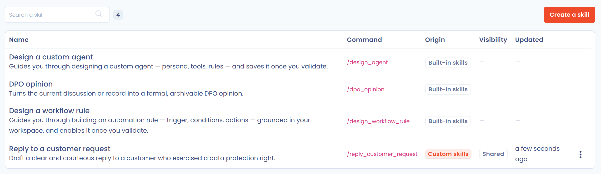

# Funktionen

Eine **Funktion** (Skill) ist eine Anweisung, die Sie einmal speichern und dann per Befehl abrufen, indem Sie in der Unterhaltung `/` eingeben. Stellen Sie sie sich als Prompt-Vorlage vor, die in der gesamten Organisation geteilt wird.

Funktionen verwalten Sie unter **Automatisierung** > **Dastra AI** > **Funktionen**.

<figure><figcaption>
Der Tab Funktionen mit den integrierten Funktionen von Dastra
</figcaption></figure>

***

## Integrierte Funktionen

Dastra liefert drei Funktionen mit, die in jedem Mandanten verfügbar und nicht bearbeitbar sind:

| Befehl | Was er bewirkt |
| --- | --- |
| `/design_agent` | Führt Sie durch den Entwurf eines benutzerdefinierten Agenten (Persona, Tools, Regeln) und speichert ihn, sobald Sie bestätigen. Diese Funktion startet die Option **Mit Dastra AI generieren** im Dialog zum Erstellen eines Agenten. |
| `/dpo_opinion` | Verwandelt die laufende Diskussion oder den Eintrag, den Sie gerade ansehen, in eine förmliche, archivierbare Stellungnahme des Datenschutzbeauftragten. |
| `/design_workflow_rule` | Führt Sie durch den Aufbau einer Workflow-Regel (Auslöser, Bedingungen, Aktionen) auf Grundlage Ihres Mandanten und aktiviert sie, sobald Sie bestätigen. |

## Eine eigene Funktion erstellen

Klicken Sie auf **Funktion erstellen** und füllen Sie dann aus:

* **Name**: die Bezeichnung, die in der Befehlsliste angezeigt wird (höchstens 120 Zeichen).
* **Befehl**: der Text, der nach dem `/` eingegeben wird. Kleinbuchstaben, Ziffern und Unterstriche, beginnend mit einem Buchstaben, und **eindeutig innerhalb der Organisation**, zum Beispiel `steering_committee_summary`.
* **Beschreibung**: ein Satz, der erklärt, wann die Funktion zu verwenden ist. Er erscheint im Chat neben dem Befehl (höchstens 1000 Zeichen).
* **Prompt**: die Anweisung, die an den Assistenten gesendet wird, bis zu 10.000 Zeichen.
* **Mit dem Unternehmen teilen**: Ist die Option eingeschaltet, sehen alle Mitglieder Ihrer Organisation die Funktion, in allen Mandanten. Andernfalls können nur Sie sie verwenden. Die Liste zeigt jede Funktion als **Geteilt** oder **Privat**.

## Eine Funktion verwenden

Geben Sie in einer Dastra-AI-Unterhaltung `/` ein oder klicken Sie auf **Funktionen**: Die Liste der verfügbaren Funktionen erscheint, mit den **Integrierten Funktionen** und Ihren **Maßgeschneiderten Funktionen**. Wählen Sie eine aus, ergänzen Sie bei Bedarf Ihre Nachricht und senden Sie sie ab. Eine Nachricht wendet höchstens fünf Funktionen an.


Eine Funktion gilt für die aktuelle Unterhaltung, mit dem Agenten und dem Modus (**Frage** oder **Bearbeiten**), die gerade ausgewählt sind. Eine Funktion, die Einträge ändern muss, erfordert daher den Bearbeitungsmodus.


Eine Funktion zu erstellen, zu ändern oder zu löschen erfordert die Schreibebene der Berechtigung **Custom AI agents**, nicht aber die Tarifoption „benutzerdefinierte Agenten“. Eine Funktion zu verwenden erfordert nur den Zugriff auf den Assistenten. Der Eintrag **Funktionen** des Menüs erscheint zusammen mit den anderen Einträgen für eigene Agenten. Im Untermenü **Funktionen** des Nachrichtenfelds können Sie außerdem eine Funktion hinzufügen (**Eine benutzerdefinierte Funktion hinzufügen**) oder Ihre eigenen bearbeiten und löschen, ohne den Chat zu verlassen.

***

## Funktion und Agent im Vergleich

Beide lassen Sie eine Anweisung wiederverwenden, aber nicht zum selben Zeitpunkt:

* Eine **Funktion** ist ein Einzelaufruf. Sie lösen sie mitten in einer Unterhaltung aus, mit dem Kontext, der gerade vorliegt.
* Ein **Agent** ist dauerhaft. Er hat eine eigene Identität, eigene Tools und gegebenenfalls einen eigenen Zeitplan.

Wenn Sie dieselbe Anfrage immer wieder eintippen, erstellen Sie eine Funktion. Wenn Sie ein spezialisiertes Gegenüber oder eine automatisierte Aufgabe wünschen, erstellen Sie einen [Agenten](README.md).
