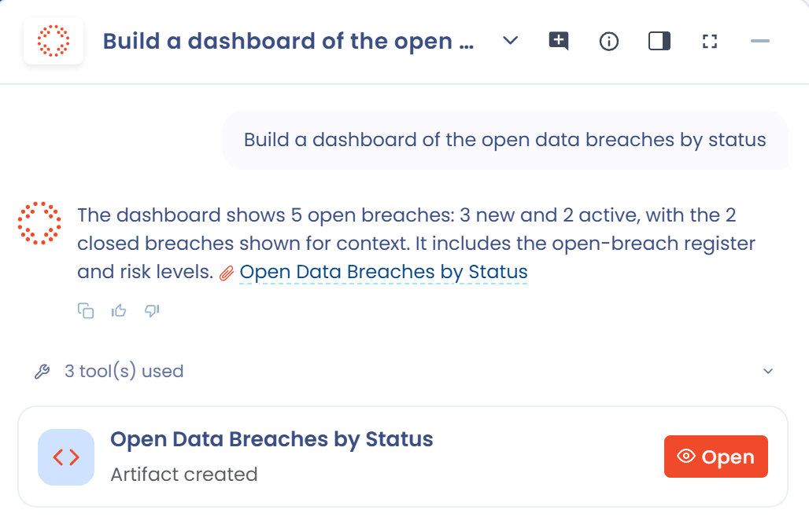
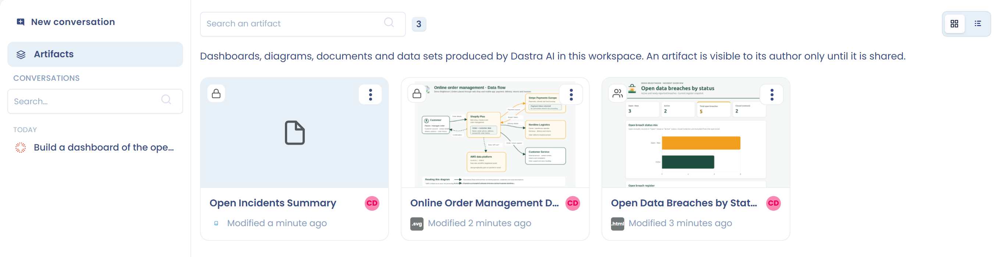
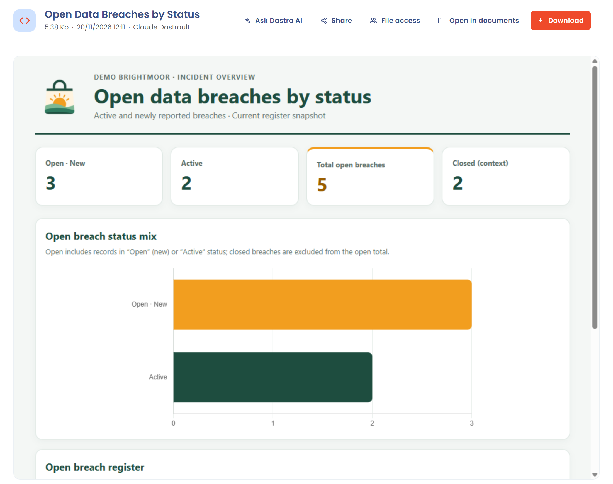

# Artefakte

Ein Artefakt ist eine Datei, die Dastra AI als Ergebnis einer Unterhaltung schreibt: ein Dashboard, ein Diagramm, ein Dokument oder ein Datenexport. Artefakte sind für alle gedacht, die mit [Dastra AI](README.md) aus den Daten eines Mandanten einen Bericht oder ein Arbeitsdokument vorbereiten.

## Was ein Artefakt sein kann

Dastra AI erstellt ein Artefakt in einem dieser Formate:

| Format | Typische Verwendung |
| --- | --- |
| HTML-Seite | Ein Dashboard, eine Grafik oder eine interaktive Seite |
| SVG | Ein Diagramm |
| Markdown oder Text | Ein Dokument, eine Notiz, eine Zusammenfassung |
| JSON oder CSV | Eine Datensammlung |

Erstellt der Assistent mit Codeausführung eine Datei oder exportiert er Einträge, wird das Ergebnis ebenfalls als Artefakt gespeichert, in einem Tabellen-, Word-, PowerPoint-, PDF- oder Bildformat. Die Codeausführung ist nicht in jeder Instanz verfügbar.

## Ein Artefakt erstellen

1. Öffnen Sie Dastra AI und beschreiben Sie, was Sie möchten: „Erstellen Sie ein Dashboard der offenen Datenschutzvorfälle nach Status“ oder „Zeichnen Sie den Datenfluss dieser Verarbeitungstätigkeit als Diagramm“.
2. Der Assistent sammelt die benötigten Daten mit Ihren Berechtigungen und zeigt dann eine Karte mit dem Titel des Artefakts und der Schaltfläche **Open**. Die Karte trägt den Titel **Artifact created**.

<figure><figcaption>
Die Karte eines Artefakts mit der Schaltfläche Open
</figcaption></figure>

3. Klicken Sie auf **Open**, um das Ergebnis auf einer eigenen Seite zu sehen.
4. Bitten Sie in derselben Unterhaltung um Änderungen. Der Assistent aktualisiert dasselbe Artefakt, statt ein zweites zu erstellen, und die Karte trägt den Titel **Artifact updated**.

Ein Artefakt ist die Antwort des Assistenten, keine Änderung Ihrer Einträge. Es braucht weder den Bearbeitungsmodus noch eine Genehmigung. Ein Dashboard trägt den Namen, das Logo und die Farben Ihres Mandanten.


Ein HTML-Artefakt zeigt die Daten so, wie sie waren, als der Assistent es erstellt hat. Um es auf den neuesten Stand zu bringen, bitten Sie den Assistenten, das Artefakt zu aktualisieren.


## Ihre Artefakte finden

Die Artefakte sind im Bereich **Dastra AI** des Menüs **Automatisierung** aufgelistet:

1. Öffnen Sie **Automatisierung** > **Dastra AI** > **Conversations**.
2. Klicken Sie in der Liste links unter **Neue Unterhaltung** auf **Artefakte**.

Im Dastra-AI-Fenster öffnet der Eintrag **My artifacts** des Menüs **+** dieselbe Liste.

Die Liste zeigt jedes Artefakt als Karte oder als Zeile einer Tabelle: Wählen Sie **Umfassende Übersicht** oder **Vereinfachte Ansicht**. Mit **Search an artifact** filtern Sie nach dem Namen. Die Tabelle zeigt den Ersteller, das Datum der letzten Aktualisierung, die Größe und die Sichtbarkeit.

<figure><figcaption>
Die Artefakte des Mandanten mit ihrer Sichtbarkeit
</figcaption></figure>

Die Liste folgt den Berechtigungen des Dateimanagers: Sie sehen nur die Artefakte, die Sie öffnen können. Ist die Liste leer, startet die Schaltfläche **Ask Dastra AI** eine Unterhaltung.

## Sichtbarkeit und Freigabe

Ein Artefakt ist nur für seinen Autor und für die Inhaber des Mandanten sichtbar, bis es geteilt wird. Das Sichtbarkeitssymbol der Liste zeigt, wo es steht:

* **Only its creator (and the workspace owners)**;
* **Shared with specific users or teams**;
* **Visible to the whole workspace**.

Um ein Artefakt für andere zu öffnen, nutzen Sie die Aktionen seiner Seite oder das Menü seiner Zeile:

* **Teilen** öffnet das Freigabefenster des Dateimanagers. Es setzt die erweiterte Schreibberechtigung voraus.
* **Dateizugriff** legt fest, wer die Datei öffnen darf, nach Nutzer oder Team. Es setzt die Berechtigung zum Verwalten von Anhängen voraus.


Ein Artefakt kann Daten enthalten, die der Assistent in Ihrem Mandanten gelesen hat, darunter personenbezogene Daten. Prüfen Sie den Inhalt, bevor Sie es teilen.


## Mit einem Artefakt arbeiten

<figure><figcaption>
Die Seite eines Artefakts: Vorschau und Aktionen
</figcaption></figure>

Auf der Seite eines Artefakts können Sie:

* **Ask Dastra AI**: eine neue Unterhaltung mit dem Artefakt als Kontext starten, um eine Überarbeitung oder eine neue Version anzufordern.
* **Open in documents**: die Datei im Dateimanager anzeigen.
* **Herunterladen**: die Datei auf Ihrem Computer speichern.

Ein HTML-Artefakt läuft in einem isolierten Rahmen. Ein Link zu einem Eintrag öffnet ihn in einem neuen Tab.

## Wo Artefakte gespeichert sind

Die Artefakte sind Dateien des Dateimanagers des Mandanten, im Ordner **AI Artifacts**. Für sie gelten die Regeln jeder Datei:

* **In den Papierkorb verschieben** im Menü der Zeile legt das Artefakt in den Papierkorb des Dateimanagers.
* Das Löschen einer Unterhaltung löscht ihre Nachrichten und die angehängten Dateien, nie aber die Artefakte, die sie erzeugt hat: Dasselbe Artefakt kann aus mehreren Unterhaltungen aktualisiert werden. Verschieben Sie ein Artefakt von seiner Seite oder aus dem Ordner **AI Artifacts** des Dateimanagers in den Papierkorb.
* Dastra AI kann sie wiederfinden: Bitten Sie es, die Artefakte des Mandanten aufzulisten.

***


[KI-Assistent](README.md)



[Der MCP-Server](mcp.md)

